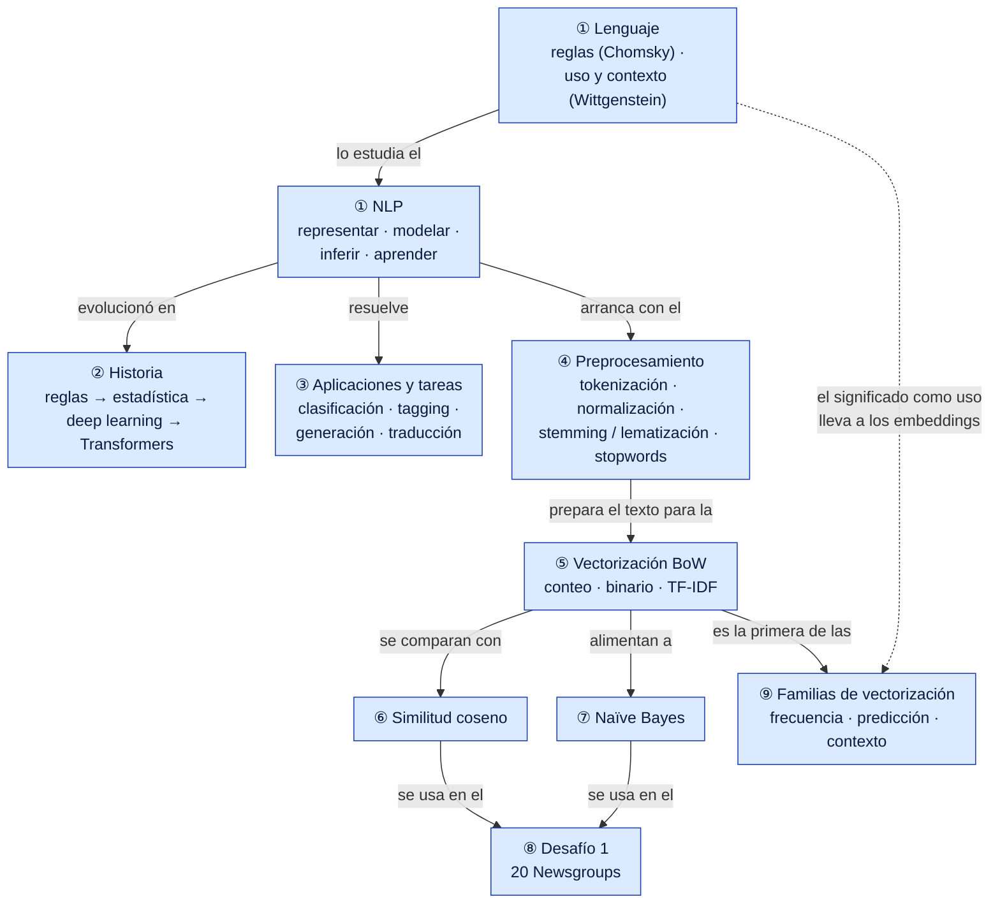
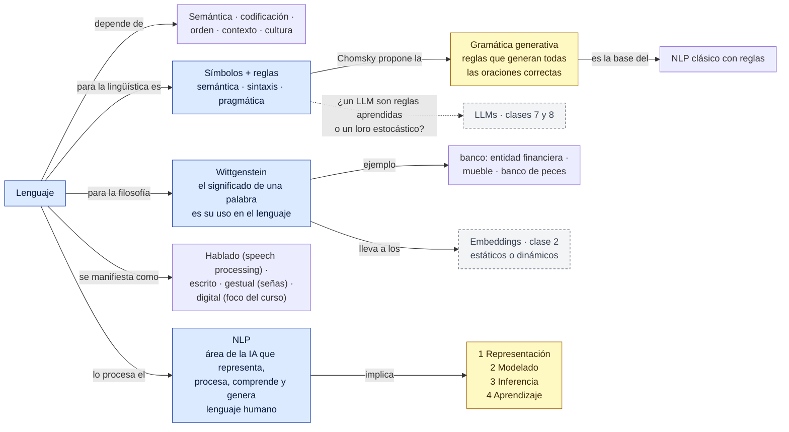
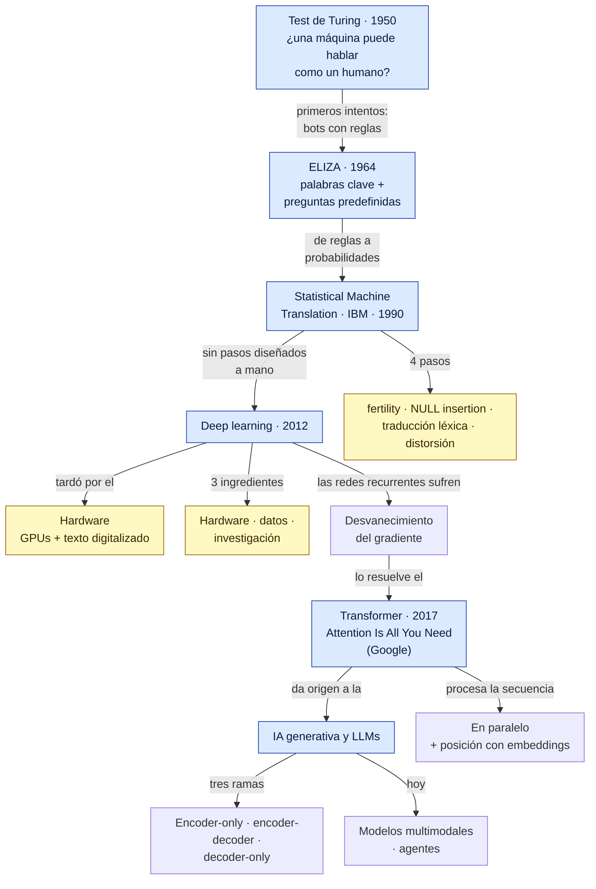
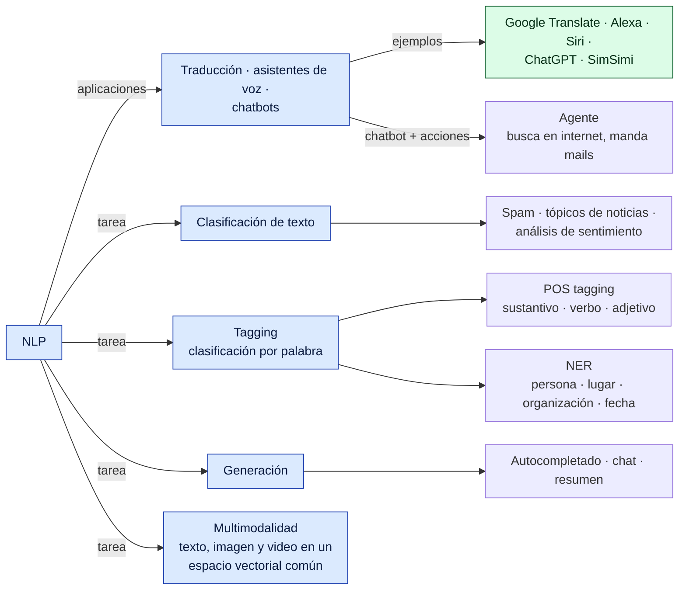
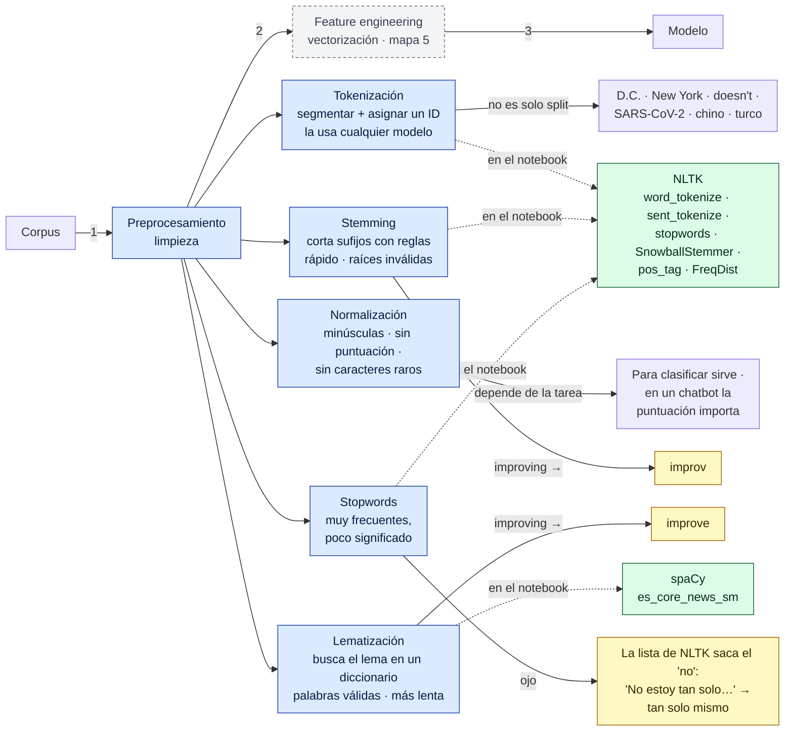
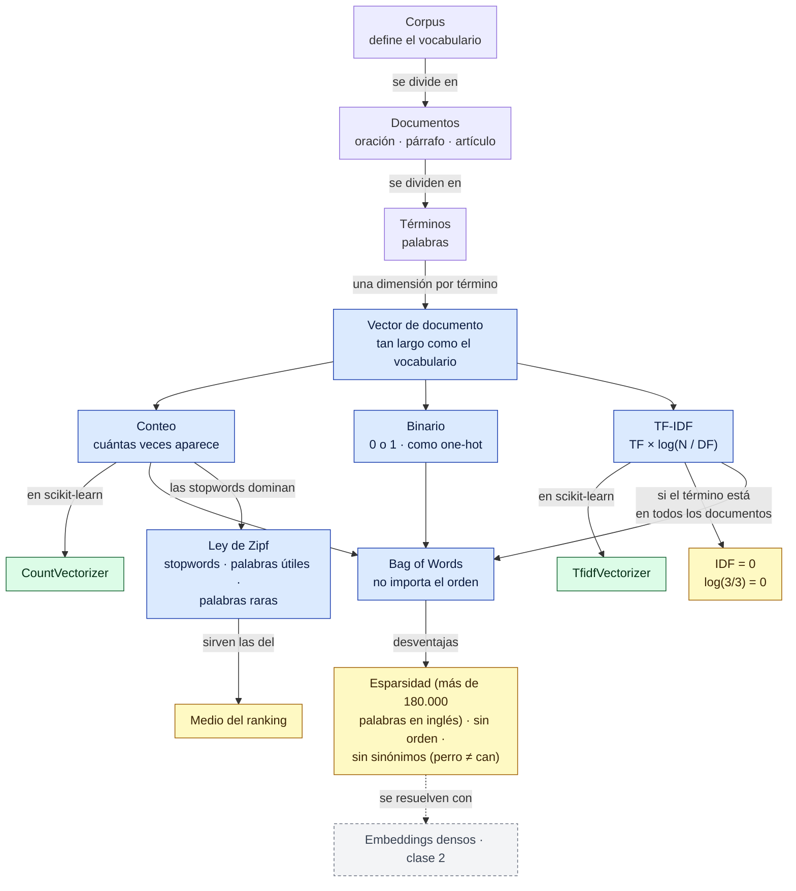
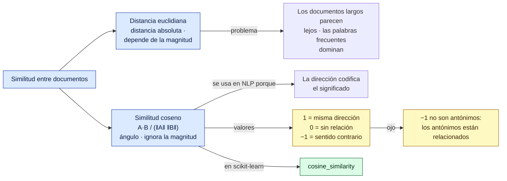
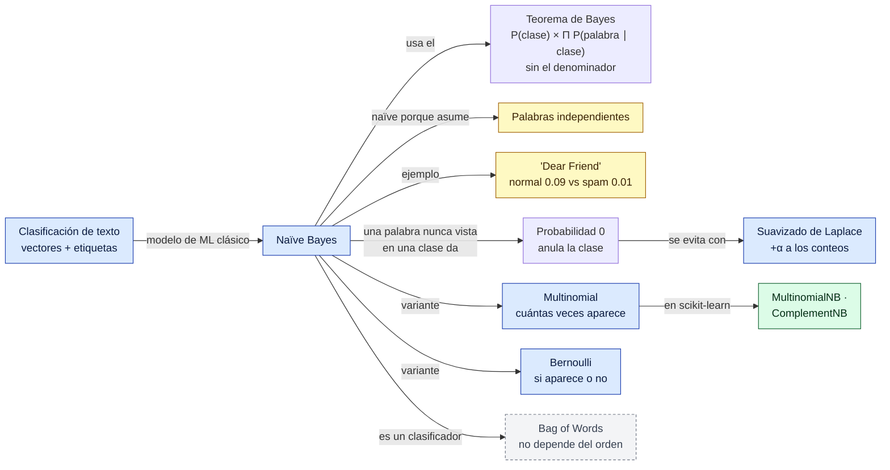
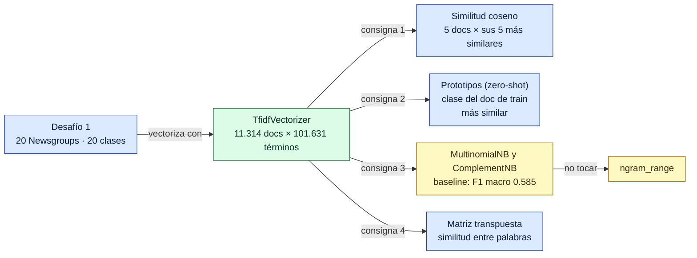
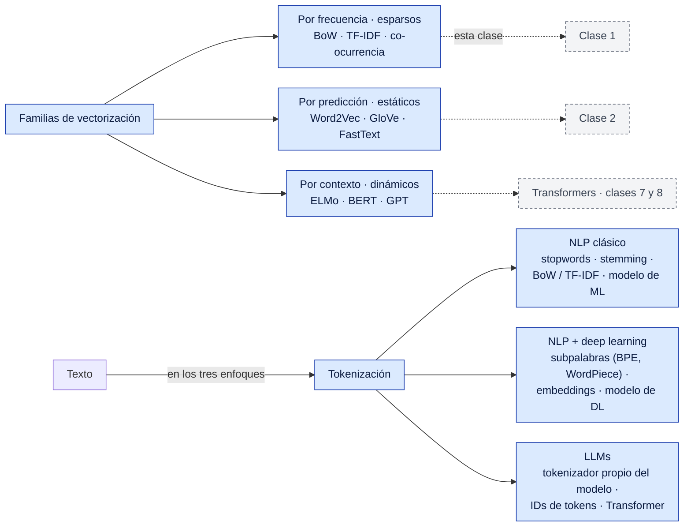

# Red conceptual — Clase 1: Introducción a NLP y vectorización de documentos

Complemento del [resumen](resumen.md). Primero hay una vista general de toda la clase y después un mapa por bloque de temas, en el orden en que se dieron. Los números de sección (§) remiten al resumen.

**Cómo leerla**
- Cada flecha forma una frase: *TF-IDF → multiplica → TF × IDF*. Una flecha sin texto quiere decir "incluye".
- Las flechas punteadas unen conceptos de temas distintos.
- Colores: azul = tema · verde = librería, función o herramienta · amarillo = dato para memorizar · gris punteado = concepto que se desarrolla en otro mapa o en otra clase.

> Todo el contenido sale de la clase. La organización y las frases de las flechas son propias.

## Vista general

## 1. Lenguaje y NLP (§1 a §4)

## 2. Historia del NLP (§5)

## 3. Aplicaciones y tareas (§6 y §7)

## 4. Preprocesamiento (§8 a §13)

## 5. Vectorización: Bag of Words y TF-IDF (§14 a §19)

## 6. Similitud entre documentos (§20)

## 7. Naïve Bayes (§21 a §23)

## 8. Desafío 1 (§24)

## 9. Cierre: familias de vectorización y enfoques (§25)

