# Clase 1 — Introducción a NLP y vectorización de documentos

- **Docente:** MSc. Josselyn Ordóñez. Data scientist en Credicorp (grupo financiero de Perú), donde trabaja en proyectos de IA generativa para el BCP: agentes conversacionales y flujos con IA para analizar llamadas y documentos. Viene de banca (va a usar muchos ejemplos de ese sector) y de negocios: su grado es en administración de empresas. Vive en Lima. Da las clases 1 a 4; Fernando Silva, de la 5 a la 8.
- **Fecha:** jueves 22/10/2026, 19:00–22:00.
- **Duración:** ~3 h. Recreos de 15 min entre ~00:54 y 01:10 y entre ~02:10 y 02:25.
- **Grabación:** pendiente (falta el link).
- **Material:** [slides](material/slides-vectorizacion-documentos.pdf) · [notebook de la clase](material/notebook-vectorizacion-texto.ipynb) · [transcripción](material/transcripcion.txt) · [carpeta `Clase 1` del repo de la materia](https://github.com/FIUBA-Posgrado-Inteligencia-Artificial/procesamiento_lenguaje_natural/tree/nov_2026/Clase%201)
- **Desafío:** [Desafío 1 — vectorización de texto](../../desafios/01-vectorizacion/README.md), nota 10 hasta el jueves 05/11.
- **Red conceptual:** [red-conceptual.md](red-conceptual.md)

> **Fuentes:** la transcripción completa, las slides y el notebook de la clase. Los tiempos `(hh:mm:ss)` marcan el bloque de la transcripción donde arranca cada tema. Lo marcado con ✎ es elaboración propia y no se dijo en clase.

---

## Repaso rápido

- **NLP (PLN):** área de la IA que desarrolla modelos computacionales capaces de representar, procesar, comprender y generar lenguaje humano mediante métodos algorítmicos y estadísticos.
- **4 cosas clave desde la IA:** representación (lenguaje → estructuras matemáticas) · modelado (funciones que capturan regularidades) · inferencia (dado un input, producir una salida coherente) · aprendizaje (ajustar parámetros con datos textuales masivos).
- **Dos miradas del lenguaje:**
  - **Lingüística:** sistema de símbolos más reglas (semántica, sintaxis, pragmática). **Chomsky** y la gramática generativa son la base del NLP clásico con reglas.
  - **Filosofía:** **Wittgenstein**, "el significado de una palabra es su uso en el lenguaje". El significado depende del contexto ("banco"), y de esa idea salen los **embeddings** (clase 2).
- **Manifestaciones del lenguaje:** hablado (speech processing) · escrito · gestual (lenguaje de señas, multimodalidad) · digital (el foco del curso).
- **Historia:** test de Turing (1950) → ELIZA (1964, palabras clave y preguntas predefinidas) → Statistical Machine Translation de IBM (1990, probabilidades en 4 pasos: fertility, NULL insertion, traducción léxica, distorsión) → deep learning (2012: hardware, datos e investigación) → Transformer (2017, "Attention Is All You Need", Google) → IA generativa y LLMs.
- **Por qué el deep learning tardó (1990–2012):** por el hardware. Las redes ya existían, pero hacían falta GPUs y mucho texto digitalizado.
- **Por qué el Transformer:** procesa la secuencia en paralelo, no en orden como las redes recurrentes, y así evita el desvanecimiento del gradiente en secuencias largas.
- **Tareas:** clasificación (spam, tópicos, análisis de sentimiento) · tagging (POS, NER) · autocompletado · generación · resumen · traducción · multimodalidad. Un chatbot que ejecuta acciones es un **agente**.
- **Pipeline:** corpus → preprocesamiento (limpieza) → feature engineering (vectorización) → modelo.
- **Tokenización:** segmentar el texto en términos y asignar a cada término único un ID, el token. La usa cualquier modelo; lo que cambia es cómo se divide (palabra, carácter, subpalabra).
- **Normalización básica:** minúsculas, sin puntuación ni caracteres raros. Cuánto limpiar depende de la tarea: para clasificar sirve, en un chatbot la puntuación importa.
- **Stemming vs lematización:**
  - **Stemming:** corta sufijos con reglas. Es rápido y simple, pero da raíces que no son palabras (*improving* → *improv*, *studies* → *studi*).
  - **Lematización:** reemplaza cada palabra por su lema usando un diccionario. Da palabras válidas y más precisión semántica (*improving* → *improve*, *are* → *be*), pero es más lenta y necesita recursos como WordNet.
- **Stopwords:** palabras muy frecuentes que no aportan significado (artículos, preposiciones, pronombres). Hay que revisar la lista: la de NLTK saca el "no", y "No estoy tan solo, pero no es lo mismo" queda en *tan solo mismo*.
- **NLTK:** `word_tokenize`, `sent_tokenize`, lista de stopwords, `SnowballStemmer`, `pos_tag`, `FreqDist`. Hay que bajar sus recursos con `nltk.download`. En el notebook, la lematización se hace con spaCy.
- **Corpus, documento y término:**
  - **Corpus:** todo el texto de entrenamiento; define el vocabulario.
  - **Documento:** unidad de texto de largo variable (oración, párrafo, artículo).
  - **Término:** unidad mínima (palabra, símbolo, conjunto de caracteres).
- **Vectores de conteo (`CountVectorizer`):** un vector por documento con cuántas veces aparece cada palabra del vocabulario; la dimensión es el tamaño del vocabulario. **Binary BoW:** solo 0 o 1 (aparece o no), como un one-hot.
- **Bag of Words:** cualquier representación o modelo cuyo resultado no cambia con el orden de las palabras. Lo son el conteo, el one-hot, TF-IDF y Naïve Bayes.
- **Ley de Zipf:** las palabras más frecuentes son stopwords y las muy raras (un DNI) tampoco sirven; las útiles están en el medio.
- **TF-IDF** = TF(n,d) × IDF(n), con IDF(n) = log(N / DF(n)). Si un término aparece en todos los documentos, su IDF es 0 y se "apaga". Ejemplo de clase: log(3/1) = 0.477, log(3/2) = 0.176, log(3/3) = 0.
- **Desventajas de BoW y TF-IDF:** vectores muy esparsos (el inglés tiene más de 180.000 palabras), se pierde el orden y no se reconocen sinónimos (*perro* y *can* no tienen relación).
- **Similitud coseno** = A·B / (‖A‖‖B‖). Mide el ángulo e ignora la magnitud (el largo del documento): por eso se usa en NLP, mientras que la euclidiana depende de la magnitud. Vale 1 con la misma dirección, 0 si son ortogonales (sin relación) y −1 en sentido contrario. **−1 no significa antónimos:** los antónimos suelen estar relacionados.
- **Naïve Bayes:** P(clase | texto) ∝ P(clase) × Π P(palabra | clase); el denominador se ignora porque es común a todas las clases. Es "ingenuo" porque asume que las palabras son independientes.
  - **Suavizado de Laplace:** sumar α a los conteos para que una palabra nunca vista no deje la probabilidad en 0.
  - **Multinomial:** cuenta cuántas veces aparece cada palabra. **Bernoulli:** solo si aparece.
- **Desafío 1:** 20 Newsgroups (20 categorías). `TfidfVectorizer` arma una matriz de 11.314 documentos × 101.631 términos y el baseline con `MultinomialNB` da F1 macro = 0.585. No cambiar `ngram_range`.
- **Familias de vectorización:** por frecuencia (BoW, TF-IDF, matriz de co-ocurrencia) · por predicción, embeddings estáticos (Word2Vec, GloVe, FastText) · por contexto, embeddings dinámicos (ELMo, BERT, GPT).
- **NLP clásico vs DL vs LLMs:** la tokenización está en los tres.
  - **Clásico:** limpia mucho (stopwords, stemming) y usa BoW + un modelo de ML.
  - **Con deep learning:** tokenización por subpalabras (BPE, WordPiece) y embeddings.
  - **LLMs:** cada modelo trae su tokenizador (BPE / WordPiece / SentencePiece) → IDs de tokens → Transformer.

---

## 0. Presentación del curso (00:00:05)

**Docentes**
- Josselyn Ordóñez da las clases 1–4 y Fernando Silva, las 5–8.
- Encuesta rápida: casi nadie aplica técnicas de NLP en el trabajo, pero todos usan LLMs en el día a día. La idea del curso es entender cómo funcionan por detrás, empezando por las técnicas más antiguas.

**Programa (00:06:17)**

| Clase | Tema | Desafío |
|---|---|---|
| 1 | Introducción a NLP y vectorización de documentos: cómo llevar texto a números, la base de cualquier proyecto de NLP | Desafío 1 |
| 2 | Word embeddings: vectores que capturan el sentido semántico | Desafío 2 |
| 3 | Deep learning para NLP: redes recurrentes, que trabajan con secuencias (celda de Elman, LSTM, GRU) | |
| 4 | Modelo de lenguaje con RNN: corpus, segmentación, tokenización, diseño de la arquitectura y generación de texto | Desafío 3 |
| 5 | CNNs para PLN (con Fernando Silva) | |
| 6 | Modelos seq2seq | Desafío 4 |
| 7 | Mecanismo de atención, Transformers | |
| 8 | Grandes modelos de lenguaje | |

El orden sigue la historia del NLP: de lo clásico al deep learning y al estado del arte.

**Material y desafíos (00:12:09)**
- Pregunta de Vicky: ¿se usa el campus? Poco: el material va en el repo de GitHub, aunque la docente va a intentar subirlo también al campus.
- En el repo, la rama default es la de esta cohorte (noviembre 2026). Las otras ramas son de cohortes anteriores y están abiertas.
- **4 desafíos:** vectorización de texto, word embeddings, generación de secuencias y seq2seq. Se presentan en las clases 1, 2, 4 y 6 (las verdes del programa) y la nota final es el promedio.
- **Entrega:** por un formulario, con el link a un Colab o a un repo de GitHub y acceso para corregir.
- **Plazos:** dos semanas con nota completa desde que se presenta cada desafío; después se descuenta. La última fecha para todo es el jueves de la clase 8.
- Novedad de esta cohorte: se pueden hacer **individuales o en pareja**.
- **Para aprobar hay que entregar los cuatro**, con al menos un 4. Si falta uno no se aprueba, aunque el promedio dé más de 4.
- La docente manda por mail el link del formulario y un Excel con las entregas y las notas. Vale la fecha del formulario.

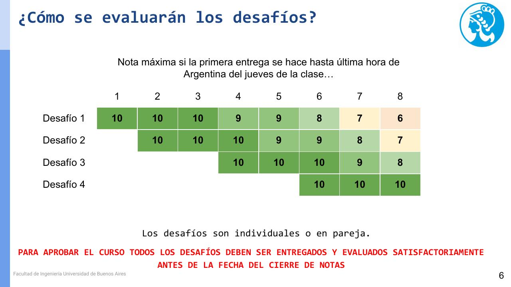

*Slide 6: nota máxima según el jueves en que se entrega. El desafío 1 vale 10 hasta la clase 3, 9 en las clases 4 y 5, 8 en la 6, 7 en la 7 y 6 en la 8. Detalle en [desafios/](../../desafios/README.md).*

**Agenda de la clase (00:15:55):** introducción (qué es el lenguaje y el NLP), historia, aplicaciones y tareas, preprocesamiento de texto, vectorización con un método clásico y un modelo simple de clasificación con esos vectores.

---

## 1. ¿Qué es el lenguaje? (00:17:11)

Pregunta abierta a la clase: ¿qué es el lenguaje y qué se necesita para entenderlo? Respuestas:
- Un código para comunicarse; un conjunto de palabras; un emisor, un mensaje y un receptor.
- **Semántica:** un significado que las dos partes comparten (Rodolfo).
- **Codificación:** los símbolos o letras con que se escribe, que cambian por idioma (el chino usa otros caracteres).
- **Orden:** según el orden, una palabra puede ser sustantivo o adjetivo (Lucas).
- **Contexto y cultura:** las mismas palabras significan otra cosa según cómo se combinan y quién las usa.
- Un estándar de comunicación para entenderse (Nicolás).

Por todo eso es tan complejo, y por mucho tiempo fue un reto que una máquina entendiera el lenguaje.

## 2. Dos miradas: lingüística y filosofía (00:20:22)

**Lingüística: el lenguaje como reglas**
- El lenguaje es un sistema de símbolos más reglas: contempla semántica, sintaxis y pragmática.
- **Noam Chomsky** y la **gramática generativa:** con el conjunto de reglas de un idioma se podrían generar todas sus oraciones correctas, y con pocas reglas, infinitas oraciones.
- El **NLP clásico** intentó modelar el lenguaje con reglas tipo Chomsky. Enlistarlas a mano nunca iba a llegar al nivel actual, porque el lenguaje cambia con la cultura y los matices.
- Se puede argumentar que **un LLM es una lista gigantesca de reglas**: miles de millones de parámetros que nadie escribió a mano, sino que el modelo aprendió de los datos.
- La slide 11 deja la pregunta para las clases 7 y 8: ¿los LLMs conocen gramática o solo patrones? ¿Son "loros estocásticos"? Cita el paper *On the Dangers of Stochastic Parrots: Can Language Models Be Too Big?* (Bender, Gebru, McMillan-Major y Shmitchell, 2021).

**Filosofía: el significado como uso (00:23:16)**
- **Ludwig Wittgenstein:** "el significado de una palabra es su uso en el lenguaje". Rompe con la idea clásica de que las palabras tienen un significado fijo.
- Ejemplo: **banco** puede ser una entidad financiera, un mueble para sentarse o un banco de peces. El significado depende del contexto, y también del orden.
- Esta idea se relaciona con los **embeddings** (clase 2), que representan las palabras con vectores construidos a partir de su uso en un corpus (00:24:37):
  - **Estáticos:** un solo vector por palabra.
  - **Dinámicos:** el vector cambia según el contexto, gracias a los mecanismos de atención.
  - En los dos casos el texto se lleva a un espacio latente denso que representa su significado.

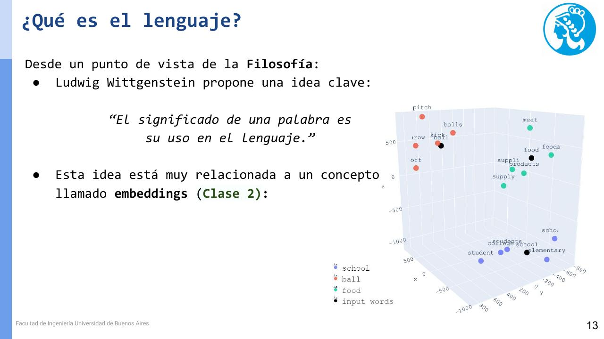

*Slide 13: palabras en un espacio de embeddings. Forman tres grupos por tema: escuela (school, student, elementary), pelota (ball, kick, pitch, throw) y comida (food, meat, supply).*

## 3. ¿Qué es el procesamiento del lenguaje natural? (00:26:23)

> **Definición (slide 14):** el procesamiento de lenguaje natural (PLN o NLP) es el área de la IA que desarrolla modelos computacionales capaces de representar, procesar, comprender y generar lenguaje humano mediante métodos algorítmicos y estadísticos.

En palabras de la docente: enseñarle a las computadoras a entender y trabajar con el lenguaje. Desde la IA implica cuatro cosas:

1. **Representación:** transformar el lenguaje (texto o voz) en números o estructuras matemáticas. Es la vectorización.
2. **Modelado:** construir funciones o modelos que capturen los patrones (regularidades) del lenguaje.
3. **Inferencia:** usar la representación y el modelo para producir una salida coherente para una tarea, como clasificar o generar texto.
4. **Aprendizaje:** ajustar los parámetros del modelo con textos masivos. Es la definición de machine learning.

## 4. Manifestaciones del lenguaje (00:27:57)

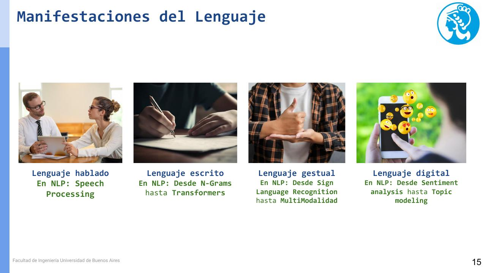

*Slide 15: las cuatro manifestaciones y cómo las aborda el NLP.*

| Manifestación | Qué dijo la docente | En NLP (slide) |
|---|---|---|
| Hablado (audio) | Hay una rama que transcribe el habla | Speech processing |
| Escrito | Escrito a mano: OCR y otras técnicas para pasar la caligrafía a texto digital | Desde n-gramas hasta Transformers |
| Gestual | Señales no verbales y lenguaje de señas; a veces hace falta ver una imagen para entender el contexto completo | Desde Sign Language Recognition hasta multimodalidad |
| Digital | Textos ya digitalizados: el foco del curso y lo más común en el trabajo | Desde sentiment analysis hasta topic modeling |

Los gestos, la voz y el tono también cambian el significado de lo que se dice.

## 5. Historia del NLP (00:31:14)

### Test de Turing (1950)

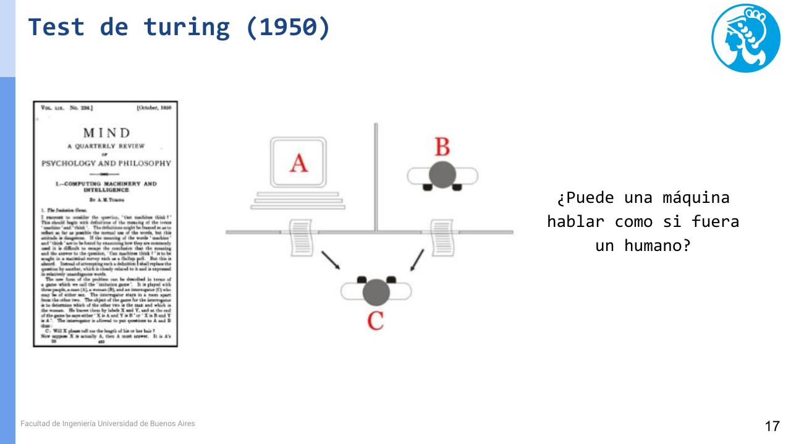

*Slide 17: el paper de Turing en la revista Mind ("Computing Machinery and Intelligence") y el esquema del test: un evaluador (C) conversa con una máquina (A) y con una persona (B).*

- Define el objetivo final del campo: ¿puede una máquina hablar como si fuera un humano?
- Se pasa si un tercero no puede distinguir si lo que recibe viene de una máquina o de una persona.
- Según la docente, en los últimos años ya se pasó "silenciosamente" esa frontera: hoy cuesta mucho distinguir una cosa de la otra.

### ELIZA (1964): el primer bot de NLP (00:32:46)

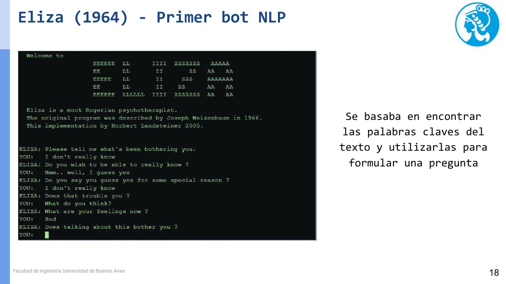

*Slide 18: conversación con ELIZA, "a mock Rogerian psychotherapist" descripto por Joseph Weizenbaum en 1966 (implementación de Norbert Landsteiner, 2005).*

- Los primeros bots se basaban en **reglas** que un programador imaginaba y programaba, y por eso eran limitados.
- ELIZA tenía preguntas predefinidas y **buscaba palabras clave** en lo que escribía el usuario para elegir cuál hacer, reformulándolas con palabras que la persona había usado. Por ejemplo, si el usuario negaba algo elegía una oración, y si usaba "es", otra.
- Las preguntas eran muy genéricas ("¿qué te está molestando?", "¿desearías saberlo?"), útiles en cualquier contexto. Era primitivo y difícil llegar a algo concreto.

### Statistical Machine Translation (1990) (00:34:06)

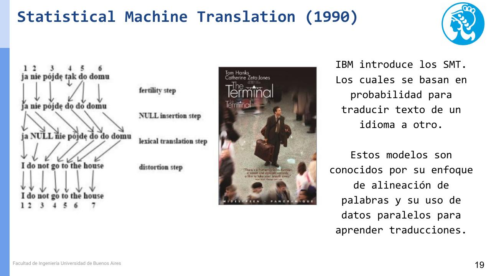

*Slide 19: traducción de "ja nie pójdę tak do domu" (polaco) a "I do not go to the house", paso a paso.*

- Se dejan las reglas escritas a mano por un enfoque **estadístico**: IBM introduce los SMT, que traducen con **probabilidades**. La slide agrega que se basan en la **alineación de palabras** y en **datos paralelos** (el mismo texto en dos idiomas) para aprender a traducir.
- Desacoplan la traducción en pasos simples, cada uno decidido por probabilidades:
  1. **Fertility step:** decidir si cada palabra se mantiene, se elimina o se duplica (cuando en el otro idioma hacen falta dos palabras). En el ejemplo, *tak* desaparece y *do* se duplica.
  2. **NULL insertion step:** agregar posiciones para palabras que el otro idioma necesita y el original no tiene, como conectores. En el ejemplo, la negación *nie* es una sola palabra en polaco y en inglés necesita dos: el *do* de *do not* sale de la posición NULL.
  3. **Lexical translation step:** traducir uno a uno (*ja* → *I*, *nie* → *not*, *domu* → *house*).
  4. **Distortion step:** reordenar, porque el orden cambia de un idioma a otro.
- Era una forma primitiva de resolver el problema, todavía con reglas, aunque estadísticas.

### Deep learning (2012 en adelante) (00:36:52)

- Más de dos décadas después llega el boom del deep learning, que **reduce el esfuerzo manual**: modelos que aprenden tareas complejas solos, entrenándose con mucha información.
- Las capas iniciales aprenden conceptos básicos y las profundas los combinan en conceptos más abstractos. En lenguaje, por ejemplo: caracteres → artículos, sustantivos y verbos → significado de los sustantivos → combinación de palabras. La capa de salida lleva todo a la tarea (clasificación, generación).
- La diferencia con el SMT: nadie diseña los pasos (como el fertility step). Se definen la arquitectura y los hiperparámetros, y los pesos se ajustan solos con los datos.
- **¿Por qué tardó tanto, si las redes neuronales ya existían antes del 2000?** (00:38:32) Por el **hardware**, como respondió Rodolfo. Para superar a los modelos manuales, una red tiene que ser gigante, como los LLMs actuales, y eso requirió GPUs y una enorme cantidad de texto digitalizado. La slide 20 resume los tres ingredientes: **hardware, datos e investigación**.

### Transformers e IA generativa (2017) (00:39:53)

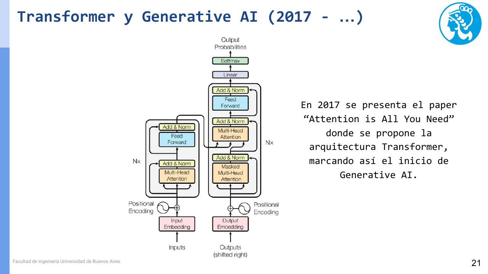

*Slide 21: la arquitectura Transformer de "Attention Is All You Need": encoder y decoder con multi-head attention, feed forward, add & norm y positional encoding.*

- En 2017, empleados de Google publican **"Attention Is All You Need"**: introduce el **mecanismo de atención** y el **Transformer**, la arquitectura base del boom de la IA y de los LLMs. La slide lo marca como el inicio de la IA generativa.
- **El salto:** procesar secuencias largas de texto **sin que se desvanezca el gradiente**. En las redes anteriores (recurrentes) el texto se procesa en orden y la secuencia le agrega profundidad al modelo, lo que genera el desvanecimiento del gradiente. El Transformer procesa en **paralelo**.
- Además usa embeddings para guardar la **posición** de los tokens, entre otras ideas.
- Las recurrentes y sus problemas se ven en la clase 3; los Transformers en detalle, con Fernando. La docente recomendó leer el paper: es uno de los básicos de la IA actual.

### La explosión de modelos (00:42:59)

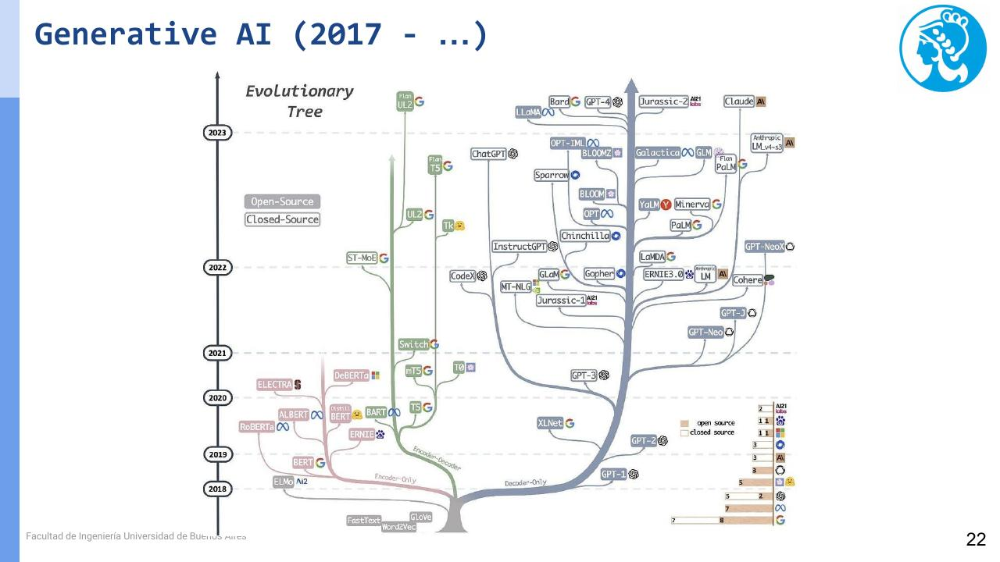

*Slide 22: árbol evolutivo de los modelos de lenguaje, 2018–2023. Tres ramas: encoder-only (BERT, RoBERTa, ALBERT, ELECTRA, DeBERTa), encoder-decoder (T5, BART, Flan-T5, UL2) y decoder-only (GPT-1 a GPT-4, ChatGPT, PaLM, LLaMA, BLOOM, OPT, Claude, Bard). Distingue open source de closed source; en la raíz están Word2Vec, GloVe y FastText.*

- Después del Transformer los modelos se ramificaron según la arquitectura (solo encoder, encoder-decoder o solo decoder), que se elige según la tarea.
- El gráfico está desactualizado: según la docente, "ya estamos en GPT 6.1, si no me equivoco", Claude ya va por la 5.5 y sale un modelo nuevo casi cada semana. Hay muchos modelos open source, y a partir de ellos se entrenan variantes para tareas específicas.
- Hoy la IA no solo habla: también escribe código y genera imágenes a partir de texto.

### Resumen de la historia (00:44:30)

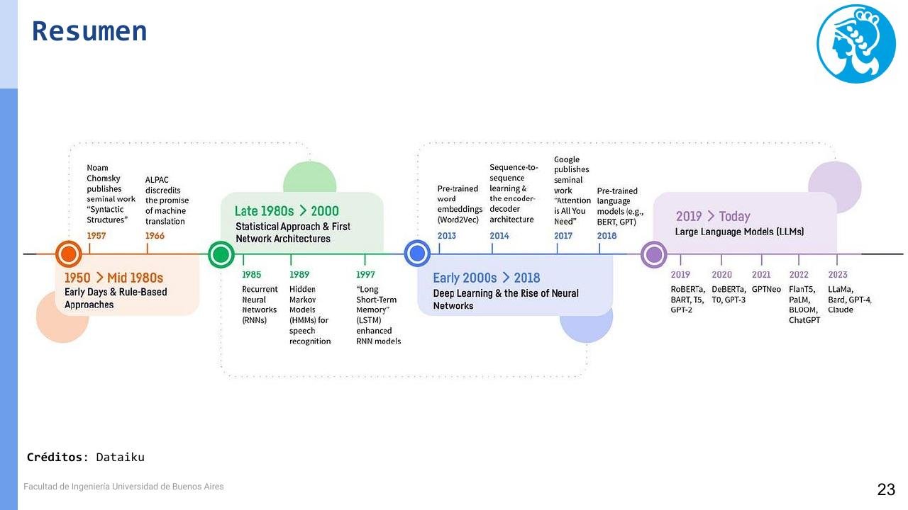

*Slide 23 (créditos: Dataiku): línea de tiempo del NLP.*

| Etapa | Hitos de la slide |
|---|---|
| 1950 – mediados de los 80: primeros días y enfoques basados en reglas | 1957: Chomsky publica *Syntactic Structures*. 1966: el informe ALPAC desacredita la promesa de la traducción automática |
| Fines de los 80 – 2000: enfoque estadístico y primeras redes neuronales | 1985: redes neuronales recurrentes (RNN). 1989: modelos ocultos de Markov (HMM) para reconocimiento de voz. 1997: LSTM, que mejora las RNN |
| Principios de los 2000 – 2018: deep learning y auge de las redes neuronales | 2013: embeddings preentrenados (Word2Vec). 2014: aprendizaje seq2seq y arquitectura encoder-decoder. 2017: Google publica "Attention Is All You Need". 2018: modelos de lenguaje preentrenados (BERT, GPT) |
| 2019 – hoy: grandes modelos de lenguaje (LLMs) | 2019: RoBERTa, BART, T5, GPT-2. 2020: DeBERTa, T0, GPT-3. 2021: GPT-Neo. 2022: Flan-T5, PaLM, BLOOM, ChatGPT. 2023: LLaMA, Bard, GPT-4, Claude |

En palabras de la docente:
1. Desde los años 50, **reglas**.
2. Después, **estadística** combinada con reglas y las primeras redes neuronales, limitadas por el hardware.
3. Con mejor hardware, **deep learning** y arquitecturas cada vez más optimizadas, hasta los **Transformers**.
4. **Modelos preentrenados:** ya procesaron una cantidad gigante de texto y son generales, sirven para cualquier tema.
5. Hoy, **LLMs** y modelos **multimodales** (texto, audio e imágenes) que hacen tareas más generales.
6. Sobre los LLMs ya se construyen **agentes** y sistemas de IA (memoria, manejo del contexto, prompting), en el límite entre el NLP y el desarrollo de sistemas.

## 6. Aplicaciones (00:47:33)

- **Traducción automática:** Google Translate (slide 25: "hello world" → "Bonjour le monde"). Es uno de los usos más comunes.
- **Asistentes de voz:** Alexa, Siri, el modo voz de ChatGPT. Ayudan a hacer tareas con la voz; se usan, por ejemplo, en domótica.
- **Clasificación de texto:** uno de los clásicos. Detectar spam según el contenido del mail, malicioso o benigno (slide 27: la carpeta de spam de Gmail); clasificar noticias por tópico o comentarios de clientes por producto o por sentimiento.
- **Chatbots:** conversar con la computadora (slide 28: SimSimi). Un chatbot que además ejecuta tareas, como buscar en internet o enviar correos, es un **agente**.

## 7. Tareas de NLP (00:49:10)

- **Clasificación y análisis de sentimiento** (slide 30: datos → preparación → clasificador → positivo, negativo o neutro). Muy usado en empresas con comentarios de clientes, para saber qué proporción está satisfecha o molesta.
- **Tagging** (00:50:27): clasificación a nivel de palabra.
  - **POS tagging** (*part of speech*): qué clase de palabra es cada una (sustantivo, verbo, adjetivo).
  - **NER** (*named entity recognition*): reconocer categorías específicas, como personas, lugares, organizaciones o fechas.

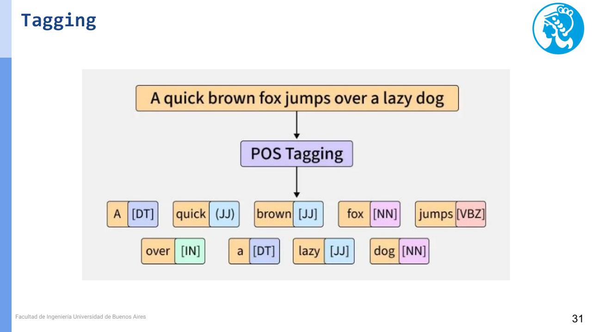

*Slide 31: "A quick brown fox jumps over a lazy dog" → A [DT], quick [JJ], brown [JJ], fox [NN], jumps [VBZ], over [IN], a [DT], lazy [JJ], dog [NN]. DT = determinante, JJ = adjetivo, NN = sustantivo, VBZ = verbo en tercera persona, IN = preposición.*

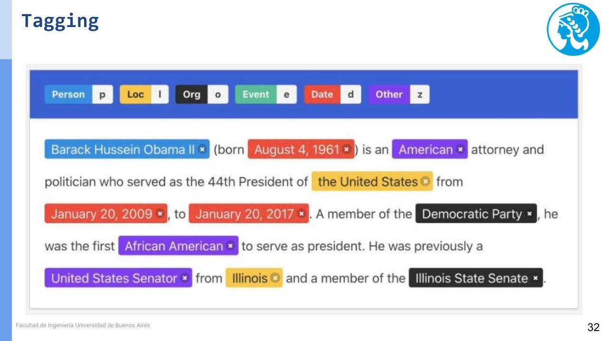

*Slide 32: NER sobre la biografía de Barack Obama, con etiquetas Person, Loc, Org, Event, Date y Other. Por ejemplo, "Barack Hussein Obama II" es una persona, "August 4, 1961" una fecha, "Democratic Party" una organización e "Illinois" un lugar.*

- **Autocompletado** (celular, Gmail): predice el siguiente carácter o palabra; detrás hay un modelo de lenguaje. Se usa tanto que ya ni se nota.
- **Generación de texto:** la más usada hoy, en chatbots y agentes, para conversar, resumir y más.
- **Summarization** (00:52:04): sacar las partes más importantes de un documento largo.
- **Multimodalidad:** de texto a imágenes o videos, o al revés. Texto, imágenes y videos se llevan a un **espacio vectorial común**, y desde ahí se generan imágenes a partir de texto o descripciones a partir de imágenes.

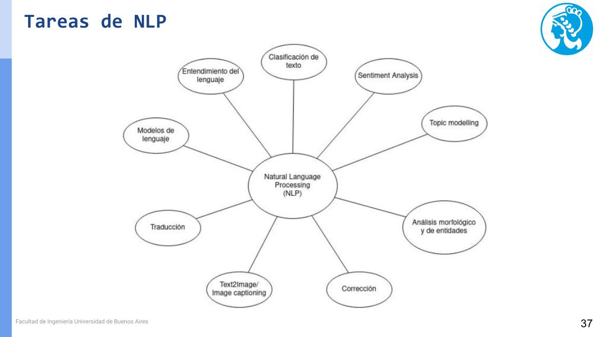

*Slide 37: entendimiento del lenguaje, clasificación de texto, sentiment analysis, topic modelling, análisis morfológico y de entidades, corrección, text2image / image captioning, traducción y modelos de lenguaje.*

- Con los modelos generales de lenguaje se suman más campos, como la programación y la ejecución de tareas automatizadas.
- Cada clase tiene **dos recreos de 15 minutos**.

---

## 8. Preprocesamiento de texto: el pipeline (01:10:38)

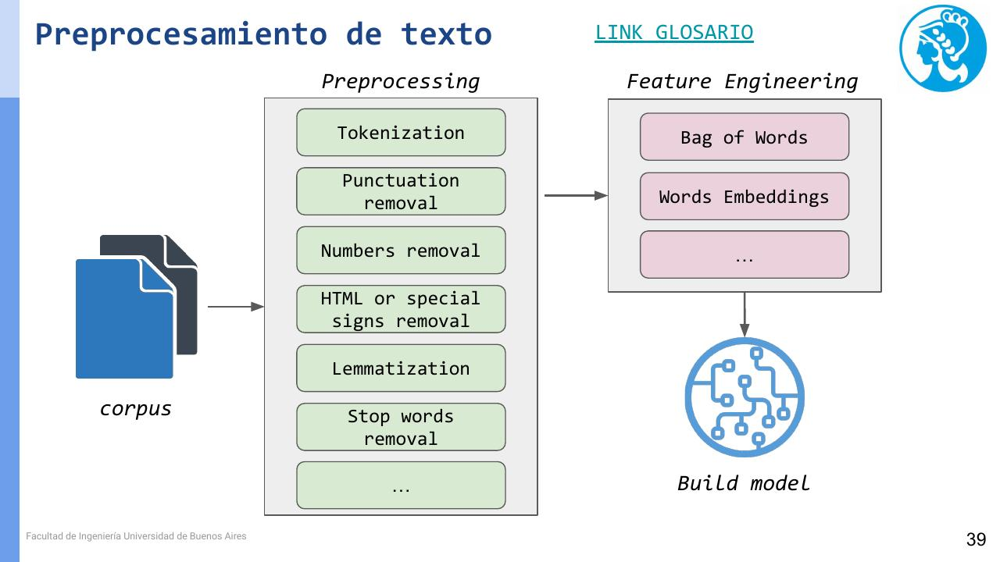

*Slide 39: corpus → preprocessing (tokenization, punctuation removal, numbers removal, HTML or special signs removal, lemmatization, stop words removal…) → feature engineering (bag of words, word embeddings…) → build model.*

- El preprocesamiento es el primer paso de cualquier caso de uso; cuánto hace falta depende de la tarea.
- Las técnicas clásicas necesitaban mucho más porque los modelos eran "menos inteligentes". Con la IA actual los pasos disminuyen, pero algunos son comunes a todos los casos.
- Para ir del corpus al modelo hay dos etapas: **preprocesamiento** (limpiar el texto) y **feature engineering** (vectorizar: convertir el texto en números, que es lo que entienden los modelos).

**Tokenización (01:12:14).** Es el paso que usa cualquier modelo: dividir el texto y asignarle un identificador a cada parte.
- "Token" es un término anterior a los LLMs: el texto se divide en partes más chicas y a cada una se le asigna un identificador, que es el token. Después ese token se vincula a un vector.
- El token es la unidad de procesamiento del lenguaje.

**Limpieza y normalización**
- Quitar signos de puntuación, números o símbolos que no se necesiten.
- Pasar todo a minúsculas, quitar tildes.
- **Stemming** y **lematización:** llevar las palabras a su raíz.
- **Stopword removal:** sacar las palabras muy comunes que no aportan significado.
- **Trade-off:** cuanto más se limpia y simplifica, más detalle del texto original se pierde. Por ejemplo, sin los puntos se pierden las pausas y dónde termina una idea. Depende de la tarea y del modelo que se use después.

**Feature engineering (01:13:44)**
- **Bag of Words** (esta clase): se "meten las palabras en una bolsa" y el texto se representa por las palabras que contiene, sin tener en cuenta el orden.
- **Word embeddings** (clase 2): tienen en cuenta el significado de las palabras.
- Otras, como los **embeddings contextuales**.
- Con el texto convertido en números, se puede entrenar o usar cualquier modelo, por ejemplo uno de clasificación.

## 9. Normalización básica (01:16:24)

- **Lowercasing**, **eliminar signos de puntuación** y **quitar caracteres raros**.
- Ejemplo de la slide 40: "The dogs are #running!!" → "the dogs are running".
- **Pregunta de Carlos:** ¿sacar la puntuación no quita significado? **Depende de la tarea.** Para clasificar un texto no importan mucho los puntos: importa qué palabras aparecen. En un chatbot, en cambio, la puntuación ayuda a entender el contexto y lo que se quiere expresar. Lo mismo vale para todas las técnicas de la clase: a veces sirven y a veces no.

## 10. Tokenización (01:17:43)

> **Definición (slide 41):** proceso en el cual una oración o documento es segmentado en términos individuales. Una vez finalizada la segmentación, cada término único es referenciado mediante un token.

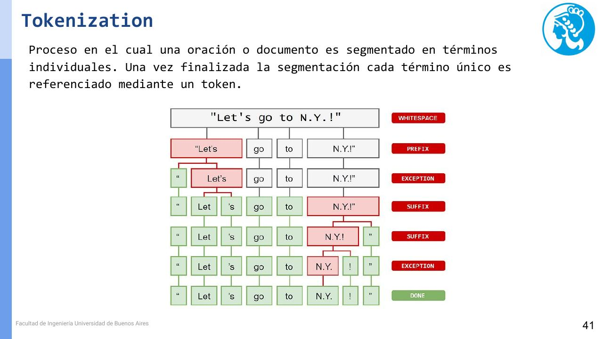

*Slide 41: tokenización de "Let's go to N.Y.!" por pasos: espacios en blanco → prefijo (la comilla de apertura) → excepción ("Let's" → "Let" + "'s") → sufijos (la comilla de cierre y el "!") → excepción ("N.Y." queda junto). Resultado: `"` `Let` `'s` `go` `to` `N.Y.` `!` `"`.*

- Es obligatoria en casi todos los casos. Antes de tokenizar hay que **segmentar**, es decir, dividir el texto en partes con reglas: primero por espacios, después separando prefijos y símbolos. Las palabras compuestas se dividen, salvo las que deben quedar juntas (como *New York*), que se buscan en un diccionario.
- Después se asigna un **ID** a cada parte: por ejemplo, la comilla de apertura es el ID 1 y *to* el ID 2, en cualquier lugar del texto. El ID tiene que ser el mismo en todo el corpus para que después se asocie a un mismo vector.
- Dividir y asignar IDs es común a todos los modelos; lo que cambia es **cómo** se divide: por palabras, por caracteres o por conjuntos de caracteres (por ejemplo, cada dos). Ahí innovan los laboratorios: OpenAI, Anthropic y Google tienen cada uno su forma de tokenizar, y de eso dependen en parte sus resultados.
- **Pregunta de Elian:** ¿qué es el corpus? Todo el texto que se usa para entrenar el modelo, que pueden ser muchos documentos.

**No es solo hacer split (01:21:45).** Los escenarios de la slide 42:
- Abreviaturas como *D.C.*
- Nombres compuestos como *New York*.
- Contracciones como *doesn't* o *could't've*.
- Nombres como *SARS-CoV-2* o *R2-D2*.
- Idiomas como el **chino**, sin espacios en blanco y con caracteres que son casi imágenes.
- Idiomas como el **turco** (o el **quechua**, agregó la docente), donde una palabra con prefijos y sufijos puede expresar tanto como una oración completa.

Cada idioma podría merecer su propio método de tokenización.

Ejemplo por palabras (slide 43): "the dogs are running" → [the, dogs, are, running]. Cada uno de los cuatro elementos se va a asociar a un vector.

## 11. Stemming y lematización (01:23:20)

### Stemming

> **Definición (slide 44):** aplica reglas de eliminación de patrones recurrentes de la lengua. El resultado es una palabra truncada que no será necesariamente la raíz morfológica de la palabra.

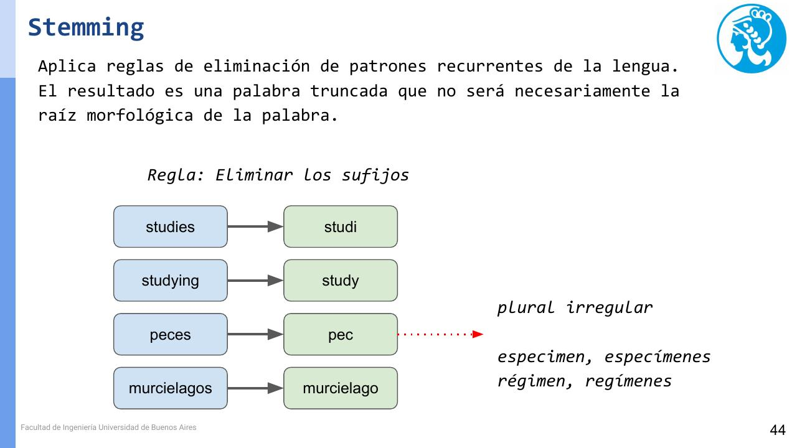

*Slide 44: con la regla "eliminar los sufijos", studies → studi, studying → study, peces → pec, murciélagos → murciélago. Los plurales irregulares (espécimen → especímenes, régimen → regímenes) rompen la regla.*

- Es uno de los métodos clásicos: ya no se usa tanto en IA, pero sirve para tareas simples.
- **Corta** la palabra para llevarla a su raíz. Pierde el número (singular o plural) y el género, y se queda con la raíz semántica.
- Es útil en **clasificación**: si solo importa si el texto habla de estudiar, no importa la conjugación sino cuánto aparece el concepto.
- Slide 45: [the, dogs, are, running] → [the, dog, are, runn].

### Lematización (01:24:59)

> **Definición (slide 46):** devuelve la raíz morfológica de una palabra. Para ello se necesita un diccionario del idioma con todas las declinaciones posibles de las palabras raíz.

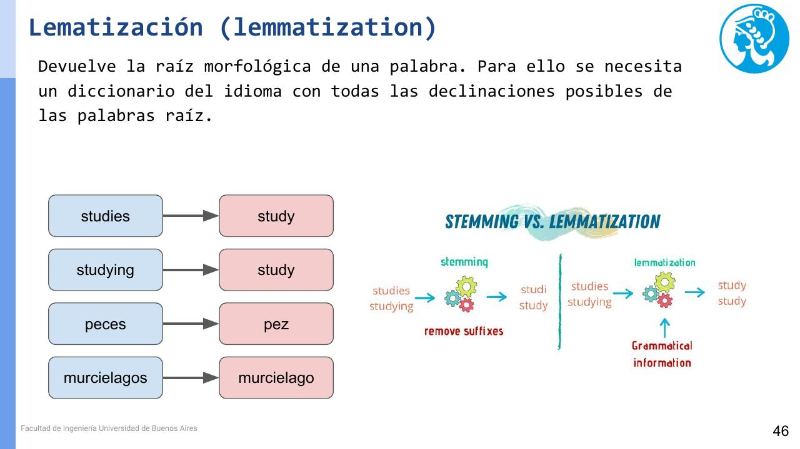

*Slide 46: studies → study, studying → study, peces → pez, murciélagos → murciélago. A la derecha, la diferencia: el stemming quita sufijos y la lematización usa información gramatical.*

- No corta: **reemplaza**. Busca la palabra conjugada en un diccionario y la cambia por su raíz, el lema.
- El resultado son palabras que existen, y es más fácil hacer *match* entre palabras iguales.
- Slide 47: [the, dogs, are, running] → [the, dog, be, run]. *are* pasa a *be* y *running* a *run*.

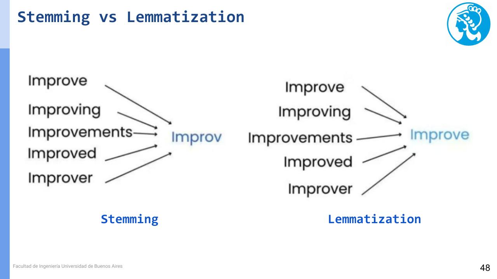

*Slide 48: improve, improving, improvements, improved e improver terminan en "improv" con stemming (una palabra cortada) y en "improve" con lematización (el infinitivo).*

**Comparación (01:26:19, slide 49)**

| | Stemming | Lematización |
|---|---|---|
| Cómo | Corta sufijos y prefijos con reglas | Reemplaza por el lema con un diccionario |
| Ventajas | Rápido y simple; no necesita diccionario | Produce palabras válidas y mantiene la precisión semántica |
| Desventajas | Puede producir raíces no válidas y perder precisión semántica | Más lenta y requiere recursos adicionales (como WordNet) |

"Más lenta" es relativo: las dos son rapidísimas comparadas con un LLM.

## 12. Stopwords (01:28:06)

> **Definición (slide 50):** palabras que no aportan valor al significado de una oración ya que son muy frecuentes o comunes en el lenguaje.

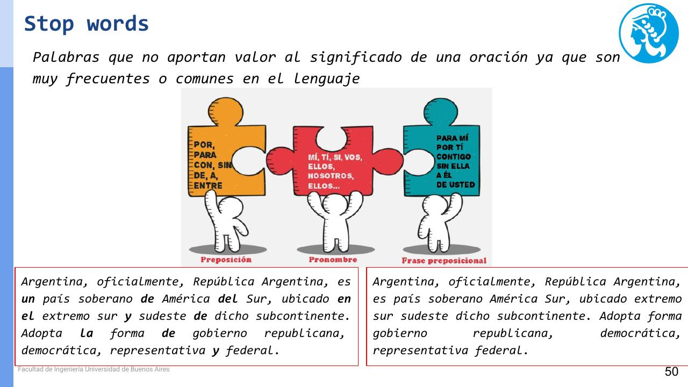

*Slide 50: tipos de stopwords (preposiciones, pronombres y frases preposicionales) y un texto sobre Argentina antes y después de quitarlas.*

- Por ejemplo: artículos, algunas conjunciones, pronombres. La slide suma preposiciones (*por, para, con, sin, de, a, entre*), pronombres (*mí, ti, sí, vos, ellos, nosotros*) y frases preposicionales (*para mí, por ti, contigo, sin ella, a él, de usted*).
- Ejemplo: "Argentina, oficialmente República Argentina, es un país soberano de América del Sur, ubicado en el extremo sur y sudeste de dicho subcontinente…" → "Argentina, oficialmente, República Argentina, es país soberano América Sur, ubicado extremo sur sudeste dicho subcontinente…". Queda más brusco, pero se sigue entendiendo.
- Sirven para **eliminar ruido** y quedarse con lo importante. Si se cuentan las palabras sin limpiar, las más "importantes" son los artículos y los conectores; al quitarlos resaltan las palabras que distinguen al texto (se ve con las nubes de palabras del §17).

## 13. Práctica en Colab (01:29:35)

Notebook: [notebook-vectorizacion-texto.ipynb](material/notebook-vectorizacion-texto.ipynb), también en la carpeta `Clase 1` del repo de la materia.

**Tokenizador a mano**
- Pasar a minúsculas, reemplazar cada signo de una lista de puntuación por un espacio y hacer `split()` por espacios.
- "¡Hola, Mundo! Este es un ejemplo de tokenización" → `['hola', 'mundo', 'este', 'es', 'un', 'ejemplo', 'de', 'tokenización']`.

**Palabras compuestas**
- ¿Cómo mantener *New York* junto? Con un **diccionario de palabras compuestas**. En un escenario real se arma con estadística sobre todo el corpus: qué palabras suelen ir juntas, o en mayúscula, para nombrar un concepto.
- Antes del split se reemplaza el espacio interno por `_`, y después se restaura.
- "Mañana viajare a New York" → `['mañana', 'viajare', 'a', 'New York']`.
- Muchas técnicas clásicas usan diccionarios por detrás.

**NLTK (01:34:26)**
- Librería con muchas técnicas de preprocesamiento ya implementadas. Usa diccionarios que hay que descargar con `nltk.download(...)` (`punkt`, `punkt_tab`, `stopwords`, `averaged_perceptron_tagger`).
- `word_tokenize` tokeniza por palabra: "NLTK is running in this colab cell" → `['NLTK', 'is', 'running', 'in', 'this', 'colab', 'cell']`.
- `sent_tokenize` divide un párrafo en oraciones: "¡Hola! ¿Cómo estás? El Dr. García llegará a las 5 p.m." da 3 oraciones, porque detecta que "Dr." no termina la oración.

**Stopwords con el diccionario de NLTK (01:35:52)**
- Con `stopwords.words('spanish')`: "La casa de papel es una serie de televisión española." → `['casa', 'papel', 'serie', 'televisión', 'española']`.
- **El problema (01:37:27):** "No estoy tan solo, pero no es lo mismo." → `['tan', 'solo', 'mismo']`. Se perdió el significado, sobre todo por el **"no"**, que invierte el sentido.
- Conclusión: fijarse qué hay en el diccionario de stopwords. Si filtra de más, cambiar el diccionario o crear excepciones, como no quitar el "no".

**Stemming y lematización (01:38:43)**

| "Los programadores programan programas en la programación." | Resultado |
|---|---|
| Stemming (`SnowballStemmer('spanish')` de NLTK) | `los, program, program, program, en, la, program` |
| Lematización (spaCy, modelo `es_core_news_sm`) | `el, programador, programar, programa, en, el, programación` |

- Con stemming casi todas quedan iguales y es fácil ver que el texto habla de programación. Sirve para clasificar o para agrupar textos de una misma categoría (clustering), cuando no hace falta el detalle.
- La lematización mantiene la diferencia y la **clase de palabra**: *programadores* → *programador* (sustantivo), *programan* → *programar* (verbo), *programas* → *programa* (otro sustantivo).
- Lo importante es **probar**: comparar las métricas (accuracy, matriz de confusión) de cada técnica sobre el corpus que se use.

| "Los mejores deportistas cuentan sus mejores cuentos mientras van al estadio." | Resultado |
|---|---|
| Stemming | `los, mejor, deport, cuent, sus, mejor, cuent, mientr, van, al, estadi` |
| Lematización | `el, mejor, deportista, contar, su, mejor, cuento, mientras, ir, al, estadio` |

- *deportistas* queda en *deport* (no existe) con stemming y en *deportista* con lematización; *cuentan* pasa a *contar*, el infinitivo.
- ✎ El stemming junta *cuentan* y *cuentos* en *cuent*, aunque significan cosas distintas; la lematización los separa (*contar* y *cuento*) y lleva *van* a *ir*.

**Tareas simples sin LLMs (01:41:30)**
- **POS tagging** con `nltk.pos_tag`: hay tareas tan estudiadas que alcanza con los diccionarios de NLTK, sin un modelo grande.
- "The quick brown fox jumps. I wait" → `The/DT, quick/JJ, brown/NN, fox/NN, jumps/NNS, ./., I/PRP, wait/VBP`. El notebook aclara que el etiquetador por defecto anda mejor en inglés. ✎ Igual se equivoca con *brown* (es adjetivo) y *jumps* (es verbo).
- **Frecuencia de palabras** con `nltk.FreqDist`: contar qué palabras aparecen es una forma básica de vectorizar. "el gato corre tras el ratón y el perro corre tras el gato" → *el*: 4, *gato*: 2, *corre*: 2.
- Recomendación: usar NLTK para un preprocesamiento rápido y revisar su documentación.

---

## 14. Vectorización: corpus, documento y término (01:43:18)

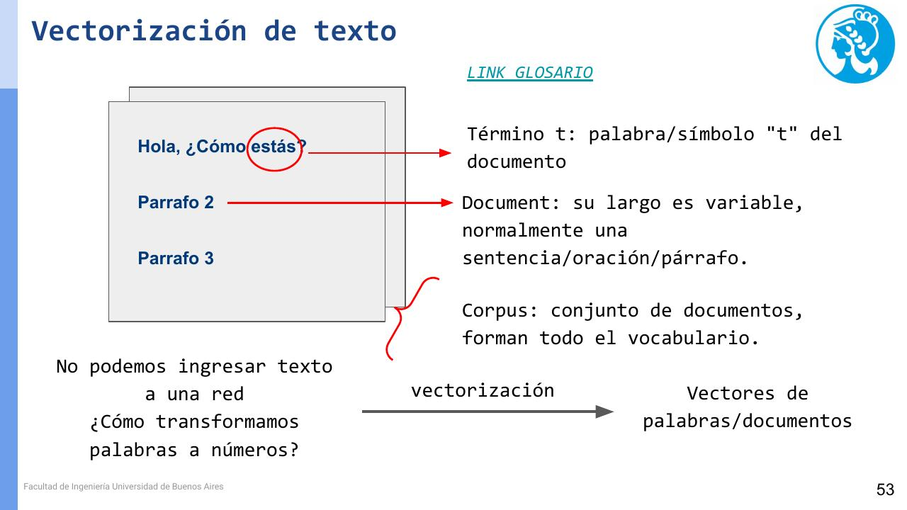

*Slide 53: término, documento y corpus. No se puede ingresar texto a una red: hay que vectorizarlo.*

- **Corpus:** todo el conjunto de textos de entrenamiento. Suele tener muchos documentos: artículos, oraciones, conversaciones, páginas web, código. **Define el vocabulario:** si una palabra no está en el corpus, el modelo no la tiene. Si el modelo tiene que entender español e inglés, el corpus tiene que tener textos en los dos idiomas.
- **Documento:** unidad de texto con un contexto o temática común, que guarda un significado completo. Su largo es variable: un artículo, un párrafo o una oración.
- **Término:** la unidad mínima en que se divide el texto, que después se lleva a un token. Puede ser una palabra, un símbolo o un conjunto de caracteres. En esta clase término = palabra, pero hay modelos que dividen en unidades más chicas.
- Los modelos usan números, así que hay que transformar el texto en **vectores**, a nivel término (palabra o carácter) o a nivel documento. En esta clase se ven **vectores de documento**; en la clase 2, vectores de palabras (word embeddings).
- Glosarios que linkean las slides: [10 NLP terms every data scientist should know](https://towardsdatascience.com/10-nlp-terms-every-data-scientist-should-know-43d3291643c0) (slide 39) y el [glosario de NLP de MoJ Analytical Services](https://moj-analytical-services.github.io/NLP-guidance/Glossary.html) (slide 53).

## 15. Vectores de frecuencia y Bag of Words (01:47:26)

> **Definición (slide 54):** por cada documento en el corpus se calcula un vector que representa cuántas veces cada palabra del vocabulario aparece en ese documento.

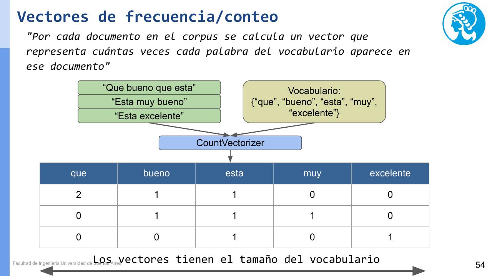

*Slide 54: CountVectorizer sobre tres documentos.*

- Ejemplo con un corpus de tres documentos, cada uno una frase: "Que bueno que esta", "Esta muy bueno" y "Esta excelente". Nadie entrena un modelo con tres frases, pero sirve para ver la idea.
- **Vocabulario** = lista de palabras únicas = {que, bueno, esta, muy, excelente}.
- Cada palabra del vocabulario es una **columna** (una dimensión) y cada valor es un conteo. Es lo que hace `CountVectorizer`:

| Documento | que | bueno | esta | muy | excelente |
|---|---|---|---|---|---|
| Que bueno que esta | 2 | 1 | 1 | 0 | 0 |
| Esta muy bueno | 0 | 1 | 1 | 1 | 0 |
| Esta excelente | 0 | 0 | 1 | 0 | 1 |

- **Los vectores son tan grandes como el vocabulario** (01:50:01): acá 5 dimensiones; en un vocabulario real, miles.
- Es un método **Bag of Words** (bolsa de palabras): el vector depende de qué palabras aparecen y cuántas veces, **no del orden**. "Esta muy bueno" y "muy bueno esta" dan el mismo vector.

**Otro ejemplo, en inglés (01:51:18)**

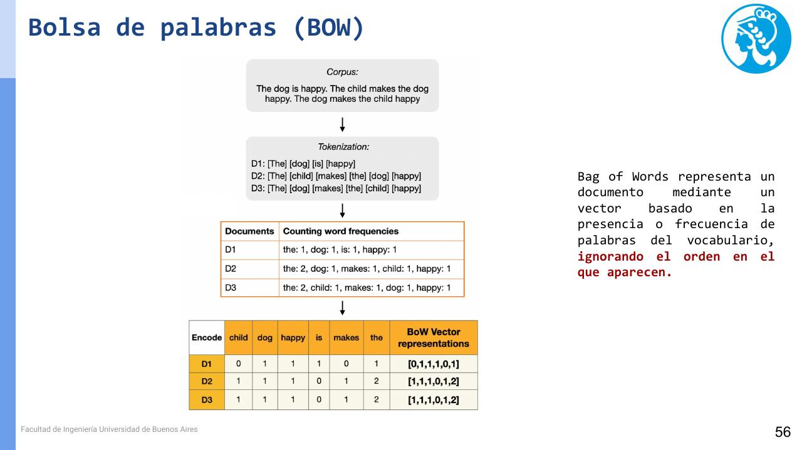

*Slide 56: el corpus "The dog is happy. The child makes the dog happy. The dog makes the child happy" se divide en 3 documentos (oraciones) → tokens → conteo por palabra → vectores con las columnas child, dog, happy, is, makes, the: D1 = [0,1,1,1,0,1], D2 = [1,1,1,0,1,2], D3 = [1,1,1,0,1,2].*

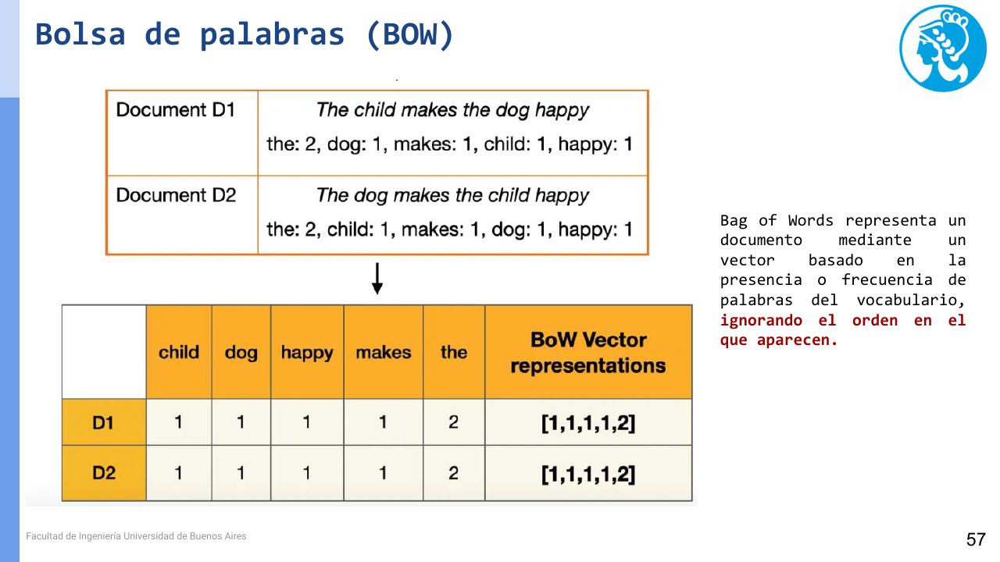

*Slide 57: "The child makes the dog happy" y "The dog makes the child happy" significan cosas distintas pero tienen el mismo vector, [1,1,1,1,2] (child, dog, happy, makes, the).*

- Se divide el corpus en documentos (acá, oraciones) y cada documento en palabras (tokens); se cuentan y se ordenan en columnas comunes a todos los documentos. Eso es el vector.
- La slide 55 muestra otro: "it is a puppy and it is extremely cute" → it = 2, puppy = 1, and = 1, cute = 1, extremely = 1, y 0 en el resto del vocabulario (they, cat, aardvark…).

## 16. Binary Bag of Words (01:51:18)

> **Definición (slide 58):** por cada documento en el corpus se calcula un vector que representa si cada palabra del vocabulario aparece o no en ese documento.

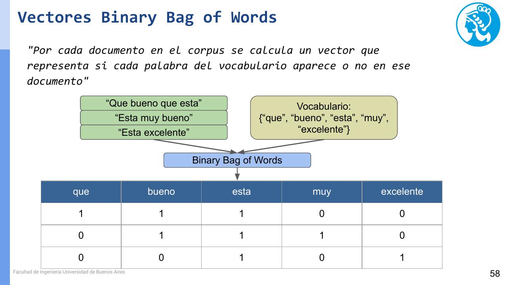

*Slide 58: el mismo ejemplo con 0 y 1: [1,1,1,0,0], [0,1,1,1,0] y [0,0,1,0,1].*

- No importa la frecuencia, solo si la palabra aparece. Es parecido a un **one-hot encoding**: *que* aparece dos veces en el primer documento, pero vale 1.
- Igual que el conteo, tiene una columna por palabra del vocabulario y no tiene en cuenta el orden.

## 17. Stopwords y ley de Zipf (01:52:44)

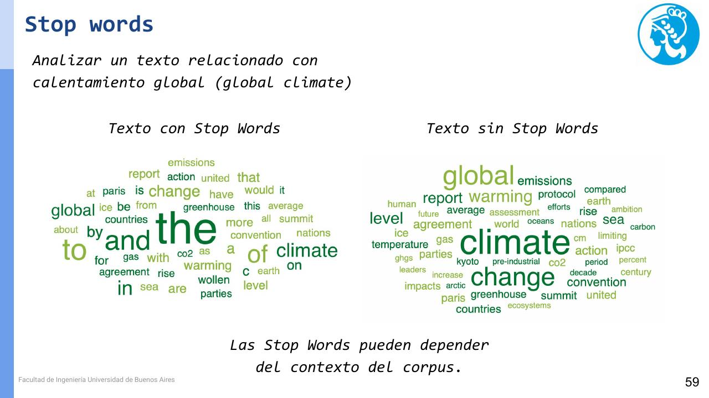

*Slide 59: un texto sobre calentamiento global. Con stopwords dominan "the", "and", "to", "of" e "in"; sin ellas resaltan "global", "climate", "change", "emissions" y "warming". La slide aclara que las stopwords pueden depender del contexto del corpus.*

- Al contar palabras, las stopwords pesan mucho en la representación pero **no permiten distinguir un texto de otro**, porque aparecen en casi todos. Si "tiran" del modelo, el modelo falla.
- Sin ellas queda una representación con menos ruido. En la nube sin stopwords se ve enseguida que el texto habla de cambio climático.
- Solo por quitar stopwords, los modelos de clasificación suelen **mejorar sus métricas**. Si se vectoriza por frecuencia, es una buena técnica para aplicar.

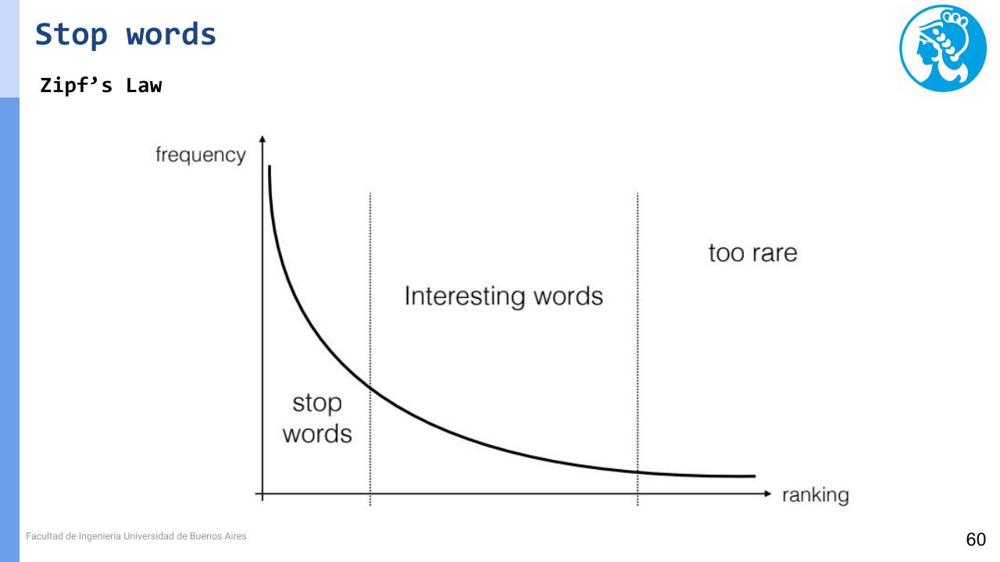

*Slide 60: ley de Zipf. La frecuencia según el ranking: a la izquierda las stopwords, en el medio las "interesting words" y en la cola las "too rare".*

- Las palabras del **top del ranking** (las más frecuentes) son las stopwords: son comunes a todos los documentos y no diferencian.
- Las **muy raras** tampoco sirven para buscar similitudes o categorías comunes, porque aparecen en un solo documento. Por ejemplo, un número de DNI o de pasaporte no relaciona ese texto con ningún otro.
- Las útiles son **las del medio**, ni tan comunes ni tan raras: ahí está el valor para clasificar y agrupar textos.

## 18. TF-IDF (01:56:50)

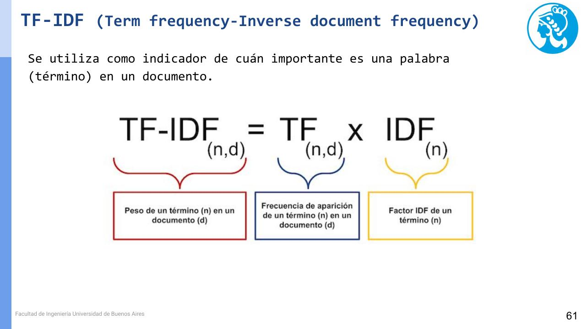

*Slide 61: TF-IDF(n,d) = TF(n,d) × IDF(n). El peso de un término n en un documento d es su frecuencia en ese documento por el factor IDF del término.*

- Es otra forma de bajarles el peso a las palabras muy comunes, **sin un diccionario de stopwords**: un término de ajuste, el **IDF** (*inverse document frequency*). La slide lo presenta como un indicador de cuán importante es una palabra en un documento.
- **TF** (*term frequency*) es lo que ya vimos: cuántas veces aparece el término n en el documento d.
- **IDF** es la frecuencia inversa en documentos:

```math
\mathrm{IDF}(n) = \log_{10} \frac{N}{\mathrm{DF}(n)}
```

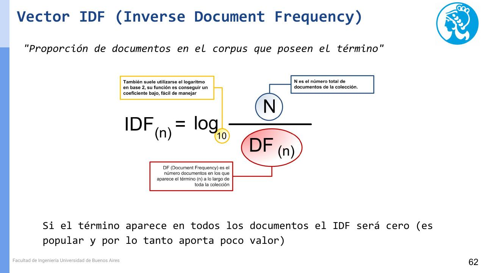

*Slide 62: N es el número total de documentos de la colección y DF(n), el número de documentos en los que aparece el término. También suele usarse el logaritmo en base 2: su función es conseguir un coeficiente bajo, fácil de manejar.*

- Si un término aparece en **todos** los documentos, N/N = 1 y log 1 = 0: el IDF es **cero** ("es popular y por lo tanto aporta poco valor"). Cuanto más común es una palabra en el corpus, más chico es su IDF y más peso se le resta.

```math
\text{TF-IDF}(n, d) = \mathrm{TF}(n, d) \times \mathrm{IDF}(n)
```

**Ejemplo (01:58:19)**

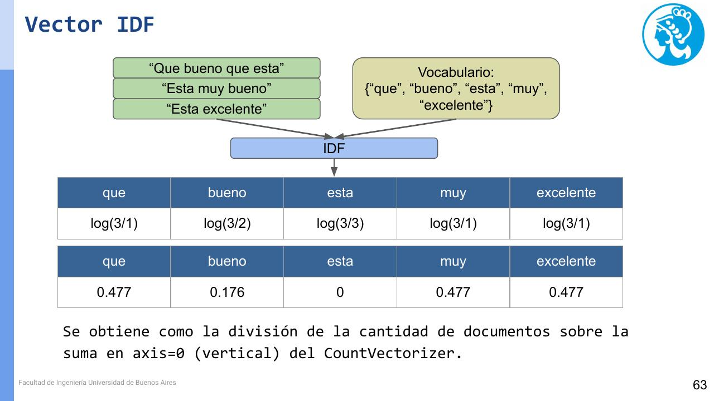

*Slide 63: IDF del ejemplo de las tres frases.*

| | que | bueno | esta | muy | excelente |
|---|---|---|---|---|---|
| Documentos donde aparece | 1 | 2 | 3 | 1 | 1 |
| IDF | log(3/1) = 0.477 | log(3/2) = 0.176 | log(3/3) = 0 | log(3/1) = 0.477 | log(3/1) = 0.477 |

- *que* aparece en un solo documento y tiene un peso alto. *esta* aparece en los tres: no sirve para diferenciar y se **apaga** por completo. *bueno*, que aparece en dos, queda en un punto medio. Así se "prende" lo diferenciador y se apaga lo común.
- La slide dice que se obtiene dividiendo la cantidad de documentos por la suma vertical (`axis=0`) del CountVectorizer. ✎ Ojo: esa suma tiene que ser sobre la versión **binaria**, es decir, en cuántos documentos aparece. *que* suma 2 en el conteo, pero aparece en un solo documento.

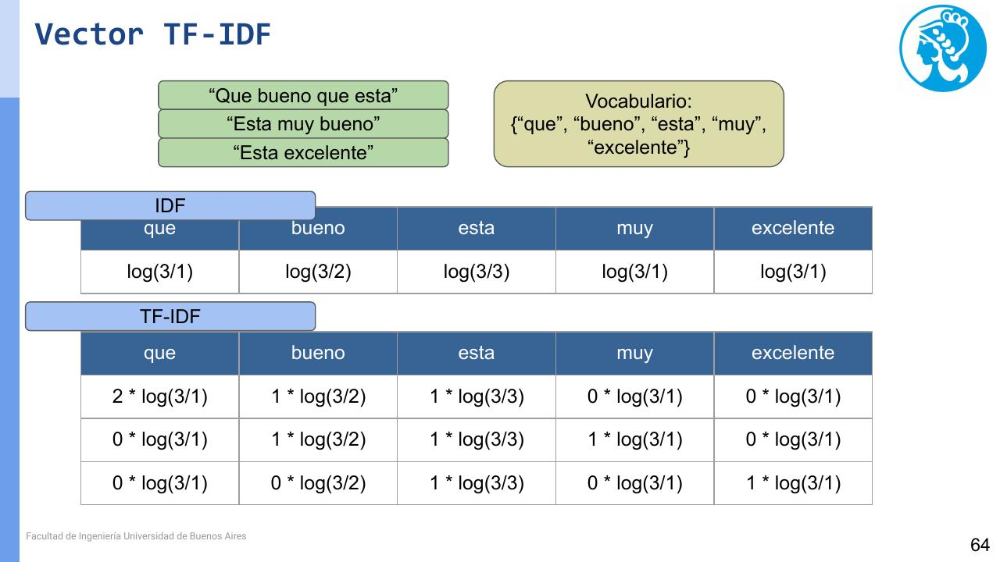

*Slide 64: TF-IDF = conteo × IDF de cada columna.*

| | que | bueno | esta | muy | excelente |
|---|---|---|---|---|---|
| Que bueno que esta | 2 × 0.477 | 1 × 0.176 | 1 × 0 | 0 | 0 |
| Esta muy bueno | 0 | 1 × 0.176 | 1 × 0 | 1 × 0.477 | 0 |
| Esta excelente | 0 | 0 | 1 × 0 | 0 | 1 × 0.477 |

- *esta* termina en 0 en todos los documentos y *que* queda con el valor más alto (✎ 0.954).
- **TF-IDF es lo que se usa en el desafío 1.**

## 19. Desventajas de BoW y TF-IDF (02:01:06)

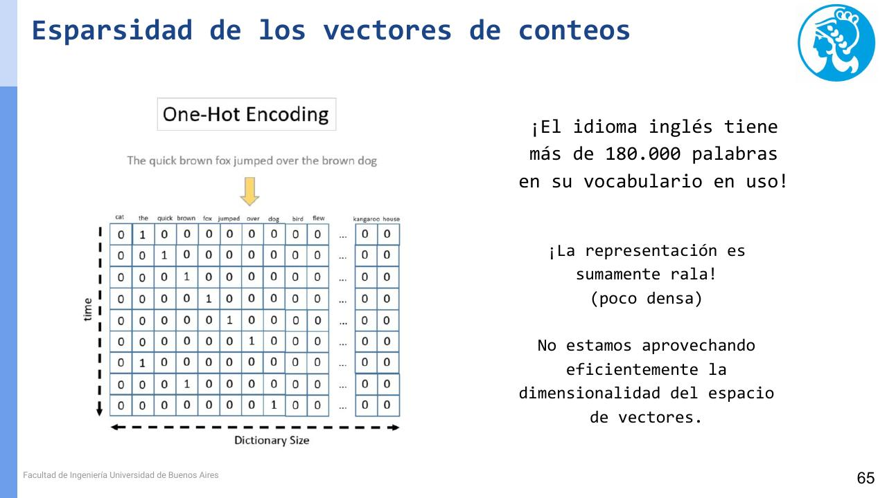

*Slide 65: one-hot encoding de "The quick brown fox jumped over the brown dog": una matriz casi toda de ceros, con una columna por palabra del diccionario.*

1. **Esparsidad:** los vectores tienen muchísimos ceros. El inglés tiene más de 180.000 palabras en uso, así que el vector tendría 180.000 dimensiones: una oración de 8 palabras usa 8 columnas y el resto son ceros. Son vectores enormes para guardar muy poca información; la representación es muy rala y no aprovecha la dimensionalidad del espacio. Por eso hoy priman las **representaciones densas** (clase 2), aunque crearlas requiere entrenar modelos, mientras que contar palabras es mucho más fácil.
2. **Se pierde el orden** (02:02:19): la misma oración al revés da el mismo vector.
3. **No entiende sinónimos:** "el perro comió" y "el can comió" tienen vectores distintos, como respondió Hernando, aunque digan lo mismo. Se consideran las palabras, no su significado.

## 20. Similitud entre documentos (02:03:54)

Con los vectores armados, hace falta una forma de medir cuáles se parecen: una distancia o una similitud.

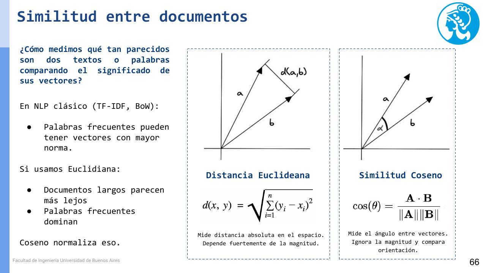

*Slide 66: distancia euclidiana vs similitud coseno.*

| | Distancia euclidiana | Similitud coseno |
|---|---|---|
| Mide | La distancia absoluta en el espacio | El ángulo entre los vectores |
| Magnitud | Depende fuertemente de ella | La ignora: compara la orientación |
| En NLP clásico | Los documentos largos parecen más lejos y las palabras frecuentes dominan | Normaliza eso |

- **¿Cuál usar en lenguaje? La coseno.** Hernando lo explicó: la dirección codifica el significado, y documentos que dicen cosas parecidas apuntan en direcciones parecidas. La magnitud depende del largo del documento y de la frecuencia de las palabras; no importa si un documento es más largo, sino que hablen de lo mismo. Es la que se va a usar en casi todo el curso.

```math
\cos(\theta) = \frac{A \cdot B}{\lVert A \rVert \, \lVert B \rVert} = \frac{\sum_{i=1}^{n} A_i B_i}{\sqrt{\sum_{i=1}^{n} A_i^2}\,\sqrt{\sum_{i=1}^{n} B_i^2}}
```

**Ejemplo (02:06:51)**

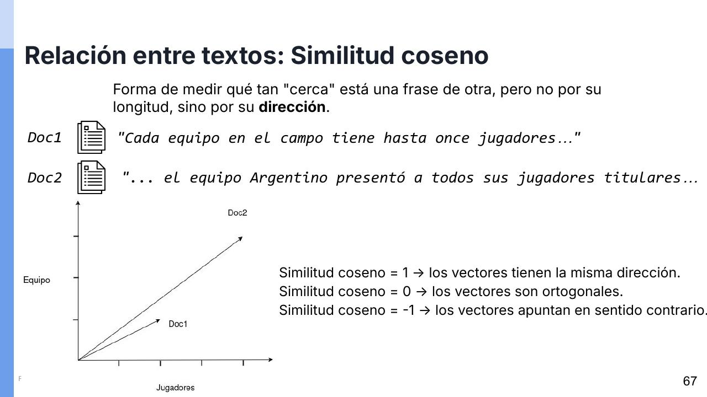

*Slide 67: Doc1 "Cada equipo en el campo tiene hasta once jugadores…" y Doc2 "…el equipo argentino presentó a todos sus jugadores titulares…", graficados en los ejes "equipo" y "jugadores": vectores de distinto largo con casi la misma dirección.*

- Los dos hablan de jugadores, de equipo, de juego. El segundo es más largo, así que la distancia euclidiana probablemente sea alta, pero las direcciones son parecidas.
- **Cómo leer el valor (02:08:11):**
  - ≈ **1:** los vectores apuntan en la misma dirección.
  - **0:** son ortogonales, no hay relación entre los textos. Por ejemplo, uno de cocina y otro de matemáticas.
  - **−1:** apuntan en sentido contrario.
- **−1 no significa antónimos.** Los antónimos tienen significados parecidos pero opuestos: están relacionados semánticamente ("del amor al odio hay un solo paso") y suelen tener una similitud alta.
- ✎ Con vectores de conteo o TF-IDF, que no tienen valores negativos, la similitud coseno va de 0 a 1. El −1 puede aparecer con vectores densos, como los embeddings.

---

## 21. Machine learning para NLP: clasificación de texto (02:25:35)

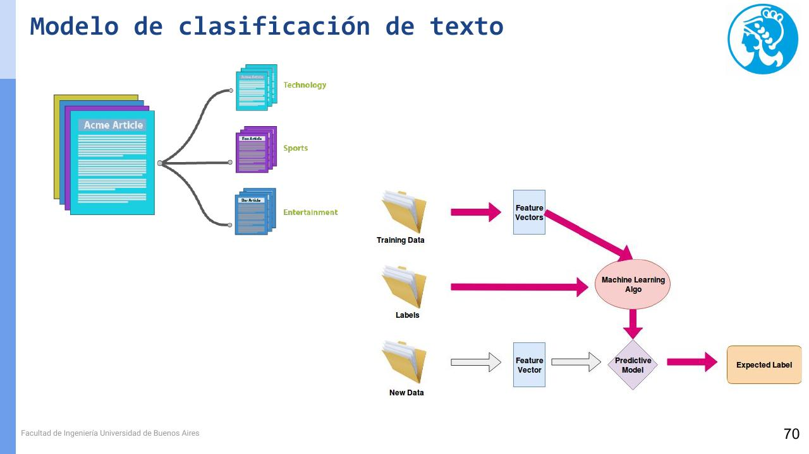

*Slide 70: artículos que se clasifican en technology, sports o entertainment. Datos de entrenamiento → vectores → algoritmo de ML (con las etiquetas) → modelo predictivo; un dato nuevo → vector → modelo → etiqueta.*

- Con los vectores ya se pueden usar modelos de **machine learning clásico**. Ejemplo (el del desafío): noticias con la etiqueta de su categoría, 20 categorías en total.
- **Entrenamiento:** se vectorizan los documentos por conteo de palabras y, con las etiquetas, se entrena un modelo.
- **Test:** con otra parte del dataset se mide qué tan bien predice las categorías.
- Las categorías son etiquetas comunes, como en cualquier modelo de clasificación.

## 22. Naïve Bayes (02:27:03)

El modelo de la clase es **Naïve Bayes**, que clasifica con el **teorema de Bayes** (probabilidades condicionales).

```math
P(c \mid d) = \frac{P(d \mid c)\, P(c)}{P(d)} \;\propto\; P(c) \prod_{i} P(w_i \mid c)
```

- **¿Por qué "naïve" (ingenuo)?** Porque asume que **cada palabra es independiente** de las demás: no le importa el orden, solo si la palabra está. En el texto eso no se cumple (las palabras se afectan entre sí y cambian de significado), pero es una simplificación que permite un modelo rápido. No es tan preciso, pero puede ser útil.
- **Cómo funciona:** calcula la probabilidad de que un texto pertenezca a una categoría según las palabras que contiene. Con el corpus de entrenamiento se cuentan las palabras de cada clase y se obtienen las probabilidades condicionales P(palabra | clase).
- P(clase | contenido) ∝ **P(clase) × P(contenido | clase)**. El denominador P(contenido) es igual para todas las clases, así que se ignora: no ayuda a distinguir.
- Ejemplo de la slide 72: si "descuento" aparece mucho en los correos marcados como spam, cuando llega un correo nuevo con esa palabra sube la probabilidad de que sea spam.

**Ejemplo: spam o normal (02:28:33)**

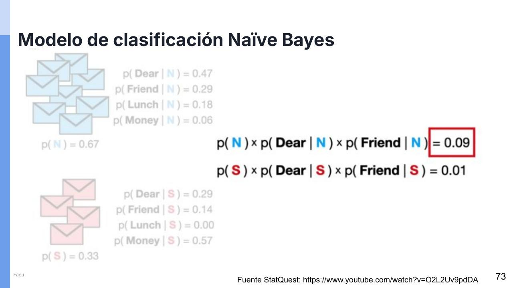

*Slide 73 (fuente: [StatQuest](https://www.youtube.com/watch?v=O2L2Uv9pdDA)): probabilidades de cada palabra en correos normales (N) y spam (S), y la clasificación de "Dear Friend".*

1. Con los datos de entrenamiento, contar cuántas veces aparece cada palabra en los correos de cada clase. Así se obtiene P(palabra | clase) para todo el vocabulario: también es un conteo de frecuencias.
2. Contar cuántos correos hay de cada clase para obtener P(clase). Por ejemplo, si 7 de 10 son normales y 3 son spam, P(spam) = 30 %.
3. Para un correo nuevo, multiplicar P(clase) por las probabilidades de sus palabras en esa clase y quedarse con la clase de mayor resultado.

| Palabra | P(palabra \| normal) | P(palabra \| spam) |
|---|---|---|
| Dear | 0.47 | 0.29 |
| Friend | 0.29 | 0.14 |
| Lunch | 0.18 | 0.00 |
| Money | 0.06 | 0.57 |
| **P(clase)** | **0.67** | **0.33** |

- "Dear Friend": normal → 0.67 × 0.47 × 0.29 = **0.09**; spam → 0.33 × 0.29 × 0.14 = **0.01**. Se clasifica como **normal**.
- Un correo con *money*, que es muy frecuente en el spam (que promete mucho dinero), da una probabilidad alta de spam.

**Suavizado de Laplace (02:33:07)**

- ¿Qué pasa con una palabra que **no apareció** en el entrenamiento de una clase? Su probabilidad es **0**, como respondió Hernando, y como todo se multiplica, **anula la clase entera**. Ejemplo: *lunch* nunca apareció en spam.
- El **suavizado de Laplace** suma una constante chica, **α**, a los conteos para que ninguna probabilidad quede en 0.

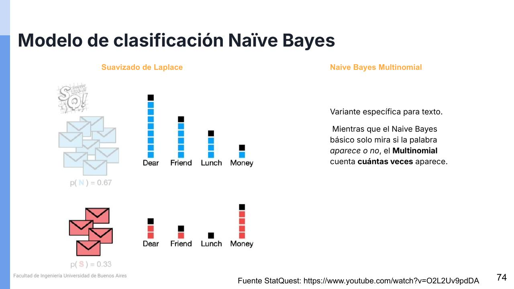

*Slide 74: conteos de Dear, Friend, Lunch y Money por clase, con un conteo extra (el cuadrado negro) en cada palabra: así Lunch deja de valer 0 en spam.*

- ✎ Con α: P(w | c) = (conteo(w, c) + α) / (total de palabras de c + α · |V|), donde |V| es el tamaño del vocabulario. α = 1 es el Laplace clásico; en scikit-learn es el parámetro `alpha`.

**Variantes (02:34:29)**
- **Multinomial:** usa la frecuencia, cuántas veces aparece cada palabra. Es la más común y la variante específica para texto.
- **Bernoulli:** solo la aparición o no aparición, binaria.

## 23. Representaciones y modelos BoW (02:34:29)

> **Slide 75:** cualquier modelo o representación (vectorización) de texto en donde el resultado no se modifique con el orden de las palabras es un modelo o representación BOW.

- **Representaciones BoW:** conteo (CountVectorizer), one-hot y TF-IDF.
- **Clasificador BoW:** Naïve Bayes, porque usa frecuencias y su resultado no depende del orden de las palabras.

## 24. Desafío 1: el ejemplo de la plantilla (02:35:55)

La plantilla está en la carpeta `Desafíos` del repo de la materia ([copia acá](../../desafios/01-vectorizacion/desafio-1.ipynb)). Arriba tiene el ejemplo que se hizo en clase y al final la consigna, que es la tarea. Consigna completa y aclaraciones en [desafios/01-vectorizacion](../../desafios/01-vectorizacion/README.md).

**Dataset: 20 Newsgroups**
- Noticias (publicaciones de grupos de noticias) en **20 categorías**: política, religión, tecnología, autos, motos, computadoras, deportes… Hay que clasificar cada una en su categoría.
- Es un dataset muy conocido que se descarga desde **scikit-learn** (`fetch_20newsgroups`), ya dividido en train y test. El notebook saca encabezados, firmas y citas (`remove=('headers', 'footers', 'quotes')`).

**Herramientas de scikit-learn**
- `CountVectorizer` (conteo simple, sin IDF) y `TfidfVectorizer` (con el ajuste IDF que apaga las palabras que aparecen en todos los documentos). Ya están implementados: no hace falta programarlos.
- `cosine_similarity`, `MultinomialNB` y `ComplementNB`, que queda para experimentar.
- Métrica común a todos los experimentos: **F1**.

**Vectorización (02:38:46)**
- En el ejemplo, `TfidfVectorizer()` va **sin parámetros**. En la consigna hay que experimentar, por ejemplo con el parámetro que saca stopwords; los demás están en la documentación de scikit-learn.
- `fit_transform` sobre el train arma el vocabulario, calcula el IDF y devuelve la **matriz documento-término**: **11.314 documentos × 101.631 términos**, sparse (`csr_matrix`). Es lo visto en clase: una matriz enorme llena de ceros.
- `vocabulary_` mapea cada término a su columna: la palabra *car* es la columna **25.775**. Con el diccionario inverso (`idx2word`) se va del índice a la palabra.
- **Palabra fuera del vocabulario (02:41:45):** da error, porque solo se pueden procesar palabras que estaban en el train. ✎ El error aparece al buscarla en `vocabulary_` (`KeyError`); `transform()` no falla, sino que ignora las palabras desconocidas.

**Similitud entre documentos (02:43:07)**
- Documento elegido: el **4811**, un discurso por radio del presidente desde la Casa Blanca (oficina de prensa, Pittsburgh, 17 de abril de 1993). Clase: `talk.politics.misc`.
- Se calcula `cosine_similarity(X_train[idx], X_train)` contra todo el train y se ordena de mayor a menor. El primero es el mismo documento (similitud 1); después siguen 0.709 y 0.675.
- Los 5 más similares (6635, 4253, 3596, 4271 y 3746) son **todos de `talk.politics.misc`**. Un método simple ya captura documentos que hablan de lo mismo.

**Naïve Bayes (02:49:45)**
- `MultinomialNB()` sin parámetros, entrenado sobre el TF-IDF del train. El test se vectoriza con `transform`, con el vectorizador ya ajustado en train.
- **F1 macro en test = 0.585.** Es el baseline a mejorar.
- F1 macro vs micro, según el notebook: el **macro** promedia el F1 de cada clase, con el mismo peso para todas; el **micro** calcula las métricas sobre todas las predicciones juntas y en multiclase suele equivaler a la accuracy, así que no es la mejor métrica con clases desbalanceadas.

**Consigna, fecha y entrega (02:44:42 a 02:55:36):** ver [desafios/01-vectorizacion](../../desafios/01-vectorizacion/README.md). Nota 10 hasta el jueves 05/11 a última hora; desde el 06/11 baja un punto.

## 25. Cierre: familias de vectorización y NLP clásico vs DL vs LLMs (02:55:36)

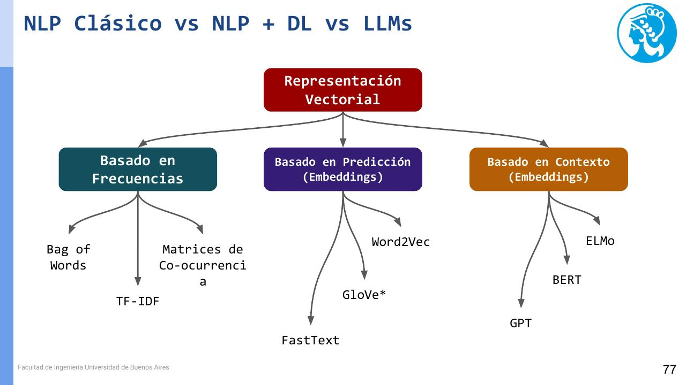

*Slide 77: representación vectorial basada en frecuencias (bag of words, TF-IDF, matrices de co-ocurrencia), en predicción (Word2Vec, GloVe, FastText) y en contexto (ELMo, BERT, GPT).*

| Familia | Métodos | Cuándo se ve | Cómo son los vectores |
|---|---|---|---|
| Basada en frecuencias | Bag of Words, TF-IDF, matriz de co-ocurrencia | Clase 1 (la matriz de co-ocurrencia, en la clase 2) | Conteos, esparsos |
| Basada en predicción (embeddings) | Word2Vec, GloVe, FastText | Clase 2 | Densos, capturan el sentido semántico. **Estáticos:** una palabra siempre tiene el mismo embedding |
| Basada en contexto (embeddings) | ELMo, BERT, GPT | Con Transformers y atención | **Dinámicos:** el vector de una palabra cambia según las palabras que la acompañan |

Los de contexto son los más usados hoy.

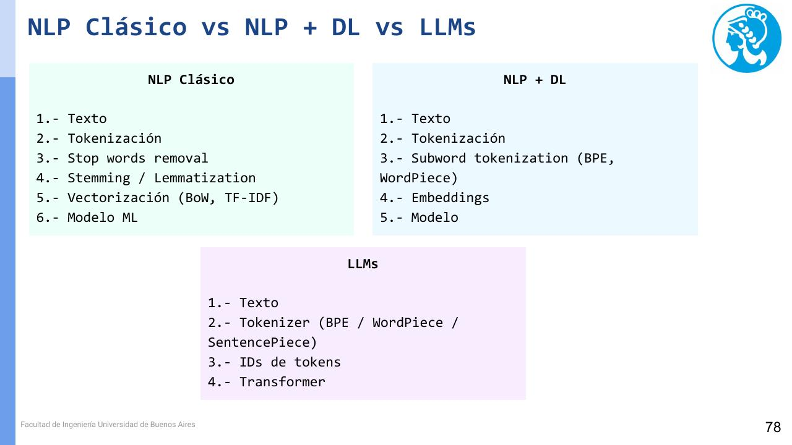

*Slide 78: los pasos de cada enfoque.*

| NLP clásico | NLP + deep learning | LLMs |
|---|---|---|
| 1. Texto | 1. Texto | 1. Texto |
| 2. Tokenización | 2. Tokenización | 2. Tokenizer (BPE / WordPiece / SentencePiece) |
| 3. Stopword removal | 3. Tokenización por subpalabras (BPE, WordPiece) | 3. IDs de tokens |
| 4. Stemming / lematización | 4. Embeddings | 4. Transformer |
| 5. Vectorización (BoW, TF-IDF) | 5. Modelo | |
| 6. Modelo de ML | | |

- **NLP clásico:** mucho énfasis en la **limpieza**. Estos modelos procesan poca información, así que cuanto más se simplifica el texto, mejor andan: quitar stopwords y hacer stemming logra que más palabras hagan *match* entre documentos.
- **NLP + DL** (antes de los Transformers y los LLMs): menos limpieza. La **tokenización sigue en los tres enfoques**; lo que cambia es cómo se divide: por subpalabras, es decir, en partes más atómicas de la palabra. Los vectores ya no salen de frecuencias sino de entrenar vectores densos que capturan el sentido semántico, y el modelo es de deep learning en vez de ML clásico.
- **LLMs:** se tokeniza, se asignan los IDs y la vectorización va **enlazada al modelo**: cada modelo tiene su propio tokenizador. Para trabajar con GPT-4 hay que usar el tokenizador de GPT, porque el modelo se entrenó con ese método. El texto entra completo, con puntuación y hasta con errores de tipeo u ortografía, y el modelo, más inteligente, saca igual todo el contenido.

---

## Correcciones de la transcripción automática

| Dice la transcripción | Es |
|---|---|
| JosselynOrdóñez | Josselyn Ordóñez |
| Creditor | Credicorp, el grupo financiero dueño del BCP |
| ella generativa | IA generativa |
| WFlows | workflows |
| la UG … se fue con IT | no se entiende; probablemente dónde y en qué hizo la maestría |
| lms, pronamiento de lenguaje | LLMs, procesamiento de lenguaje |
| trabajan consecuencias | trabajan con secuencias |
| Word Bedits, envenis, envelles, Wen, edis, verbedings | (word) embeddings |
| LCTM y Ju | LSTM y GRU |
| RAM ("este es su RAM") | rama (de Git) |
| Gilhub, colaps, colap | GitHub, Colab |
| Chamski | Chomsky |
| escándar | estándar |
| actualización (de documentos) | vectorización |
| T de Tool, test de Twin | test de Turing |
| Elisa | ELIZA |
| estatistical Machine Translation | Statistical Machine Translation (SMT) |
| 2002 (boom del deep learning) | 2012 |
| 20171, attention unit | 2017, "Attention Is All You Need" |
| se vanzca (la gradiente) | se desvanezca (el gradiente) |
| Cloud | Claude |
| chatbox | chatbots |
| tocanización, toquenización, toque, tocan | tokenización, token |
| Antropic | Anthropic |
| tú (el ID dos) | *to*, del ejemplo "Let's go to N.Y.!" |
| de matización, la matización | lematización |
| stopwatización, Star Wars, Stop Wars, stopwan | stopwords |
| steming, streaming, streamización | stemming |
| Docs Running, Docar Running | "The dogs are #running!!" |
| NTK, en el etk | NLTK |
| world tokenizer | `word_tokenize` |
| la categoría de instauración | probablemente "la categoría de esta oración" |
| claser, clastering | clustering |
| acas de de confusión | accuracy, matriz de confusión |
| un vectorizer | `CountVectorizer` |
| Back of Words, Bag of Ws | Bag of Words |
| oneehot encoding, one encoding | one-hot encoding |
| TFC, TF y DF | TF-IDF |
| esparcidad | esparsidad (*sparsity*) |
| clidiana, cosente, semilitos | euclidiana, coseno, similitud |
| ortoganales | ortogonales |
| antónimus | antónimos |
| nave, ingemo, Niveas, N vies, night by es, bytes, NY | Naïve Bayes |
| teorema de valles, byes, Ves, B | teorema de Bayes |
| verilitud | verosimilitud |
| dear frame | "Dear Friend" |
| suavizado de la PL, la place | suavizado de Laplace |
| vernuli | Bernoulli |
| cit learn, cycle learn | scikit-learn |
| 20 News Group | 20 Newsgroups |
| Washing | Washington |
| ser shot | zero-shot |
| F1 SC | F1 score |
| matriz de conocurrencia | matriz de co-ocurrencia |

---

## ✎ Para los desafíos

**Desafío 1** ([consigna y aclaraciones](../../desafios/01-vectorizacion/README.md))

| Consigna | Conceptos de la clase |
|---|---|
| 1. Similitud entre documentos | TF-IDF (§18), similitud coseno (§20), el ejemplo de la plantilla (§24) |
| 2. Clasificador por prototipos | Similitud coseno contra todo el train y la clase del más parecido (§20) |
| 3. Naïve Bayes | Multinomial vs Complement, `alpha` = suavizado de Laplace (§22), stopwords y Zipf (§17) |
| 4. Similitud entre palabras | Matriz término-documento (la transpuesta), Zipf (§17), limitaciones de BoW (§19) |

Detalles prácticos:
- `TfidfVectorizer` de scikit-learn no usa exactamente la fórmula de la slide. Por defecto usa logaritmo natural y `smooth_idf=True`, con IDF = ln((1 + N) / (1 + DF)) + 1: un término que aparece en todos los documentos vale 1, no 0. Además normaliza cada fila con L2 (`norm='l2'`), así que la similitud coseno entre filas es directamente el producto punto.
- Por defecto pasa todo a minúsculas, no saca stopwords (`stop_words=None`) y su `token_pattern` ignora los tokens de un solo carácter.
- Parámetros para explorar en el punto 3:
  - En el vectorizador: `stop_words='english'`, `min_df`, `max_df`, `max_features`, `sublinear_tf`, `use_idf`, `norm`.
  - En el modelo: `alpha` en `MultinomialNB` y en `ComplementNB`, que además tiene `norm`. `ComplementNB` está pensado para clases desbalanceadas y suele andar bien con texto.
- Para no elegir parámetros mirando el test, buscarlos con validación cruzada sobre el train (`GridSearchCV` con `scoring='f1_macro'`) y medir el test una sola vez al final.
- El clasificador por prototipos es un **1-NN** (vecino más cercano) con similitud coseno. El test tiene 7.532 documentos: para no armar de una la matriz densa de 7.532 × 11.314, calcular por lotes y tomar el `argmax` de cada fila.
- Referencia para "¿es mejor que el azar?": elegir una clase al azar entre 20 da un F1 macro de alrededor de 0.05.
- Punto 4: `X_train.T` da una matriz de 101.631 términos × 11.314 documentos. Por Zipf, las palabras muy raras dan vecinos poco interpretables: conviene elegir palabras de frecuencia media y de temas distintos (autos, religión, espacio).

---

## ✎ Glosario

- **Corpus:** conjunto de documentos de entrenamiento; define el vocabulario.
- **Documento:** unidad de texto con significado completo (oración, párrafo, artículo).
- **Término:** unidad mínima en que se divide el texto (palabra, símbolo, conjunto de caracteres).
- **Token:** identificador asignado a cada término único; después se asocia a un vector.
- **Vocabulario:** conjunto de términos únicos del corpus.
- **Tokenización por subpalabras:** dividir las palabras en partes más chicas (BPE, WordPiece, SentencePiece). La usan los modelos modernos.
- **Normalización:** pasar a minúsculas y sacar puntuación y caracteres raros.
- **Stemming:** cortar afijos con reglas para llegar a una raíz, que puede no ser una palabra.
- **Lema / lematización:** la forma de diccionario de una palabra (infinitivo, singular) / llevar cada palabra a su lema.
- **Stopwords:** palabras muy frecuentes y con poco significado propio.
- **Ley de Zipf:** la frecuencia de una palabra es inversamente proporcional a su posición en el ranking. Hay pocas palabras muy frecuentes y una cola larga de palabras raras.
- **Matriz documento-término:** filas = documentos, columnas = términos. Su transpuesta es la matriz término-documento.
- **Bag of Words (BoW):** representación o modelo que no depende del orden de las palabras.
- **One-hot encoding:** vector con un 1 en la posición de la palabra y 0 en el resto.
- **TF / DF / IDF:** frecuencia del término en el documento / cantidad de documentos que lo contienen / log(N / DF).
- **Esparsa (*sparse*, rala):** matriz o vector con casi todos ceros. scikit-learn las guarda en formato CSR.
- **Representación densa:** vector de pocas dimensiones y casi sin ceros, como los embeddings.
- **Embedding estático / dinámico (contextual):** un vector fijo por palabra / un vector que cambia según el contexto.
- **Similitud coseno:** coseno del ángulo entre dos vectores.
- **OOV (*out of vocabulary*):** palabra que no estaba en el vocabulario de entrenamiento.
- **Naïve Bayes:** clasificador probabilístico que asume independencia entre las palabras.
- **Suavizado de Laplace:** sumar α a los conteos para evitar probabilidades cero.
- **F1 macro / micro:** promedio del F1 de cada clase / F1 calculado sobre todas las predicciones juntas.
- **Zero-shot:** clasificar sin entrenar un modelo para la tarea. En el desafío, asignar la clase del documento más parecido.
- **POS tagging / NER:** etiquetar la clase gramatical de cada palabra / reconocer entidades (personas, lugares, organizaciones, fechas).
- **SMT:** traducción automática estadística (IBM, 1990).
- **Desvanecimiento del gradiente:** el gradiente se achica al propagarse por muchas capas o pasos y las primeras casi no aprenden. Afecta a las redes recurrentes con secuencias largas.
- **Gramática generativa:** la idea de Chomsky de un conjunto de reglas que genera todas las oraciones correctas de un idioma.
- **Loro estocástico:** crítica de Bender et al. (2021): un LLM combinaría patrones de sus datos sin entender el significado.

---

## ✎ Preguntas de práctica

1. ¿Cuáles son las cuatro cosas clave que implica el NLP desde la IA?
2. ¿Qué diferencia hay entre la mirada lingüística (Chomsky) y la filosófica (Wittgenstein) del lenguaje? ¿Con qué tema del curso se relaciona la segunda?
3. ¿Qué plantea el test de Turing y de qué año es?
4. ¿Cómo funcionaba ELIZA?
5. Nombrar los cuatro pasos del Statistical Machine Translation de IBM.
6. ¿Por qué el deep learning recién despegó en 2012 si las redes neuronales ya existían? ¿Cuáles son los tres ingredientes de la slide?
7. ¿Qué paper introdujo el Transformer, de qué año es y qué problema de las redes recurrentes resuelve?
8. ¿Qué diferencia a un agente de un chatbot?
9. ¿Qué diferencia hay entre POS tagging y NER?
10. ¿Cuáles son las dos etapas entre el corpus y el modelo?
11. ¿Qué es la tokenización? ¿Qué parte es común a todos los modelos y qué parte cambia?
12. Dar tres casos en los que tokenizar no es "solo hacer split".
13. ¿Siempre conviene quitar la puntuación?
14. ¿En qué quedan "improving" e "improved" con stemming y con lematización?
15. ¿Cuál **no** es una ventaja de la lematización? a) produce palabras válidas b) mantiene la precisión semántica c) no necesita recursos adicionales d) es más precisa que el stemming
16. ¿Qué problema mostró el filtrado de stopwords de NLTK con "No estoy tan solo, pero no es lo mismo"? ¿Cómo se resuelve?
17. En el notebook, ¿con qué librería se hizo el stemming y con cuál la lematización?
18. Definir corpus, documento y término.
19. Armar el vector de conteo y el binario de "Que bueno que esta" con el vocabulario {que, bueno, esta, muy, excelente}.
20. ¿Por qué "The child makes the dog happy" y "The dog makes the child happy" tienen el mismo vector BoW?
21. Según la ley de Zipf, ¿qué palabras sirven para clasificar y cuáles no?
22. Escribir la fórmula del IDF. ¿Cuánto vale para un término que aparece en todos los documentos?
23. En un corpus de 3 documentos, "bueno" aparece en 2. ¿Cuál es su IDF (log10)?
24. Nombrar las tres desventajas de BoW y TF-IDF que se vieron en clase.
25. ¿Por qué se prefiere la similitud coseno a la distancia euclidiana para comparar textos?
26. Una similitud coseno de −1, ¿indica que los textos son antónimos?
27. ¿Por qué Naïve Bayes es "naïve"? ¿Por qué se ignora el denominador del teorema de Bayes?
28. Con P(N) = 0.67, P(Dear|N) = 0.47, P(Friend|N) = 0.29, P(S) = 0.33, P(Dear|S) = 0.29 y P(Friend|S) = 0.14, ¿cómo se clasifica "Dear Friend"?
29. ¿Para qué sirve el suavizado de Laplace?
30. ¿Qué diferencia hay entre Naïve Bayes multinomial y Bernoulli?
31. ¿Qué representaciones y qué clasificador de la clase son BoW, y por qué?
32. En el ejemplo del desafío, ¿qué forma tiene la matriz documento-término y cuánto da el F1 macro del baseline?
33. ¿Por qué el F1 macro es mejor que el micro con clases desbalanceadas?
34. ¿Qué hiperparámetro no hay que cambiar en el desafío 1?
35. Nombrar las tres familias de representación vectorial con un ejemplo de cada una.
36. ¿Qué paso está en el NLP clásico, en NLP + DL y en los LLMs? ¿Por qué con un LLM hay que usar su propio tokenizador?

<details>
<summary>Respuestas</summary>

1. Representación, modelado, inferencia y aprendizaje.
2. La lingüística ve el lenguaje como símbolos más reglas (semántica, sintaxis, pragmática); Chomsky propone la gramática generativa, base del NLP clásico con reglas. La filosófica dice que el significado de una palabra es su uso, así que depende del contexto ("banco"). Se relaciona con los embeddings.
3. Si una máquina puede hablar como un humano, al punto de que un tercero no distinga si conversa con una máquina o con una persona. Es de 1950.
4. Buscaba palabras clave en lo que escribía el usuario y elegía una pregunta predefinida, reformulada con esas palabras. Eran reglas escritas a mano.
5. Fertility (mantener, eliminar o duplicar cada palabra), NULL insertion (agregar posiciones para palabras que el otro idioma necesita), traducción léxica (uno a uno) y distorsión (reordenar).
6. Por el hardware: hacían falta GPUs y mucho texto digitalizado para entrenar redes gigantes. Los ingredientes: hardware, datos e investigación.
7. "Attention Is All You Need" (2017, empleados de Google). Procesa la secuencia en paralelo y evita el desvanecimiento del gradiente que sufren las recurrentes con secuencias largas.
8. Un agente es un chatbot que además ejecuta tareas, como buscar en internet o enviar correos.
9. POS etiqueta la clase gramatical de cada palabra (sustantivo, verbo, adjetivo); NER reconoce entidades (personas, lugares, organizaciones, fechas). Las dos son clasificación a nivel de palabra.
10. Preprocesamiento (limpieza) y feature engineering (vectorización).
11. Segmentar el texto en términos y asignar a cada término único un identificador (el token), que es el mismo en todo el corpus. Dividir y asignar IDs es común a todos; cambia cómo se divide (palabras, caracteres, subpalabras).
12. Cualquiera de estos: abreviaturas (D.C.), nombres compuestos (New York), contracciones (doesn't), nombres como SARS-CoV-2 o R2-D2, idiomas sin espacios (chino) o aglutinantes (turco, quechua).
13. No. Para clasificar suele dar igual, pero en un chatbot la puntuación ayuda a entender el contexto. Depende de la tarea.
14. Con stemming, "improv" (no es una palabra); con lematización, "improve".
15. c) La lematización necesita un diccionario, como WordNet.
16. Quedó "tan solo mismo": al sacar el "no" se perdió el sentido, justo la palabra que lo invertía. Hay que revisar el diccionario, cambiarlo o agregar excepciones.
17. El stemming con el `SnowballStemmer` de NLTK y la lematización con spaCy (`es_core_news_sm`).
18. Corpus: todo el texto de entrenamiento, que define el vocabulario. Documento: unidad de texto de largo variable con un significado completo. Término: unidad mínima (palabra, símbolo, conjunto de caracteres) que se lleva a un token.
19. Conteo: [2, 1, 1, 0, 0]. Binario: [1, 1, 1, 0, 0].
20. Porque BoW solo cuenta qué palabras aparecen y cuántas veces, sin el orden: las dos tienen child 1, dog 1, happy 1, makes 1 y the 2.
21. Sirven las de frecuencia media. Las más frecuentes son stopwords (aparecen en todos los documentos) y las muy raras aparecen en un solo documento (como un DNI).
22. IDF(n) = log(N / DF(n)). Vale 0, porque log(N/N) = log 1 = 0.
23. log10(3/2) ≈ 0.176.
24. Vectores muy esparsos (tantas dimensiones como palabras tiene el vocabulario), pérdida del orden y no reconocer sinónimos.
25. Porque mide la dirección, que codifica el significado, e ignora la magnitud, que depende del largo del documento y de la frecuencia de las palabras.
26. No. −1 es sentido contrario; los antónimos suelen estar relacionados y tener una similitud alta. "Sin relación" es 0.
27. Porque asume que las palabras son independientes entre sí, y no lo son. El denominador es igual para todas las clases, así que no cambia cuál gana.
28. Como normal: 0.67 × 0.47 × 0.29 ≈ 0.09, contra 0.33 × 0.29 × 0.14 ≈ 0.01 de spam.
29. Para que una palabra que nunca apareció en una clase no deje su probabilidad en 0 y anule toda la multiplicación. Se suma una constante α a los conteos.
30. El multinomial usa cuántas veces aparece cada palabra; el Bernoulli, solo si aparece o no.
31. El conteo (CountVectorizer), el one-hot y TF-IDF, y el clasificador Naïve Bayes: su resultado no cambia si se cambia el orden de las palabras.
32. 11.314 documentos × 101.631 términos (sparse). F1 macro = 0.585 con `MultinomialNB()`.
33. Porque le da el mismo peso a cada clase. El micro se calcula sobre todas las predicciones juntas y en multiclase equivale a la accuracy, que dominan las clases grandes.
34. `ngram_range`, el de los vectorizadores.
35. Basadas en frecuencias (BoW, TF-IDF, co-ocurrencia), en predicción (Word2Vec, GloVe, FastText) y en contexto (ELMo, BERT, GPT).
36. La tokenización. Con un LLM la vectorización está enlazada al modelo: se entrenó con ese tokenizador y esos IDs.

</details>
