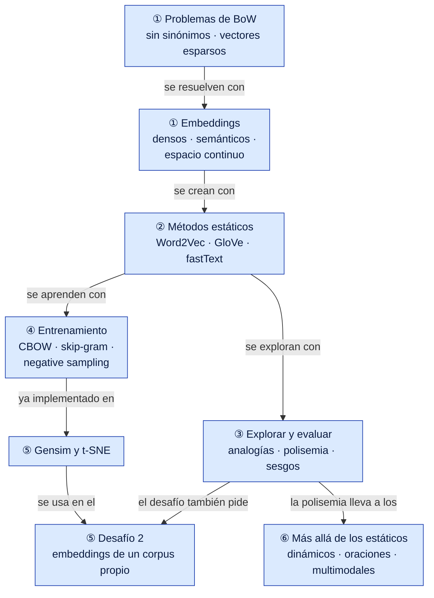
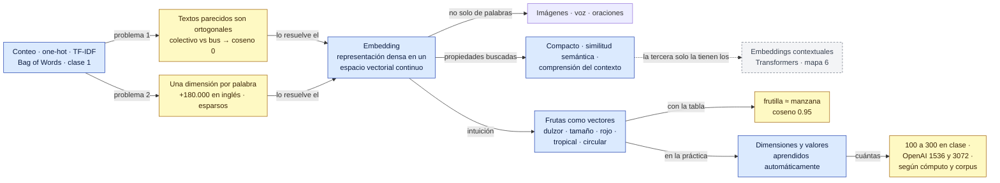
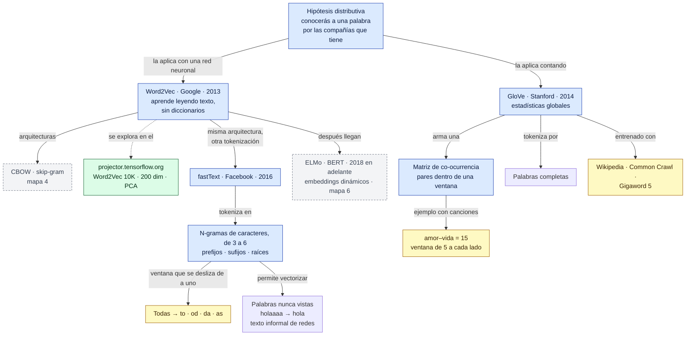
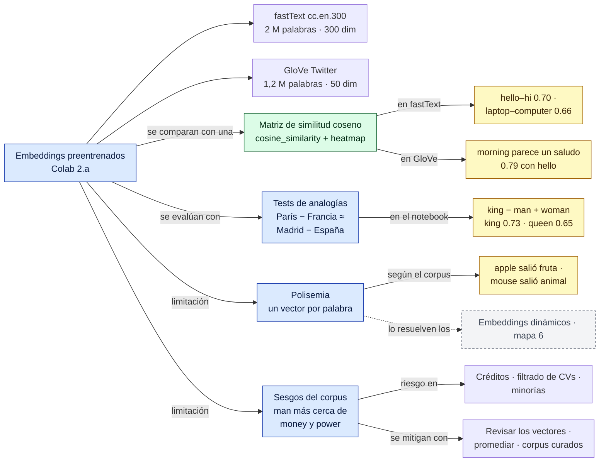
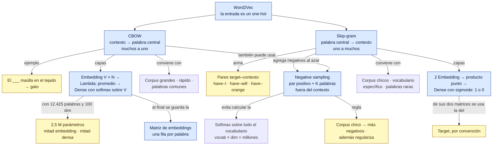
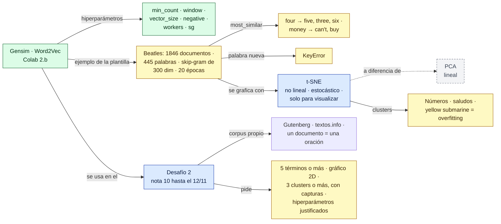
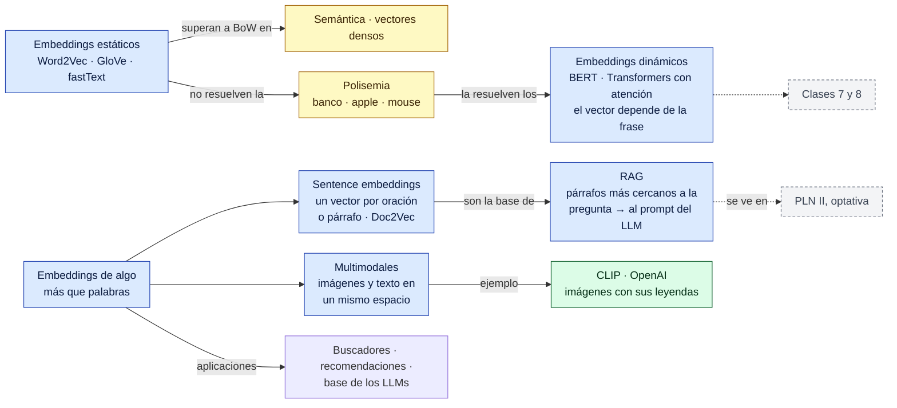

# Red conceptual — Clase 2: Word embeddings

Complemento del [resumen](resumen.md). Primero hay una vista general de toda la clase y después un mapa por bloque de temas, en el orden en que se dieron. Los números de sección (§) remiten al resumen.

**Cómo leerla**
- Cada flecha forma una frase: *CBOW → conviene con → corpus grandes*. Una flecha sin texto quiere decir "incluye".
- Las flechas punteadas unen conceptos de temas distintos.
- Colores: azul = tema · verde = librería, función o herramienta · amarillo = dato para memorizar · gris punteado = concepto que se desarrolla en otro mapa o en otra clase.

> Todo el contenido sale de la clase. La organización y las frases de las flechas son propias.

## Vista general

## 1. De Bag of Words a embeddings (§0 a §4)

## 2. Métodos estáticos: Word2Vec, GloVe y fastText (§5 a §10)

## 3. Explorar y evaluar embeddings (§11 a §15)

## 4. Entrenamiento: CBOW, skip-gram y negative sampling (§16 a §19)

## 5. Gensim, t-SNE y el desafío 2 (§20 a §25)

## 6. Cierre: más allá de los embeddings estáticos (§26 a §28)

