# Clase 2 — Word embeddings

- **Docente:** MSc. Josselyn Ordóñez. En la transcripción figura como "lse posgrados", la cuenta del posgrado.
- **Fecha:** jueves 29/10/2026, 19:00–22:00.
- **Duración:** ~2 h 50 min. Un recreo de 15 min entre ~01:07 y 01:22 y uno corto, de ~10 min, entre ~02:10 y 02:20.
- **Grabación:** pendiente (falta el link).
- **Material:** [slides](material/slides-word-embeddings.pdf) · [notebook de la clase (2a, GloVe y fastText)](material/notebook-embeddings-glove-fasttext.ipynb) · [plantilla del desafío 2 (2b, Gensim)](../../desafios/02-word-embeddings/desafio-2.ipynb) · [transcripción](material/transcripcion.txt) · [notas de Gemini](material/notas-gemini.txt) · [carpeta `Clase 2` del repo de la materia](https://github.com/FIUBA-Posgrado-Inteligencia-Artificial/procesamiento_lenguaje_natural/tree/nov_2026/Clase%202)
- **Desafío:** [Desafío 2 — word embeddings con Gensim](../../desafios/02-word-embeddings/README.md), presentado en esta clase. Nota 10 hasta el jueves 12/11.
- **Red conceptual:** [red-conceptual.md](red-conceptual.md)

> **Fuentes:** la transcripción completa, las slides, el notebook de la clase (2a) y la plantilla del desafío 2 (2b), que fue el notebook de la segunda parte. Las notas de Gemini solo se usaron para cotejar. Los tiempos `(hh:mm:ss)` marcan el bloque de la transcripción donde arranca cada tema. Lo marcado con ✎ es elaboración propia y no se dijo en clase.

---

## Repaso rápido

- **El problema de BoW y TF-IDF:** "Estoy viajando en colectivo" y "Voy arriba del bus" no comparten palabras, así que tienen similitud coseno 0 aunque digan lo mismo. Además hay una dimensión por palabra del vocabulario (más de 180.000 en inglés): vectores esparsos que no aprovechan la dimensionalidad.
- **Embedding:** representación **densa** de una palabra (o de una imagen, una voz, una oración) en un **espacio vectorial continuo**. Se buscan tres propiedades: representación compacta, similitud semántica y comprensión del contexto.
- **Intuición de las frutas:** cada dimensión es un atributo (dulzor, tamaño, rojo, tropical, circular). Con valores puestos a mano, la frutilla y la manzana quedan cerca. Los métodos reales aprenden solos las dimensiones y sus valores. En clase se usan de 100 a 300 dimensiones; los embeddings de OpenAI tienen 1536 y 3072.
- **Línea de tiempo:**
  - **Word2Vec** (Google, 2013): CBOW y skip-gram.
  - **GloVe** (Stanford, 2014): matriz de co-ocurrencia, estadísticas globales.
  - **fastText** (Facebook, 2016): n-gramas de caracteres, palabras desconocidas.
  - **ELMo y BERT** (2018 en adelante): embeddings dinámicos o contextuales, con Transformers.
- **Hipótesis distributiva:** "conocerás a una palabra por las compañías que tiene" ("dime con quién andas…"). Word2Vec aprende el significado leyendo mucho texto, sin diccionarios.
- **GloVe:** cuenta cuántas veces aparecen juntas dos palabras dentro de una ventana y arma una matriz de co-ocurrencia de todo el corpus. Tokeniza por palabras y se entrenó con Wikipedia, Common Crawl y Gigaword 5.
- **fastText:** usa las arquitecturas de Word2Vec (CBOW y skip-gram) pero tokeniza en **n-gramas de caracteres** (de 3 a 6). Así entiende prefijos, sufijos y raíces, y arma vectores para palabras que nunca vio ("holaaaa"), algo clave en el texto informal de las redes sociales.
- **N-grama:** subsecuencia de N elementos tomada con una ventana que se desliza de a uno. Los bigramas de caracteres de "Todas" son *to, od, da, as*.
- **Tests de analogías:** París − Francia ≈ Madrid − España (≈ "capital"); rey − hombre + mujer ≈ reina. Si la similitud coseno entre los dos lados da cerca de 1, los embeddings capturaron la relación.
- **Limitaciones de los embeddings estáticos:**
  - **Polisemia:** un solo vector por palabra mezcla sus sentidos (*apple* salió fruta y *mouse*, animal).
  - **Sesgos:** capturan los del corpus (*man* queda más cerca de *money* y *power* que *woman*) y los amplifican si se usan sin revisar, por ejemplo para dar créditos o filtrar CVs.
- **CBOW:** predice la palabra central a partir del contexto ("El ___ maúlla en el tejado"). Es muchos a uno, rápido y bueno con corpus grandes y palabras comunes. One-hot → matriz de embeddings → promedio → capa densa con softmax sobre el vocabulario.
- **Skip-gram:** al revés: con la palabra central predice el contexto, por pares [target, contexto], con producto punto y sigmoide. Es uno a muchos, más lento pero más preciso con las palabras raras, y mejor con corpus chicos o vocabulario específico.
- **Lo que se guarda:** la matriz de embeddings (vocabulario × dimensión), donde cada fila es el vector de una palabra. Skip-gram tiene dos matrices y por convención se usa la del target.
- **Parámetros:** con 12.425 palabras y 100 dimensiones, CBOW entrena 2,5 millones de parámetros, mitad en la embedding y mitad en la densa.
- **Negative sampling:** en vez de calcular la softmax sobre todo el vocabulario, cada paso usa el par positivo y K palabras al azar como negativas. Ahorra cómputo y regulariza. Con un corpus chico, más negativos.
- **t-SNE:** reducción de dimensionalidad **no lineal** (PCA es lineal) para graficar en 2D o 3D. Es estocástica: cambia entre corridas, así que sirve solo para visualizar y explorar.
- **Gensim:** librería de Python (2009, nació para topic modelling) con Word2Vec ya implementado. Hiperparámetros: `min_count`, `window`, `vector_size`, `negative`, `workers` y `sg` (0 = CBOW, 1 = skip-gram).
- **Plantilla del desafío 2:** letras de los Beatles, con 1846 líneas (documentos) y 445 palabras en el vocabulario. Un skip-gram de 300 dimensiones entrenado 20 épocas en ~3 s. Queda muy sobreajustado a las canciones (*yellow* + *submarine*).
- **Palabra fuera del vocabulario:** Word2Vec da `KeyError` y hay que reentrenar. fastText no tiene ese problema.
- **Desafío 2:** embeddings propios con Gensim sobre un corpus propio (Project Gutenberg, textos.info…). Pide términos de interés con sus más y menos similares, una reducción a 2D con t-SNE y al menos 3 clusters interpretados con capturas, con los hiperparámetros justificados. Nota 10 hasta el jueves 12/11.
- **Cierre:** el estado del arte usa embeddings **dinámicos** (BERT, Transformers con atención): el vector se calcula según la frase. También hay **sentence embeddings**, que son la base de RAG, y **multimodales** (CLIP: imágenes y texto en el mismo espacio). Aplicaciones: buscadores, recomendaciones y la base de los LLMs.

---

## 0. Repaso de la clase 1 (00:00:04)

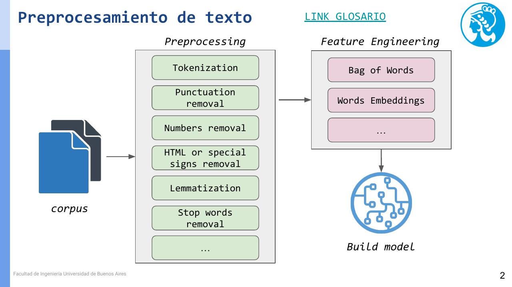

*Slide 2: corpus → preprocessing (tokenization, punctuation removal, numbers removal, HTML or special signs removal, lemmatization, stop words removal) → feature engineering (Bag of Words, Words Embeddings) → build model.*

- El corpus se divide en documentos y los documentos, en términos. Antes de vectorizar se preprocesa, y qué técnicas se usan depende del modelo: clásico, de deep learning o un LLM.
- **Lo que hay que recordar sí o sí: segmentar y tokenizar** (00:06:20). La slide 4 es la misma que la 41 de la clase 1.
  - **Segmentar** (00:07:42): dividir el texto en unidades con alguna regla: por espacios, por símbolos, dejando juntas las palabras compuestas…
  - **Tokenizar:** reemplazar cada término único por un identificador, el token.
- La tokenización está en cualquier modelo. La normalización (sacar puntuación, números y símbolos), la lematización, el stemming y las stopwords dependen del caso.
- Las técnicas de vectorización vistas son de conteo, tipo bolsa de palabras: primero el conteo simple y después TF-IDF (slide 3), que es el conteo con un factor que les baja la importancia a las palabras comunes a todos los documentos. Dan vectores **esparsos**. Detalle en el [resumen de la clase 1](../01-introduccion-vectorizacion/resumen.md), §10 y §18.
- Cualquiera sea la técnica, el vector es lo que entra al modelo.

## 1. Problemas de las técnicas de conteo (00:07:42)

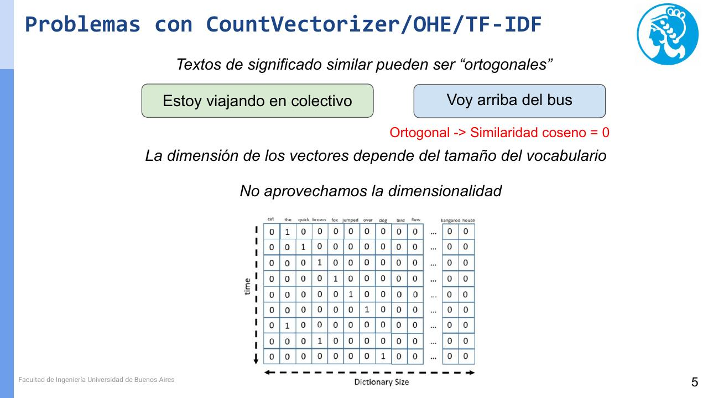

*Slide 5: "Estoy viajando en colectivo" y "Voy arriba del bus" son ortogonales: similitud coseno = 0. La dimensión de los vectores depende del tamaño del vocabulario y no se aprovecha la dimensionalidad: la matriz one-hot, tan ancha como el diccionario, está casi toda en ceros.*

El conteo, el one-hot encoding y TF-IDF son técnicas Bag of Words y tienen dos problemas en común:

1. **Textos de significado parecido pueden ser ortogonales.** ¿Qué similitud coseno tienen "Estoy viajando en colectivo" y "Voy arriba del bus"? **Cero**, respondió Gonzalo (00:09:04), porque no comparten ninguna palabra. *Colectivo* y *bus* son sinónimos, pero estas técnicas no miran el significado: una palabra escrita distinto es otra palabra.
2. **La dimensión depende del vocabulario:** hay una columna por palabra. El inglés tiene más de 180.000 palabras, así que serían 180.000 columnas casi todas en cero (00:10:42): una oración de cuatro palabras llena cuatro columnas. Es una matriz muy esparsa que no aprovecha la dimensionalidad.

Los embeddings resuelven los dos problemas.

## 2. Embeddings: qué son y qué se busca (00:10:42)

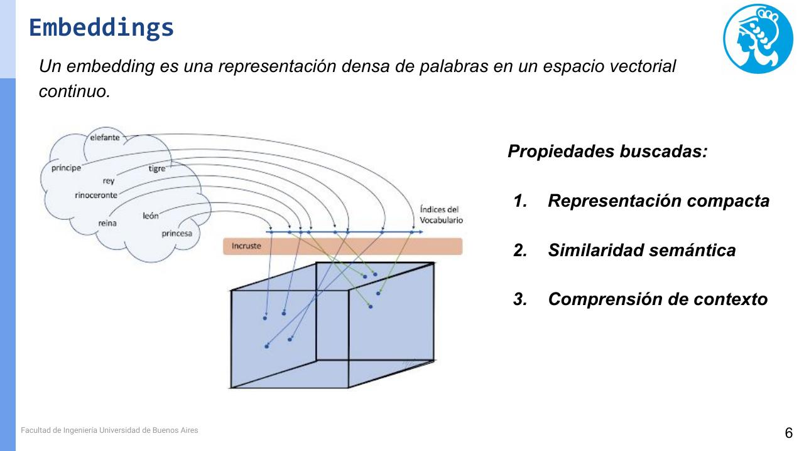

*Slide 6: "Un embedding es una representación densa de palabras en un espacio vectorial continuo". Elefante, tigre, rinoceronte, león, rey, reina, príncipe y princesa se "incrustan" desde los índices del vocabulario en un espacio de pocas dimensiones. Propiedades buscadas: representación compacta, similaridad semántica, comprensión de contexto.*

- Un embedding es una **representación densa en un espacio vectorial continuo**. Se llama **densa** porque aprovecha todas las dimensiones.
- No es solo para palabras (00:12:14). Se puede hacer un embedding de cualquier concepto abstracto: palabras, imágenes o voz. Por ejemplo, para separar a los hablantes de una transcripción se crean embeddings de la voz de cada persona. El vector captura las características que distinguen al concepto, aunque sean medio abstractas.
- **Propiedades buscadas:**
  1. **Representación compacta:** no hacen falta tantas dimensiones para capturar el valor de la palabra.
  2. **Similitud semántica:** que cuente el significado de la palabra, no solo si aparece o no en un documento.
  3. **Comprensión del contexto** (00:13:38): depende de la técnica. Los de esta clase son **a nivel de palabra**, así que el vector no cambia si cambia el contexto. Los de los **Transformers** son **contextuales**: el embedding cambia según las palabras que rodean a la palabra.

## 3. Atributos como dimensiones: el ejemplo de las frutas (00:13:38)

¿Cómo logra un vector de números representar algo abstracto como el significado de una palabra? Con un ejemplo muy simplificado: distinguir frutas por sus características.

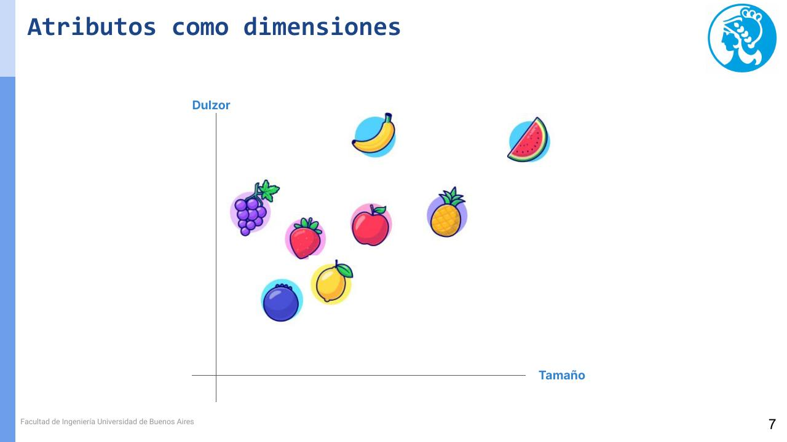

*Slide 7: frutas ubicadas en dos ejes, dulzor y tamaño. La sandía queda arriba a la derecha (grande y dulce), la banana arriba al medio y el arándano, cerca del origen.*

- Con dos dimensiones, **dulzor** y **tamaño**, cada fruta se ubica según la realidad (00:15:01). La **sandía** es grande y dulce y va en la esquina superior. La **banana** es dulce y no tan grande: arriba, al medio. El **arándano**, chico y ácido, queda cerca del origen. Cada fruta ya es un vector de dos valores en un espacio continuo.
- Dos dimensiones no alcanzan para describir una fruta (00:16:20), así que se agregan **rojo**, **tropical** y **circular**.

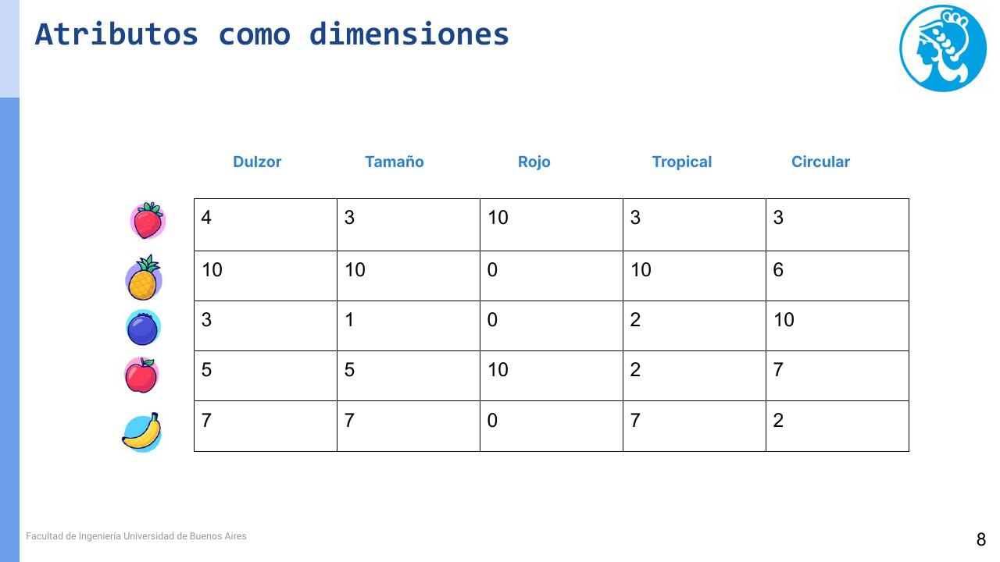

*Slide 8: cinco frutas descritas con cinco atributos.*

| | Dulzor | Tamaño | Rojo | Tropical | Circular |
|---|---|---|---|---|---|
| Frutilla (fresa) | 4 | 3 | 10 | 3 | 3 |
| Ananá (piña) | 10 | 10 | 0 | 10 | 6 |
| Arándano | 3 | 1 | 0 | 2 | 10 |
| Manzana | 5 | 5 | 10 | 2 | 7 |
| Banana (plátano) | 7 | 7 | 0 | 7 | 2 |

- El ananá es grande, dulce, más o menos circular y nada rojo (0). La manzana es roja casi entera, de dulzor y tamaño medios, poco tropical y bastante circular.
- Cada fila es el vector de una fruta: un **embedding de 5 dimensiones** armado a mano, "de forma mecánica, poco artificial".
- Con la similitud coseno (00:17:40), las frutas rojas y medianas quedan más cerca entre sí que, por ejemplo, la frutilla y la banana. ✎ Con la tabla: frutilla–manzana 0.95, ananá–banana 0.99, frutilla–banana 0.52, frutilla–arándano 0.40.
- **En la práctica** nadie define las dimensiones a mano, y cinco no alcanzan para todo el vocabulario de un idioma. Hay que encontrar las dimensiones y sus valores de forma **automática**, y eso hacen los métodos de esta clase. ✎ Las dimensiones aprendidas no tienen un nombre interpretable como "dulzor".

## 4. ¿Cuántas dimensiones? (00:17:40)

Pregunta de María Teresa, por chat. Depende de:
- **La capacidad de cómputo** (00:19:05): más dimensiones necesitan más memoria y más procesamiento.
- **El corpus:** con un corpus chico, una dimensión muy alta no ayuda, porque no hay información para llenar tantas dimensiones. Con más corpus se puede aprovechar una dimensión más grande.

En clase se usan entre **100 y 300** dimensiones. "Cinco no va a ser nunca": casi seguro más de 100 (00:20:21). Los embeddings actuales son más grandes y necesitan GPUs más grandes. Carlos averiguó los de OpenAI: **1536 y 3072** dimensiones. ✎ Son `text-embedding-3-small` (1536) y `text-embedding-3-large` (3072).

## 5. Evolución de los embeddings (00:20:21)

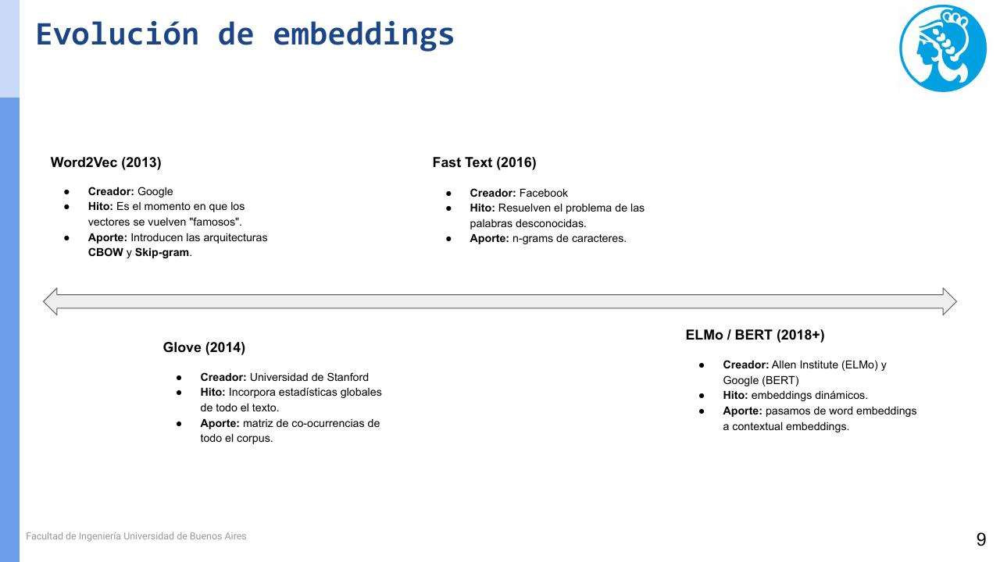

*Slide 9: línea de tiempo de los métodos.*

| Método | Año | Creador | Hito | Aporte |
|---|---|---|---|---|
| Word2Vec | 2013 | Google | Los vectores se vuelven "famosos" | Las arquitecturas **CBOW** y **skip-gram** |
| GloVe | 2014 | Universidad de Stanford | Incorpora estadísticas globales de todo el texto | Matriz de co-ocurrencias de todo el corpus |
| fastText | 2016 | Facebook | Resuelve el problema de las palabras desconocidas | N-gramas de caracteres |
| ELMo / BERT | 2018+ | Allen Institute (ELMo) y Google (BERT) | Embeddings dinámicos | De word embeddings a *contextual embeddings* |

- **Word2Vec** (00:21:45) fue el primero y el método estrella. CBOW y skip-gram son arquitecturas de redes neuronales que capturan el significado de las palabras y crean los embeddings; se ven en detalle en la segunda parte (§16 a §19).
- **GloVe** incorpora estadísticas globales: arma una matriz con qué palabras aparecen juntas en todo el corpus.
- **fastText** crea embeddings de palabras que no estaban en el corpus, con n-gramas de caracteres.
- **ELMo y BERT** (00:23:19) son el estado del arte desde 2018 y usan Transformers. Sus embeddings son **dinámicos**: el vector de una palabra cambia según el contexto. Se ven con Fernando Silva, junto con los Transformers y la atención.
- Esta clase cubre los tres primeros, los **estáticos**.

## 6. Word2Vec y la hipótesis distributiva (00:23:19)

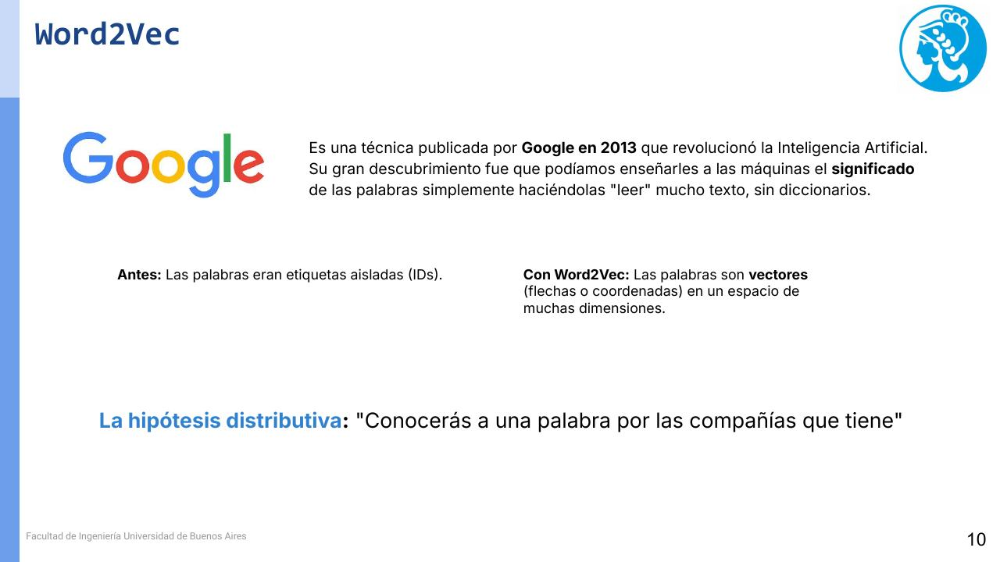

*Slide 10: Word2Vec (Google, 2013). Antes, las palabras eran etiquetas aisladas (IDs); con Word2Vec son vectores (flechas o coordenadas) en un espacio de muchas dimensiones. La hipótesis distributiva: "Conocerás a una palabra por las compañías que tiene".*

- El gran descubrimiento de Word2Vec fue enseñarles a las máquinas el significado de las palabras **haciéndolas leer mucho texto, sin diccionarios**. Los métodos anteriores usaban diccionarios o conteos; acá el modelo aprende a medida que recorre el corpus.
- **Hipótesis distributiva** (00:24:50): "conocerás a una palabra por las compañías que tiene". Es el "dime con quién andas y te diré quién eres" llevado al mundo de las palabras. ✎ La frase es de J. R. Firth (1957): *"You shall know a word by the company it keeps"*.
- Con Word2Vec se popularizó el término *embedding*: vectores en un espacio denso de muchas dimensiones que apuntan según el significado de la palabra.

## 7. El proyector de TensorFlow (00:24:50)

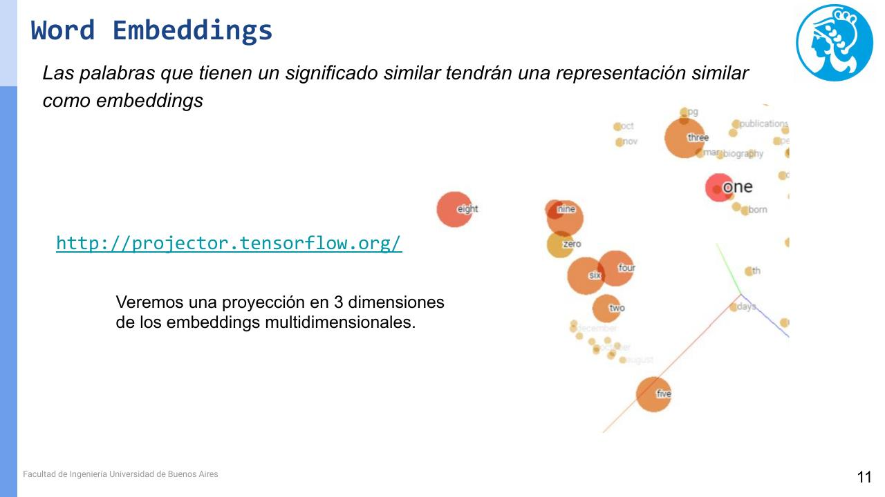

*Slide 11: "Las palabras que tienen un significado similar tendrán una representación similar como embeddings". Proyección en 3 dimensiones en [projector.tensorflow.org](http://projector.tensorflow.org/), con los números (one, two, three…) agrupados.*

- El proyector trae de ejemplo **Word2Vec 10K**: 10.000 palabras con embeddings de **200 dimensiones**, reducidos a 3D con **PCA** para graficarlos (00:27:54). Se pueden usar otras reducciones. Cada punto es una palabra.
- Al hacer clic en una palabra, a la derecha aparecen las más cercanas por **distancia coseno**, que es menor cuanto más parecidas son (00:26:21):
  - *versus* → la más cercana es *vs*, su abreviatura. Con Bag of Words, estas dos palabras serían ortogonales.
  - ✎ Probablemente *income* → *capital, revenues, household, tax, taxes, revenue, poverty, earnings*: agrupa palabras de categorías parecidas.
  - *printer* → *printers, printing, controller, graphics*: plurales, conjugaciones y palabras del mismo tema.
- **Pregunta de Elian:** ¿qué pasa con las palabras en español? Depende del corpus de entrenamiento (00:29:15). Este es en inglés: una palabra en español no tiene vector y no se puede relacionar. Hay versiones entrenadas con corpus multilingües, que relacionan idiomas por ejemplo con traducciones; hay que revisar la descripción de cada una.

## 8. GloVe: la matriz de co-ocurrencia (00:29:15)

La hipótesis de GloVe es parecida a la de Word2Vec, porque la co-ocurrencia también es mirar a los vecinos, pero trabaja con una **matriz de co-ocurrencia** de palabras. Un ejemplo simplificado con letras de canciones:

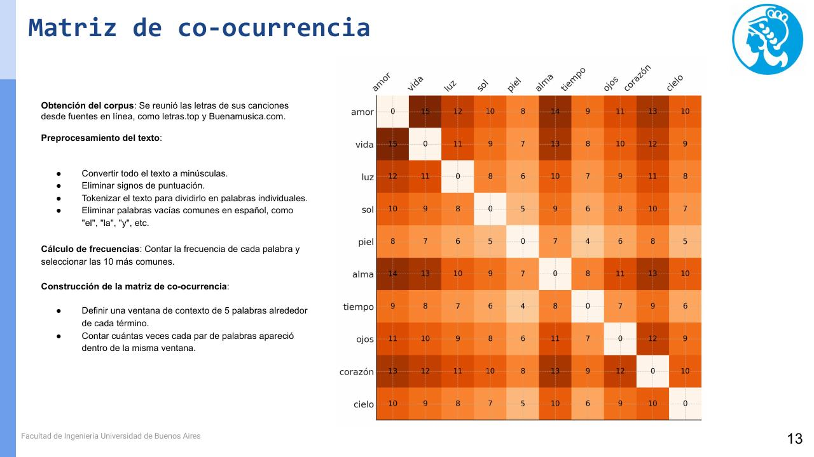

*Slide 13: matriz de co-ocurrencia de las 10 palabras más comunes en letras de canciones en español.*

1. **Corpus** (00:30:38): letras de canciones sacadas de letras.top y buenamusica.com.
2. **Preprocesamiento:** minúsculas, sin puntuación, tokenización por palabra y sin stopwords en español ("el", "la", "y"…).
3. **Frecuencias:** se cuentan y se toman las **10 palabras más comunes**. Es solo para poder visualizarlo; en la técnica real entran todas.
4. **Co-ocurrencia:** con una **ventana de contexto de 5 palabras** alrededor de cada término (5 antes y 5 después), se cuenta cuántas veces cada par aparece dentro de la misma ventana.

| | amor | vida | luz | sol | piel | alma | tiempo | ojos | corazón | cielo |
|---|---|---|---|---|---|---|---|---|---|---|
| **amor** | 0 | 15 | 12 | 10 | 8 | 14 | 9 | 11 | 13 | 10 |
| **vida** | 15 | 0 | 11 | 9 | 7 | 13 | 8 | 10 | 12 | 9 |
| **luz** | 12 | 11 | 0 | 8 | 6 | 10 | 7 | 9 | 11 | 8 |
| **sol** | 10 | 9 | 8 | 0 | 5 | 9 | 6 | 8 | 10 | 7 |
| **piel** | 8 | 7 | 6 | 5 | 0 | 7 | 4 | 6 | 8 | 5 |
| **alma** | 14 | 13 | 10 | 9 | 7 | 0 | 8 | 11 | 13 | 10 |
| **tiempo** | 9 | 8 | 7 | 6 | 4 | 8 | 0 | 7 | 9 | 6 |
| **ojos** | 11 | 10 | 9 | 8 | 6 | 11 | 7 | 0 | 12 | 9 |
| **corazón** | 13 | 12 | 11 | 10 | 8 | 13 | 9 | 12 | 0 | 10 |
| **cielo** | 10 | 9 | 8 | 7 | 5 | 10 | 6 | 9 | 10 | 0 |

- *Amor* y *vida* aparecieron juntas 15 veces dentro de la ventana; *amor* y *luz*, 12.
- **Cada fila ya es un vector** (00:32:03). Esto captura relaciones porque las palabras suelen aparecer junto a otras de significado parecido o relacionado: *amor* con *corazón*, *vida* o *alma*, o *luz* con *sol*.
- La premisa es la misma que en Word2Vec: conocer una palabra por las que la acompañan. GloVe lo hace **contando** dentro de una ventana; Word2Vec entrena una red neuronal.
- ✎ La matriz es simétrica, porque que *amor* aparezca cerca de *vida* es lo mismo que al revés, y la diagonal es 0.

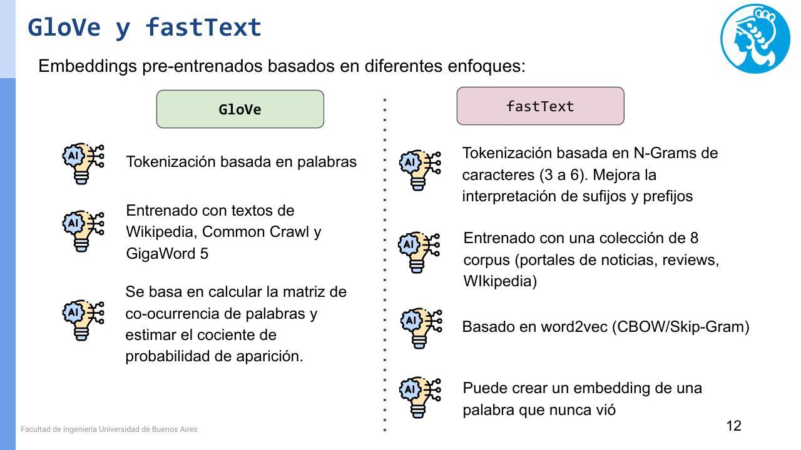

*Slide 12, repetida como slide 14: GloVe y fastText, embeddings preentrenados con enfoques diferentes.*

| | GloVe | fastText |
|---|---|---|
| Tokenización | Por palabras | Por n-gramas de caracteres (3 a 6): mejora la interpretación de sufijos y prefijos |
| Entrenamiento | Textos de Wikipedia, Common Crawl y Gigaword 5 | Una colección de 8 corpus (portales de noticias, reviews, Wikipedia) |
| Cómo funciona | Calcula la matriz de co-ocurrencia de palabras y estima el cociente de probabilidad de aparición | Basado en Word2Vec (CBOW / skip-gram) |
| Palabras nuevas | No | Puede crear el embedding de una palabra que nunca vio |

- **GloVe** (00:33:22): la unidad mínima es la palabra. Sus textos de entrenamiento son mayormente en inglés, pero hay versiones entrenadas en otros idiomas.
- ✎ Sobre el "cociente de probabilidad" de la slide: GloVe no usa los conteos tal cual. Ajusta los vectores para que el producto punto de dos palabras aproxime el logaritmo de cuántas veces aparecen juntas. Así, los cocientes de probabilidades quedan codificados como diferencias de vectores. El ejemplo del paper compara *hielo* y *vapor*: el cociente P(k | hielo) / P(k | vapor) es alto con k = *sólido*, bajo con k = *gas* y cercano a 1 con k = *agua*. La función de costo (Pennington et al., 2014) usa X_ij, la cantidad de co-ocurrencias, y una ponderación f que limita el peso de los pares muy frecuentes:

```math
J = \sum_{i,j=1}^{V} f(X_{ij}) \left( w_i^\top \tilde{w}_j + b_i + \tilde{b}_j - \log X_{ij} \right)^2
```

## 9. fastText: n-gramas de caracteres (00:33:22)

- Lo que hay que recordar de fastText es **la tokenización**. GloVe y Word2Vec tokenizan por palabra; fastText usa **n-gramas de caracteres**: ya no toma la palabra completa, sino que la divide en grupos de 3, 4, 5 o 6 caracteres. Así interpreta el significado a nivel de **sufijos, prefijos y raíces**.
- Lo creó Facebook, y gracias a ese método puede armar embeddings de **palabras que no estaban en la base de entrenamiento**.

**¿Por qué le interesaba eso a Facebook?** (00:34:51) Gonzalo dijo que para predecir mejor la escritura, y porque en las redes se escribe con términos que no están en el diccionario. Vicky, que por los hashtags. Carlos, que por la informalidad del texto. La docente se quedó con lo último (00:36:18):
- Los hashtags se pueden limpiar en el preprocesamiento. Lo que no se resuelve fácil son las **variaciones del lenguaje de las redes**: texto informal, palabras mal escritas a propósito, caracteres de más. Para saludar con emoción alguien escribe "hola" con muchas "a".
- Un método que toma la palabra como token no reconoce "holaaaa", porque nunca la vio. fastText la mira por caracteres: encuentra la parte "hola" dentro de esa combinación nueva y deduce el significado.
- Según la docente, lo entrenaron con sus redes, portales de noticias, reviews y Wikipedia. ✎ Los vectores publicados no usan datos de Facebook: los de inglés se entrenaron con Wikipedia, noticias y Common Crawl.
- Las técnicas de entrenamiento son las de Word2Vec, **CBOW y skip-gram** (00:37:36). Lo que cambia es la forma de tokenizar, y la ventaja es poder deducir el significado de palabras nunca vistas.
- ✎ Cómo lo hace (Bojanowski et al., 2017): cada palabra se rodea con `<` y `>` y su vector es la **suma** de los vectores de sus n-gramas, incluida la palabra completa. Con n = 3, *where* se representa con `<wh`, `whe`, `her`, `ere`, `re>` y `<where>`. El vector de una palabra desconocida se arma sumando los n-gramas que sí se vieron:

```math
\mathbf{v}_{w} = \sum_{g \in \mathcal{G}_w} \mathbf{z}_g
```

## 10. N-gramas de palabras y de caracteres (00:37:36)

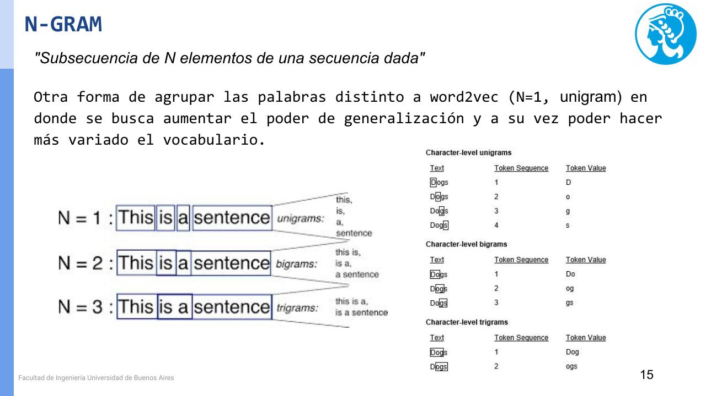

*Slide 15: "Subsecuencia de N elementos de una secuencia dada". Otra forma de agrupar las palabras, distinta de Word2Vec (N = 1, unigramas), que busca aumentar el poder de generalización y hacer más variado el vocabulario. A nivel de palabra, "This is a sentence" da unigramas (this, is, a, sentence), bigramas (this is, is a, a sentence) y trigramas (this is a, is a sentence). A nivel de carácter, "Dogs" da D, o, g, s; Do, og, gs; y Dog, ogs.*

- Un n-grama es una **subsecuencia** de elementos, a nivel de palabra o de carácter.
- **Por palabras:** con N = 1 se toma palabra por palabra; con N = 2 se agarra de a dos palabras ("this is", "is a", "a sentence"); con N = 3, de a tres.

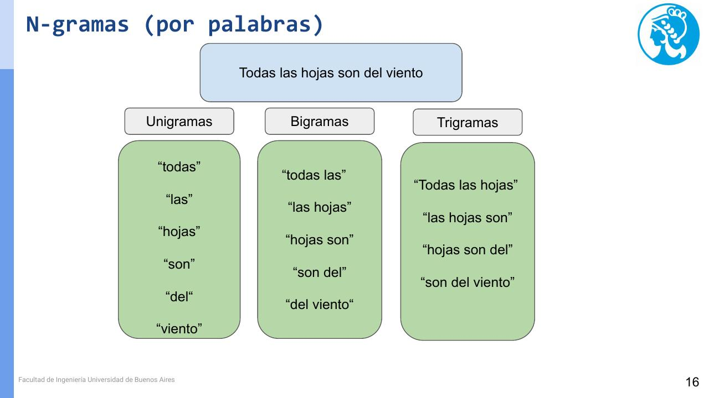

*Slide 16: "Todas las hojas son del viento". Unigramas: todas, las, hojas, son, del, viento. Bigramas: todas las, las hojas, hojas son, son del, del viento. Trigramas: todas las hojas, las hojas son, hojas son del, son del viento.*

- **Por caracteres** (00:39:03) es lo mismo, pero con caracteres. Los unigramas dividen la oración en cada carácter (t, o, d, a, s…). Los bigramas se arman deslizando la ventana de a un carácter: *to*, *od*, *da*… Los trigramas, igual, de a tres.

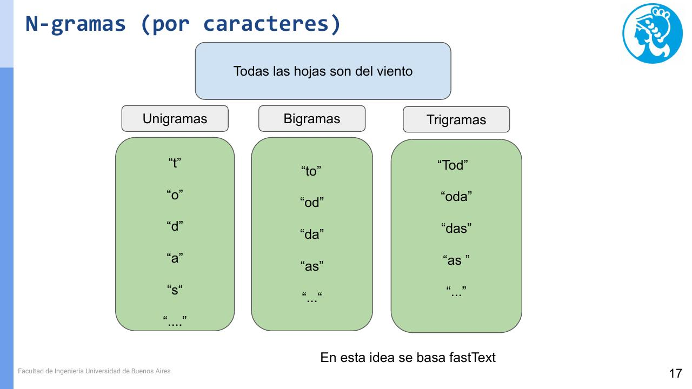

*Slide 17: n-gramas de caracteres de "Todas las hojas son del viento". Unigramas: t, o, d, a, s… Bigramas: to, od, da, as… Trigramas: Tod, oda, das, "as "… "En esta idea se basa fastText".*

- **No es una división en bloques de 3**: la ventana se va corriendo de a uno. Se puede elegir un solo carácter, tres o más; la idea es no quedarse en el nivel de palabra.

## 11. Tests de analogías (00:40:20)

Hace falta alguna forma de comparar unos embeddings con otros. Como son números, se pueden **sumar y restar**, y con esas operaciones se arman analogías: dos pares de palabras con la misma relación deberían dar vectores parecidos.

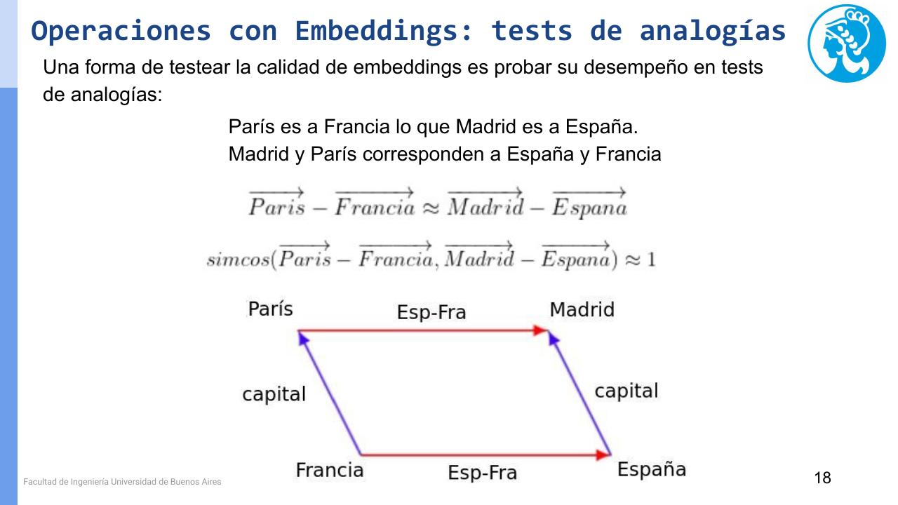

*Slide 18: "Una forma de testear la calidad de embeddings es probar su desempeño en tests de analogías". París es a Francia lo que Madrid es a España. En el paralelogramo, Francia → París y España → Madrid son la relación "capital", y Francia → España y París → Madrid, la relación "Esp-Fra".*

- ¿Qué queda si a París se le quita todo lo que significa Francia? **Capital**, respondió Carlos (00:41:53). Y lo mismo con Madrid menos España. Las dos operaciones deberían dar algo parecido:

```math
\vec{\text{París}} - \vec{\text{Francia}} \approx \vec{\text{Madrid}} - \vec{\text{España}}
```

```math
\operatorname{sim}_{\cos}\left(\vec{\text{París}} - \vec{\text{Francia}},\ \vec{\text{Madrid}} - \vec{\text{España}}\right) \approx 1
```

- Si la similitud coseno da cerca de 1 (00:43:18), los embeddings capturaron la relación entre capitales y países. Si da lejos, capturaron otro tipo de significado.
- ✎ Despejando sale la forma más común: Madrid ≈ París − Francia + España. Se busca la palabra más cercana a ese vector, sin contar las tres de la consulta. Mikolov et al. (2013) publicaron un set estándar de unas 19.500 analogías en inglés. Las hay semánticas (capital-país, masculino-femenino) y sintácticas (plurales, tiempos verbales).

## 12. Práctica: GloVe y fastText preentrenados (Colab 2.a) (00:43:18)

Es el [notebook de la clase](material/notebook-embeddings-glove-fasttext.ipynb) (slide 19). Más que el código, la idea es **explorar embeddings ya entrenados** de GloVe y fastText.

**Carga de los embeddings (00:45:09)**
- Lo más rápido es bajarlos de un Google Drive con `gdown`: `fasttext.pkl` pesa 2,88 GB y `gloveembedding.pkl`, 525 MB. Si el Drive deja de estar disponible, el notebook trae los links oficiales:
  - GloVe: `glove.twitter.27B.zip` de Stanford, del que se usa solo el de **50 dimensiones**.
  - fastText: `cc.en.300.vec.gz` de Facebook, de **300 dimensiones**.
- Una clase general, `WordsEmbeddings`, y dos hijas, `GloveEmbeddings` y `FasttextEmbeddings`, permiten operar igual con los dos. Tienen `word2idx` e `idx2word` para ir de palabra a índice y al revés, y `get_words_embeddings(words)`. ✎ Al final agregan un `null_embedding` de ceros: una palabra desconocida da el índice −1 y cae en ese vector nulo.
- `embeddings_matrix_distance` calcula la matriz de similitud con `sklearn.metrics.pairwise.cosine_similarity` y `plot_matrix_distance` la grafica como heatmap con seaborn. Un comentario del código avisa que en scipy la *distancia* coseno no es la similitud, sino 1 − similitud.
- fastText tiene **2.000.001 palabras** (2 millones más el vector nulo) y GloVe, 1.193.514 entradas (00:46:49). La docente creía que el de fastText tenía varios idiomas. ✎ `cc.en.300` es el modelo de inglés entrenado con Common Crawl; hay uno por idioma, como `cc.es.300` para español.

**Saludos y dispositivos con fastText (00:46:49)**

Se comparan *hi, hello, bye, goodbye, morning*, que son saludos, con *computer, machine, laptop, device, printer*, que son dispositivos. Similitud coseno según la salida guardada en el notebook:

| | hi | hello | bye | goodbye | morning | computer | machine | laptop | device |
|---|---|---|---|---|---|---|---|---|---|
| **hello** | **0.70** | | | | | | | | |
| **bye** | 0.38 | 0.52 | | | | | | | |
| **goodbye** | 0.35 | 0.62 | 0.60 | | | | | | |
| **morning** | 0.15 | 0.23 | 0.27 | 0.26 | | | | | |
| **computer** | 0.13 | 0.11 | 0.09 | 0.08 | 0.14 | | | | |
| **machine** | 0.09 | 0.08 | 0.05 | 0.05 | 0.14 | 0.47 | | | |
| **laptop** | 0.18 | 0.13 | 0.14 | 0.14 | 0.17 | **0.66** | 0.35 | | |
| **device** | 0.05 | 0.06 | 0.04 | 0.07 | −0.02 | 0.43 | 0.38 | 0.38 | |
| **printer** | 0.12 | 0.09 | 0.02 | 0.02 | 0.10 | 0.46 | 0.41 | 0.40 | 0.37 |

- Se forman dos **subgrupos**, los saludos por un lado y los dispositivos por otro. Entre palabras de categorías distintas la similitud es cercana a 0.
- *Hello* y *hi* tienen la similitud más alta (00:48:13), porque son casi sinónimos y uno es más informal. *Laptop* y *computer* también son sinónimos y tienen una similitud alta.
- *Morning*, que suele ir en *good morning*, no se parece tanto a los saludos: toma más el sentido de momento del día. Está apenas más cerca de *goodbye* que de los demás saludos.
- *Computer*–*printer* y *device*–*laptop* están relacionadas, pero menos que los sinónimos.

## 13. Polisemia: un solo vector por palabra (00:49:38)

Después se agregaron en vivo palabras que sugirió la clase. Estos resultados no quedaron guardados en el notebook.
- ***Apple***, que es marca y fruta, comparada con *computer*, *machine* y *banana*: con *computer* y *machine* dio baja, aunque no cero, y con *banana*, muy alta. En estos embeddings ***apple* es más fruta que marca**.
- Qué sentido gana depende del **corpus de entrenamiento** (00:51:12). Con revistas de tecnología, *apple* quedaría cerca de *computer*; con recetas de cocina, cerca de *banana*.
- ***Mouse*** comparada con *cat* y *laptop*: *mouse*–*cat* da muy alta y *mouse*–*laptop* no es cero, pero da bastante menos. Acá *mouse* es más animal que dispositivo (00:52:36).
- **Primera contra de estos embeddings:** son **vectores fijos**. Una palabra con dos significados en contextos distintos tiene un solo vector, y en ese vector se mezclan los dos sentidos.

## 14. Sesgos en los embeddings (00:52:36)

Con *power*, *money*, *man* y *woman*, ***man* sale más relacionado con *money* y *power* que *woman***. ¿Por qué?
- Martín: por el corpus con el que se entrenó. Un texto de política habla de presidentes, y en Estados Unidos todos los presidentes fueron hombres. Nicolás: por los salarios.
- Los embeddings **capturan los sesgos de la sociedad** (00:54:35). Lo que escribimos refleja lo que pensamos y realidades que ocurren: hay estudios que miden la brecha salarial entre hombres y mujeres. *Ingeniero* probablemente también salga más relacionado con *hombre*. Es texto escrito por humanos.

**El problema es cómo se usan.** Supongamos que estos vectores se usan tal cual para decidir a quién darle un crédito (00:55:58). El modelo puede terminar diciendo que el hombre puede pagar más y merece más crédito: un **sesgo machista**, en palabras de Martín. Un modelo así **amplifica** las diferencias. Otros casos donde hay que tener cuidado:
- Prejuicios con minorías, razas o colores de piel, como señaló Gonzalo (00:57:29).
- **El filtrado de CVs:** muchas empresas usan modelos de lenguaje para decidir si un CV calza con una vacante o quién pasa a la entrevista. Hay que revisar que el modelo no priorice por nacionalidad, género o algún grupo minoritario.

Cuando por ética hay que ser equitativo, **hay que inspeccionar los vectores antes de usarlos** (00:58:58). Martín preguntó cómo corregirlo:
- Ajustar los vectores: por ejemplo, **promediar** los de *hombre* y *mujer*, o las dimensiones en las que no se quiere distinción (01:00:16).
- Usar **corpus curados** o limpiar el corpus: el problema no está solo en los embeddings, empieza en el corpus.
- Para detectar los sesgos sirven estos mismos análisis: graficar las relaciones entre palabras.
- La docente ofreció mandar por mail el material de un taller de equidad.
- ✎ El trabajo clásico es "Man is to Computer Programmer as Woman is to Homemaker?" (Bolukbasi et al., 2016). Encuentra una "dirección de género" (por ejemplo, *he* − *she*) y la anula en las palabras que deberían ser neutras (*neutralize*). También iguala pares como *abuelo*/*abuela* respecto del resto de las palabras (*equalize*).

## 15. Analogías en el notebook (01:00:16)

**Rey − hombre + mujer.** ¿Qué palabra debería dar? **Reina**, respondió Hernando.

```math
\vec{\text{king}} - \vec{\text{man}} + \vec{\text{woman}} = \vec{\text{new\_queen}} \approx \vec{\text{queen}}
```

- El vector resultante se llamó `new_queen` y se agregó a la matriz para compararlo con el resto (01:01:37):

| | king | man | woman | queen |
|---|---|---|---|---|
| **man** | 0.34 | | | |
| **woman** | 0.22 | 0.77 | | |
| **queen** | 0.71 | 0.23 | 0.36 | |
| **new_queen** | **0.73** | −0.27 | 0.01 | **0.65** |

- Queda muy cerca de *king* (0.73), algo lógico porque se partió de *king* y conserva muchas de sus características. También se parece bastante a *queen* (0.65), así que el experimento salió bien. Quedó lejos de *woman*: tal vez debería estar más cerca.
- **Las 10 palabras más cercanas a `new_queen`** en todo el vocabulario de fastText (01:03:01) fueron *king* 0.73, *queen* 0.65, *kings* 0.54, *queen-mother* 0.53, *Queen* 0.51, *royal* 0.50, *king-* 0.49, *queens* 0.49, *monarch* 0.49 y *queenship* 0.48. Hay muchas variantes de *queen*, porque el vocabulario está un poco sucio, y todas están relacionadas.
- ✎ En un test de analogías se excluyen las palabras de la consulta: sin *king*, la respuesta sería *queen*. Es lo que hace `most_similar` de Gensim.

**Rey − hombre.** ¿Qué concepto queda? Elian propuso *plebeyo*, que según la docente sería al revés. Hernando dijo **realeza**, y por chat alguien dijo *aristocracia*: un rey es un hombre con realeza, y si se le quita lo de hombre queda la realeza. Se comparó `no_king` = *king* − *man* con *anarchy*, *monarchy*, *kingdom*, *crown* y *royal*:

| | anarchy | monarchy | kingdom | crown | royal |
|---|---|---|---|---|---|
| **monarchy** | 0.47 | | | | |
| **kingdom** | 0.34 | 0.50 | | | |
| **crown** | 0.13 | 0.48 | 0.40 | | |
| **royal** | 0.20 | 0.60 | 0.49 | 0.50 | |
| **no_king** | 0.00 | 0.24 | 0.23 | 0.23 | **0.33** |

- Se parece más a *royal* (realeza), aunque no mucho: *king* contiene otros significados además de la realeza, como poder o riqueza.
- Para la docente, *anarchy* da lo opuesto (01:04:42): un rey gobierna, lo contrario de la anarquía. ✎ Con 0.00, más que opuesta queda sin relación; opuesta sería una similitud cerca de −1 (ver §20 de la clase 1).

**Rey − realeza.** Debería quedar solo *hombre*. Con `new_man` = *king* − *royal* da *king* 0.63, *queen* 0.39, *man* 0.25 y *woman* 0.08. **Sigue pareciéndose a rey**: *king* tiene otros significados además de la realeza, y habría que restarle más conceptos para llegar a un plebeyo (01:06:23).

**GloVe (opcional).** El notebook repite la comparación de saludos y dispositivos con GloVe, que en clase quedó como opcional. Con los vectores de Twitter de 50 dimensiones:

| | hi | hello | bye | goodbye | morning | computer | machine | laptop | device |
|---|---|---|---|---|---|---|---|---|---|
| **hello** | **0.81** | | | | | | | | |
| **bye** | 0.61 | 0.74 | | | | | | | |
| **goodbye** | 0.54 | 0.77 | 0.70 | | | | | | |
| **morning** | 0.65 | **0.79** | 0.75 | 0.75 | | | | | |
| **computer** | 0.37 | 0.41 | 0.35 | 0.40 | 0.40 | | | | |
| **machine** | 0.29 | 0.40 | 0.25 | 0.39 | 0.45 | 0.69 | | | |
| **laptop** | 0.32 | 0.40 | 0.43 | 0.36 | 0.36 | **0.81** | 0.57 | | |
| **device** | 0.18 | 0.28 | 0.08 | 0.24 | 0.29 | 0.78 | 0.69 | 0.64 | |
| **printer** | 0.21 | 0.30 | 0.17 | 0.20 | 0.26 | 0.69 | 0.60 | 0.78 | 0.69 |

El notebook concluye que distintos embeddings capturan distintas relaciones, y en distinto grado. En GloVe, *morning* queda muy relacionado con los saludos, algo que podría no ser deseado; en fastText, la similitud entre los dos grupos no es tan alta. ✎ Lo explica que este GloVe se haya entrenado con tweets, donde *good morning* es un saludo. Además, en GloVe 50d todas las similitudes son más altas: los valores solo se pueden comparar dentro de un mismo modelo.

Después vino el recreo de 15 minutos (01:06:23).

## 16. CBOW: adivinar la palabra por su contexto (01:24:20)

Word2Vec introdujo dos técnicas, **CBOW** (*continuous bag of words*) y **skip-gram**. fastText usa las mismas, así que entendiéndolas se entienden los dos: la diferencia es solo la tokenización. Al final se usa una librería con la lógica ya construida (Gensim, §21), pero hay que entender cómo funciona para saber interpretar los resultados.

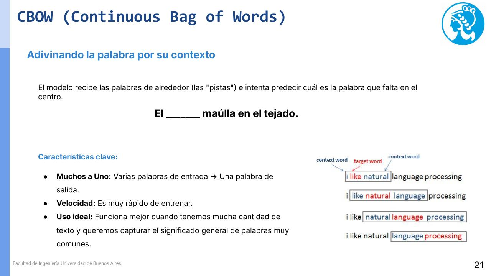

*Slide 21: CBOW, adivinando la palabra por su contexto. El modelo recibe las palabras de alrededor (las "pistas") e intenta predecir cuál falta en el centro: "El ___ maúlla en el tejado". Características clave: muchos a uno (varias palabras de entrada → una de salida), es muy rápido de entrenar y funciona mejor con mucho texto, para capturar el significado general de palabras muy comunes.*

- "El ___ maúlla en el tejado" (01:25:38): **gato**, respondió Hernando. Es fácil porque sabemos que los gatos maúllan y que les gusta el tejado: **el contexto da información suficiente sobre la palabra**. Si se miran muchas oraciones con *gato*, aparece relacionada con *maullar*, *tejado*, *bigotes*, *patas*, *cola*… y esos conceptos de a poco la van describiendo. Con más ejemplos se aprende más sobre su significado.
- **Características** (01:27:02):
  - Una **ventana de contexto** de tamaño variable (por ejemplo, una palabra antes y una después) y una palabra **target** en el medio. Se le da al modelo "I … natural" y tiene que devolver *like*.
  - Es **muchos a uno**: varias palabras de entrada y una de salida.
  - Es **rápido** comparado con skip-gram, porque hace una sola pasada por cada palabra target.
  - Es **ideal con un corpus grande**, cuando interesa el significado general de las palabras, sobre todo de las comunes. No es tan bueno con palabras muy específicas (01:28:24).
- **Cómo funciona:** recibe los vectores de las palabras del contexto (con ventana 2, dos antes y dos después) y normalmente los **promedia**, aunque podría ser otra operación. Una capa más compara ese vector con todo el vocabulario para decidir cuál es la palabra central. Da la probabilidad de que, dado ese contexto, cada palabra sea la del medio.

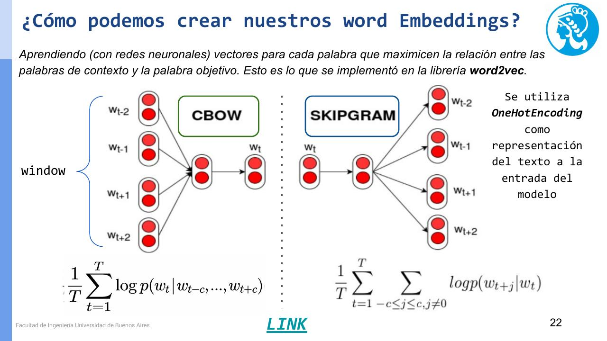

*Slide 22: "¿Cómo podemos crear nuestros word embeddings?" Aprendiendo con redes neuronales vectores que maximicen la relación entre las palabras de contexto y la palabra objetivo; es lo que implementa la librería word2vec. CBOW va de w(t−2), w(t−1), w(t+1), w(t+2) a w(t); skip-gram, de w(t) a su contexto. A la entrada del modelo, el texto se representa con one-hot encoding.*

Los objetivos de la slide, con T palabras en el corpus y una ventana de c palabras a cada lado. CBOW maximiza la probabilidad de la palabra central dado el contexto:

```math
\frac{1}{T} \sum_{t=1}^{T} \log p\left(w_t \mid w_{t-c}, \dots, w_{t+c}\right)
```

Skip-gram, la de cada palabra del contexto dada la central (01:29:57):

```math
\frac{1}{T} \sum_{t=1}^{T} \sum_{\substack{-c \le j \le c \\ j \neq 0}} \log p\left(w_{t+j} \mid w_t\right)
```

En los dos casos la entrada es un **one-hot**, que se transforma en el vector de la palabra buscándolo en la matriz que se va construyendo durante el entrenamiento.

## 17. Cómo se entrena CBOW (01:31:20)

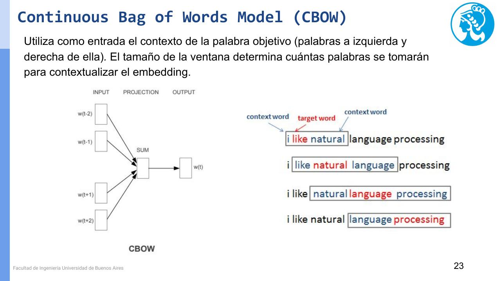

*Slide 23: CBOW usa como entrada el contexto de la palabra objetivo, a izquierda y derecha, y el tamaño de la ventana determina cuántas palabras se toman. Input w(t−2), w(t−1), w(t+1), w(t+2) → suma (projection) → output w(t). Ejemplos con "i like natural language processing" y ventana 1: (i, natural) → like; (like, language) → natural; (natural, processing) → language.*

- **Armado de los ejemplos:** se define la ventana (acá, de 1) y se recorre el corpus de a una palabra. Primero se predice *like* con *I* y *natural*; después, *natural* con *like* y *language*; después, *language* con *natural* y *processing*. Así salen los ejemplos de entrenamiento.
- **Las dimensiones** (01:32:31): con embeddings de dimensión m y un vocabulario de n palabras, hay una matriz con el vector de cada palabra. El one-hot de cada palabra del contexto saca su vector, los vectores se promedian o se suman en uno solo y otra capa da una probabilidad para cada una de las n palabras.

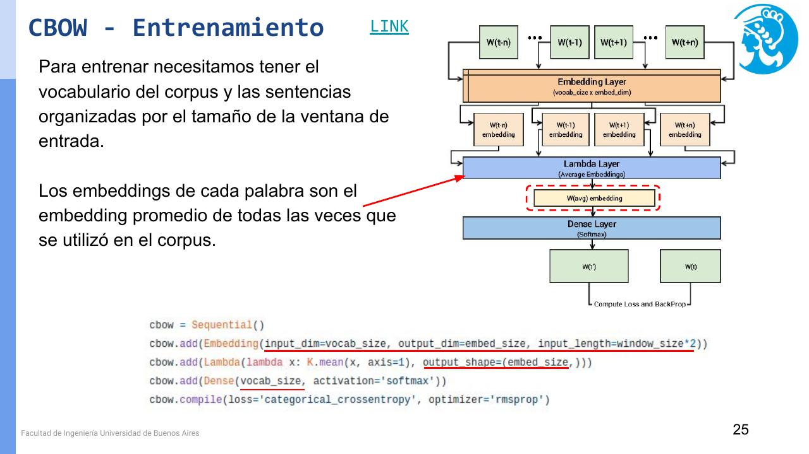

*Slide 25: CBOW, entrenamiento. Hace falta el vocabulario del corpus y las oraciones organizadas según el tamaño de la ventana. W(t−n) … W(t+n) → Embedding Layer (vocab_size × embed_dim) → embedding de cada palabra → Lambda Layer (Average Embeddings) → W(avg) → Dense Layer (Softmax) → se compara la predicción con W(t) → loss y backprop.*

El paso a paso (01:33:55):
1. Se arma el **one-hot** de cada palabra del contexto.
2. Se multiplica por la **matriz de embeddings** (*embedding layer*), que tiene el **tamaño del vocabulario × la dimensión del embedding**. Cada fila es el embedding de una palabra, y el one-hot elige qué fila extraer. Se hace con todas las palabras de la ventana.
3. Una **capa Lambda** promedia los vectores y da uno solo, de la misma dimensión que el embedding, con la información del contexto.
4. Una **capa densa con softmax** da la probabilidad de que cada palabra del vocabulario sea la target.
5. Se compara la palabra elegida con la real y se hace **backpropagation** para ajustar los pesos (01:35:13).

- Se entrena sobre todo la **matriz de embeddings**, aunque la capa densa también tiene pesos. A medida que se recorren todos los ejemplos del corpus, esa matriz termina **guardando el significado de las palabras**.
- **Al terminar se extrae solo esa matriz.** Para vectorizar un texto se busca el índice de cada palabra y se toma su fila.
- En resumen (01:36:27): one-hot → vector de cada palabra → promedio → probabilidades → elegir la palabra → comparar con la real → ajustar.
- ✎ La slide dice que el embedding de cada palabra es "el embedding promedio de todas las veces que se utilizó en el corpus". En realidad, lo que se promedia en cada paso son los vectores del contexto. El vector final de una palabra es su fila de la matriz, que se fue ajustando cada vez que la palabra apareció como contexto.
- **Pregunta de Nicolás:** si aparece una palabra nueva, ¿hay que reentrenar? Sí: no tiene vector y da error. Es el problema que resolvió fastText.
- ✎ Lo caro es la capa densa con softmax, porque para cada ejemplo hay que normalizar sobre las V palabras del vocabulario. Con v_w el vector de entrada y v'_w el de salida de la palabra w:

```math
p(w_O \mid w_I) = \frac{\exp\left({v'_{w_O}}^{\top} v_{w_I}\right)}{\sum_{w=1}^{V} \exp\left({v'_{w}}^{\top} v_{w_I}\right)}
```

**En Keras** (01:37:52) se arma con `Sequential`, agregando capa por capa:

```python
cbow = Sequential()
cbow.add(Embedding(input_dim=vocab_size, output_dim=embed_size, input_length=window_size*2))
cbow.add(Lambda(lambda x: K.mean(x, axis=1), output_shape=(embed_size,)))
cbow.add(Dense(vocab_size, activation='softmax'))
cbow.compile(loss='categorical_crossentropy', optimizer='rmsprop')
```

- `Embedding` recibe el tamaño del vocabulario, el del embedding (que uno elige) y el largo de la entrada: la ventana × 2, porque toma palabras antes y después.
- `Lambda` promedia y devuelve un vector del tamaño del embedding. `Dense` da una probabilidad por palabra del vocabulario, y la pérdida es *categorical crossentropy*.
- **Pregunta de Hernando:** ¿el backpropagation ajusta los embeddings? Sí. La mayoría de los parámetros están en la matriz de embeddings, y también se ajustan los de la densa, aunque esos después no interesan (01:39:11). La matriz de embeddings **se inicializa al azar** y se va entrenando.

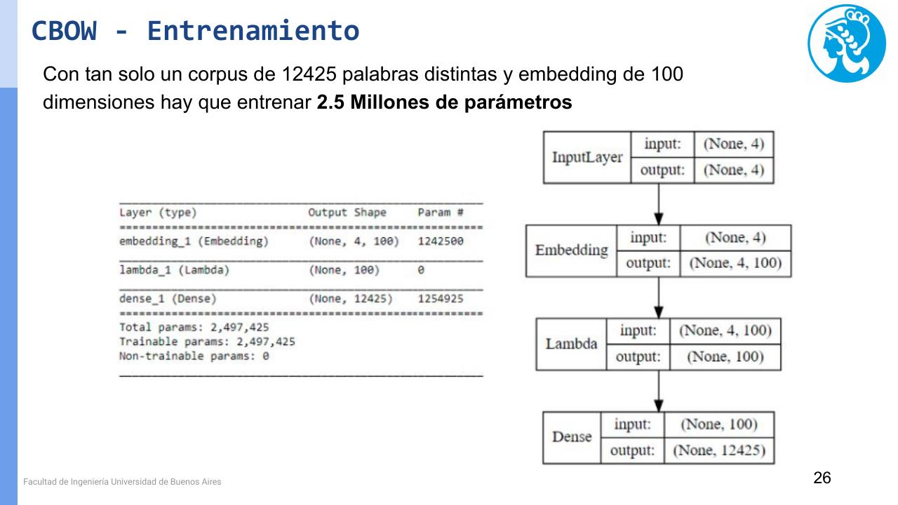

*Slide 26: con un corpus de 12.425 palabras distintas y embeddings de 100 dimensiones hay que entrenar 2,5 millones de parámetros.*

| Capa | Salida | Parámetros |
|---|---|---|
| Embedding | (None, 4, 100) | 1.242.500 = 12.425 × 100 |
| Lambda | (None, 100) | 0 |
| Dense | (None, 12425) | 1.254.925 = 100 × 12.425 + 12.425 |
| **Total** | | **2.497.425** |

Los parámetros se reparten más o menos **mitad y mitad** entre la embedding y la densa (01:40:20). La de embedding, que es la que importa, tiene la cantidad de palabras × 100. La entrada es de 4 palabras: ventana 2, dos antes y dos después.

## 18. Skip-gram: adivinar el contexto con una palabra (01:40:20)

Usa un target y un contexto, como CBOW, pero **al revés**: la palabra del medio es la entrada y lo que se adivina son las palabras del contexto.

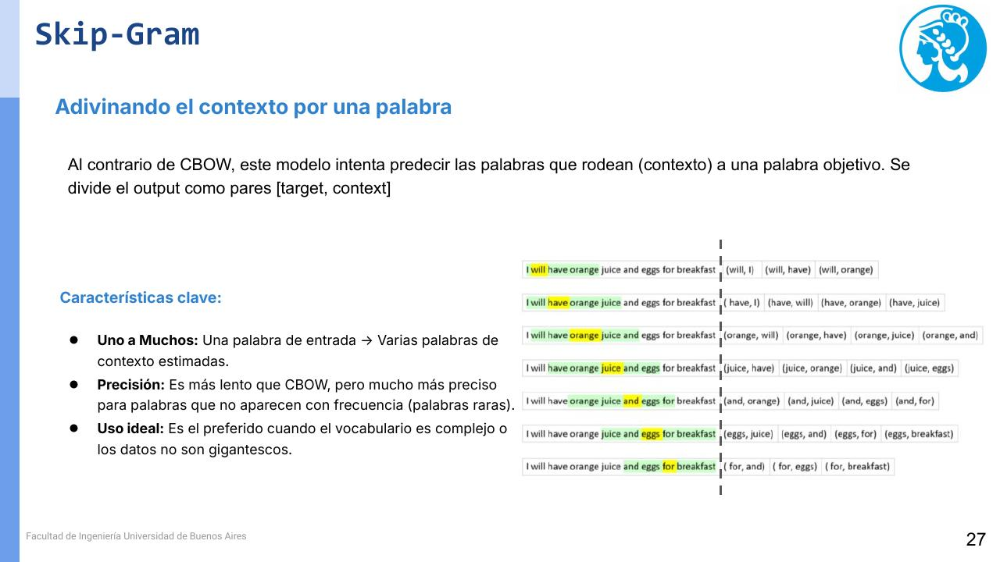

*Slide 27: skip-gram, adivinando el contexto por una palabra. Al contrario de CBOW, intenta predecir las palabras que rodean a una palabra objetivo, y el output se divide en pares [target, context]. Características clave: uno a muchos (una palabra de entrada → varias de contexto), más lento que CBOW pero mucho más preciso con las palabras poco frecuentes, y preferido cuando el vocabulario es complejo o los datos no son gigantescos.*

- **Pares [target, contexto]** (01:41:47). En "I will have orange juice and eggs for breakfast", con ventana 2, *have* da (have, I), (have, will), (have, orange) y (have, juice): **cuatro pares y cuatro pasos de entrenamiento**. CBOW entrenaba una sola vez con esas cuatro palabras para adivinar una. Todos los pares de la slide:

| Target | Pares |
|---|---|
| will | (will, I) (will, have) (will, orange) |
| have | (have, I) (have, will) (have, orange) (have, juice) |
| orange | (orange, will) (orange, have) (orange, juice) (orange, and) |
| juice | (juice, have) (juice, orange) (juice, and) (juice, eggs) |
| and | (and, orange) (and, juice) (and, eggs) (and, for) |
| eggs | (eggs, juice) (eggs, and) (eggs, for) (eggs, breakfast) |
| for | (for, and) (for, eggs) (for, breakfast) |

- **Le saca más provecho al corpus**, porque salen muchos más ejemplos de entrenamiento.
- Es **uno a muchos**. Es **más lento** que CBOW porque hace más pasos, pero **más preciso**: captura más relaciones y aprende mejor las **palabras raras**.
- **Cuándo conviene** (01:43:02): con un **corpus chico** o con un vocabulario complejo, específico y variado, porque saca más ejemplos de entrenamiento. La contra es que es más lento y un poco más costoso.

**El entrenamiento** (01:43:02): la entrada es la palabra target, y para cada palabra del contexto se toma una **decisión binaria**: ¿está en el contexto o no?

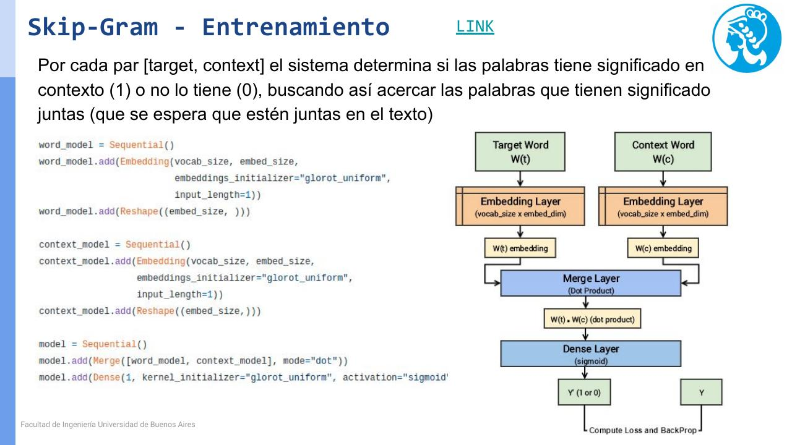

*Slide 29: "Por cada par [target, context] el sistema determina si las palabras tienen significado en contexto (1) o no lo tienen (0), buscando así acercar las palabras que tienen significado juntas". La target word W(t) y la context word W(c) pasan cada una por una embedding layer (vocab_size × embed_dim) → merge layer (producto punto) → dense layer (sigmoide) → Y' (1 o 0) contra Y → loss y backprop.*

1. Se arma el **one-hot** de la palabra target y el de la de contexto: el par que se analiza.
2. Se saca el **embedding de cada una**.
3. Se combinan con el **producto punto** (01:44:25).
4. Una **capa densa con sigmoide** decide si el par es del mismo contexto (1) o no (0).
5. Se compara con el dato de entrenamiento y se hace backpropagation.

```python
word_model = Sequential()
word_model.add(Embedding(vocab_size, embed_size,
                         embeddings_initializer="glorot_uniform",
                         input_length=1))
word_model.add(Reshape((embed_size, )))

context_model = Sequential()
context_model.add(Embedding(vocab_size, embed_size,
                  embeddings_initializer="glorot_uniform",
                  input_length=1))
context_model.add(Reshape((embed_size,)))

model = Sequential()
model.add(Merge([word_model, context_model], mode="dot"))
model.add(Dense(1, kernel_initializer="glorot_uniform", activation="sigmoid"))
```

✎ `Merge(..., mode="dot")` es de Keras 1 y ya no existe. Hoy se arma con la API funcional y la capa `Dot(axes=1)`.

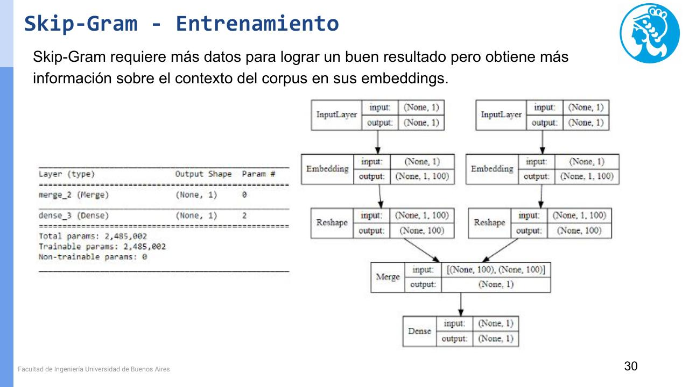

*Slide 30: skip-gram requiere más datos para lograr un buen resultado, pero sus embeddings tienen más información sobre el contexto del corpus. Dos entradas de una palabra → dos Embedding (None, 1, 100) → Reshape (None, 100) → Merge por producto punto (None, 1) → Dense (None, 1). Merge tiene 0 parámetros, Dense 2, y el total es 2.485.002.*

✎ Las cuentas: 2 matrices × 12.425 × 100 = 2.485.000, más 2 de la densa (un peso y un bias). El vocabulario es el mismo de la slide 26.

**¿Dónde quedan los embeddings?** (pregunta de Hernando, 01:45:48) En las matrices de embedding. Acá hay **dos**, la del target y la del contexto, y **por convención se usa la del target**. Hay variantes, como promediarlas o sumarlas (01:47:14).

**¿Las dos matrices dan igual?** (pregunta de Gonzalo) No: son pesos distintos que se ajustan distinto. No deberían diferir tanto, pero no son la misma matriz.

Comparando el target con su contexto se va ajustando su significado, como en el ejemplo del gato: se compara *gato* con *bigotes*, con *cola*… (01:48:44).

## 19. Negative sampling (01:48:44)

- Si solo se entrenara con los pares del contexto, que son los **ejemplos positivos**, la respuesta sería siempre 1. El modelo también tiene que ver palabras que **no** están en el contexto, para aprender qué no está relacionado.
- El entrenamiento completo compararía cada target con **todas** las palabras del vocabulario. Es muy pesado y además puede causar **overfitting**, porque se ajusta demasiado al corpus.
- **Negative sampling** (01:50:08): en vez de todo el vocabulario, se toma una **muestra al azar** de palabras de fuera del contexto. Entran todas las del contexto como positivas y algunas de afuera como negativas. El modelo aprende de los dos tipos de ejemplo con mucho menos cómputo.
- **La cantidad de negativos es un parámetro** (01:51:54) y depende del corpus. Con un corpus chico hay pocos ejemplos y conviene un muestreo más grande; con uno grande, que sobra texto, se puede achicar.
- Se usa en skip-gram y también en CBOW: no hace falta calcular la probabilidad de todo el vocabulario.

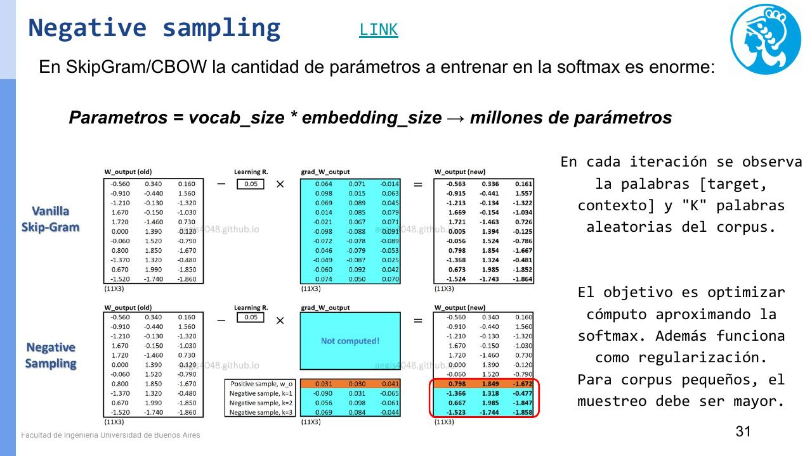

*Slide 31: en skip-gram y CBOW la cantidad de parámetros de la softmax es enorme, vocab_size × embedding_size: millones. En el skip-gram común se actualizan las 11 filas de W_output (old − 0.05 × gradiente = new). Con negative sampling se actualizan solo 4, la muestra positiva y 3 negativas (k = 1, 2, 3), y el resto no se calcula. En cada iteración se observan las palabras [target, contexto] y K palabras aleatorias del corpus. El objetivo es optimizar cómputo aproximando la softmax, y además funciona como regularización. Para corpus pequeños, el muestreo debe ser mayor.*

**Pregunta de Hernando** (01:53:14): una palabra elegida al azar como negativa, ¿no puede aparecer junto al target dos párrafos más adelante? Sí, puede pasar. Por ejemplo, para *will* se arman pares con *breakfast* o *cat*, que no están en su contexto y deberían dar 0. Si el modelo se equivoca, el backpropagation ajusta los pesos. Es un ajuste a lo largo de todo el corpus: al final es una probabilidad, y los pares que aparecen juntos más seguido quedan más cerca (01:54:25).

✎ Lo que maximiza skip-gram con negative sampling (Mikolov et al., 2013), con σ la sigmoide, c el contexto positivo y K negativas sacadas de una distribución de ruido P_n:

```math
\log \sigma\left({v'_{c}}^{\top} v_{t}\right) + \sum_{k=1}^{K} \mathbb{E}_{w_k \sim P_n(w)} \left[ \log \sigma\left(-{v'_{w_k}}^{\top} v_{t}\right) \right]
```

✎ P_n(w) es proporcional a la frecuencia de la palabra elevada a 3/4, para que las palabras raras salgan un poco más que con la frecuencia pura. El paper recomienda K entre 5 y 20 en corpus chicos y entre 2 y 5 en corpus grandes, lo mismo que dijo la docente.

## 20. Visualizar embeddings con t-SNE (01:54:25)

Para el ejercicio y para el desafío 2 hace falta poder ver si los embeddings salieron bien. Además de las analogías y los gráficos de similitud, se pueden hacer gráficos en 2D o 3D como el del proyector. Para eso hay que **reducir la dimensionalidad** (01:56:03).

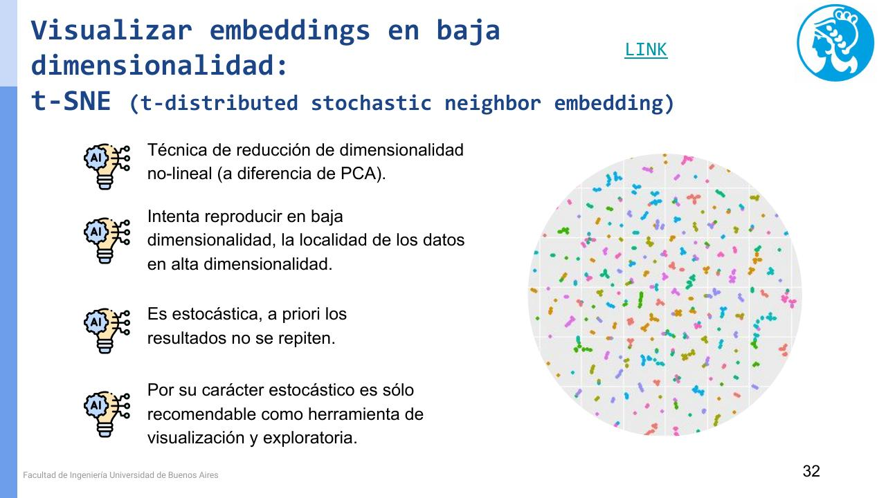

*Slide 32: t-SNE (t-distributed stochastic neighbor embedding). Técnica de reducción de dimensionalidad no lineal, a diferencia de PCA. Intenta reproducir en baja dimensionalidad la localidad de los datos en alta dimensionalidad. Es estocástica: a priori los resultados no se repiten. Por eso solo se recomienda como herramienta de visualización y exploración.*

- **No es lineal.** PCA es una reducción lineal, y las relaciones entre palabras normalmente no lo son.
- **Es estocástica:** puede cambiar de una corrida a otra y no es reproducible. Por eso no se usa para entrenar modelos, solo para visualizar y explorar.

## 21. Gensim y el ejemplo de la plantilla (Colab 2.b) (01:57:27)

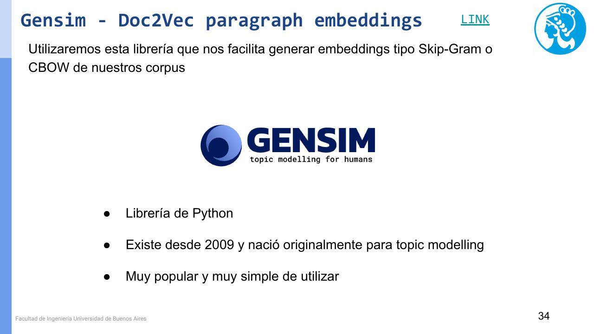

*Slide 34: Gensim, "topic modelling for humans". La librería facilita generar embeddings tipo skip-gram o CBOW de un corpus propio. Es de Python, existe desde 2009, nació para topic modelling y es muy popular y simple de usar. El título de la slide menciona Doc2Vec (paragraph embeddings).*

- Gensim trae la lógica de CBOW y skip-gram ya hecha, así que no hace falta armar la red de cero.
- El ejemplo está en la plantilla del desafío 2, en la carpeta `Desafíos` del repo de la materia ([copia acá](../../desafios/02-word-embeddings/desafio-2.ipynb)). Arriba tiene el ejemplo y al final, la consigna (slide 35, "Colab 2.b"). Su objetivo: crear embeddings con canciones de una banda, así que los vectores reflejan cómo esa banda usó las palabras en sus letras.

**El corpus** (01:58:56)
- El ejemplo usa el *songs dataset*: letras de 49 artistas, un `.txt` por artista (Beatles, Bob Dylan, Eminem, Adele…).
- **Para el desafío hay que conseguir otro corpus** (02:00:30). Las sugerencias, de la slide 37 y de la clase:

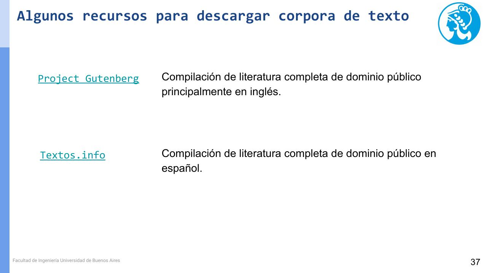

*Slide 37: Project Gutenberg, compilación de literatura completa de dominio público, principalmente en inglés. Textos.info, compilación de literatura completa de dominio público en español.*

  - Libros de [Project Gutenberg](https://www.gutenberg.org/) o de [textos.info](https://www.textos.info/).
  - Un dataset propio, como papers de un tema de interés o textos del campo de trabajo. La elección es libre.
- El ejemplo toma a los **Beatles**. Los datos ya vienen separados por línea, así que **cada documento es una línea de una canción**: **1846 documentos**, un corpus chico que entrena rápido.

**Limpieza y segmentación** (02:01:51)
- Un libro importado hay que limpiarlo: caracteres raros, encabezados que se repiten, pies de página.
- **Segmentar según el corpus**, que es un error común. El ejemplo separa por línea porque en las canciones cada oración es una línea. En un libro eso **corta oraciones por la mitad**, porque las oraciones siguen después del salto de línea. Cada documento tiene que ser **una oración completa**.

**Preprocesamiento** (02:03:08)
- Keras, igual que NLTK, tiene funciones para procesar texto. `text_to_word_sequence` va de texto a lista de palabras:

```python
from tensorflow.keras.preprocessing.text import text_to_word_sequence

sentence_tokens = []
for _, row in df[:None].iterrows():
    sentence_tokens.append(text_to_word_sequence(row[0]))
# [['yesterday', 'all', 'my', 'troubles', 'seemed', 'so', 'far', 'away'],
#  ['now', 'it', 'looks', 'as', 'though', "they're", 'here', 'to', 'stay']]
```

- Las etapas: limpieza → división en documentos → división en palabras.
- ✎ El archivo se lee con `pd.read_csv('songs_dataset/beatles.txt', sep='/n', header=None)`. `'/n'` no es un salto de línea, sino la cadena literal "/n". Funciona porque pandas igual lee línea por línea y esa cadena no aparece en las letras, así que cada línea queda entera en una columna.
- ✎ `text_to_word_sequence` pasa a minúsculas, saca los caracteres de su lista de filtros y separa por espacios. Deja los apóstrofos (*they're*). Ojo con el español: los filtros no incluyen `¿`, `¡`, `«`, `»` ni `—`.

## 22. Hiperparámetros de Word2Vec en Gensim (02:04:49)

```python
w2v_model = Word2Vec(min_count=5,     # frecuencia mínima de palabra para incluirla en el vocabulario
                     window=2,        # cant de palabras antes y desp de la predicha
                     vector_size=300, # dimensionalidad de los vectores
                     negative=20,     # cantidad de negative samples... 0 es no se usa
                     workers=1,       # si tienen más cores pueden cambiar este valor
                     sg=1)            # modelo 0:CBOW  1:skipgram
```

| Hiperparámetro | Qué es | Qué se dijo en clase |
|---|---|---|
| `min_count` | Frecuencia mínima para que una palabra entre al vocabulario | Una palabra que aparece una sola vez no tiene información suficiente para definir su vector, así que las de muy pocas apariciones se descartan. Con un corpus grande se puede subir; con uno chico, un `min_count` alto puede volar la mitad de las palabras |
| `window` | Ventana de contexto: palabras antes y después (02:06:04) | Las canciones tienen oraciones cortas y una ventana de 2 está bien. Con oraciones más largas hay que probar ventanas más grandes |
| `vector_size` | Dimensión de los vectores | Depende del corpus. Con uno chico como el de las canciones, poner 1000 no va a mejorar nada, porque no hay tanta información para capturar. Con más corpus se puede subir. Hay que probar |
| `negative` | Cantidad de ejemplos negativos al azar (02:07:13) | Con un corpus grande alcanza con menos y con uno chico conviene subirlo. Si hay overfitting, bajarlo puede ayudar. Con 0 no se usa |
| `workers` | Núcleos para entrenar | Casi no se toca; solo si hay más de un núcleo |
| `sg` | 0 = CBOW, 1 = skip-gram | La plantilla usa **skip-gram**. Comparar los dos es opcional |

**Para cualquier hiperparámetro:** elegir un número, ir comparando y **explicar por qué** se eligió y qué se observa al experimentar.

- `build_vocab(sentence_tokens)` arma el vocabulario a partir del corpus: `corpus_count` da **1846 documentos** y hay **445 palabras distintas** (02:08:42). Es un corpus muy chico.

Acá hubo un recreo corto, de ~10 minutos.

## 23. Entrenamiento y exploración del modelo (02:08:42)

```python
w2v_model.train(sentence_tokens,
                total_examples=w2v_model.corpus_count,
                epochs=20,
                compute_loss=True,
                callbacks=[callback()])
```

- Se fija la cantidad de **épocas**, 20. Gensim no informa la *loss* por defecto, así que la plantilla define un `callback` (hereda de `CallbackAny2Vec`) que la imprime en cada época. ✎ `get_latest_training_loss()` devuelve la pérdida acumulada, y por eso el callback le resta la de la época anterior.
- La loss baja de forma continua, de **113.045** en la época 0 a **48.960** en la 19: el modelo está aprendiendo (02:21:29). Tardó unos **3 segundos**, por lo chico del corpus. ✎ `train` devuelve `(156986, 287740)`: las palabras que efectivamente se entrenaron y todas las leídas en las 20 épocas. Las efectivas son menos porque se saltean las que no llegan a `min_count` y se submuestrean las muy frecuentes (parámetro `sample`).

**Palabras más y menos similares.** `most_similar` devuelve las palabras más parecidas por similitud coseno: `positive` trae las más relacionadas, `negative` las menos, y `topn` define cuántas.

| Consulta | Resultado (similitud coseno) |
|---|---|
| `positive=["darling"]` | pretty 0.90 · sleep 0.87 · help 0.84 · cry 0.84 · not 0.83 · try 0.83 · peace 0.81 · little 0.81 · twist 0.81 · seems 0.81 |
| `negative=["love"]` | shake −0.23 · four −0.23 · five −0.24 · six −0.24 · bang −0.25 · our −0.26 · day −0.27 · going −0.27 · here −0.27 · three −0.28 |
| `positive=["four"]` | five 0.98 · three 0.97 · six 0.97 · seven 0.96 · two 0.95 · sixty 0.90 · one 0.80 · crying 0.79 · us 0.77 · i'm 0.75 |
| `positive=["money"]`, `topn=5` | can't 0.94 · buy 0.94 · much 0.90 · just 0.85 · hide 0.84 |
| `positive=["love"]` | babe 0.91 · someone 0.89 · need 0.88 · nothing 0.87 · didn't 0.86 · there's 0.85 · you 0.85 · feed 0.84 · somebody 0.84 · buy 0.84 |

- ***Darling*** (02:23:00): *pretty*, *sleep*, *help* y *cry* tienen sentido en las canciones. Lo que sale está muy atado a cómo usa las palabras el artista y, con un corpus tan chico, incluso **sobreajustado** al corpus.
- ***Love* con `negative`**: salen palabras sin relación, sobre todo números. ✎ Los valores negativos son la similitud con −*love*: *shake* es la menos parecida y aun así tiene 0.23 con *love*. En un corpus chico todos los vectores apuntan más o menos para el mismo lado, y "menos similar" no quiere decir "opuesta".
- ***Four***: un cluster muy notorio de **números**. Desde el séptimo resultado ya se desvía a otros temas, pero los números quedaron bien relacionados (02:24:33).
- ***Money***: algunas tienen sentido (*buy*) y otras no tanto. Lo importante es **entender por qué**, porque el corpus influye mucho en las relaciones que se encuentran. Tal vez los Beatles no usen tanto *money*, y sirve contar cuántas veces aparece y en qué casos. Cada artista ve el dinero distinto: un rapero puede usar *money* como algo positivo, que tiene y que gana, y otro cantante puede verlo de otra forma, y eso se refleja en las letras (02:26:03). ✎ *Can't* y *buy* vienen de "Can't Buy Me Love" ("I don't care too much for money, money can't buy me love"): es sobreajuste a una canción.
- **Palabra fuera del vocabulario:** `most_similar(negative=["diedaa"])` da `KeyError: "Key 'diedaa' not present in vocabulary"`, porque la palabra no está en el índice. **Word2Vec a nivel de palabra no funciona con palabras nuevas.**
- **El vector completo:** `w2v_model.wv.get_vector("love")` devuelve sus 300 valores. Con los vectores se pueden hacer las mismas operaciones y analogías de antes (02:27:12). `most_similar(vector_love)` da lo mismo que `most_similar("love")`, salvo que incluye a la propia palabra (*love* 1.0).
- ***Love*** → ***babe***: para los Beatles son casi intercambiables, porque a alguien que amás lo llamás *babe*. Después se desvía a otros conceptos.
- **Para el desafío:** comparar qué palabras salen, cuáles no tienen mucho sentido, si los resultados son coherentes y qué críticas se le pueden hacer al modelo.

## 24. Visualización de los clusters (02:28:38)

```python
def reduce_dimensions(model, num_dimensions=2):
    vectors = np.asarray(model.wv.vectors)
    labels = np.asarray(model.wv.index_to_key)
    tsne = TSNE(n_components=num_dimensions, random_state=0)
    vectors = tsne.fit_transform(vectors)
    return vectors, labels

vecs, labels = reduce_dimensions(w2v_model)
MAX_WORDS = 200
fig = px.scatter(x=vecs[:MAX_WORDS, 0], y=vecs[:MAX_WORDS, 1], text=labels[:MAX_WORDS])
fig.show(renderer="colab")
```

- La función ya viene hecha: reduce con **t-SNE** y grafica con **Plotly** en 2D. `MAX_WORDS` define cuántas palabras se grafican, para no llenar el gráfico con todo el vocabulario: de unas 445 se grafican 200, casi la mitad.
- La idea es **encontrar clusters y explicar por qué están cerca**:
  - **Números:** *one, two, three, four* juntos, como ya se había visto con `most_similar`.
  - **Frases de canciones:** *yellow* y *submarine* quedan casi en la misma posición (02:29:57). En otros contextos no saldrían juntas, pero *submarine* no es una palabra común en canciones y probablemente solo aparezca en "Yellow Submarine". Es un caso de **overfitting**.
  - **Saludos:** *hello*, *goodbye*, *say*.
  - Más estrofas: ✎ probablemente "change the world"; también "(I) want to hold your hand" y "get back" (02:31:19).
- Word2Vec caracteriza palabras con sentido, como los números o los saludos, pero tiene sus límites. Con un corpus chico hay mucho **overfitting a las frases que se repiten**, sobre todo a los estribillos. Con un dataset más grande es menos probable que quede sobreajustado a canciones particulares.
- **En 3D** (`px.scatter_3d`) se hace zoom y se buscan clusters. Aparecen *hey* y *jude*, otra vez *submarine* y *carry* con *weight* (02:33:10). La docente leyó esto último como "cargar peso", que tiene sentido. ✎ Es también "Carry That Weight", del disco Abbey Road.
- Con solo 1846 documentos es esperable que quede sobreajustado. Con libros probablemente den mejores resultados, porque hay más ejemplos y más texto. La idea es ver qué relaciones aparecen y qué dicen los embeddings del autor analizado.
- **Opcional:** guardar los embeddings en `vectors.tsv` y `labels.tsv` y cargarlos en el [proyector](http://projector.tensorflow.org/) (02:34:41). Ahí se puede cambiar la reducción (PCA, t-SNE) y explorar los resultados.

## 25. Desafío 2: consigna y entrega (02:34:41)

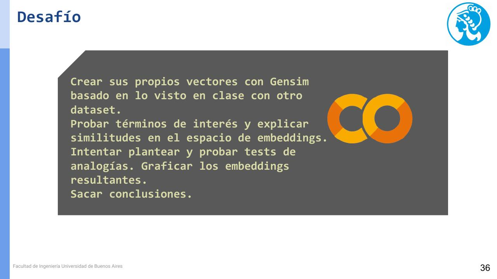

*Slide 36: crear sus propios vectores con Gensim, basado en lo visto en clase, con otro dataset. Probar términos de interés y explicar similitudes en el espacio de embeddings. Intentar plantear y probar tests de analogías. Graficar los embeddings resultantes. Sacar conclusiones.*

La consigna completa, las aclaraciones y la entrega están en [desafios/02-word-embeddings](../../desafios/02-word-embeddings/README.md). Lo que se dijo en clase:
- Crear vectores propios con Gensim, como en la plantilla, pero con **un corpus propio**: es lo que da el puntaje completo. Hacerle la limpieza que corresponda. No usar el songs dataset (02:36:10).
- Elegir **términos de interés**, idealmente **al menos cinco**, buscar los más similares y compararlos como se hizo con *love* o *darling*. Concluir si tienen sentido, cuáles no y cuáles son overfitting del texto.
- **Reducir la dimensionalidad** con la función de la plantilla, a 2 o 3 dimensiones, y ajustar `MAX_WORDS`: con libros completos el vocabulario va a ser más grande.
- **Inspeccionar el gráfico** y encontrar **al menos tres clusters** interpretables: por qué se agruparon, si tiene sentido o si es una limitación del modelo.
- **t-SNE no da siempre lo mismo** (02:37:33), así que la docente no va a ver los mismos grupos. Hay que sacar una **captura de pantalla** de cada grupo y pegarla en una celda de texto con el comentario.
- Comentar y explicar cada consigna. **No olvidarse de comentar los hiperparámetros**, que pesan bastante en la nota, ni las conclusiones.
- **Fechas:** el desafío 2 se presenta en esta clase y vale **nota 10 hasta el jueves 12/11** (clase 4); después se descuentan puntos. El desafío 1 vale 10 hasta el final del jueves 05/11 (02:38:55).
- **Entrega:** por el **formulario**, no por mail, para que no se pierdan entregas. Puede ser individual o en pareja: se elige qué desafío se entrega y se pega el link. El link está en las slides de la clase 1 y la docente iba a reenviarlo por mail con el cronograma.

## 26. Cierre: de embeddings estáticos a dinámicos (02:40:15)

- Word2Vec, fastText y GloVe superan las debilidades de las técnicas de conteo de la clase 1:
  - Toman en cuenta la **semántica**: relacionan mejor los sinónimos y las palabras vinculadas conceptualmente.
  - El vector es **denso** y aprovecha la dimensionalidad: no está lleno de ceros.
- **Lo que no resuelven** (02:41:44): una palabra con varios significados según el contexto tiene **un solo vector**, que mezcla los conceptos. Pasó con *banco* (clase 1), *apple* y *mouse*.

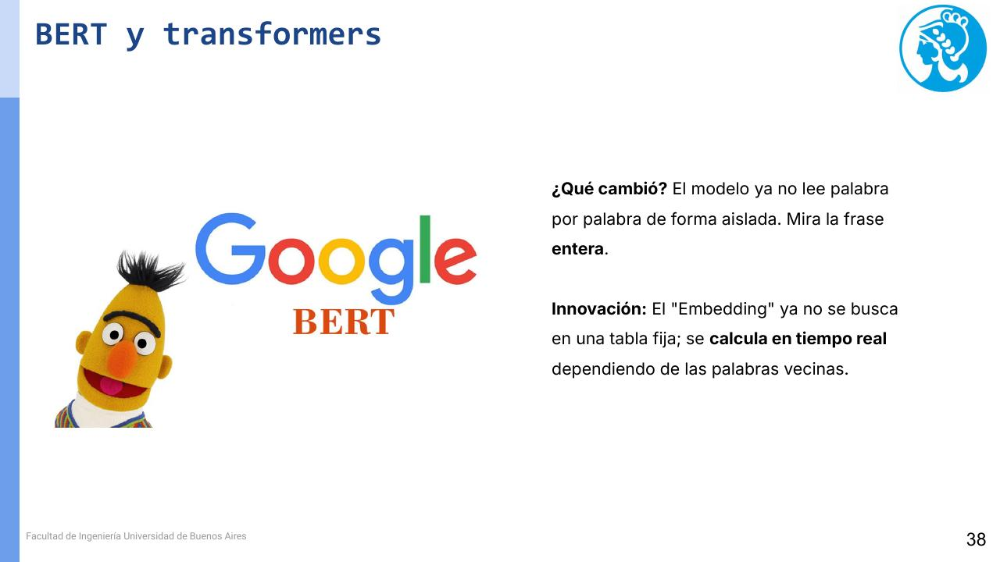

*Slide 38: BERT (Google) y Transformers. ¿Qué cambió? El modelo ya no lee palabra por palabra de forma aislada: mira la frase entera. La innovación: el embedding ya no se busca en una tabla fija, sino que se calcula en tiempo real según las palabras vecinas.*

- El estado del arte usa embeddings **dinámicos**. Con un vector estático, cada palabra se reemplaza por su vector. Acá, en cambio, el modelo **ve la frase entera**, y por detrás un **mecanismo de atención** determina cómo afectan las otras palabras al significado global del texto.
- Ya no hay una tabla fija para todo el vocabulario: los embeddings **se calculan en el momento**, según las palabras vecinas (02:43:13).
- El más conocido es **BERT**. Es open source y tiene muchísimas variantes reentrenadas para casos específicos, además de arquitecturas más modernas basadas en él. Todas usan Transformers.

## 27. Sentence embeddings y RAG (02:43:13)

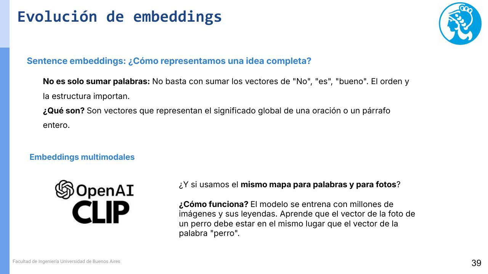

*Slide 39: sentence embeddings: ¿cómo se representa una idea completa? No basta con sumar los vectores de "No", "es", "bueno": el orden y la estructura importan. Son vectores que representan el significado global de una oración o de un párrafo entero. Embeddings multimodales, OpenAI CLIP: el mismo mapa para palabras y para fotos. Se entrena con millones de imágenes y sus leyendas, y aprende que el vector de la foto de un perro debe estar en el mismo lugar que el de la palabra "perro".*

- Como un embedding puede representar cualquier concepto abstracto, también se hacen **a nivel de oración**. En vez de un vector por palabra y después promediarlos, se arma directamente **un vector para toda la oración**, que resume lo que la oración quiere comunicar: son los **sentence embeddings** (02:44:37). La docente mencionó **Doc2Vec**. ✎ Doc2Vec (Le y Mikolov, 2014) está en Gensim: son los "paragraph embeddings" del título de la slide 34.
- **RAG** (*retrieval-augmented generation*). Nicolás lo describió como una forma de extender un LLM, que no está entrenado con documentos propios, para poder consultarlos. La docente lo precisó:
  - **No se reentrena el modelo.** Se insertan partes de texto con la información propia **dentro del prompt**, en la ventana de contexto, junto con la pregunta.
  - **Qué partes se insertan se decide con embeddings** (02:46:06). Por ejemplo, un chatbot sobre la Declaración Universal de los Derechos Humanos: el documento, junto con otros de interés, es la base de conocimiento. Se divide en párrafos o unidades de información y **se vectoriza cada párrafo**. Después se compara el vector de cada párrafo con el de la **pregunta del usuario**, se traen los más cercanos y se ponen en el prompt del LLM.
- **Pregunta de Martín:** ¿se ve RAG en la materia? No. Esta materia se queda a nivel modelo: cómo se construyen los LLMs conceptualmente, los Transformers y los mecanismos de atención. Lo que hay alrededor se ve en **Procesamiento de Lenguaje Natural II**, que en la especialización es optativa (02:47:25).

## 28. Embeddings multimodales y aplicaciones (02:47:25)

- Los embeddings también sirven para imágenes. ¿Para qué sirve llevar palabras e imágenes al **mismo espacio vectorial** (espacio latente)? Hernando: para generar imágenes a partir de texto, buscar imágenes por su contexto y describir lo que hay en una imagen (02:48:45). Se puede ir de texto a imagen y de imagen a texto: el espacio común es un **puente** entre los dos tipos de input.
- Ese puente lo construyó **OpenAI con CLIP**. Usaron un dataset grande de imágenes con sus descripciones ("perrito marrón, de tal raza") para entrenar un modelo con Transformers que vectoriza palabras e imágenes en el mismo espacio. Se entrenan **en conjunto** para que las dimensiones de los dos estén relacionadas (02:50:03).
- Eso permite la **generación de imágenes** a partir de texto y los **LLMs multimodales**, que reciben una imagen y una pregunta a la vez.

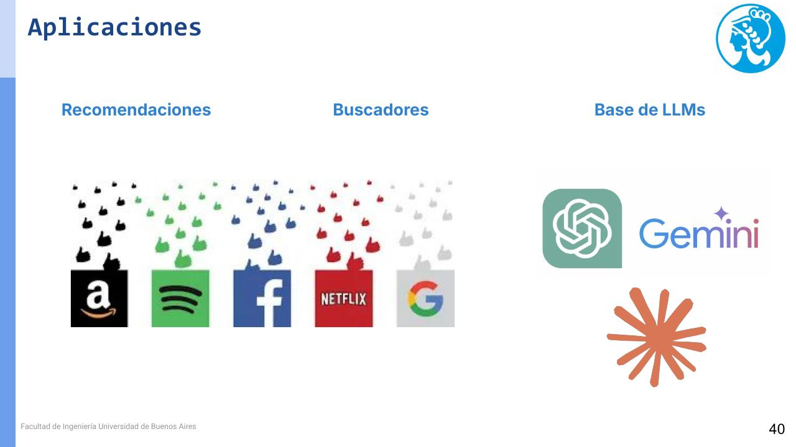

*Slide 40: aplicaciones de los embeddings. Recomendaciones (Amazon, Spotify, Facebook, Netflix, Google), buscadores y base de los LLMs (OpenAI, Gemini, Claude).*

- **RAG:** para buscar información (§27).
- **Buscadores:** lo que se escribe en la caja de búsqueda se vectoriza y se busca contenido similar en las páginas, por similitud de vectores.
- **Recomendaciones:** con los embeddings de los libros que le gustan a una persona, se buscan libros que no leyó y que se parezcan a sus gustos.
- **LLMs:** usan embeddings para procesar el texto y responder lo que se les pregunta en el chat.

---

## Correcciones de la transcripción automática

| Dice la transcripción | Es |
|---|---|
| lse posgrados (hablante) | la docente, Josselyn Ordóñez (cuenta del posgrado) |
| Word and Bedings, Word and Ben, Word BS, embils, enveis, envins, edings, embates, emails, losings, medis, enve, Bedis, embedits, edad edins, empeños, emboses, mediance | (word) embeddings |
| tocanización, toquenizar, tocenización | tokenización |
| laización stemi | lematización, stemming |
| TF y DF, TFID DF | TF-IDF |
| OneH encoding, one encoding, one de coding | one-hot encoding |
| back of words, back of worlds, Back of Wars | Bag of Words |
| esparzos, esparza | esparsos, esparsa |
| ortoganales, ortogales | ortogonales |
| minitud coseno | similitud coseno |
| sandilla · aranda, arana · el plata · dors, suor | sandía · arándano · el plátano · dulzor |
| la escendí o la piña | probablemente "la sandía o la piña" |
| Maneta | María Teresa (pregunta por chat) |
| cómpo | cómputo |
| los textes … 1500 36 y el otro 3000 | los tamaños: 1536 y 3072 |
| word to back, Word to Bec, Word to B, WordB, Wardb, World tobe | Word2Vec |
| Sibo, SO, Zoow | CBOW |
| la técnica adhesivo, el ejemplo adhesivo | de CBOW |
| Steelw, Skip Bram, Skibrom, Skib, Skim | skip-gram |
| Glob, Glob Stanford, Glock, Glow, Globo | GloVe |
| matriz de concurrencias, conocurrencia | matriz de co-ocurrencia |
| Fastex, Fastx, FastX, Fasts, Fast Tex | fastText |
| enramas, enegramas, eama | n-gramas |
| elito | el hito |
| Elmo y Bert. ver · ver ("el más conocido es ver") | ELMo y BERT · BERT |
| dynamics, contextualis, contextos albe | dinámicos, contextuales |
| Groll y Gigaw | Common Crawl y Gigaword |
| datasedo | dataset |
| inco ya. Inclusela comedia | probablemente *income* (en el proyector) |
| versus abreviado B | *vs* |
| disis, Isa y acentis | "this is", "is a", "a sentence" |
| por t o de A | t, o, d, a |
| Ghub · el colap, el color | GitHub · el Colab |
| Yarquía | anarquía |
| Noki | `no_king` |
| New World, newman | `new_man` |
| Kim | *king* |
| Pleo, le bello, plebello | plebeyo |
| sesjos, ejos, este tipo de C, algún ser | sesgos, sesgo |
| CBS | CVs |
| el mañado | "El ___ maúlla" |
| hype con, hype con wheel, hype con orange, hype con use | *have* con *I*, *will*, *orange*, *juice* |
| eling layer, capa de medi, la capada de B | embedding layer |
| la raicional | (capa) adicional |
| que eras, queras, enqueras | Keras, en Keras |
| categórica central | categorical crossentropy |
| la delta, la de T | la del target, W(t) |
| delito arriba, deito | dedito arriba |
| overfeiting | overfitting |
| negative sample | negative sampling |
| Disney, Disney de Tistributed Stocastic Neighbor | t-SNE (t-distributed stochastic neighbor embedding) |
| GSIM, GSIN | Gensim |
| sound dataset, son dataset | songs dataset |
| beatops | Beatles |
| Tex Infos, textas.info | textos.info |
| Tex to word sequence | `text_to_word_sequence` |
| colbava | callback |
| el inco · Windows | `min_count` · `window` |
| epox · los | epochs · loss |
| darle | *darling* |
| mani, la palabra armónica | *money* |
| getor | `get_vector` |
| más relacionado a P | *babe* |
| hielo · submariz, submarin | *yellow* · *submarine* |
| one to hold your hand | "(I) want to hold your hand" |
| Good Jud | "Hey Jude" |
| ploty · maxws | Plotly · `MAX_WORDS` |
| 18 documentos | 1846 documentos |
| el término R | RAG |
| doc toc, doct | Doc2Vec |
| prom | prompt |
| Peni con su modelo CL | OpenAI con su modelo CLIP |

---

## ✎ Para los desafíos

**Desafío 2** ([consigna y aclaraciones](../../desafios/02-word-embeddings/README.md))

| Consigna | Conceptos de la clase |
|---|---|
| Vectores propios con Gensim y un corpus propio | Gensim, la plantilla, la limpieza y la segmentación en oraciones (§21), los hiperparámetros (§22), CBOW vs skip-gram (§16 a §18), negative sampling (§19) |
| Términos de interés, con sus más y menos similares | `most_similar` con `positive` y `negative` (§23), hipótesis distributiva (§6), polisemia (§13), sesgos (§14) |
| Tests de analogías (slide 36) | Analogías (§11 y §15) |
| Reducir a 2D y graficar | t-SNE (§20), `reduce_dimensions` y `MAX_WORDS` (§24) |
| Encontrar e interpretar clusters, con capturas | Los clusters y el overfitting del ejemplo (§24) |

Detalles prácticos:
- **Gensim 4** cambió nombres: `vector_size` (antes `size`) y `epochs` (antes `iter`), y los vectores están en `model.wv`. Muchos tutoriales viejos usan los nombres anteriores.
- **Project Gutenberg:** cada libro trae un encabezado y un pie con la licencia, en inglés. Hay que quedarse con el texto entre `*** START OF THE PROJECT GUTENBERG EBOOK … ***` y `*** END OF THE PROJECT GUTENBERG EBOOK … ***` (en libros viejos dice *THIS* en vez de *THE*); si no, esas palabras contaminan el vocabulario.
- **Segmentar en oraciones:** unir las líneas (reemplazar los saltos de línea por espacios), cortar en oraciones con `nltk.sent_tokenize(texto, language='spanish')` (o `'english'`) y recién ahí tokenizar cada oración.
- **Español con `text_to_word_sequence`:** agregar `¿¡«»—…` a `filters`, o tokenizar con NLTK o spaCy. Si no, "¿qué" y "qué" quedan como dos palabras distintas.
- **Tamaño del corpus:** un libro de unas 100.000 palabras da un vocabulario de unos pocos miles con `min_count=5`. Con un solo libro chico el modelo va a sobreajustar como el de los Beatles; juntar varios libros del mismo autor ayuda.
- **Experimentos con los hiperparámetros:** cambiar uno por vez y comparar los vecinos de las mismas palabras de interés. Candidatos: `sg` (0 contra 1), `window` (2 contra 5 o más, con oraciones largas), `vector_size` (100 contra 300), `min_count`, `negative` y `epochs` (Gensim usa 5 por defecto; la plantilla, 20). Anotar qué cambia en los vecinos.
- **Menos similares:** `most_similar(negative=[palabra])` devuelve la similitud con el vector opuesto. Para reportar la similitud real entre dos palabras, usar `model.wv.similarity(a, b)`.
- **Analogías:** `model.wv.most_similar(positive=['rey', 'mujer'], negative=['hombre'], topn=5)`. Gensim ya excluye las palabras de la consulta. `model.wv.doesnt_match([...])` encuentra la palabra que no encaja en una lista. Con un corpus chico las analogías suelen fallar, y explicar por qué también es una conclusión válida.
- **`MAX_WORDS` toma las primeras palabras de `index_to_key`**, que Gensim ordena por frecuencia: el gráfico muestra las más frecuentes, muchas de ellas stopwords. Conviene graficar una lista filtrada (sin stopwords, o las palabras de interés y sus vecinos), aunque t-SNE se ajuste sobre todo el vocabulario.
- **Reproducibilidad:** `TSNE(random_state=0)` fija la proyección para unos vectores dados, pero Word2Vec puede dar vectores distintos en cada sesión: inicializa cada vector con el hash de Python de la palabra, que cambia en cada proceso. Por eso, sacar las capturas como pidió la docente.
- **Plotly no se ve en GitHub:** el gráfico interactivo (`renderer="colab"`) no queda guardado en el notebook. Es otra razón para pegar las capturas en celdas de texto.
- **Que corra de punta a punta:** la plantilla pide que el notebook corra sin errores, y la celda de ejemplo con `diedaa` tira `KeyError`. Antes de consultar una palabra, verificar con `if palabra in model.wv:`.
- Si el entrenamiento tarda, `workers` puede ser la cantidad de núcleos del Colab (`multiprocessing.cpu_count()`; `multiprocessing` ya está importado en la plantilla).

---

## ✎ Glosario

- **Embedding:** representación densa de un concepto (palabra, oración, imagen, voz) en un espacio vectorial continuo.
- **Representación densa / esparsa:** pocas dimensiones, casi todas con valores distintos de cero / tantas dimensiones como palabras tiene el vocabulario, casi todas en cero.
- **Embedding estático:** un vector fijo por palabra, sin importar el contexto (Word2Vec, GloVe, fastText).
- **Embedding dinámico o contextual:** el vector de una palabra se calcula según la frase en que aparece (ELMo, BERT).
- **Hipótesis distributiva:** las palabras que aparecen en contextos parecidos tienen significados parecidos.
- **Word2Vec:** método de Google (2013) que aprende embeddings con una red neuronal, con las arquitecturas CBOW y skip-gram.
- **CBOW (continuous bag of words):** predice la palabra central a partir del promedio de los vectores del contexto. Muchos a uno.
- **Skip-gram:** predice el contexto a partir de la palabra central, por pares [target, contexto]. Uno a muchos.
- **Target / contexto / ventana:** la palabra central / las palabras de alrededor / cuántas palabras se toman a cada lado.
- **Matriz de embeddings (embedding layer):** matriz de vocabulario × dimensión en la que cada fila es el vector de una palabra. Es lo que se guarda después de entrenar.
- **One-hot encoding:** vector con un 1 en la posición de la palabra y ceros en el resto. Multiplicado por la matriz de embeddings, selecciona una fila.
- **Softmax:** convierte puntajes en probabilidades que suman 1. CBOW la usa para dar una probabilidad por palabra del vocabulario.
- **Sigmoide:** da una probabilidad entre 0 y 1 para una decisión binaria. Skip-gram la usa para decidir si un par está en contexto.
- **Negative sampling:** entrenar con el par positivo y K palabras al azar como negativas, en vez de calcular la softmax sobre todo el vocabulario.
- **GloVe (global vectors):** método de Stanford (2014) que ajusta los vectores a partir de la matriz de co-ocurrencia de todo el corpus.
- **Matriz de co-ocurrencia:** cuántas veces aparece cada par de palabras dentro de una ventana.
- **fastText:** método de Facebook (2016): Word2Vec con n-gramas de caracteres. Arma vectores para palabras nunca vistas.
- **N-grama:** subsecuencia de N elementos consecutivos (palabras o caracteres), tomada con una ventana que se desliza de a uno.
- **OOV (out of vocabulary):** palabra que no estaba en el vocabulario de entrenamiento. En Word2Vec y GloVe da error; fastText la arma con sus n-gramas.
- **Test de analogías:** evaluar embeddings con operaciones como rey − hombre + mujer ≈ reina.
- **Polisemia:** una palabra con varios significados (*apple*, *mouse*, *banco*).
- **Sesgo:** asociación injusta que el modelo aprende del corpus, como *man* más cerca de *money* que *woman*.
- **t-SNE:** reducción de dimensionalidad no lineal y estocástica, para visualizar.
- **PCA:** reducción de dimensionalidad lineal y determinística.
- **Gensim:** librería de Python con Word2Vec, fastText y Doc2Vec implementados.
- **`min_count`, `window`, `vector_size`, `negative`, `sg`, `epochs`:** la frecuencia mínima, la ventana, la dimensión, la cantidad de negativos, la arquitectura (0 = CBOW, 1 = skip-gram) y las pasadas por el corpus.
- **Overfitting (en embeddings):** vectores que reflejan frases puntuales del corpus (*yellow submarine*) más que relaciones generales.
- **Sentence embedding:** un vector para una oración o un párrafo entero.
- **Doc2Vec:** extensión de Word2Vec que aprende vectores de párrafos o documentos.
- **RAG (retrieval-augmented generation):** buscar con embeddings los fragmentos de una base de conocimiento más parecidos a la pregunta y ponerlos en el prompt de un LLM.
- **Espacio latente:** el espacio vectorial donde viven los embeddings.
- **Embedding multimodal:** imágenes y texto (u otros tipos de dato) en un mismo espacio, como en CLIP.
- **CLIP:** modelo de OpenAI entrenado con imágenes y sus leyendas para llevar fotos y texto al mismo espacio.
- **BERT:** modelo de Google (2018) basado en Transformers que da embeddings contextuales.
- **Mecanismo de atención:** la parte del Transformer que decide cuánto influye cada palabra de la frase en el significado de las demás.

---

## ✎ Preguntas de práctica

1. ¿Qué dos problemas de Bag of Words y TF-IDF resuelven los embeddings? Dar el ejemplo de clase de cada uno.
2. ¿Qué similitud coseno tienen "Estoy viajando en colectivo" y "Voy arriba del bus" con TF-IDF? ¿Por qué?
3. Definir embedding. ¿Por qué se dice que es una representación densa?
4. ¿Cuáles son las tres propiedades que se buscan en un embedding? ¿Cuál no cumplen Word2Vec, GloVe ni fastText?
5. Con la tabla de las frutas, ¿qué fruta debería ser la más parecida a la frutilla? ¿Por qué en la práctica las dimensiones no se definen a mano?
6. ¿De qué depende la cantidad de dimensiones de un embedding? ¿Qué rango se usa en clase?
7. Ordenar en el tiempo Word2Vec, BERT, fastText y GloVe, con el creador y el aporte de cada uno.
8. ¿Qué dice la hipótesis distributiva?
9. ¿Qué cuenta la matriz de co-ocurrencia de GloVe? En el ejemplo de las canciones, ¿qué ventana se usó y cuántas veces aparecieron juntas *amor* y *vida*?
10. ¿En qué se diferencia fastText de Word2Vec? ¿Qué arquitecturas usa?
11. ¿Por qué a Facebook le interesaba poder vectorizar palabras desconocidas?
12. Escribir los bigramas de caracteres de "hojas" y los bigramas de palabras de "Todas las hojas son del viento".
13. ¿Cómo funciona un test de analogías? ¿Qué valor de similitud coseno indica que los embeddings capturaron la relación?
14. En el notebook, ¿qué dio king − man + woman? ¿Cuál fue la palabra más cercana y por qué?
15. ¿Por qué *apple* salió más cerca de *banana* que de *computer*? ¿Qué limitación de los embeddings estáticos muestra?
16. ¿Qué sesgo apareció con *man*, *woman*, *money* y *power*? Dar dos casos de uso en los que sería un problema y dos formas de mitigarlo.
17. ¿Qué hace CBOW? ¿Es muchos a uno o uno a muchos?
18. Describir el paso a paso del entrenamiento de CBOW, desde el one-hot hasta el backpropagation.
19. Después de entrenar CBOW, ¿qué parte de la red se usa como embeddings?
20. ¿Cuántos parámetros tiene el CBOW de la slide 26 (12.425 palabras, 100 dimensiones)? Desglosar la cuenta.
21. ¿Qué hace skip-gram? ¿Cuántos pares de entrenamiento genera *orange* en "I will have orange juice and eggs for breakfast" con ventana 2?
22. ¿Qué operación combina los dos embeddings en skip-gram y qué activación tiene la salida?
23. ¿Cuándo conviene CBOW y cuándo skip-gram?
24. En skip-gram hay dos matrices de embeddings. ¿Cuál se usa?
25. ¿Qué es negative sampling y qué problemas resuelve? ¿Cómo se elige la cantidad de negativos según el corpus?
26. ¿Por qué se prefiere t-SNE a PCA para graficar embeddings? ¿Por qué no se usa para entrenar modelos?
27. ¿Qué hacen los hiperparámetros `min_count`, `window`, `vector_size`, `negative` y `sg` de Gensim?
28. En la plantilla del desafío, ¿cuántos documentos y cuántas palabras tiene el corpus de los Beatles? ¿Qué arquitectura usa el modelo?
29. ¿Por qué *yellow* y *submarine* aparecen juntas en el gráfico? ¿Qué problema muestra?
30. ¿Qué pasa si se le pide al modelo una palabra que no está en el vocabulario?
31. ¿Por qué no hay que segmentar un libro por líneas, como se hace con las canciones?
32. ¿Qué hay que entregar en el desafío 2? ¿Hasta cuándo vale nota 10?
33. ¿Qué diferencia a BERT de Word2Vec?
34. ¿Qué es un sentence embedding y cómo se usa en RAG?
35. ¿Qué es un embedding multimodal? ¿Cómo se entrenó CLIP?

<details>
<summary>Respuestas</summary>

1. Textos de significado parecido pueden ser ortogonales ("colectivo" y "bus" no comparten palabras), y la dimensión depende del vocabulario, con vectores esparsos de más de 180.000 dimensiones en inglés.
2. 0: no comparten ninguna palabra, y estas técnicas no reconocen sinónimos.
3. Es una representación de una palabra (u otro concepto) en un espacio vectorial continuo. Es densa porque usa pocas dimensiones y todas tienen valores, en vez de estar casi todas en cero.
4. Representación compacta, similitud semántica y comprensión del contexto. La última no: son estáticos y una palabra tiene siempre el mismo vector.
5. La manzana, porque las dos son rojas y medianas (✎ similitud 0.95). Porque los vocabularios son enormes y harían falta cientos de dimensiones: se aprenden automáticamente del texto.
6. De la capacidad de cómputo y del tamaño del corpus: un corpus chico no llena muchas dimensiones. En clase, entre 100 y 300.
7. Word2Vec (Google, 2013: CBOW y skip-gram) → GloVe (Stanford, 2014: matriz de co-ocurrencia, estadísticas globales) → fastText (Facebook, 2016: n-gramas de caracteres, palabras desconocidas) → BERT (Google, 2018: embeddings dinámicos).
8. Que una palabra se conoce por las que la acompañan: palabras en contextos parecidos tienen significados parecidos.
9. Cuántas veces aparece cada par de palabras dentro de una ventana de contexto. La ventana fue de 5 palabras a cada lado, y *amor* y *vida* aparecieron juntas 15 veces.
10. En la tokenización: fastText divide las palabras en n-gramas de caracteres (3 a 6) y Word2Vec usa palabras completas. Las arquitecturas son las mismas, CBOW y skip-gram.
11. Porque en las redes sociales el texto es informal: palabras mal escritas a propósito, caracteres de más ("holaaaa"), términos que no están en el diccionario.
12. *ho, oj, ja, as*. *todas las, las hojas, hojas son, son del, del viento*.
13. Se opera con los vectores de dos pares con la misma relación (París − Francia y Madrid − España) y se comparan los resultados con la similitud coseno. Tiene que dar cerca de 1.
14. Un vector `new_queen` con similitud 0.73 con *king* y 0.65 con *queen*. La más cercana fue *king*, porque se partió de ese vector y conserva muchas de sus características; la segunda fue *queen*.
15. Porque en el corpus de entrenamiento *apple* se usó más como fruta. Muestra que un vector fijo por palabra mezcla los significados de una palabra polisémica, y que gana el más frecuente en el corpus.
16. *Man* quedó más cerca de *money* y *power* que *woman*. Sería un problema en modelos de crédito o de filtrado de CVs. Se mitiga revisando los vectores antes de usarlos, promediando los vectores o las dimensiones en las que no se quiere distinción, o con corpus curados.
17. Predice la palabra central a partir de las palabras del contexto. Es muchos a uno.
18. One-hot de cada palabra del contexto → producto con la matriz de embeddings (se extrae la fila de cada una) → promedio en una capa Lambda → capa densa con softmax sobre el vocabulario → comparación con la palabra real → backpropagation, que ajusta la matriz de embeddings y la densa.
19. La matriz de embeddings (vocabulario × dimensión): cada fila es el vector de una palabra.
20. 2.497.425: 12.425 × 100 = 1.242.500 en la embedding, más 100 × 12.425 + 12.425 = 1.254.925 en la densa.
21. Predice las palabras del contexto a partir de la central, por pares [target, contexto]. *Orange* genera 4 pares: (orange, will), (orange, have), (orange, juice) y (orange, and).
22. El producto punto. La salida es una densa con sigmoide: 1 si el par está en el mismo contexto y 0 si no.
23. CBOW, con corpus grandes, cuando importa la rapidez y el significado general de las palabras comunes. Skip-gram, con corpus chicos y vocabulario complejo o específico: saca más ejemplos y aprende mejor las palabras raras, aunque es más lento.
24. Por convención, la de la palabra target. También se pueden promediar o sumar las dos.
25. En cada paso se usa el par positivo y K palabras al azar como negativas, en vez de todo el vocabulario. Evita calcular la softmax sobre todas las palabras, que es muy costoso, y reduce el sobreajuste: funciona como regularización. Con un corpus chico, más negativos; con uno grande, menos.
26. Porque las relaciones entre palabras no son lineales, y t-SNE es una reducción no lineal que conserva la vecindad. No se usa para entrenar porque es estocástico: sus resultados cambian entre corridas.
27. `min_count`: la frecuencia mínima para entrar al vocabulario. `window`: las palabras de contexto a cada lado. `vector_size`: la dimensión de los vectores. `negative`: la cantidad de ejemplos negativos. `sg`: 0 = CBOW, 1 = skip-gram.
28. 1846 documentos (líneas de canciones) y 445 palabras distintas. Usa skip-gram (`sg=1`) de 300 dimensiones, con `window=2`, `min_count=5` y `negative=20`.
29. Porque *submarine* casi solo aparece en "Yellow Submarine": el modelo aprendió la frase, no una relación general. Es overfitting de un corpus chico.
30. Da `KeyError`: Word2Vec no tiene vector para las palabras fuera del vocabulario. Hay que reentrenar o usar fastText.
31. Porque en un libro las oraciones siguen después del salto de línea y se cortarían por la mitad. Cada documento tiene que ser una oración completa.
32. Embeddings propios con Gensim y un corpus propio, términos de interés con sus similares, la reducción a 2D o 3D con su gráfico, al menos tres clusters interpretados con capturas, y los hiperparámetros y las conclusiones comentados. Nota 10 hasta el jueves 12/11.
33. BERT calcula el vector de cada palabra según la frase entera, con atención: es contextual. Word2Vec tiene una tabla fija con un vector por palabra.
34. Es un vector que representa el significado global de una oración o de un párrafo. En RAG se vectorizan los párrafos de la base de conocimiento, se comparan con el vector de la pregunta y los más cercanos se agregan al prompt del LLM.
35. Un embedding que lleva distintos tipos de datos, como imágenes y texto, a un mismo espacio. CLIP se entrenó con millones de imágenes y sus leyendas, para que la foto de un perro y la palabra "perro" queden en el mismo lugar.

</details>
