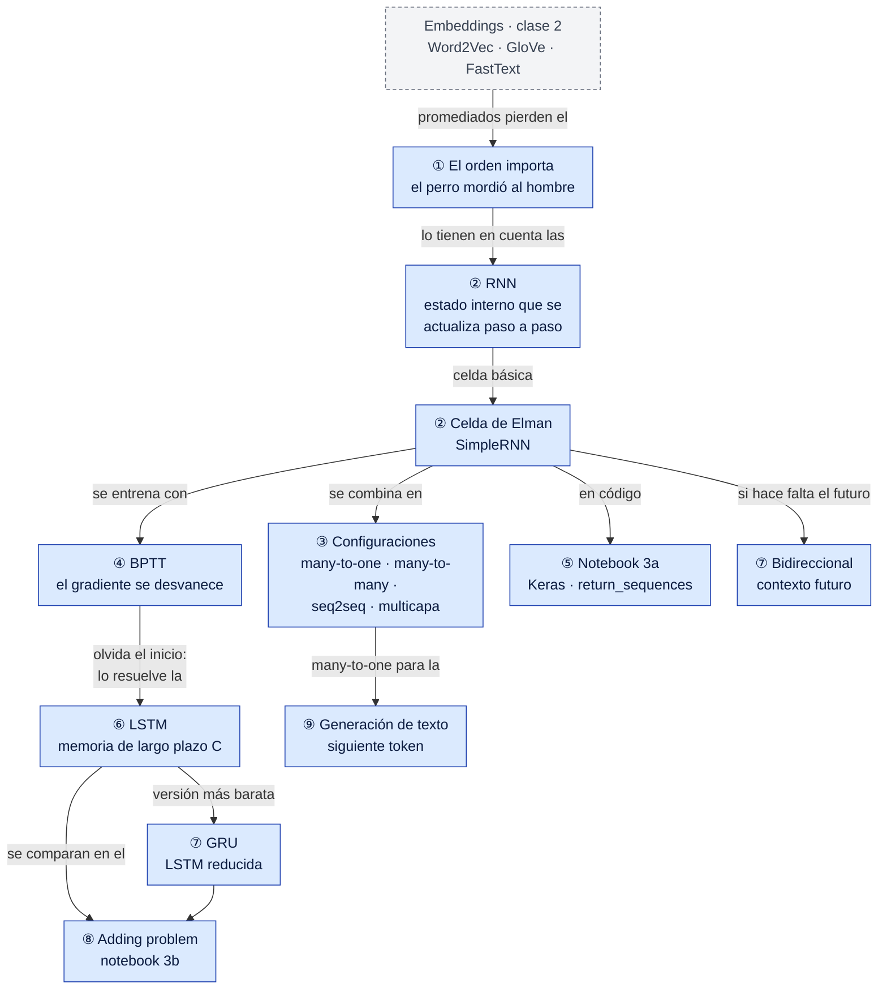
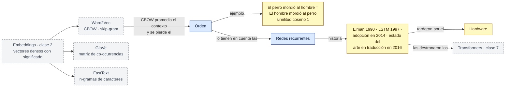
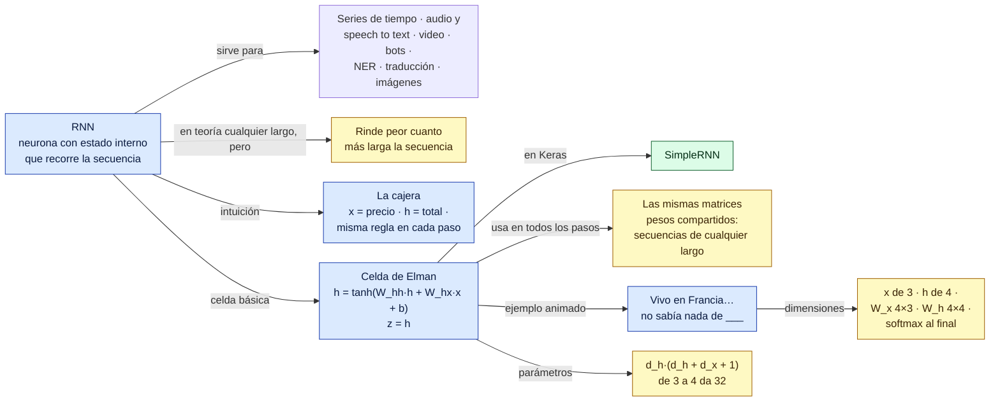
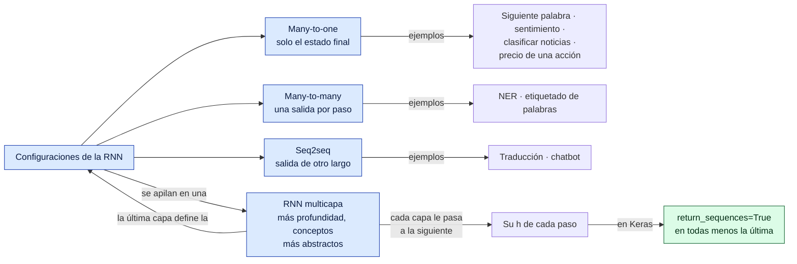
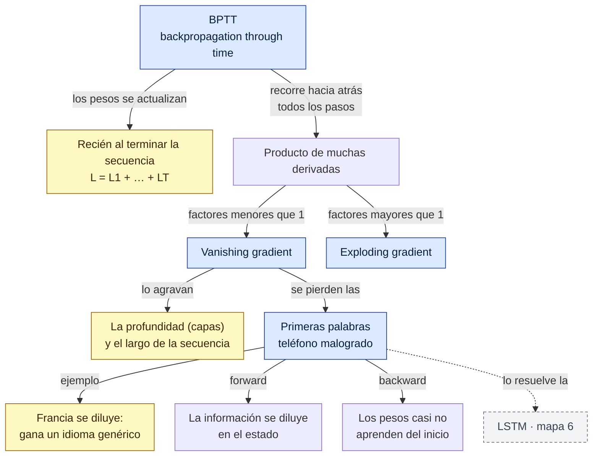
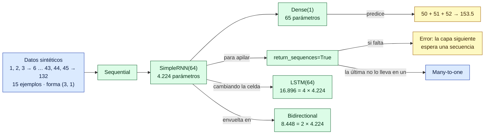
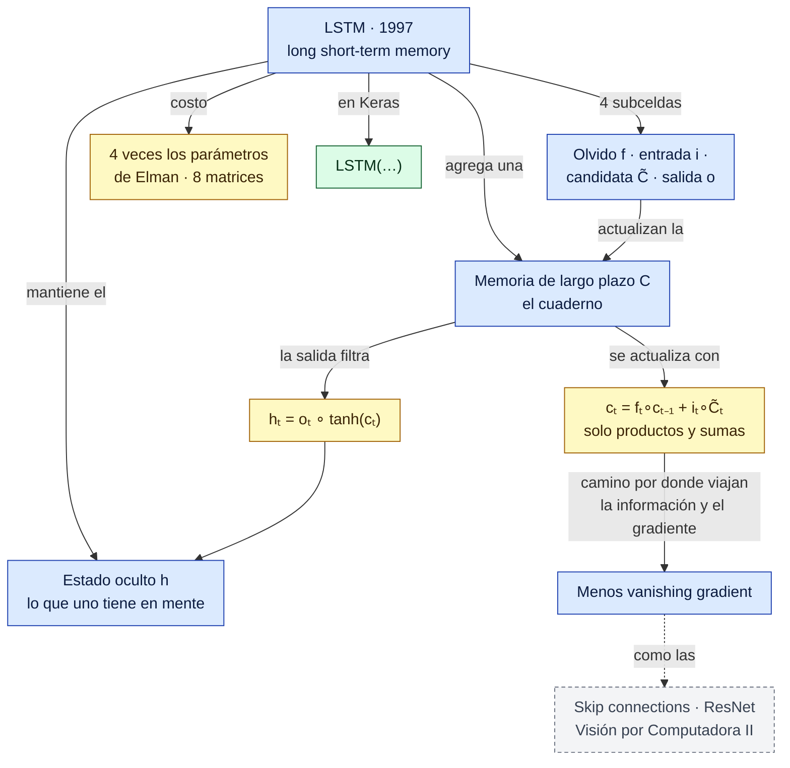
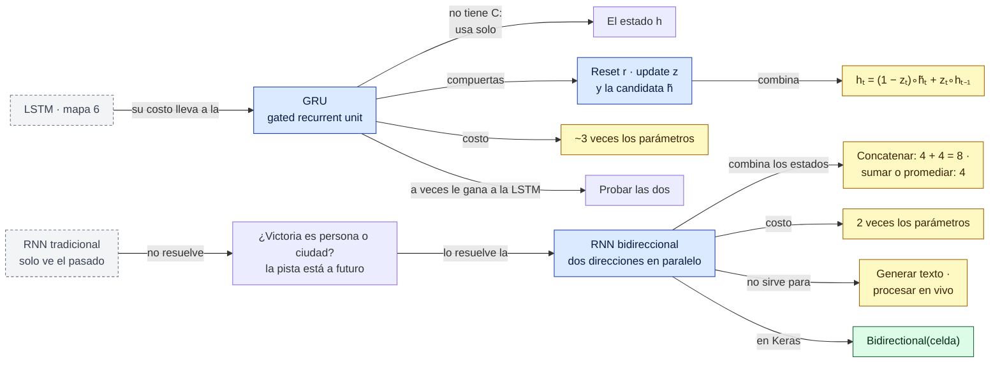
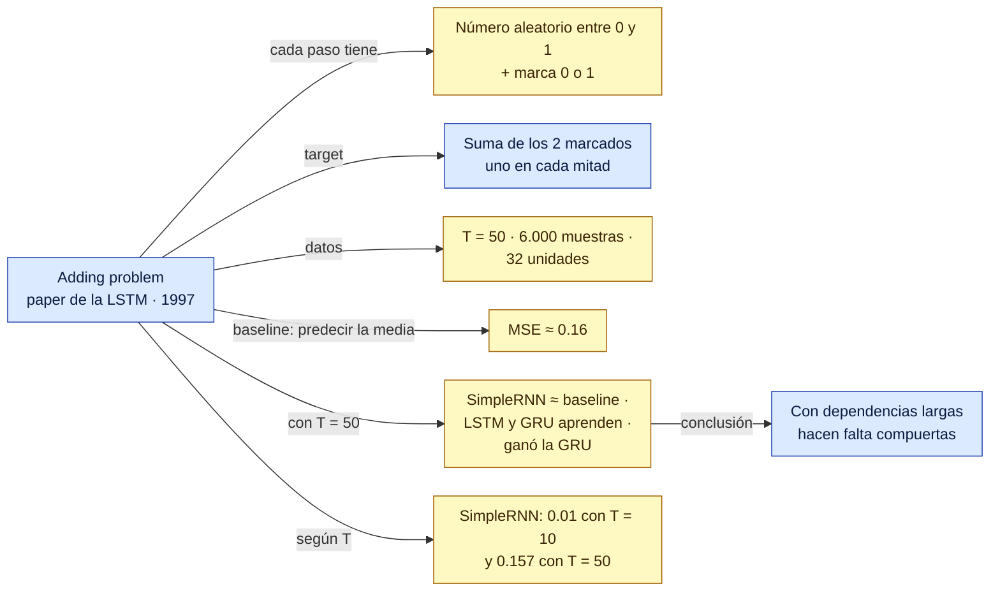
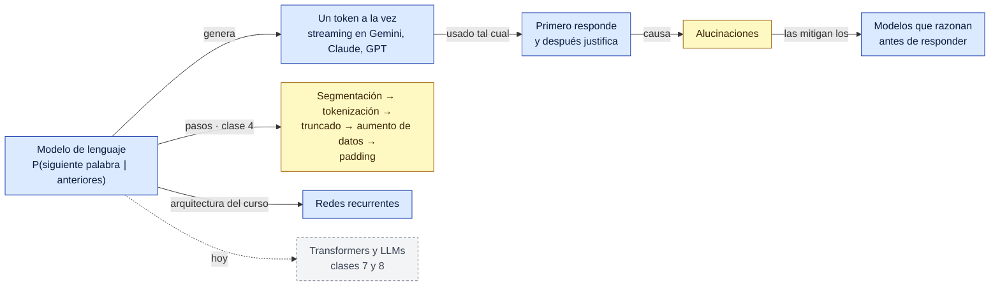

# Red conceptual — Clase 3: Redes recurrentes (Elman, LSTM y GRU)

Complemento del [resumen](resumen.md). Primero hay una vista general de toda la clase y después un mapa por bloque de temas, en el orden en que se dieron. Los números de sección (§) remiten al resumen.

**Cómo leerla**
- Cada flecha forma una frase: *LSTM → agrega una → memoria de largo plazo C*. Una flecha sin texto quiere decir "incluye".
- Las flechas punteadas unen conceptos de temas distintos.
- Colores: azul = tema · verde = librería, función o herramienta · amarillo = dato para memorizar · gris punteado = concepto que se desarrolla en otro mapa o en otra clase.

> Todo el contenido sale de la clase. La organización y las frases de las flechas son propias.

## Vista general

## 1. Del embedding a la secuencia (§1 a §3)

## 2. RNN y celda de Elman (§4 a §8)

## 3. Configuraciones y multicapa (§9 y §10)

## 4. Entrenamiento y memoria corta (§11, §12 y §14)

## 5. Notebook 3a en Keras (§13)

## 6. LSTM (§14)

## 7. GRU y RNN bidireccional (§15 y §16)

## 8. Adding problem (§17)

## 9. Generación de texto y cierre (§18 y §19)

