# Clase 3 — Redes recurrentes: Elman, LSTM y GRU

- **Docente:** MSc. Josselyn Ordóñez. En la transcripción figura como "lse posgrados", la cuenta del posgrado.
- **Fecha:** jueves 05/11/2026, de 19:00 a ~21:35.
- **Duración:** ~2 h 30 min; terminó antes de lo habitual. Recesos de ~15 min entre ~00:47 y ~01:04 (volvían a las 20:05) y entre ~01:54 y ~02:11 (volvían a las 21:10).
- **Grabación:** pendiente (falta el link).
- **Material:** [slides](material/slides-rnn-lstm.pdf) · [notebook 3a: many-to-one](material/notebook-many-to-one.ipynb) · [notebook 3b: adding problem](material/notebook-adding-problem.ipynb) · [animación "RNN, LSTM y GRU paso a paso"](material/animacion-rnn-lstm-gru.html) (es un HTML: GitHub muestra el código, así que hay que descargarlo y abrirlo en el navegador) · [transcripción](material/transcripcion.txt) · [notas de Gemini](material/notas-gemini.txt) · [carpeta `Clase 3` del repo de la materia](https://github.com/FIUBA-Posgrado-Inteligencia-Artificial/procesamiento_lenguaje_natural/tree/nov_2026/Clase%203)
- **Desafío:** esta clase no presenta ninguno. Ese día vencía la nota 10 del desafío 1, y el desafío 2 vale 10 hasta el jueves 12/11 (ver [desafíos](../../desafios/README.md)). Esta clase y la siguiente son la base del desafío 3, que se presenta en la clase 4.
- **Clase anterior:** [resumen de la clase 2](../02-word-embeddings/resumen.md) (word embeddings).
- **Red conceptual:** [red-conceptual.md](red-conceptual.md)

> **Fuentes:** la transcripción completa, las slides, los dos notebooks y la animación HTML que mostró la docente; las notas de Gemini solo para cotejar. Los tiempos `(hh:mm:ss)` marcan el bloque de la transcripción donde arranca cada tema (los temas que empiezan a la vuelta de un receso llevan el tiempo del bloque siguiente). Lo marcado con ✎ es elaboración propia y no se dijo en clase.

---

## Repaso rápido

- **El orden importa:** los embeddings promediados (como en CBOW) y las bolsas de palabras pierden el orden. "El perro mordió al hombre" y "El hombre mordió al perro" dan el mismo vector. Las **redes recurrentes (RNN)** leen la secuencia palabra por palabra y recuerdan lo que ya vieron.
- **Historia:** celda de Elman (1990) y LSTM (1997). Tardaron en usarse en lenguaje por el hardware: la LSTM se adoptó en 2014 y en 2016 fue el estado del arte en traducción, hasta los Transformers.
- **RNN:** neurona con un **estado interno** (memoria h) que se actualiza con cada elemento de la secuencia. Acepta secuencias de cualquier largo, pero rinde peor cuanto más larga es. Aplicaciones: series de tiempo, audio y speech to text, video, bots conversacionales, NER, traducción, imágenes.
- **Celda de Elman (`SimpleRNN`):** hₜ = σ(W_hh·hₜ₋₁ + W_hx·xₜ + b), normalmente con tanh; la salida es zₜ = hₜ. Las mismas matrices se usan en todos los pasos (pesos compartidos).
- **Parámetros de una celda de Elman:** d_h·(d_h + d_x + 1). Con memoria 4 y embedding 3 da 32; `SimpleRNN(64)` con un número por paso da 4.224, y la `Dense(1)` de salida suma 65.
- **Configuraciones:**
  - **Many-to-one:** siguiente palabra, sentimiento, clasificación.
  - **Many-to-many:** NER, etiquetado de palabras.
  - **Seq2seq:** traducción, chatbots; la salida puede tener otro largo.
- **Multicapa:** cada capa le pasa a la siguiente su h de cada paso. En Keras, `return_sequences=True` en todas las capas recurrentes menos la última (si es many-to-one).
- **BPTT:** los pesos se actualizan recién cuando termina la secuencia; en many-to-many, L = L₁ + … + L_T. El gradiente vuelve paso por paso multiplicándose, y se **desvanece** (o explota). Pierde sobre todo las primeras palabras, como un **teléfono malogrado**: en el ejemplo, *Francia* se olvida antes de llegar al final.
- **LSTM:** agrega una **memoria de largo plazo C** (el cuaderno) y cuatro subceldas: olvido f, entrada i, candidata C̃ y salida o.
  - cₜ = fₜ∘cₜ₋₁ + iₜ∘C̃ₜ y hₜ = oₜ∘tanh(cₜ).
  - El camino de C, hecho solo de productos y sumas, deja pasar la información y el gradiente, como las skip connections de ResNet.
  - Tiene **4 veces** los parámetros de Elman.
- **GRU:** versión reducida de la LSTM. No tiene C y usa compuertas de reset y update: hₜ = (1 − zₜ)∘h̃ₜ + zₜ∘hₜ₋₁. Tiene **~3 veces** los parámetros de Elman y a veces le gana a la LSTM: conviene probar las dos.
- **Bidireccional:** dos RNN en paralelo, una hacia adelante y otra hacia atrás, cuyos estados se concatenan, suman o promedian.
  - Sirve cuando el contexto está después: ¿*Victoria* es persona o ciudad?
  - No sirve para generar texto ni para procesar en vivo.
  - Duplica los parámetros.
- **Adding problem (notebook 3b):** con T = 50 la SimpleRNN casi no aprende (en 20 épocas no baja del baseline, MSE ≈ 0.16), mientras que la LSTM y la GRU sí (ganó la GRU). Con T = 10 andan las tres.
- **Modelo de lenguaje:** predecir la siguiente palabra a partir de las anteriores, un token a la vez.
  - Por eso un LLM usado tal cual **responde y después se justifica**, y alucina. Los modelos actuales "razonan" antes de responder.
  - Pasos para la clase 4: segmentación, tokenización, truncado, aumento de datos y padding.

---

## 0. Avisos: entregas y Excel de notas (00:00:03)

- La docente mandó un mail con el cronograma de entregas y el link del formulario.
- En el Excel de notas de la cohorte agregó columnas con el **desglose por desafío**. La hoja está enlazada al formulario: al entregar, la fecha se carga sola, apenas se envía o a los pocos minutos. Sirve para verificar que la entrega llegó bien con el código de alumno.
- Ya había bastantes entregas del desafío 1. Las notas se cargan a medida que avanza la corrección.

## 1. Repaso de la clase 2: embeddings (00:04:35)

- Esta clase entra en deep learning: arquitecturas de redes neuronales que tienen en cuenta la secuencia, es decir, la **red neuronal recurrente** y sus derivadas. Casi todos ya vieron RNN en Aprendizaje Profundo, así que esa parte es un repaso; la LSTM se explica igual por si no la vieron.
- En esta clase se ve la teoría de las redes, y en la próxima se usan para armar un **modelo de lenguaje**. Las dos clases están enlazadas.
- **Repaso (00:06:01):** la clase pasada se vectorizó texto teniendo en cuenta el significado: **embeddings** a nivel de palabra, con tres métodos de 2013 a 2016 (ver el [resumen de la clase 2](../02-word-embeddings/resumen.md)).
  - **Word2Vec** (Google) introdujo las arquitecturas **CBOW** y **skip-gram**. Las dos miran qué palabras aparecen en el mismo contexto que una palabra central. Recorriendo un corpus grande se llega a un embedding que describe la palabra en sentido semántico y que agrupa palabras de contextos parecidos: tecnología, números, saludos (00:07:25).
  - **GloVe** (2014) parte de la misma hipótesis (conocer una palabra por las que la acompañan), pero usa una **matriz de co-ocurrencias**: cuenta cuántas veces aparecen juntas dos palabras dentro de una ventana, con estadísticas globales de todo el texto.
  - **FastText** usa CBOW y skip-gram, pero tokeniza en **n-gramas de caracteres**. Así puede vectorizar palabras que no estaban en el corpus de entrenamiento.

## 2. Lo que falta: el orden (00:08:48)

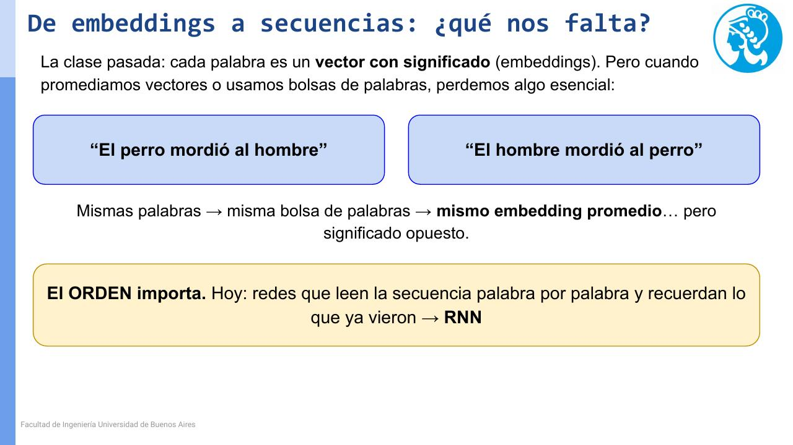

*Slide 2: "El perro mordió al hombre" y "El hombre mordió al perro". Son las mismas palabras, así que dan la misma bolsa de palabras y el mismo embedding promedio, pero el significado es opuesto. El ORDEN importa: hacen falta redes que lean la secuencia palabra por palabra y recuerden lo que ya vieron, las RNN.*

- Ninguna técnica vista hasta ahora tiene en cuenta el orden. CBOW, por ejemplo, toma unas cuatro palabras de contexto y las **promedia**, y en el promedio se pierde el orden en que vinieron.
- Si se reemplaza cada palabra de las dos oraciones por su embedding y se promedia, ¿da lo mismo? Gonzalo: el mismo vector. Son exactamente las mismas palabras: el promedio es igual y la similitud coseno da 1, aunque se inviertan el que muerde y el mordido (00:10:14).
- Una forma de considerar el orden son las **redes neuronales recurrentes**, que analizan la oración en secuencia.

## 3. Historia de las redes recurrentes (00:10:14)

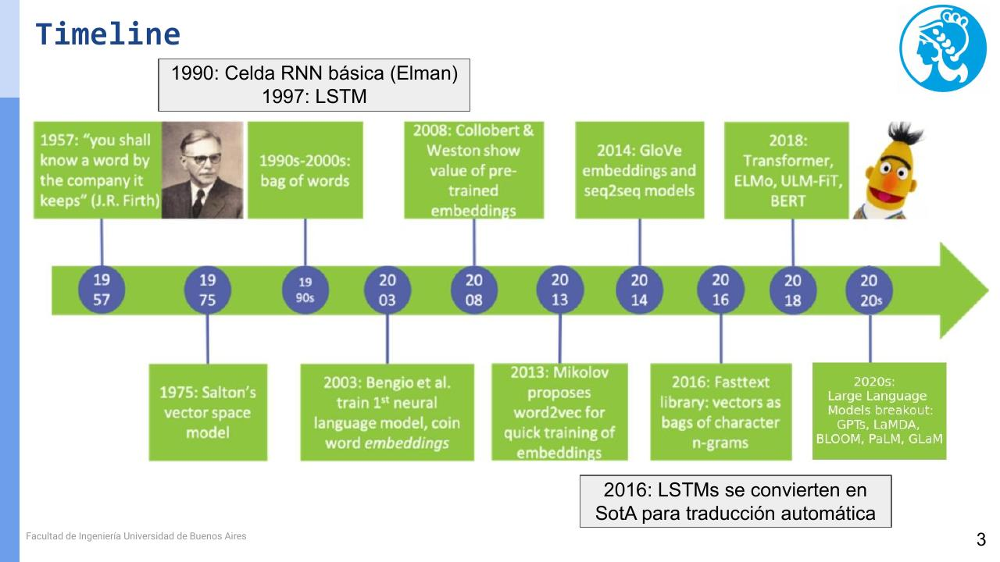

*Slide 3: línea de tiempo.*

| Año | Hito |
|---|---|
| 1957 | "You shall know a word by the company it keeps" (J. R. Firth) |
| 1975 | Modelo de espacio vectorial de Salton |
| 1990 | Celda RNN básica (Elman) |
| 1990s–2000s | Bag of words |
| 1997 | LSTM |
| 2003 | Bengio et al. entrenan el primer modelo de lenguaje neuronal y acuñan el término *word embeddings* |
| 2008 | Collobert y Weston muestran el valor de los embeddings preentrenados |
| 2013 | Mikolov propone word2vec para entrenar embeddings rápido |
| 2014 | Embeddings GloVe y modelos seq2seq |
| 2016 | Librería FastText: vectores como bolsas de n-gramas de caracteres. **Las LSTM se vuelven el estado del arte en traducción automática** |
| 2018 | Transformer, ELMo, ULM-FiT, BERT |
| 2020s | Explosión de los LLMs: GPTs, LaMDA, BLOOM, PaLM, GLaM |

- Las RNN tienen bastante tiempo: la celda de Elman es de **1990** y la **LSTM**, su versión avanzada, de **1997**. Aparecieron cerca de los métodos Bag of Words y antes que GloVe y Word2Vec, pero en lenguaje recién se hicieron conocidas bastante después (00:11:59). En **2016** la LSTM se volvió el estado del arte en traducción.
- **¿Por qué tanta demora?** Por el hardware, como se habló en la clase 1: un modelo de lenguaje necesita muchos parámetros para andar bien y ganarles a los modelos tradicionales. Desde 2016, o un poco antes, las redes neuronales se empezaron a usar mucho en lenguaje: vino el boom, y con los Transformers se aceleró todavía más.
- Antes de que los Transformers la destronaran, la LSTM era la red más usada. Aunque hoy no se use directamente, porque hay modelos mejores, conviene conocerla: muestra cómo avanzó el campo y qué problemas se fueron resolviendo, y cada tanto salen variantes que sirven en casos particulares.
- ✎ La slide pone el Transformer en 2018, junto con ELMo y BERT, pero el paper "Attention Is All You Need" es de 2017 (clase 1).

## 4. ¿Qué es una RNN? (00:13:35)

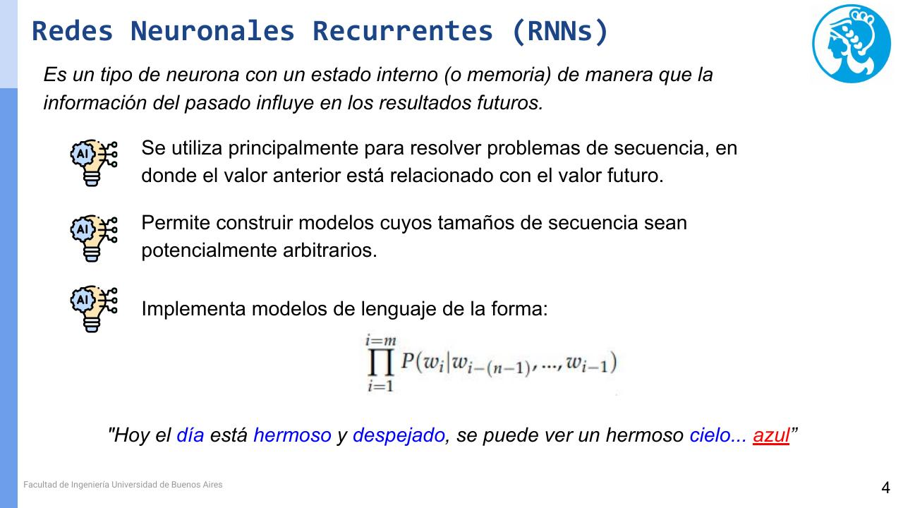

*Slide 4: "Es un tipo de neurona con un estado interno (o memoria) de manera que la información del pasado influye en los resultados futuros". Se usa en problemas de secuencia, donde el valor anterior está relacionado con el futuro. Permite secuencias de tamaño potencialmente arbitrario e implementa modelos de lenguaje. Ejemplo: "Hoy el día está hermoso y despejado, se puede ver un hermoso cielo… azul".*

- Es un tipo de neurona que guarda un **estado interno**, una especie de memoria, y analiza la información **en secuencia**: entra un input, se procesa, se actualiza la memoria y se pasa al siguiente input, que la vuelve a actualizar. Así recorre la secuencia en orden.
- Sirve para problemas de secuencia, que van más allá del lenguaje.
- En teoría admite secuencias de cualquier largo, pero tiene limitaciones: **cuanto más larga la secuencia, peor el desempeño** (§12 y §17).
- En un modelo de lenguaje, modela la **probabilidad de la siguiente palabra dadas todas las anteriores**. La slide lo escribe así:

```math
\prod_{i=1}^{m} P\left(w_i \mid w_{i-(n-1)}, \dots, w_{i-1}\right)
```

✎ Tal como está escrita, la fórmula condiciona en las n − 1 palabras anteriores (la aproximación de los n-gramas). Una RNN condiciona en toda la secuencia previa, resumida en su estado.

## 5. Problemas de secuencia (00:15:04)

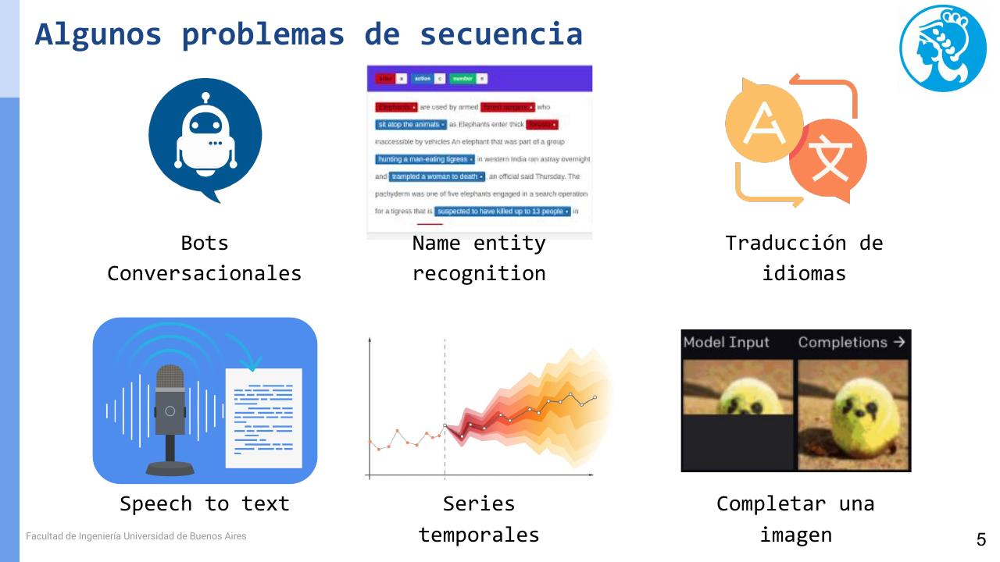

*Slide 5: bots conversacionales, name entity recognition, traducción de idiomas, speech to text, series temporales, completar una imagen.*

Pregunta a la clase: aparte del lenguaje, ¿qué otros problemas de secuencia se pueden resolver con RNN? Respuestas: audio y video (Carlos: el video "tiene una componente temporal") y series de tiempo (Nicolás). Entra en esta categoría todo lo que tenga una dimensión temporal:
- **Audio:** también es una serie de tiempo, de señales o frecuencias que cambian. Dentro del audio está **speech to text**, pasar de frecuencias a texto, que es parte del procesamiento de lenguaje.
- **Series temporales:** proyecciones de ingresos, ventas, capacidad productiva de una planta o temperatura. Sirve para cualquier magnitud que evolucione en el tiempo (00:16:36).
- **Bots conversacionales:** una respuesta es una secuencia de palabras que se genera **un token a la vez**. La generación de texto se ve en la próxima clase.
- **Clasificación por palabra, como NER** (clase 1): para asignarle una etiqueta a cada palabra hay que tener en cuenta el orden en que aparecen.
- **Traducción:** hace falta el orden para entender el significado y transmitirlo en otro idioma.
- **Imágenes:** se pueden modelar como secuencias en dos dimensiones, aunque las RNN no son el estado del arte para imágenes (00:17:57).

## 6. Intuición: la caja del supermercado (00:17:57)

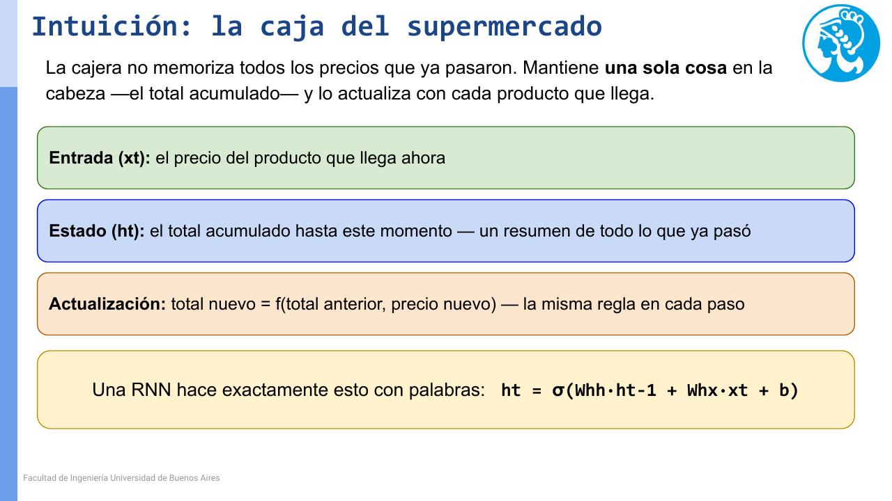

*Slide 6: la cajera no memoriza todos los precios: mantiene una sola cosa en la cabeza, el total acumulado, y lo actualiza con cada producto. Entrada (xₜ): el precio del producto que llega ahora. Estado (hₜ): el total acumulado hasta este momento, un resumen de todo lo que ya pasó. Actualización: total nuevo = f(total anterior, precio nuevo), la misma regla en cada paso. Una RNN hace exactamente esto con palabras: hₜ = σ(W_hh·hₜ₋₁ + W_hx·xₜ + b).*

- Los productos pasan **en orden**. El estado interno (la memoria) es el total a pagar y los elementos que entran en secuencia son los precios. Con cada precio se actualiza el total (00:19:21).
- Al terminar la secuencia (digamos, 10 productos), queda la memoria del último paso, h₁₀. Esa es la salida, lo que se le dice al cliente. En este caso es una tarea de **regresión**: un monto.
- Una RNN hace eso: pasa elemento tras elemento, va guardando en una memoria la información que necesita y usa la memoria final para la tarea. Con texto, el último estado puede ser un vector de toda la oración, que después pasa por otra capa para **clasificar** el texto o decidir **qué palabra sigue**.

## 7. La celda de Elman (00:20:45)

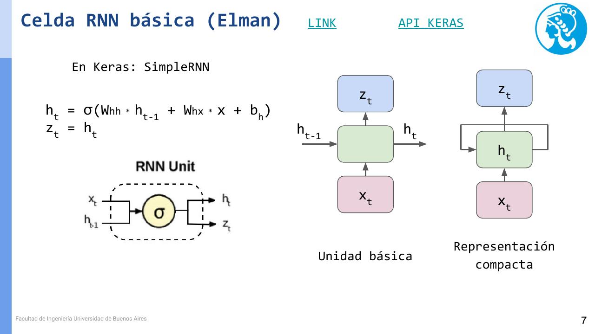

*Slide 7: celda RNN básica (Elman); en Keras, `SimpleRNN`. A la derecha, la unidad básica (entran xₜ y hₜ₋₁, salen hₜ y zₜ) y la representación compacta, en la que el estado vuelve a entrar a la celda.*

```math
h_t = \sigma\left(W_{hh}\, h_{t-1} + W_{hx}\, x_t + b_h\right), \qquad z_t = h_t
```

- Cada celda recibe el **elemento del tiempo t** (xₜ) y la **memoria del tiempo anterior** (hₜ₋₁).
- La memoria anterior se multiplica por su matriz de pesos y el elemento nuevo por la suya. Se suman los dos vectores y un **bias**: es una combinación lineal, previa a la activación. Después se aplica una **función de activación**, normalmente la **tangente hiperbólica**, y se obtiene la nueva memoria hₜ, que vuelve a entrar en el paso siguiente.
- Por eso la representación compacta es **autorregresiva**: la memoria vuelve a la celda junto con el siguiente x, y así hasta el final de la secuencia (00:22:24).
- Cada celda puede tener su propio **output** zₜ, que es igual a hₜ. Se pueden usar los z de cada paso o solo el h final.
- "Esta es la base de todo lo que vamos a ver hoy".
- ✎ En la slide, σ es la función de activación en general, no necesariamente la sigmoide. En Keras, `SimpleRNN` usa `tanh` por defecto.

## 8. Ejemplo animado: "Vivo en Francia…" (00:22:24)

La docente armó con Claude una animación en HTML, "para probar sus capacidades de generación de gráficos": [animacion-rnn-lstm-gru.html](material/animacion-rnn-lstm-gru.html). Tiene cinco pestañas: Elman, LSTM, GRU, parámetros y comparación.

**La oración (00:23:52):** "Vivo en Francia desde hace 6 meses, pero aún me cuesta comunicarme porque antes de mudarme no sabía nada de ___". Hay que adivinar la palabra que falta. La pista clave, *Francia*, aparece 17 palabras antes.

**El modelo de juguete:** según la animación, los pesos están elegidos a mano para poder seguir las cuentas. En una red real se aprenden con backpropagation, pero las operaciones son las mismas.

| Pieza | Dimensión | Detalle |
|---|---|---|
| Embedding de cada palabra, xₜ | 3 | Dimensiones con nombre solo para el ejemplo: lugar, comunicación, negación. En la realidad no se sabe qué representa cada una |
| Estado oculto, hₜ | 4 | País, idioma, negación y una sin significado claro (a propósito) |
| W_x | 4 × 3 | Lleva el embedding al tamaño de la memoria |
| W_h | 4 × 4 | Multiplica la memoria anterior |
| Salida | softmax | Candidatas: *francés*, *inglés*, *español*, *cocina*, *historia* |

**Paso a paso (00:25:02)**
1. Primera palabra, *Vivo*: su embedding de 3 dimensiones se multiplica por W_x, que es de **4 × 3** porque 4 es la dimensión elegida para la memoria y 3 la del embedding. Queda un vector de 4. Los pesos son entrenables.
2. El estado interno inicial se multiplica por W_h. Ese estado empieza en cero, o en valores aleatorios.
3. Se suman los dos vectores de 4 y el bias, que también es entrenable. Queda el vector previo a la activación, que en la primera palabra tiene sobre todo información de *Vivo*.
4. La activación (tanh) agrega la no linealidad y da h₁, la memoria del tiempo 1 (00:26:24).
5. Segunda palabra, *en*: se repite con **las mismas matrices**, que no cambian de un paso a otro, pero ahora hₜ₋₁ ya no es cero. El nuevo h₂ tiene mezclada la información de *Vivo* y la de *en* (00:27:32).
6. Se sigue así con toda la oración. El último h guarda la información de toda la secuencia y pasa por una capa **softmax** que da la probabilidad de cada candidata para continuar.

**Pregunta de Hernando:** ¿se hace la pasada de toda la frase y recién ahí se calcula la pérdida y se hace backpropagation, para después volver a hacer la pasada completa? Sí (00:28:57). Y ahí está el punto débil: con tantas operaciones encadenadas, el gradiente se va **diluyendo**, o incluso puede **explotar**, porque se multiplican gradientes a lo largo de una secuencia muy larga. Es la principal debilidad de esta arquitectura.

## 9. Tipos de problemas: many-to-one, many-to-many y seq2seq (00:28:57)

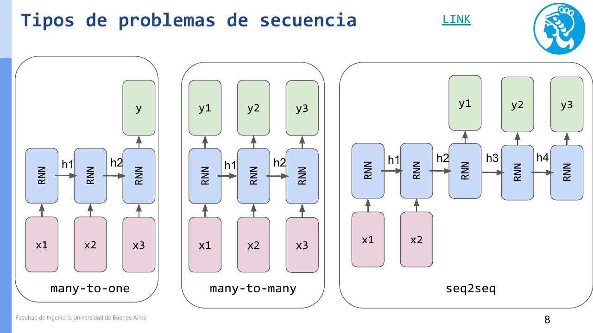

*Slide 8: many-to-one (x1, x2, x3 → y), many-to-many (una salida yₜ por cada xₜ) y seq2seq (x1, x2 → y1, y2, y3).*

Las celdas de Elman se configuran distinto según el problema que se quiere resolver.

**Many-to-one (00:30:24):** hay varios inputs y solo interesa el estado final. Es el caso del ejemplo: para completar una sola palabra se usa el h del último paso, y las memorias anteriores no importan.

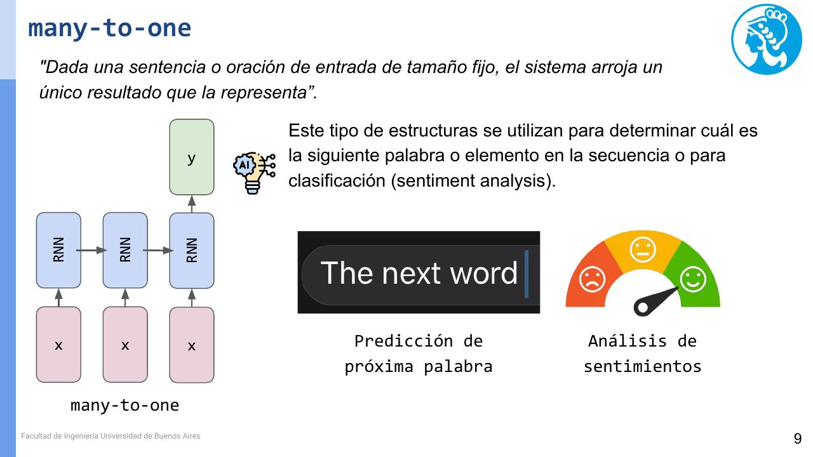

*Slide 9: "Dada una sentencia o oración de entrada de tamaño fijo, el sistema arroja un único resultado que la representa". Se usa para predecir la próxima palabra o elemento de la secuencia y para clasificar (análisis de sentimientos).*

- Ejemplos de la clase:
  - El **precio de una acción** (Gonzalo): a partir de los precios pasados se decide el siguiente.
  - La **clasificación de noticias**, como en el desafío 1: se procesa todo el artículo, se toma la memoria final, que condensa toda la información, y ahí se decide la clase (00:32:04).
  - El **análisis de sentimiento**: se recorre todo el comentario y con la última celda se decide si es positivo, negativo o neutro.

**Many-to-many (00:33:15):** hace falta la salida de cada celda. Por ejemplo, en **NER** o en el etiquetado de palabras se etiqueta cada palabra y no la frase entera, así que cada salida define la etiqueta de su palabra.

**Seq2seq:** primero se procesa la secuencia de entrada y después se genera una secuencia nueva, que puede tener **otro largo**. Por ejemplo, la **traducción** o un chatbot que genera respuestas completas.

## 10. RNN multicapa (00:34:43)

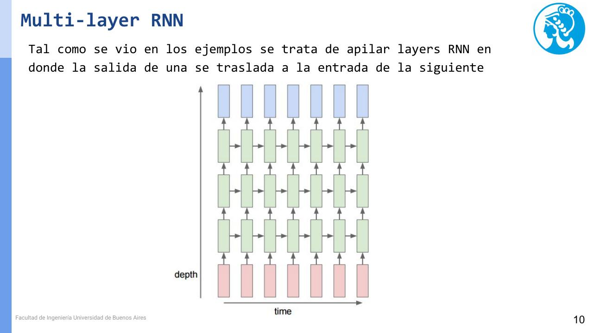

*Slide 10: multi-layer RNN. Se apilan capas RNN y la salida de una pasa a la entrada de la siguiente (eje vertical: profundidad; eje horizontal: tiempo).*

- Normalmente una RNN no se usa como una única capa: las capas se **apilan**. Como en cualquier red, más profundidad permite capturar conceptos más abstractos, y para algo complejo como el lenguaje suele hacer falta más de una capa (00:36:10).
- La primera capa se configura como **many-to-many**: cada celda devuelve su memoria en ese punto, y esa memoria es el input de la celda correspondiente de la capa siguiente, en lugar del embedding de la palabra. La capa 2 procesa igual que la primera: actualiza su propia memoria y la pasa a su paso siguiente. Lo mismo pasa con todas las capas que se apilen.
- La salida final es la de la **última capa**, y esa capa define el escenario: many-to-many si devuelve todos sus pasos, many-to-one si devuelve solo el último, o seq2seq (00:37:24).

## 11. Backpropagation through time y pesos compartidos (00:37:24)

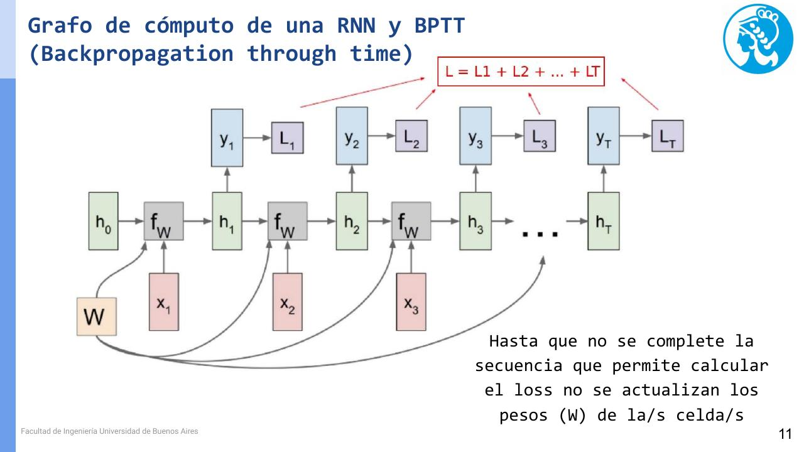

*Slide 11: grafo de cómputo de una RNN y BPTT (backpropagation through time). La misma W alimenta todas las f_W; cada salida yₜ tiene su pérdida Lₜ, y L = L1 + L2 + … + LT. "Hasta que no se complete la secuencia que permite calcular el loss no se actualizan los pesos (W) de la/s celda/s".*

```math
L = L_1 + L_2 + \dots + L_T
```

- **Forward:** entra cada elemento, se multiplica por las matrices y se actualiza el estado. La matriz de pesos es **la misma en todos los pasos** de la secuencia: se comparte.
- Al llegar al final, cada output tiene su loss. En many-to-many se calcula uno por salida y el loss final es la **suma**; en many-to-one hay uno solo, el del final (00:38:47).
- **Backward:** hay que recorrer todo el camino hacia atrás, paso por paso, calculando las derivadas. Eso da una multiplicación de derivadas muy larga, y cuanta más distancia hay entre el peso que se corrige y el loss final, más probable es que el gradiente **se desvanezca o explote** (como en Aprendizaje Profundo).
- **¿Por qué se comparte la matriz? (pregunta de Carlos, 00:40:13):** la matriz define **cómo se combina** la información del input con la de la memoria, y esa forma de combinar es la misma en todos los pasos. Además, así la RNN puede procesar **secuencias de distinto largo**, sin un número fijo de inputs.
- **Dos dimensiones del problema:** en una red común preocupa la cantidad de capas. En una RNN también importa el **largo de la secuencia**, porque cada elemento más es otra derivada que multiplicar (00:41:40). La información que más se pierde es la de los **primeros elementos**.

## 12. ¿Cuánto queda de "Francia"? (00:41:40)

Volviendo a la animación: ¿cuál es la palabra más importante para completar la oración? Hernando: *Francia* (00:43:11). Junto con *comunicarme*, porque hay que relacionar la comunicación con un país para llegar a un idioma.

- Cuando entra *Francia*, su información está "fresca": la dimensión de lugar está muy activada. Con cada palabra nueva el estado se multiplica y se actualiza, y el efecto de *Francia* va disminuyendo. Las palabras del inicio, las más lejanas del final, son las que más se pierden.
- Al final queda información de *comunicar*, pero poca del país, y puede ganar un idioma más genérico, como *inglés* (00:44:44).
- Pasa mucho con secuencias largas cuando la información que hace falta está al principio. Son **dos efectos en contra**:
  1. **Forward:** la información se diluye en las multiplicaciones del estado.
  2. **Backward:** al ajustar los pesos, esas palabras influyen poco en el gradiente. Los pesos aprenden poco de las palabras iniciales y no saben procesarlas.
- En la animación, el panel "¿Cuánto queda de «Francia»?" sigue la dimensión *país* paso a paso, con un control para mover su peso recurrente, W_h[h₁, h₁], que arranca en 0.45. El panel del gradiente explica que el error del final, para llegar hasta *Francia*, se multiplica en cada paso por diag(1 − hₜ²)·W_h. Si esos factores son menores que 1, la señal se achica de forma exponencial.

Receso de 15 minutos, hasta las 20:05.

---

## 13. Notebook 3a: una RNN en Keras (01:04:54)

[notebook-many-to-one.ipynb](material/notebook-many-to-one.ipynb). Es un ejemplo *dummy* (de juguete): sumar tres números, algo para lo que normalmente no se usaría una red. El notebook dice que se inspiró en un artículo de Stack Abuse sobre problemas de secuencia con LSTM en Keras.

**Datos**
- Son datos sintéticos: los números del 1 al 45 agrupados de a tres consecutivos, con la suma como target. [1, 2, 3] → 6, [4, 5, 6] → 15… hasta [43, 44, 45] → 132. En total, **15 ejemplos**.
- Cada ejemplo se lleva a la forma (3, 1): **3 pasos de tiempo, con 1 número por paso**. Ese es el `input_shape`.

**Modelo (01:06:33)**

```python
model = Sequential()
model.add(SimpleRNN(64, activation='relu', input_shape=input_shape))  # input_shape = (3, 1)
model.add(Dense(output_shape))  # output_shape = 1
model.compile(loss='mse', optimizer="Adam")
```

- `Sequential` sirve para redes con capas secuenciales, una detrás de otra: se instancia y se van agregando capas con `add`.
- `SimpleRNN` es la celda de Elman. Se define el tamaño de h: en la animación era 4 y acá es **64**.
- La salida de la RNN (el estado del último paso, un vector de 64) entra a una capa **`Dense`** que da el número final. Esa capa tiene **65 parámetros**: 64 pesos más un bias.
- Pregunta de Hernando (01:09:42): ¿la densa es una capa fully connected? Sí. La arquitectura recurrente es solo la `SimpleRNN`, pero hace falta una capa más para traducir ese vector a lo que se busca, en este caso la suma.

**Parámetros (01:08:01)**

```math
\#\text{params}_{\text{Elman}} = \underbrace{d_h \cdot d_x}_{W_{hx}} + \underbrace{d_h \cdot d_h}_{W_{hh}} + \underbrace{d_h}_{b} = d_h\,(d_h + d_x + 1)
```

| Capa | d_x (entrada por paso) | d_h (memoria) | Cuenta | Parámetros |
|---|---|---|---|---|
| Celda del ejemplo animado | 3 | 4 | 4·3 + 4·4 + 4 | **32** |
| `SimpleRNN(64)` del notebook | 1 | 64 | 64·1 + 64·64 + 64 | **4.224** |
| `Dense(1)` de salida | 64 | — | 64 + 1 | **65** |

- La docente explicó la cuenta con el ejemplo chico: 4 × 3 de la matriz del input, 4 × 4 de la matriz del estado interno (el tamaño del estado al cuadrado) y el bias, del tamaño del estado. Con una memoria de 64 da "un poco más de 4.000".
- `model.summary()` dibuja la red y cuenta los parámetros: 4.224 + 65 = **4.289**.
- ✎ En clase dijo que la matriz del input es de 3 × 64 porque "el input tiene tres". Pero 3 es el **largo de la secuencia**, no la dimensión de cada paso: cada paso es un solo número, así que W_hx es de 64 × 1. Los pesos no dependen del largo porque se comparten entre los pasos. Con 3 × 64 daría 4.352, no los 4.224 del summary.

**Entrenamiento y prueba (01:09:42)**
- `model.fit(X, y, epochs=50, validation_split=0.2, batch_size=5)`. Es un ejemplo tan simple que el error baja rápido. En el notebook guardado, la última época da loss 0.053 y val_loss 0.104.
- Prueba con una secuencia nueva, [50, 51, 52]: la suma es 153 y el modelo predice **153.5** (153.49567 en el notebook guardado).
- ✎ El notebook usa `activation='relu'`; el default de `SimpleRNN` es `tanh`.

**Varias capas: `return_sequences` (01:11:07)**

```python
model3 = Sequential()
model3.add(SimpleRNN(64, activation='relu', input_shape=input_shape, return_sequences=True))
model3.add(SimpleRNN(64, activation='relu', input_shape=input_shape))
model3.add(Dense(output_shape))
```

- Para un problema más complejo está la versión multicapa: las capas se agregan igual, pero las de abajo llevan **`return_sequences=True`**.
- El default es `False`: la capa devuelve solo la salida del **último paso**, como en el many-to-one. En el primer modelo estaba bien así, porque esa salida se usaba directo para calcular el número final.
- ¿Qué pasa si se apilan capas sin el parámetro? (01:12:33) Hernando: la capa siguiente necesita toda la secuencia. Exacto. La docente lo sacó y, al ejecutar, apareció un **error** (01:13:56): la segunda capa no tiene con qué calcular. Con `return_sequences=True`, la capa devuelve un elemento por cada celda.
- ¿Por qué la última capa no lo lleva? Hernando: porque es many-to-one. Es una suma, así que solo hace falta el resultado final (01:15:22). Si fuera many-to-many, la última capa también lo llevaría y la densa recibiría todas las salidas.
- Cada capa puede tener un tamaño de estado distinto; acá todas tienen 64. La primera tiene menos parámetros porque su input es un número por paso. Desde la segunda, el input es un vector de 64.
- **Pregunta de Diego (01:15:22):** el notebook de GitHub tiene una capa menos. Es probable: en clase mostró tres capas y el notebook subido tiene dos. Es una decisión de arquitectura y se pueden quitar o agregar capas sin que deje de funcionar. Para sumar no hace falta ni una red, pero en lenguaje normalmente sí hacen falta más capas, y hay que probar si mejora o si hay overfitting y conviene sacarlas.
- En el notebook guardado, la primera `SimpleRNN` devuelve una salida de forma (None, 3, 64) y tiene 4.224 parámetros. La segunda devuelve (None, 64) y tiene 8.256 (64·64 + 64·64 + 64). Con los 65 de la densa, el total es 12.545.
- ✎ El error de Keras es del tipo `Input 0 of layer "simple_rnn_…" is incompatible with the layer: expected ndim=3, found ndim=2`. La segunda RNN no recibe "nada": recibe un tensor de 2 dimensiones, (batch, 64), que es el último estado, cuando espera uno de 3, (batch, pasos, features).

**Bidireccional:** el notebook también tiene una versión con `Bidirectional`, que se ve en §16.

## 14. LSTM (01:16:48)

### El problema: memoria corta

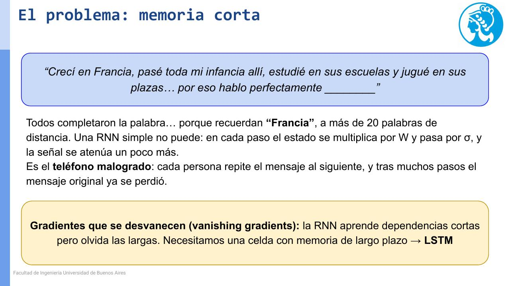

*Slide 13: "Crecí en Francia, pasé toda mi infancia allí, estudié en sus escuelas y jugué en sus plazas… por eso hablo perfectamente ___". Todos completan la palabra porque recuerdan "Francia", a más de 20 palabras. Una RNN simple no puede: en cada paso el estado se multiplica por W y pasa por σ, y la señal se atenúa un poco más. Es el teléfono malogrado. Gradientes que se desvanecen: la RNN aprende dependencias cortas pero olvida las largas, y hace falta una celda con memoria de largo plazo, la LSTM.*

- Es el mismo problema del ejemplo animado (01:18:18). Con muchas palabras en el medio, la del inicio se pierde, como en un **teléfono malogrado**: su información se va mezclando con todas las palabras que se procesan.
- A eso se suma el **vanishing gradient**: en backpropagation, el efecto del inicio es muy chico porque el gradiente se achica tanto que casi no mueve los pesos.
- Por eso se creó una variante de la RNN: la **LSTM**, *long short-term memory*.

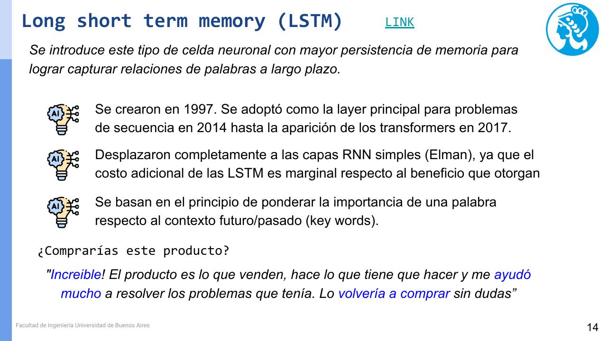

*Slide 14: la LSTM es una celda con mayor persistencia de memoria, para capturar relaciones de palabras a largo plazo. Se creó en 1997 y se adoptó como la capa principal para problemas de secuencia en 2014, hasta la aparición de los Transformers en 2017. Desplazó por completo a las RNN simples (Elman), porque su costo adicional es marginal frente al beneficio que otorga. Se basa en ponderar la importancia de una palabra respecto del contexto futuro o pasado (key words). Ejemplo: "¿Comprarías este producto? Increíble! El producto es lo que venden, hace lo que tiene que hacer y me ayudó mucho a resolver los problemas que tenía. Lo volvería a comprar sin dudas", con las palabras clave resaltadas.*

- Como dice el nombre, además de la memoria de corto plazo agrega una **memoria de largo plazo**, que guarda la información necesaria durante una secuencia más larga (01:19:35).
- Tiene más parámetros entrenables, pero resuelve el problema crítico del **olvido** de la información del inicio. Igual que la RNN, tiene pesos que ponderan las palabras, pero esos pesos deciden cómo actualizar una memoria de corto plazo y otra de largo plazo.

### Intuición: tomar apuntes en clase (01:19:35)

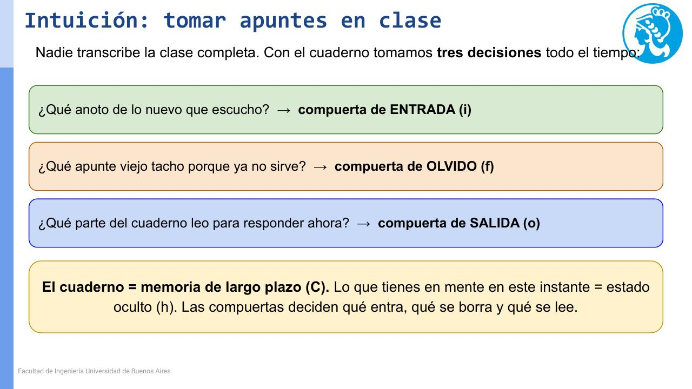

*Slide 15: nadie transcribe la clase completa; con el cuaderno se toman tres decisiones todo el tiempo. ¿Qué anoto de lo nuevo que escucho? Compuerta de ENTRADA (i). ¿Qué apunte viejo tacho porque ya no sirve? Compuerta de OLVIDO (f). ¿Qué parte del cuaderno leo para responder ahora? Compuerta de SALIDA (o). El cuaderno es la memoria de largo plazo (C); lo que uno tiene en mente en este instante es el estado oculto (h). Las compuertas deciden qué entra, qué se borra y qué se lee.*

- Con un cuaderno limitado, sin espacio infinito, cada vez que se dice algo nuevo hay que decidir cuánto de lo nuevo anotar y cuánto de lo viejo mantener (01:21:05).
- **Compuerta de olvido:** calcula qué parte de la información vieja borrar.
- **Compuerta de entrada:** decide qué tanto de lo nuevo anotar.
- **Compuerta de salida** (01:22:24): para resolver algo, como una pregunta del profesor, decide qué información del cuaderno sirve para la tarea.
- El **cuaderno** es la memoria de largo plazo (C). Lo que uno tiene en mente es el **estado oculto** (h), que ya existía en la RNN simple. Las compuertas deciden qué incluir y qué no; ya no es una sola matriz la que multiplica la información.

### Las cuatro subceldas (01:22:24)

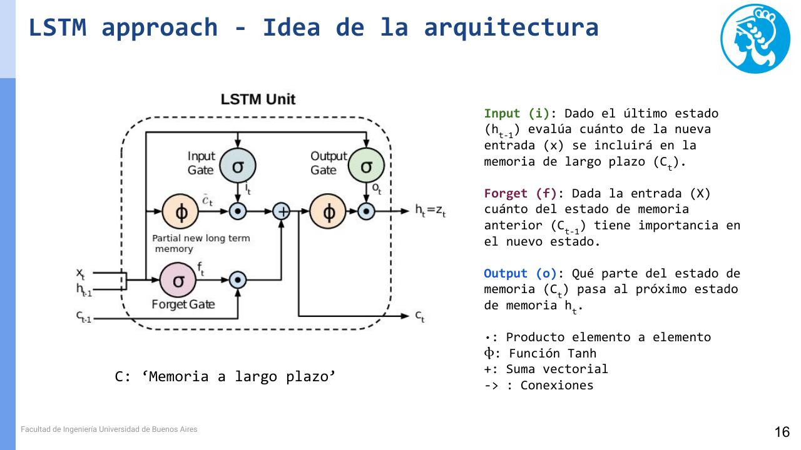

*Slide 16: idea de la arquitectura. Input (i): dado el último estado (hₜ₋₁), evalúa cuánto de la nueva entrada (x) se incluye en la memoria de largo plazo (Cₜ). Forget (f): dada la entrada (x), decide cuánto del estado de memoria anterior (Cₜ₋₁) importa en el nuevo estado. Output (o): decide qué parte del estado de memoria (Cₜ) pasa al próximo estado hₜ. Referencias: · es el producto elemento a elemento, ϕ es tanh, + es la suma vectorial y C, la "memoria a largo plazo".*

Entran los mismos dos inputs que en la celda de Elman: xₜ, el elemento del tiempo t, y hₜ₋₁, el estado interno, que ahora es la memoria de corto plazo. Pero no pasan por una sola combinación: **entran cuatro veces**, una por subcelda (01:23:40).
1. **Olvido (f):** con los dos inputs calcula pesos que dicen cuánto olvidar de la memoria de largo plazo anterior (Cₜ₋₁).
2. **Memoria candidata (C̃):** calcula la información nueva, la candidata a memoria de largo plazo.
3. **Entrada (i):** decide cuánto de esa información nueva mantener.
4. **Combinación:** la memoria anterior multiplicada por los pesos de olvido más la candidata multiplicada por los de entrada. Es una **combinación ponderada** (01:25:01) y da la nueva memoria de largo plazo Cₜ, que pasa tal cual al paso siguiente.
5. **Salida (o):** la cuarta subcelda decide cuánto de Cₜ hace falta para la tarea. De ahí sale zₜ, que también es el estado interno hₜ que pasa al elemento siguiente.

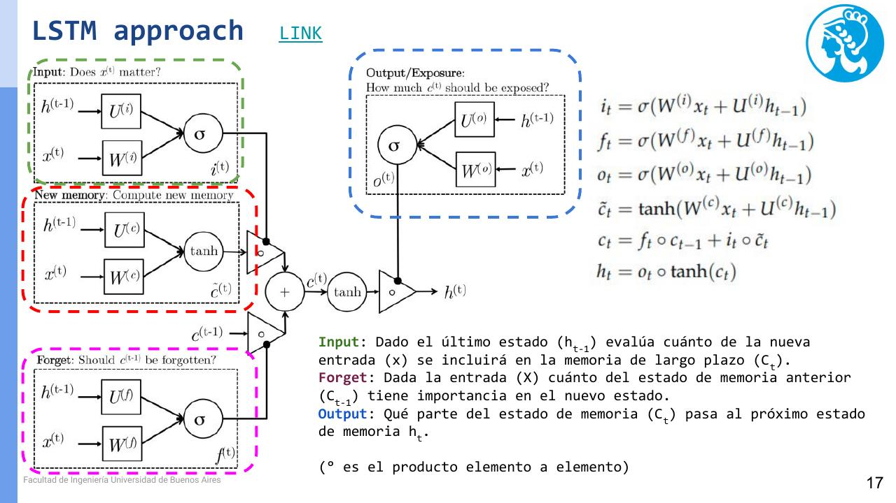

*Slide 17: el desglose de las cuatro operaciones, cada una con sus propios pesos W (para xₜ) y U (para hₜ₋₁): input ("¿importa xₜ?"), new memory, forget ("¿hay que olvidar cₜ₋₁?") y output/exposure ("¿cuánto de cₜ mostrar?"). ∘ es el producto elemento a elemento.*

```math
\begin{aligned}
i_t &= \sigma\left(W^{(i)} x_t + U^{(i)} h_{t-1}\right) \\
f_t &= \sigma\left(W^{(f)} x_t + U^{(f)} h_{t-1}\right) \\
o_t &= \sigma\left(W^{(o)} x_t + U^{(o)} h_{t-1}\right) \\
\tilde{c}_t &= \tanh\left(W^{(c)} x_t + U^{(c)} h_{t-1}\right) \\
c_t &= f_t \circ c_{t-1} + i_t \circ \tilde{c}_t \\
h_t &= o_t \circ \tanh(c_t)
\end{aligned}
```

- Cada una de las cuatro operaciones tiene **sus propias matrices**. Ya no hay dos matrices sino **ocho**, cuatro veces las de la RNN (01:30:49), así que la LSTM tiene **4 veces los parámetros** de una celda de Elman del mismo tamaño.
- Vale la pena: el aumento de parámetros permite resolver mejor los problemas de secuencias largas.
- ✎ La slide no escribe los bias. En Keras hay uno por subcelda.

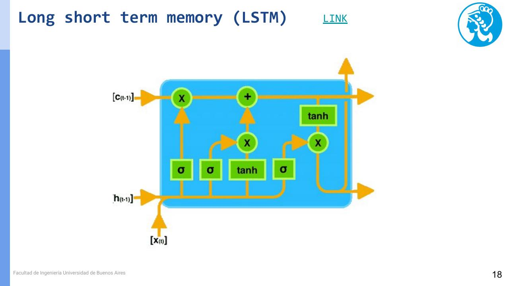

*Slide 18: diagrama de la celda LSTM. Entran cₜ₋₁, hₜ₋₁ y xₜ; hay tres compuertas σ y una tanh, y por arriba pasa la línea de c, con un × (olvido) y un + (lo nuevo). Según la docente, es un GIF parecido a la animación, que no repitió.*

### El camino de la memoria C (01:25:01)

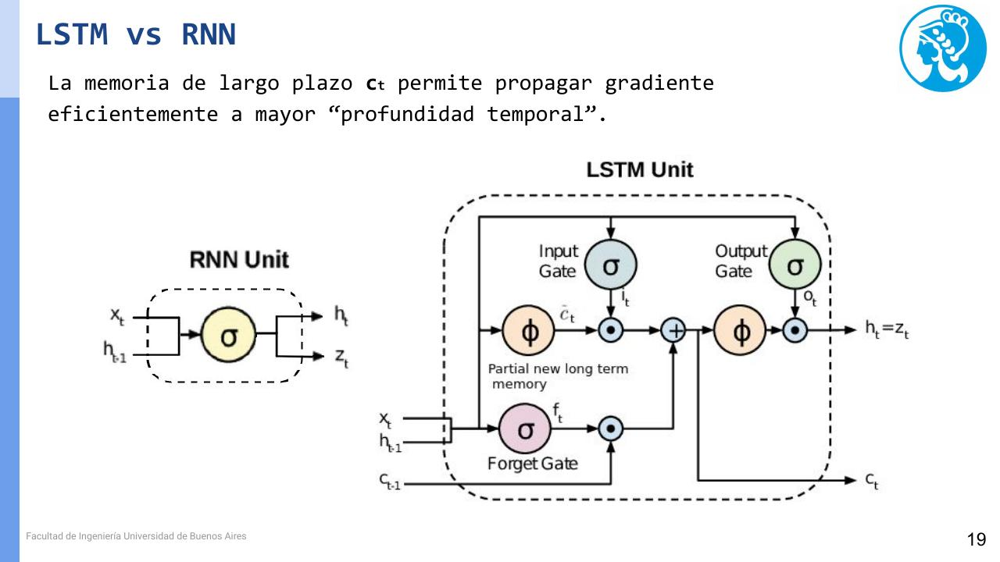

*Slide 19: LSTM vs RNN. "La memoria de largo plazo cₜ permite propagar gradiente eficientemente a mayor profundidad temporal".*

- Lo más interesante, además de las compuertas, es que crean un **camino** para C. Entre un paso y el siguiente, C solo pasa por operaciones aritméticas (se multiplica y se suma): es una vía libre de actualización que, según la docente, no se ve afectada por las derivadas.
- Además, como las compuertas deciden qué información queda, se elige de forma más específica qué es importante mantener para la tarea. "Este caminito es la innovación de este tipo de redes".
- **En la animación (01:26:23):** la pestaña LSTM muestra xₜ y hₜ₋₁ pasando por olvido (en el primer paso no importa, porque la memoria arranca en cero), entrada y candidata. La combinación da la nueva C, que pasa al paso siguiente y también se usa, junto con la compuerta de salida, para calcular h.
  - Cuando se llega a *Francia*, los pesos (entrenados para detectar qué mantener) hacen que C **conserve** esa información hasta el final, así que el idioma se elige con mucha más información (01:29:12).
  - La animación describe C como una **cinta transportadora**: la información solo se modifica multiplicando por la compuerta de olvido y sumando lo nuevo. C guarda *Francia* casi intacta, y h la muestra cuando se abre la compuerta de salida, después de *comunicarme*.
- **Carlos (01:30:49):** la RNN es más intuitiva, porque iba armando una combinación lineal de lo que encontraba; en la LSTM cuesta entender qué se logra con esos productos. Respuesta: en la RNN había una sola operación, y la información nueva y la vieja se combinaban solo con dos matrices. Acá lo más importante es el camino del vector de memoria, que solo se multiplica y se suma. No pasa por ninguna función de activación, así que no le afecta el vanishing gradient a lo largo de la secuencia (01:32:24).
- **Skip connections (01:33:37):** ¿alguien escuchó hablar de ResNet? Hernando: conecta una capa con una posterior, se saltea capas. Carlos: lo vio en Aprendizaje Profundo, conectando por bloques. La LSTM hace algo parecido: lo que se decide recordar en la memoria de largo plazo se "saltea" a la etapa siguiente y perdura a lo largo de la secuencia, sin perderse en la profundidad de la red. Se ve en Visión por Computadora II.
- ✎ Para ser más precisos: por C también pasa el gradiente, pero en cada paso solo se multiplica por fₜ, elemento a elemento, sin la matriz W ni la derivada de una tanh. Si la red aprende f ≈ 1 en las dimensiones que importan, el gradiente llega casi intacto a los primeros pasos.

### En Keras (01:35:03)

- Es igual que con la RNN simple: en lugar de `SimpleRNN` se usa `LSTM`, que ya viene implementada, y se define el tamaño de las memorias.
- En el notebook 3a, `LSTM(64, activation='relu', input_shape=(3, 1))` tiene **16.896** parámetros, que son **4 × 4.224**.
- Cerró con la comparación entre las dos (01:36:28). En la RNN, los dos inputs pasan por una sola operación. En la LSTM pasan cuatro veces, para generar las compuertas y actualizar la memoria de largo plazo, que en la versión anterior no existía.

## 15. GRU (01:36:28)

¿Qué desventaja tiene la LSTM? Respuesta: **el costo**. Antes era algo simple y ahora hay muchos más cálculos y cuatro veces los parámetros. Por eso surgió una tercera versión, más optimizada: la **GRU** (*gated recurrent unit*), que tiene **tres** veces los parámetros en vez de cuatro.

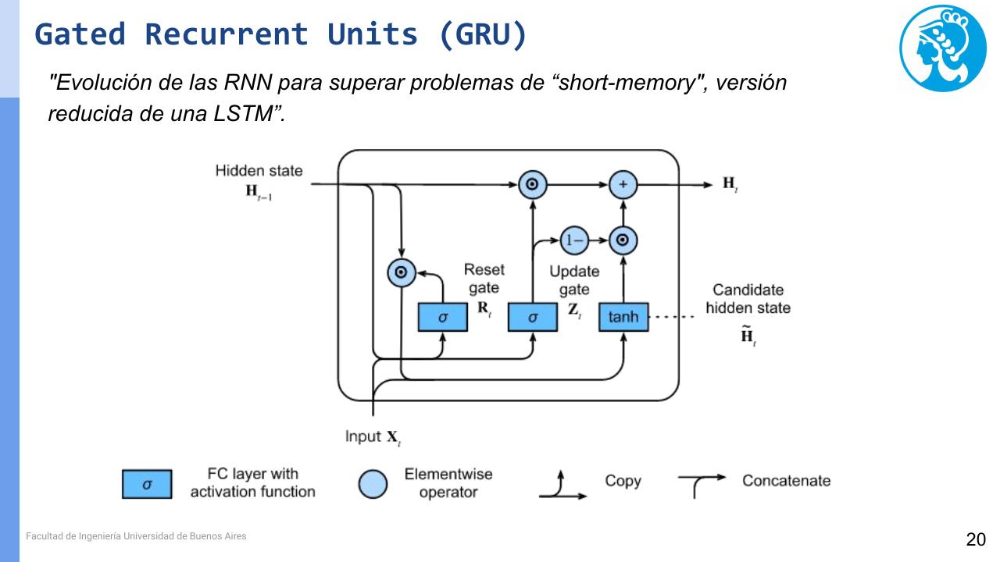

*Slide 20: "Evolución de las RNN para superar problemas de short-memory, versión reducida de una LSTM". Entran Hₜ₋₁ y Xₜ; hay una reset gate Rₜ, una update gate Zₜ y un estado candidato H̃ₜ, y la salida es Hₜ.*

- Es una versión reducida de la LSTM que muchas veces funciona bastante bien y **en algunos casos le gana a la LSTM**, según el caso de uso. **Siempre vale la pena probar las dos** (01:38:02).
- **No tiene C:** reutiliza el estado h, que sigue siendo la única memoria de la red.
- Usa tres subceldas:
  - **Compuerta de reset (r):** decide cuánto de la memoria anterior se resetea para calcular la candidata.
  - **Candidata (h̃):** calcula la nueva memoria candidata.
  - **Compuerta de update (z):** con sus pesos se define cuánto entra de la memoria anterior y, con su opuesto, cuánto entra de la nueva candidata. Con eso se hace la combinación lineal.
- Optimiza la cantidad de operaciones y reutiliza el estado interno, pero igual le crea un **camino directo, sin funciones de activación**, para propagar la información al paso siguiente (01:39:29).

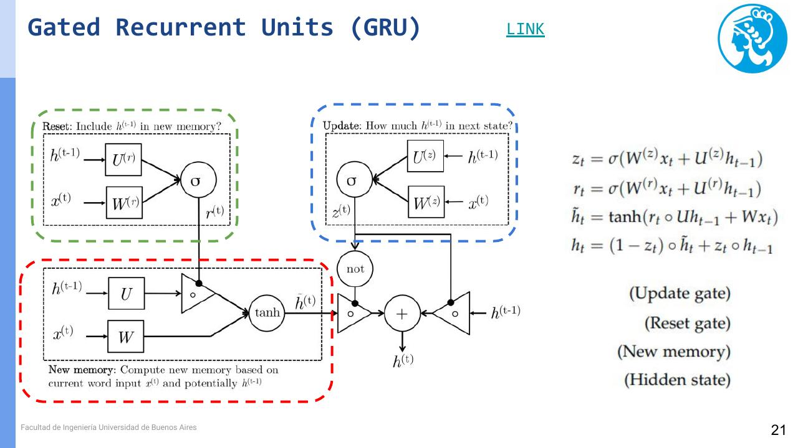

*Slide 21: reset ("¿incluir h^(t−1) en la nueva memoria?"), update ("¿cuánto de h^(t−1) va al próximo estado?") y new memory, que se calcula con el input x^(t) y, potencialmente, con h^(t−1).*

```math
\begin{aligned}
z_t &= \sigma\left(W^{(z)} x_t + U^{(z)} h_{t-1}\right) && \text{(update gate)} \\
r_t &= \sigma\left(W^{(r)} x_t + U^{(r)} h_{t-1}\right) && \text{(reset gate)} \\
\tilde{h}_t &= \tanh\left(r_t \circ U h_{t-1} + W x_t\right) && \text{(new memory)} \\
h_t &= (1 - z_t) \circ \tilde{h}_t + z_t \circ h_{t-1} && \text{(hidden state)}
\end{aligned}
```

- **En la animación (01:40:58):** la misma oración, ahora con la GRU. Entra el embedding, se calculan el reset y la candidata, y la compuerta de update pondera la memoria anterior y la nueva.
  - Según la animación, z cae casi a 0 solo en *Francia* (ahí escribe) y queda cerca de 1 el resto del tiempo (conserva).
  - Usa la misma convención que la slide, Keras y PyTorch: z ≈ 1 conserva. Algunos libros intercambian z y 1 − z, pero el mecanismo es el mismo.
- **En Keras:** se reemplaza la celda por `GRU(...)`. El notebook subido no tiene esa celda, pero en clase la mostró: la RNN original tenía 4.224 parámetros, la LSTM cuatro veces más y la GRU "solo tres veces" (01:42:53). Agrega parámetros, aunque no tantos como la LSTM, y también resuelve el vanishing gradient.
- **Pregunta de Carlos:** ¿todos los componentes se ven afectados por backpropagation? En la GRU también hay un **camino libre** de memoria, hecho solo de multiplicaciones y sumas elemento a elemento. Usa el mismo truco de la LSTM para transmitir información sin que se desvanezca.
- ✎ El "×3" es exacto con un bias por bloque. Keras usa dos bias en la GRU (`reset_after=True`, el default), así que `GRU(64)` con entrada (3, 1) daría 3 × (64·1 + 64·64 + 2·64) = 12.864, no 12.672. La pestaña de parámetros de la animación explica la diferencia.

## 16. RNN bidireccionales (01:44:32)

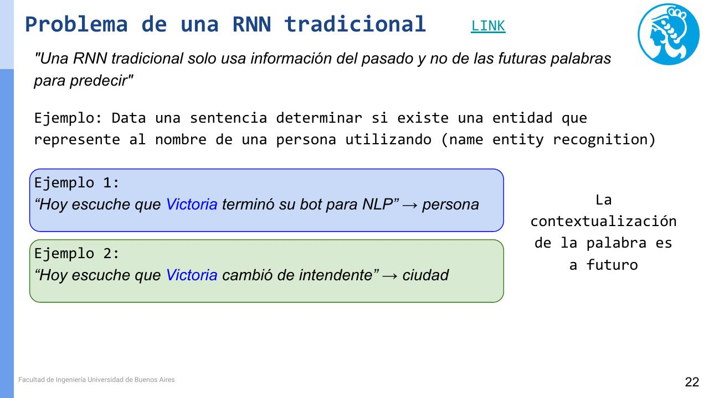

*Slide 22: "Una RNN tradicional solo usa información del pasado y no de las futuras palabras para predecir". Ejemplo de NER: ¿hay una entidad que sea el nombre de una persona? "Hoy escuché que Victoria terminó su bot para NLP" → persona. "Hoy escuché que Victoria cambió de intendente" → ciudad. La contextualización de la palabra está a futuro.*

- ¿Qué información hace falta para saber si *Victoria* es persona o ciudad, y dónde está? Hernando: al final, en *intendente*. En la primera oración, la pista es *su bot*.
- Una RNN tradicional va de izquierda a derecha. Cuando llega a *Victoria* y da su output, solo tiene la información del pasado y no la de cómo sigue la oración (01:46:25).
- Cuando la información está en el medio, hace falta la variante **bidireccional**, que procesa la oración en los dos sentidos. Hay celdas iguales a las ya vistas que van en un sentido y, en paralelo, otras que arrancan en el último elemento y van hacia atrás (01:47:58).

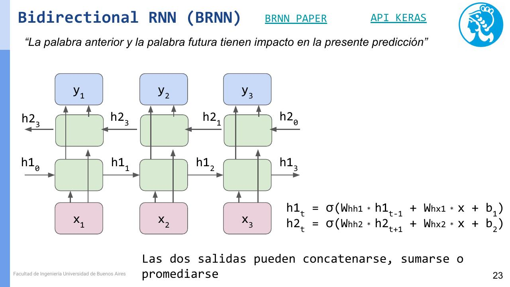

*Slide 23: Bidirectional RNN (BRNN): "La palabra anterior y la palabra futura tienen impacto en la presente predicción". En cada paso hay dos estados, uno que viene del pasado y otro del futuro: "Las dos salidas pueden concatenarse, sumarse o promediarse".*

```math
h^{(1)}_t = \sigma\left(W_{hh1}\, h^{(1)}_{t-1} + W_{hx1}\, x_t + b_1\right), \qquad
h^{(2)}_t = \sigma\left(W_{hh2}\, h^{(2)}_{t+1} + W_{hx2}\, x_t + b_2\right)
```

- A cada output llegan dos vectores, el estado de cada dirección, y se **combinan**: se concatenan, se suman o se promedian. La salida tiene la información de las dos direcciones.
- Se calcula **en paralelo**: el resultado de una dirección no pasa a la otra como si fueran dos capas. Los dos van directo al output, y recién ahí se juntan.
- **Concatenar vs sumar (01:49:08):** si llegan dos vectores de 4, al concatenarlos queda uno de **8** (Hernando). Al sumarlos o promediarlos elemento a elemento queda uno de 4.
- Hace falta cuando la información está en el medio y hay que considerar el futuro, por ejemplo para **etiquetar palabras**. Para **generar el siguiente token** no se necesita, porque se va generando hacia adelante.
- **En Keras (01:50:22):** la clase `Bidirectional` envuelve a la celda. El `input_shape` va afuera, como parámetro de `Bidirectional`, y la celda va adentro:

```python
model2 = Sequential()
model2.add(Bidirectional(SimpleRNN(64, activation='relu'), input_shape=input_shape))
model2.add(Dense(output_shape))
```

- Los parámetros se **duplican**, porque hay estados y matrices para las dos direcciones. En el notebook: 8.448 parámetros (2 × 4.224) y una salida de 128 (las dos direcciones concatenadas, que es el default). La densa tiene 129. Para [50, 51, 52] predice 152.1, con val_loss final de 0.336.
- **Carlos (01:51:55):** para usarla en vivo, ¿solo se puede en diferido? Sí: si hay que procesar elementos del futuro, en vivo no se tienen. Sirve cuando ya está el texto completo y se quiere etiquetar información del medio. En generación de secuencias no se usa, porque lo que se quiere es generar el futuro.
- **Hernando:** ¿se usa en una única pasada sobre un texto gigante o por oraciones? Depende de la tarea. Cuanto más texto se abarca, más contexto hay, pero para decidir si una palabra es sustantivo o verbo alcanza con la oración, sin ver el párrafo completo (01:53:22).

Receso, hasta las 21:10.

---

## 17. Notebook 3b: el adding problem (02:11:19)

[notebook-adding-problem.ipynb](material/notebook-adding-problem.ipynb). En el notebook 3a la secuencia tiene solo tres números y no se nota la diferencia entre arquitecturas. Este ejemplo es el del **paper original de la LSTM** (Hochreiter y Schmidhuber, 1997).

**La tarea**
- Cada muestra es una serie de tiempo de largo T con **dos features por paso**: un **número aleatorio** entre 0 y 1 y un **marcador** binario.
- Solo dos pasos tienen la marca en 1; el resto es ruido. El target es la **suma de esos dos números** (02:12:38).
- Para resolverlo, el modelo tiene que detectar la primera marca, memorizar ese valor durante muchos pasos de ruido, encontrar la segunda marca y sumar.
- Para que se vea la diferencia, una marca cae en la **primera mitad** de la secuencia y la otra en la **segunda**, así que siempre hay una dependencia larga.
- **T = 50**, con **6.000 muestras** de entrenamiento (02:13:57) y 1.000 de validación. X tiene forma (6.000, 50, 2).
- En el gráfico de la muestra 0, las marcas están en los pasos 0 y 39, separadas por 39 pasos: 0.512 + 0.062 = 0.574.
- Jeraldinne pidió repetirlo (02:15:24). De los 50 números, 48 son ruido y 2 importan. La red recibe el valor y la marca: 1 = sumar, 0 = ruido. Es la misma suma del notebook anterior, pero con ruido y una secuencia larga.

**Baseline (02:16:44):** un modelo que no aprende nada y siempre predice la media. El target es la suma de dos uniformes en [0, 1], con media 1 y varianza 2 · 1/12 ≈ 0.167, así que ese modelo tiene un MSE igual a la varianza. Medido en el notebook: media 0.998 y **MSE del baseline = 0.161**. Un modelo que se estanca ahí no aprendió a usar la secuencia.

**Los tres modelos:** misma cantidad de unidades (32), mismo optimizador (Adam, lr = 1e-3), mismos datos y mismas épocas (30, con batch de 64). Solo cambia la celda. Con d_x = 2 y d_h = 32:

| Celda | Parámetros de la capa | `Dense(1)` | Total |
|---|---|---|---|
| `SimpleRNN(32)` | 1.120 = 32·(32 + 2 + 1) | 33 | 1.153 |
| `LSTM(32)` | 4.480 (×4) | 33 | 4.513 |
| `GRU(32)` | 3.456 (×3, con dos bias por bloque) | 33 | 3.489 |

**Resultados con T = 50 (02:18:15)**
- La SimpleRNN **casi no aprendió**: el error bajó un poco al final, pero no logró retener la información para sumar. Es el problema que se vio: un elemento muy al inicio y una secuencia larga (50 es bastante).
- La LSTM y la GRU bajaron el error mucho más. En este caso **ganó la GRU**.
- MSE de validación final en el notebook guardado: SimpleRNN 0.0254, LSTM 0.0049 y GRU 0.0021. En el gráfico (escala logarítmica), la SimpleRNN se queda en el baseline unas 13 épocas y después baja de a poco; la LSTM y la GRU caen alrededor de la época 8.

**Predicciones (02:18:15)**

| Target | SimpleRNN | LSTM | GRU |
|---|---|---|---|
| 0.954 | 0.842 | 0.991 | 1.008 |
| 1.082 | 1.205 | 1.135 | 1.154 |
| 0.615 | 0.610 | 0.558 | 0.605 |
| 0.749 | 0.731 | 0.767 | 0.732 |
| 1.526 | 1.372 | 1.343 | 1.480 |

En clase comentó que en el primer caso la más cercana era la GRU y que en el segundo ganaba la LSTM. ✎ Los valores de la tabla son los del notebook guardado; en la corrida de la clase pueden haber variado un poco.

**Según el largo de la secuencia (02:19:40):** mejor MSE de validación en 20 épocas.

| T | SimpleRNN | LSTM | GRU |
|---|---|---|---|
| 10 | 0.0139 | 0.0066 | 0.0002 |
| 30 | 0.0313 | 0.0085 | 0.0030 |
| 50 | **0.1574** | 0.0363 | 0.0054 |

- Con la SimpleRNN, el error con T = 10 era de 0.01 y con T = 50 de casi 0.15, prácticamente el baseline. La diferencia crece a medida que la secuencia se alarga.
- La LSTM tampoco es perfecta: con secuencias más largas su error también sube, pero mucho menos que el de la RNN (02:21:16).
- Para probar en casa: T = 100 o más, para ver cómo la SimpleRNN se equivoca cada vez más.
- Conclusiones del notebook:
  - Con secuencias cortas no hay diferencia entre las tres; por eso la suma de 3 números no mostraba nada.
  - Con dependencias largas, la SimpleRNN colapsa al baseline.
  - La LSTM y la GRU resuelven la tarea en todos los largos probados.
  - La GRU logra resultados comparables a los de la LSTM con ~25 % menos parámetros, y en la práctica suele ser la primera opción cuando importa el cómputo.
  - El costo crece de RNN a GRU y a LSTM: aproximadamente 1×, 3× y 4×.
- El notebook trae una sección opcional, que no se vio en clase, que mide cuánto influye cada paso de la entrada en la predicción final (‖∂ŷ/∂xₜ‖). En el notebook guardado, la LSTM mantiene una sensibilidad alta (~0.9) y pareja en los 50 pasos.

## 18. Introducción a la generación de texto (02:21:16)

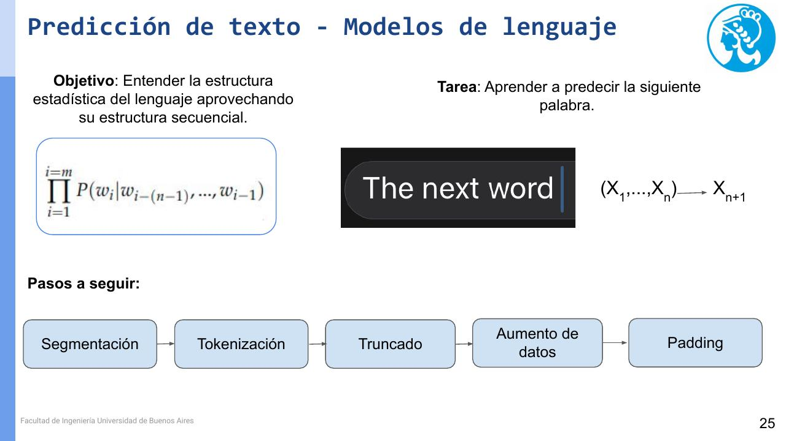

*Slide 25: predicción de texto con modelos de lenguaje. Objetivo: entender la estructura estadística del lenguaje aprovechando su estructura secuencial. Tarea: aprender a predecir la siguiente palabra, (X₁, …, Xₙ) → Xₙ₊₁. Pasos a seguir: segmentación → tokenización → truncado → aumento de datos → padding.*

Con estas tres redes, que eran el estado del arte antes de los Transformers, ya están los elementos para generar texto. Esta clase solo introduce el tema; se profundiza en la clase 4.

- Generar texto es **predecir la siguiente palabra**: la probabilidad de que una palabra complete la oración, dadas todas las anteriores. Para eso hay que entender la **estructura estadística** del lenguaje, cómo se juntan las palabras, y armar un modelo que la capture (02:22:41).
- El modelo va completando una oración incompleta **un token a la vez**. Es lo que se ve en Gemini, Claude o GPT en modo streaming: por detrás, el modelo mira las probabilidades y elige el siguiente token.
- **¿Responde o razona primero? (02:24:08)** Ante una pregunta de sí o no, un modelo usado tal cual viene, ¿decide la respuesta y después la justifica, o razona primero? Jeraldinne, sin estar segura: primero razona. La respuesta de la docente (02:25:38), como dijo Emiliano: así como está creado, un modelo de lenguaje **primero responde y después justifica**.
  - Decide qué es más probable, un sí o un no, y después genera la justificación más probable para esa respuesta. Arma una historia plausible y la dice con mucha confianza, aunque puede estar equivocada.
  - Por eso aparecen las **alucinaciones**: el modelo se autojustifica y hasta puede inventar algo que suena verdadero (02:26:55).
- Después los modelos evolucionaron: en vez de dar la respuesta directamente, generan una especie de **razonamiento**. Va "entre comillas, porque los modelos no razonan": son generadores de tokens. Como procesan más información antes de la respuesta final, tienen margen para corregirse. Los chats actuales hacen que el modelo razone antes de responder.
- Lo importante es saber cómo funcionan por dentro: solo generan tokens según probabilidades, y por eso tienen estos problemas y sesgos (02:28:16).
- **Pasos para construir el modelo:**
  - **Segmentación:** dividir el corpus en documentos (clases 1 y 2).
  - **Tokenización:** dividir los documentos en unidades (palabras, caracteres o n-gramas) y asignarles un identificador.
  - **Truncado y padding:** dejar todas las secuencias del mismo largo.
  - **Aumento de datos:** combinando truncado y padding, de un mismo corpus se sacan muchísimos ejemplos de oraciones incompletas para que el modelo aprenda la estructura del lenguaje.
- En la clase 4 se ve todo en un notebook: un pequeño modelo de lenguaje con redes recurrentes, desde el corpus hasta la generación de oraciones (02:29:43).

## 19. Cierre (02:29:43)

- **Jeraldinne:** ¿en la materia que sigue a esta (PLN II) se ven los algoritmos que hay detrás de algo como ChatGPT? En esta materia también: Transformers, mecanismos de atención y LLMs. La primera parte del curso recorre las técnicas anteriores y cómo fueron resolviendo los problemas del lenguaje (02:31:29).
- Los pasos de la próxima clase (segmentación, tokenización, etc.) se usan en **cualquier** modelo de lenguaje. Lo que cambia es la arquitectura de la red: en el curso se usan redes recurrentes, y hoy se usan Transformers y otras variantes.
- La clase terminó un poco antes. Recordatorio: el desafío 1 se podía entregar hasta el final del día.

---

## Correcciones de la transcripción automática

| Dice la transcripción | Es |
|---|---|
| lse posgrados (hablante) | la docente, Josselyn Ordóñez (cuenta del posgrado) |
| la corte | la cohorte |
| Word to Bec, World tobe | Word2Vec |
| Sibo, SO, CBO | CBOW |
| Skipbram, Skimer, Skip Skipgram | skip-gram |
| GL, Glob | GloVe |
| Fast Tex | FastText |
| enegrama | n-grama |
| edadings, inbase, invedan, embeding | embedding(s) |
| parámetras (aparecen juntas) | palabras |
| morri, morrió, morre, morrida | mordió, muerde, mordida |
| Back of Wars | Bag of Words |
| LCTM, el STM, el CM | LSTM |
| celda del man, celdas de alma | celda de Elman |
| byes, vallas, varas, varia, var | bias |
| Cloud | Claude |
| dami, de Ami | *dummy* (ejemplo de juguete) |
| ejemplo Daming | probablemente "el ejemplo dinámico" (la animación) |
| Fran | Francia |
| Sofmax, Smax | softmax |
| backagation, back preparation, propag | backpropagation |
| merito to one, menit to, manit one, medi one | many-to-one |
| sentimental análisis | sentiment analysis (análisis de sentimiento) |
| nameic recognition, name recognition | named entity recognition (NER) |
| Sequ se sequence | sequence to sequence (seq2seq) |
| multiler | multilayer |
| queras, quereras, quedas, KS, conquas, en qué horas | Keras |
| simple RN | `SimpleRNN` |
| public conect | fully connected |
| return sequen true, return s | `return_sequences=True` |
| input zero with name | "Input 0 of layer…" (el error de Keras) |
| nodo (que subí) | notebook |
| neurolonal | neuronal |
| vanish ingredients, vanishing gradi, van gradi | vanishing gradient(s) |
| long short termy | long short-term memory |
| comporta | compuerta |
| subscelda | subcelda |
| Hreu, LZU, la LGO, R, RU, GR | GRU |
| gated recur unit | gated recurrent unit |
| gift | GIF |
| Так | ruido de la transcripción |
| NLEPEC | NLP |
| laaboración | la oración |
| RNM | RNN |
| Stben Ben | no se entiende |
| punto95 | 0.95 (el target 0.954) |
| pregunta de signo | pregunta de sí o no |
| toque | token |
| tocción | tokenización |
| pading | padding |
| Llilo Chat GPT, chaval pt | ChatGPT |
| pensamiento de lenguaje natural dos | Procesamiento de Lenguaje Natural II |
| 8:5 | 20:05 |

---

## ✎ Para los desafíos

Esta clase no presenta desafío. Fechas: el desafío 1 valía 10 hasta el jueves 05/11, el mismo día de esta clase, y el desafío 2 vale 10 hasta el jueves 12/11 (ver la [tabla de notas](../../desafios/README.md)).

**Desafío 3 (se presenta en la clase 4):** generación de secuencias con un modelo de lenguaje basado en redes recurrentes. Lo que aporta esta clase:

| Para… | Conceptos de esta clase |
|---|---|
| Elegir la celda | SimpleRNN, LSTM y GRU (§7, §14, §15) y su comparación en el adding problem (§17) |
| Armar la red en Keras | `Sequential`, capas recurrentes y `Dense` (§13) |
| Apilar capas | `return_sequences=True` en todas menos la última (§10, §13) |
| Predecir la siguiente palabra | Many-to-one y softmax sobre las candidatas (§8, §9, §18) |
| Revisar el `summary()` | Conteo de parámetros (§13, §14, §15) |
| Preparar el corpus | Segmentación, tokenización, truncado, aumento de datos y padding (§18; se ven en la clase 4) |

Detalles prácticos:
- Las capas recurrentes de Keras reciben tensores de 3 dimensiones: (batch, pasos de tiempo, features). En el notebook 3a cada paso es un número y la forma es (3, 1). Con texto, una capa `Embedding` antes de la RNN da (batch, pasos, d_x).
- `return_sequences=False` (el default) devuelve (batch, d_h), y `True` devuelve (batch, pasos, d_h).
- Parámetros por capa, con entrada d_x y memoria d_h:
  - `SimpleRNN`: d_h·(d_h + d_x + 1).
  - `LSTM`: 4·d_h·(d_h + d_x + 1).
  - `GRU` (en Keras): 3·d_h·(d_h + d_x + 2).
  - `Bidirectional`: el doble que la celda que envuelve.
  - Una `Dense` de salida suma d_h + 1 por neurona.
- Conviene empezar por GRU o LSTM: la SimpleRNN solo anda con secuencias cortas (§17). Vale la pena probar las dos.
- `Bidirectional` no sirve para generar texto, porque necesita el futuro de la secuencia (§16).
- `SimpleRNN`, `LSTM` y `GRU` usan `tanh` por defecto; el notebook 3a les pone `relu`.

---

## ✎ Glosario

- **RNN (red neuronal recurrente):** red con un estado interno que se actualiza con cada elemento de una secuencia.
- **Estado oculto (h):** la memoria de la RNN, un vector de tamaño d_h. En la LSTM es la memoria de corto plazo.
- **Celda de Elman:** la celda RNN básica (1990). En Keras, `SimpleRNN`.
- **Pesos compartidos:** las mismas matrices W se usan en todos los pasos de la secuencia.
- **BPTT (backpropagation through time):** backpropagation sobre la red desplegada en el tiempo, desde el último paso hasta el primero.
- **Vanishing / exploding gradient:** el gradiente se achica / crece de forma exponencial al multiplicarse por muchos factores.
- **Many-to-one / many-to-many / seq2seq:** de una secuencia sale un resultado / una salida por elemento / una secuencia de otro largo.
- **RNN multicapa (*stacked*):** varias capas recurrentes apiladas; cada una le pasa a la siguiente su h de cada paso.
- **`return_sequences`:** parámetro de Keras para que la capa devuelva la salida de todos los pasos y no solo la del último.
- **LSTM (*long short-term memory*):** celda con una memoria de largo plazo C y compuertas de olvido, entrada y salida (1997).
- **Estado de celda (C):** la memoria de largo plazo de la LSTM; se actualiza solo con productos y sumas.
- **Compuerta (*gate*):** capa con sigmoide que da valores entre 0 y 1 para decidir cuánto pasa de cada dimensión.
- **Memoria candidata (C̃ en la LSTM, h̃ en la GRU):** la información nueva que se propone agregar a la memoria.
- **GRU (*gated recurrent unit*):** versión reducida de la LSTM, sin C y con compuertas de reset y update (Cho et al., 2014, según el notebook 3b).
- **Producto elemento a elemento (∘, ⊙, de Hadamard):** multiplicar dos vectores posición por posición.
- **Skip connection:** conexión que se saltea capas (ResNet) para que la información y el gradiente lleguen sin perderse.
- **RNN bidireccional (BRNN):** dos RNN, una hacia adelante y otra hacia atrás, con sus estados combinados en cada paso.
- **Adding problem:** el benchmark del paper de la LSTM: sumar dos valores marcados dentro de una secuencia larga de ruido.
- **Baseline:** la referencia mínima para comparar. En el adding problem, predecir siempre la media (MSE ≈ 0.16).
- **Modelo de lenguaje:** modelo que estima la probabilidad de la siguiente palabra dada la secuencia anterior.
- **Streaming:** mostrar la respuesta a medida que se genera, token por token.
- **Alucinación:** respuesta que suena plausible y segura, pero es falsa.
- **Truncado y padding:** cortar las secuencias largas y rellenar las cortas para que todas tengan el mismo largo.
- **Aumento de datos (*data augmentation*):** generar más ejemplos de entrenamiento a partir de los que hay.

---

## ✎ Preguntas de práctica

1. ¿Por qué los embeddings de la clase 2 no alcanzan para distinguir "El perro mordió al hombre" de "El hombre mordió al perro"?
2. ¿De qué año son la celda de Elman y la LSTM? ¿Por qué tardaron en usarse en lenguaje?
3. Nombrar cinco problemas de secuencia además de la generación de texto.
4. En la analogía de la caja del supermercado, ¿qué es la entrada, qué es el estado y qué es la actualización?
5. Escribir la ecuación de la celda de Elman. ¿Qué activación se usa normalmente?
6. ¿Qué significa que la matriz de pesos sea compartida? ¿Qué ventaja da?
7. ¿Cuántos parámetros tiene una celda de Elman con embedding de 3 y memoria de 4?
8. ¿Cuántos parámetros tiene `SimpleRNN(64)` con entrada de forma (3, 1)? ¿Por qué la matriz del input no es de 3 × 64?
9. Dar un ejemplo de many-to-one, uno de many-to-many y uno de seq2seq.
10. En una RNN multicapa, ¿qué recibe como input la segunda capa?
11. ¿Para qué sirve `return_sequences=True`? ¿Qué pasa si se apilan dos capas recurrentes sin él? ¿Por qué la última capa de un many-to-one no lo lleva?
12. ¿Cuándo se actualizan los pesos en BPTT? ¿Cómo se calcula el loss en un many-to-many?
13. ¿Por qué se desvanece el gradiente en una RNN? ¿Qué dos "dimensiones" lo agravan?
14. En "Vivo en Francia… no sabía nada de ___", ¿qué dos efectos hacen que la RNN simple pierda *Francia*?
15. Nombrar las cuatro subceldas de la LSTM y qué decide cada una.
16. En la analogía del cuaderno, ¿qué son C y h?
17. Escribir cómo se actualiza cₜ y cómo se obtiene hₜ en la LSTM.
18. ¿Por qué la LSTM sufre menos el vanishing gradient? ¿Con qué idea de visión por computadora se relaciona?
19. ¿Cuántos parámetros tiene una LSTM respecto de una celda de Elman del mismo tamaño? ¿Y una GRU?
20. ¿En qué se diferencia la GRU de la LSTM? ¿Qué hace la compuerta de update?
21. ¿Qué conviene usar, LSTM o GRU?
22. ¿Por qué una RNN tradicional no puede saber si "Victoria" es una persona o una ciudad? ¿Qué arquitectura lo resuelve y cómo?
23. Si cada dirección de una BRNN da un vector de 4, ¿de qué tamaño es la salida si se concatenan? ¿Y si se suman?
24. ¿Sirve una BRNN para generar texto o para procesar algo en vivo? ¿Por qué?
25. ¿En qué consiste el adding problem y por qué cada marca va en una mitad distinta?
26. ¿Cuál es el baseline del adding problem y cuánto vale su MSE?
27. ¿Qué pasó con la SimpleRNN, la LSTM y la GRU con T = 50? ¿Y con T = 10?
28. ¿Por qué un LLM usado tal cual puede alucinar al responder una pregunta de sí o no? ¿Qué cambió en los modelos actuales?
29. Nombrar los pasos para construir un modelo de lenguaje que aparecen en la slide 25.

<details>
<summary>Respuestas</summary>

1. Porque los vectores de las palabras se promedian (o se suman), y el promedio no depende del orden. Las dos oraciones tienen las mismas palabras, así que dan el mismo vector y la similitud coseno es 1.
2. Elman, de 1990; LSTM, de 1997. Tardaron por el hardware: un modelo de lenguaje necesita muchos parámetros, y recién hacia 2014–2016 hubo capacidad para entrenarlos. En 2016 la LSTM fue el estado del arte en traducción.
3. Cualquiera de estos: series de tiempo, audio y speech to text, video, bots conversacionales, NER, traducción, completar imágenes.
4. Entrada: el precio del producto que llega. Estado: el total acumulado. Actualización: total nuevo = f(total anterior, precio nuevo), con la misma regla en cada paso.
5. hₜ = σ(W_hh·hₜ₋₁ + W_hx·xₜ + b_h), con zₜ = hₜ. Normalmente se usa la tangente hiperbólica.
6. Que las mismas matrices se usan en todos los pasos de la secuencia: definen cómo se combinan el input y la memoria, y eso es igual en todos los pasos. Así la red puede procesar secuencias de cualquier largo.
7. 4·3 + 4·4 + 4 = 32.
8. 64·1 + 64·64 + 64 = 4.224. La matriz del input es de 64 × 1 porque 3 es el largo de la secuencia, no la dimensión de cada paso (que es un número). Los pesos se comparten entre los pasos.
9. Many-to-one: análisis de sentimiento, siguiente palabra, clasificar noticias, el precio de una acción. Many-to-many: NER o etiquetado de palabras. Seq2seq: traducción o un chatbot.
10. La memoria (h) de cada paso de la capa anterior, en vez del embedding de la palabra.
11. Sirve para que la capa devuelva la salida de cada paso y no solo la del último. Sin él, la segunda capa recibe un solo vector en lugar de una secuencia y da error. La última capa de un many-to-one no lo lleva porque solo hace falta el estado final.
12. Recién cuando se completa la secuencia y se puede calcular el loss. En many-to-many, el loss es la suma de los de cada salida: L = L1 + … + LT.
13. Porque, para volver hasta los primeros pasos, el gradiente se multiplica por muchas derivadas (las de la matriz W y la activación). Si esos factores son menores que 1, se achica de forma exponencial; si son mayores, explota. Lo agravan la cantidad de capas y el largo de la secuencia.
14. Forward: la información de *Francia* se diluye en el estado con cada multiplicación. Backward: el gradiente que llega a esas palabras es tan chico que los pesos casi no aprenden de ellas.
15. Olvido (cuánto borrar de Cₜ₋₁), entrada (cuánto anotar de lo nuevo), candidata (la información nueva) y salida (cuánto de Cₜ mostrar como hₜ).
16. C es el cuaderno, la memoria de largo plazo; h es lo que uno tiene en mente en este instante, el estado oculto.
17. cₜ = fₜ ∘ cₜ₋₁ + iₜ ∘ c̃ₜ y hₜ = oₜ ∘ tanh(cₜ).
18. Porque C se actualiza solo con productos y sumas, sin pasar por una matriz ni por una activación. Es un camino por el que la información y el gradiente viajan muchos pasos, parecido a las skip connections de ResNet.
19. La LSTM tiene 4 veces los parámetros (cuatro bloques con sus matrices y bias); la GRU, unas 3 veces.
20. La GRU no tiene C: usa solo h, con dos compuertas (reset y update) y una candidata. La compuerta de update decide a la vez cuánto se conserva de la memoria anterior (z) y cuánto entra de la candidata (1 − z).
21. Depende del caso. La GRU es más barata y a veces le gana a la LSTM, así que conviene probar las dos. En el adding problem ganó la GRU.
22. Porque procesa de izquierda a derecha y, al llegar a *Victoria*, todavía no vio la palabra que la define (*intendente* o *su bot*). Lo resuelve una RNN bidireccional: procesa en los dos sentidos en paralelo y combina los dos estados en cada paso.
23. De 8 si se concatenan; de 4 si se suman o se promedian.
24. No, porque necesita el futuro de la secuencia. Sirve en diferido, con el texto completo; por ejemplo, para etiquetar palabras.
25. Cada paso tiene un número aleatorio entre 0 y 1 y una marca, y hay que sumar los dos números marcados. Poner una marca en cada mitad asegura una dependencia larga: hay que recordar el primer valor durante muchos pasos de ruido.
26. Predecir siempre la media. Su MSE es la varianza del target: 2 · 1/12 ≈ 0.167 (0.161 medido).
27. Con T = 50, la SimpleRNN casi no aprendió (en el barrido de 20 épocas quedó en 0.157, el nivel del baseline), y la LSTM y la GRU sí; ganó la GRU. Con T = 10 andan las tres (la SimpleRNN, con un MSE de ≈ 0.01).
28. Porque genera token por token: primero elige lo más probable (sí o no) y después la justificación más probable para eso, con mucha confianza aunque esté mal. Los modelos actuales generan un "razonamiento" antes de la respuesta final, y eso les deja margen para corregirse.
29. Segmentación, tokenización, truncado, aumento de datos y padding.

</details>
