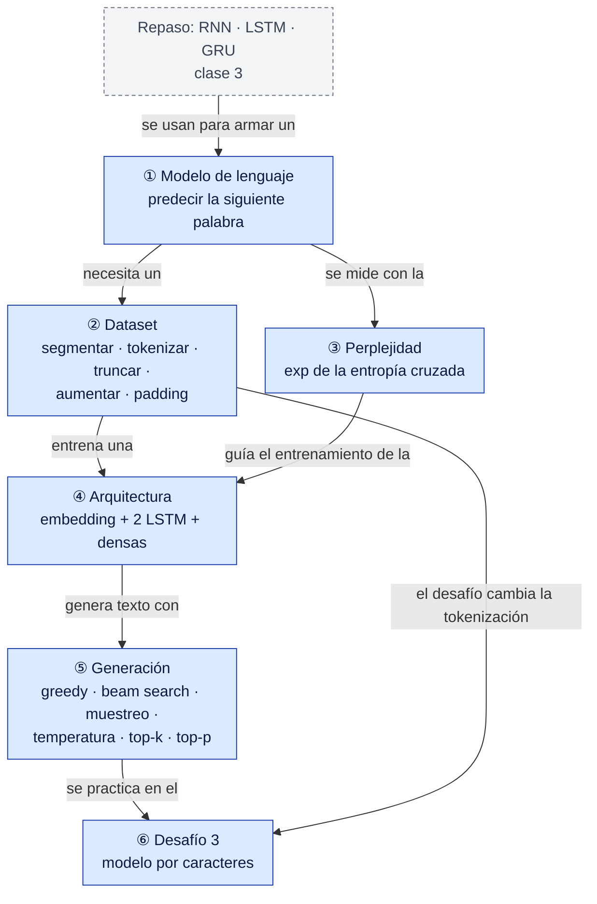
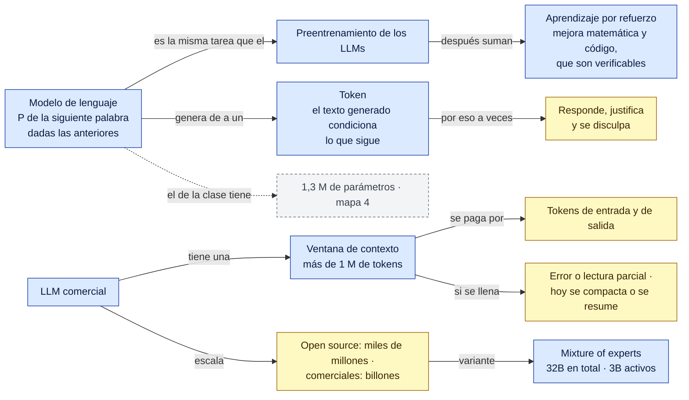
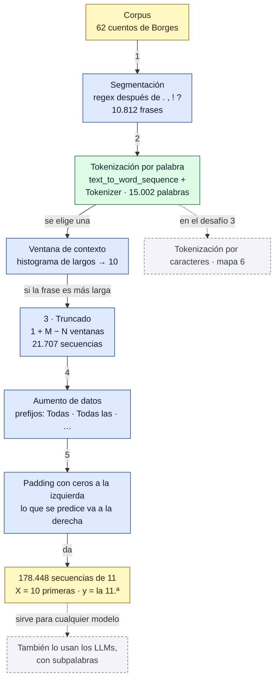
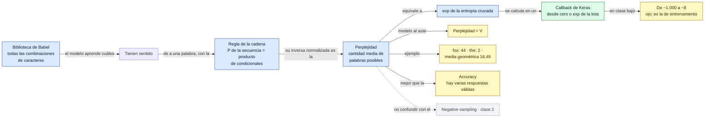
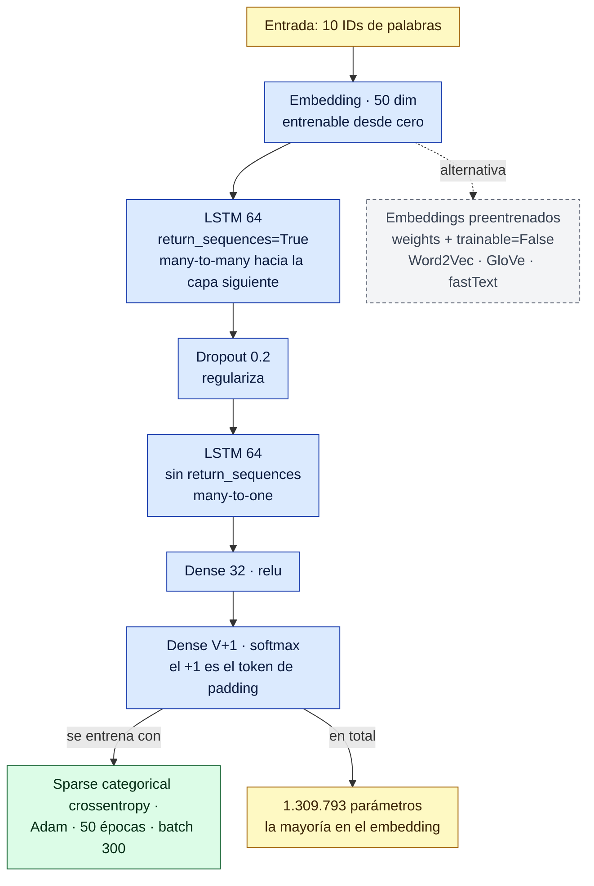
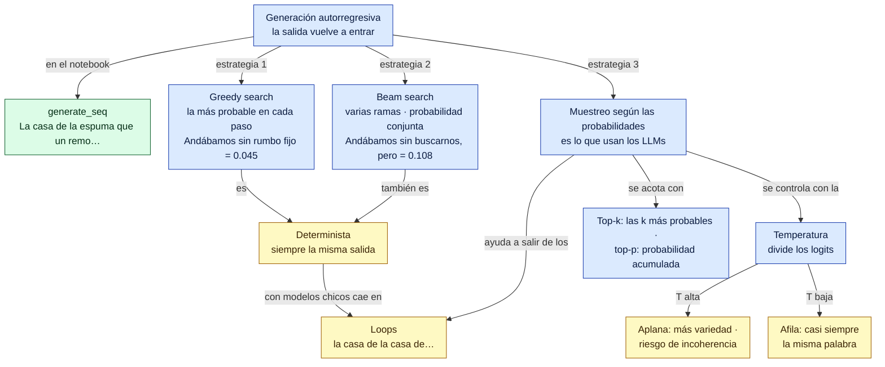
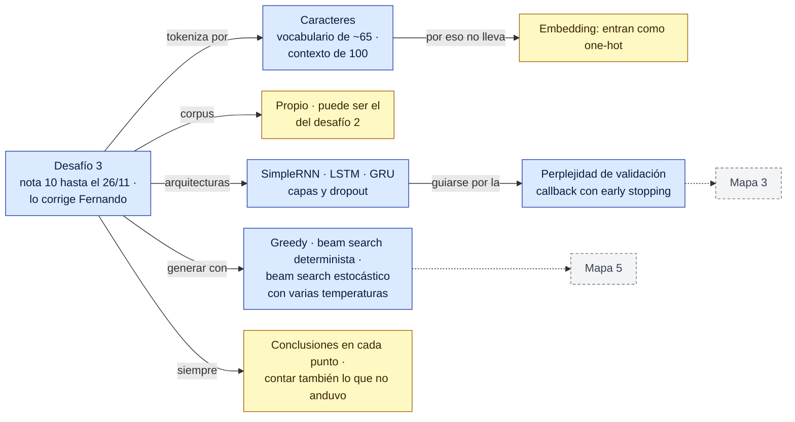

# Red conceptual — Clase 4: Modelo de lenguaje con LSTM

Complemento del [resumen](resumen.md). Primero hay una vista general de toda la clase y después un mapa por bloque de temas, en el orden en que se dieron. Los números de sección (§) remiten al resumen.

**Cómo leerla**
- Cada flecha forma una frase: *greedy search → elige → la palabra más probable*. Una flecha sin texto quiere decir "incluye".
- Las flechas punteadas unen conceptos de temas distintos.
- Colores: azul = tema · verde = librería, función o herramienta · amarillo = dato para memorizar · gris punteado = concepto que se desarrolla en otro mapa o en otra clase.

> Todo el contenido sale de la clase. La organización y las frases de las flechas son propias.

## Vista general

## 1. Modelos de lenguaje y LLMs (§1, §2, §4 y §12)

## 2. Preparar el dataset (§3, §5 a §7 y §10)

## 3. Probabilidad de una secuencia y perplejidad (§8, §9 y §13)

## 4. La arquitectura del notebook (§11)

## 5. Generación y estrategias de decodificación (§14 a §18)

## 6. Desafío 3 (§19)

