# Clase 4 — Modelo de lenguaje con LSTM

- **Docente:** MSc. Josselyn Ordóñez. En la transcripción figura como "lse posgrados", la cuenta del posgrado. Fue su última clase: desde la clase 5 sigue Fernando Silva.
- **Fecha:** jueves 12/11/2026, de ~19:05 a ~22:10. Empezó unos minutos tarde por un problema para entrar y terminó un poco pasada la hora.
- **Duración:** ~3 h. Recreos de ~15 min entre ~01:04 y ~01:20 (volvían a las 20:25) y entre ~01:55 y ~02:10 (volvían a las 21:15). Entre ~01:44 y ~01:46 se cortó el audio de la docente por el wifi.
- **Grabación:** pendiente (falta el link).
- **Material:** [slides](material/slides-modelo-lenguaje-lstm.pdf) · [notebook de la clase (Borges)](material/notebook-modelo-lenguaje-borges.ipynb) · [transcripción](material/transcripcion.txt) · [notas de Gemini](material/notas-gemini.txt) · [carpeta `Clase 4` del repo de la materia](https://github.com/FIUBA-Posgrado-Inteligencia-Artificial/procesamiento_lenguaje_natural/tree/nov_2026/Clase%204)
- **Desafío:** [Desafío 3 — modelo de lenguaje por caracteres](../../desafios/03-modelo-lenguaje-caracteres/README.md), presentado en esta clase. Lo corrige Fernando Silva. Nota 10 hasta el jueves 26/11.
- **Clase anterior:** [resumen de la clase 3](../03-redes-recurrentes/resumen.md) (RNN, LSTM y GRU). Las slides 2 a 8 de esta clase son las mismas de la clase 3.
- **Red conceptual:** [red-conceptual.md](red-conceptual.md)

> **Fuentes:** la transcripción completa, las slides y el notebook de la clase. Las notas de Gemini solo se usaron para cotejar. El notebook del repo no guarda las salidas de la generación de texto: las frases generadas salen de la transcripción. Los tiempos `(hh:mm:ss)` marcan el bloque de la transcripción donde arranca cada tema. Lo marcado con ✎ es elaboración propia y no se dijo en clase.

---

## Repaso rápido

- **Modelo de lenguaje:** modela la probabilidad de la siguiente palabra dadas las anteriores. Es la misma tarea con la que se preentrenan los LLMs; lo que cambia es la escala y la arquitectura (Transformers). Un LLM genera de a un token; no "razona", pero el texto que va generando condiciona los tokens que siguen.
- **Por qué un LLM a veces responde y después se disculpa:** elige primero la respuesta más probable (por ejemplo "sí"), después la justifica, y si la justificación lleva a lo contrario, se corrige. Los modelos actuales suman una segunda etapa de entrenamiento con **aprendizaje por refuerzo**, que mejoró sobre todo matemática y programación, donde es fácil verificar si una tarea salió bien.
- **Pasos para armar el dataset:** segmentación → tokenización → truncado → aumento de datos → padding. Son independientes del modelo y casi los mismos que usan los LLMs, salvo la tokenización, que en los LLMs es por subpalabras.
- **Ventana de contexto:** la cantidad máxima de tokens que el modelo considera a la vez. En un modelo que uno usa ya viene dada (hoy, más de un millón de tokens) y se paga por token de entrada y de salida. Cuando uno entrena un modelo, la elige.
- **Truncado:** una secuencia de M tokens y una ventana N < M dan 1 + M − N secuencias de N tokens. "Todas las hojas son del viento" con N = 3 da 4.
- **Padding:** a las secuencias más cortas se les agregan ceros **a la izquierda**, porque lo que se predice es lo que va a la derecha. Además, en una RNN el final de la secuencia es lo que más pesa.
- **Aumento de datos:** de cada secuencia se sacan también sus prefijos ("Todas", "Todas las"…) con padding, para que el modelo aprenda a continuar textos de cualquier largo.
- **Biblioteca de Babel:** la de Borges tiene todas las combinaciones posibles de caracteres. El modelo tiene que aprender cuáles tienen sentido, y lo hace de a una palabra: P(secuencia) = producto de las probabilidades condicionales.
- **Perplejidad:** "cantidad media de palabras posibles". Es la inversa de la probabilidad del corpus normalizada por la cantidad de palabras (media geométrica), y equivale a la exponencial de la entropía cruzada. Un modelo al azar tiene perplejidad V (el tamaño del vocabulario), y cuanto más baja, mejor. La accuracy no sirve, porque una oración se puede completar bien de varias formas.
- **Notebook:** cuentos de Borges. Frases separadas con regex, ventana de 10, `Tokenizer` de Keras y padding a la izquierda: 178.448 secuencias y 15.002 palabras de vocabulario.
  - Modelo: `Embedding(50)` → `LSTM(64, return_sequences=True)` → `Dropout(0.2)` → `LSTM(64)` → `Dense(32)` → `Dense(vocab+1, softmax)`, con 1,3 millones de parámetros, la mayoría en el embedding.
  - La perplejidad de entrenamiento bajó de ~1.000 a ~8.
- **Escala real:** los modelos open source "chicos" tienen miles de millones de parámetros (Qwen: 1,5B, 7B, 32B…) y los comerciales, del orden de los billones. **MoE** (mezcla de expertos): solo se activa una parte de los parámetros por token (por ejemplo, 32B en total y 3B activos).
- **Generación autorregresiva:** la salida de un paso es la entrada del siguiente.
- **Estrategias de decodificación:**
  - **Greedy search:** en cada paso, la palabra más probable. Es determinista.
  - **Beam search:** mantiene varias ramas y elige la de mayor probabilidad conjunta (0.108 contra 0.045 en el ejemplo de la slide). También es determinista.
  - **Muestreo:** se sortea según las probabilidades, y así es como varían las respuestas de los LLMs.
- **Temperatura:** divide los logits antes de la softmax. Con T alta la distribución se aplana (más variedad, más riesgo de incoherencia); con T baja se afila (más repetitivo).
- **Top-k y top-p:** top-k sortea entre las k palabras más probables; top-p, entre las que acumulan una probabilidad p.
- **Loops:** los modelos chicos y sobreajustados repiten ("la casa de la casa de…"). El muestreo con temperatura ayuda a salir de ahí.
- **Desafío 3:** modelo de lenguaje **por caracteres**, con la plantilla de la materia y un corpus propio (puede ser el del desafío 2). Pide comparar SimpleRNN, LSTM y GRU, guiarse por la perplejidad y generar con greedy y con beam search determinista y estocástico, probando temperaturas. Nota 10 hasta el 26/11.

---

## 0. Repaso de la clase 3 (00:04:01)

La clase usa las tres arquitecturas recurrentes de la clase 3 (SimpleRNN, LSTM y GRU) para armar un modelo de lenguaje. Antes, un repaso. Las slides 2 a 8 son las de la clase 3; el detalle está en su [resumen](../03-redes-recurrentes/resumen.md).

- **¿Para qué sirven las RNN?** Gonzalo: para series de tiempo, donde importa la secuencia en que entran los datos. Emiliano, por chat: para datos secuenciales. Tienen en cuenta el **orden** de los elementos para predecir el siguiente o para clasificar la secuencia entera. Como usan la misma matriz en cada paso, procesan secuencias de cualquier largo.
- **Problemas de secuencia** (00:05:31):
  - Bots conversacionales, que hoy evolucionaron a **agentes**: chats que además razonan y ejecutan acciones.
  - NER: etiquetar palabras como personas, lugares, fechas o montos, o según su categoría gramatical.
  - Traducción y speech to text.
  - Series temporales, como la temperatura o las ventas.
  - Imágenes, que son secuencias en dos dimensiones.
- **Celda de Elman** (00:07:08): combina el elemento de la secuencia en el momento t con la memoria del paso anterior. Usa dos matrices de pesos, que son los parámetros entrenables, más un bias y una función de activación. El resultado es la nueva memoria, que también es la salida de la celda.
- **El problema** (00:08:42): la red tiene profundidad en capas y también en **tiempo**, un nivel más por cada elemento de la secuencia, y el backpropagation tiene que atravesarlos todos. El gradiente puede explotar o desvanecerse. La explosión se maneja poniéndole un tope (✎ *gradient clipping*); el desvanecimiento no, y hace que se olviden los primeros elementos.
- **LSTM** (00:10:23): existe desde 1997, se popularizó en 2014 y fue el estado del arte en texto hasta los Transformers.
  - Agrega una **memoria de largo plazo** C que se actualiza con compuertas: la de olvido, la de entrada y la de salida, que decide qué parte de la memoria nueva sale como h.
  - El camino de C es solo una combinación aritmética, sin funciones de activación. Así la información viaja de una celda a otra como un *skip*, sin que la afecte el desvanecimiento del gradiente (00:13:30).
  - En el *adding problem* de la clase 3, con 50 elementos, la LSTM le ganó a la RNN simple.
- **GRU** (00:14:45): reusa el mismo h, sin una segunda memoria, y tiene tres subceldas.
  - La compuerta de **update** decide cuánto queda de la memoria anterior y cuánto entra de la nueva, la h̃ ("h sombrerito").
  - La de **reset** decide cuánto se usa en el cálculo de h̃.
  - Mantiene el mismo camino libre de solo productos y sumas. En el ejemplo de la clase pasada incluso le ganó a la LSTM.

## 1. Modelos de lenguaje: predecir la siguiente palabra (00:17:44)

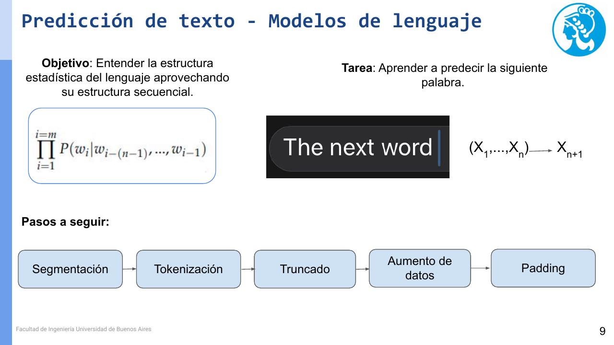

*Slide 9: predicción de texto con modelos de lenguaje. Objetivo: entender la estructura estadística del lenguaje aprovechando su estructura secuencial. Tarea: aprender a predecir la siguiente palabra, (X₁, …, Xₙ) → Xₙ₊₁. Pasos: segmentación, tokenización, truncado, aumento de datos y padding.*

- El modelo tiene que comprender **de forma estadística** qué palabras van juntas y cómo se combinan normalmente para formar secuencias con sentido. Matemáticamente modela la probabilidad del siguiente elemento dados los anteriores:

```math
P(w_1, \dots, w_m) = \prod_{i=1}^{m} P\left(w_i \mid w_{i-(n-1)}, \dots, w_{i-1}\right)
```

- **Es lo mismo que hacen los LLMs** (00:19:05): aprender a predecir la siguiente palabra. Acá el modelo es chico, porque no hay GPUs tan grandes y la arquitectura es anterior a los Transformers, pero el objetivo, la tarea y hasta el preprocesamiento son muy parecidos. Sirve para entender por qué los LLMs se comportan como se comportan.
- **Un LLM genera de a un token.** No razona: genera texto que imita una oración de razonamiento, como lo haría un humano. Pero funciona, porque cada token generado se vuelve entrada de los siguientes (00:20:49): si el modelo escribe un razonamiento, ese razonamiento condiciona la respuesta final. En la práctica termina siendo un símil de razonamiento.

## 2. Por qué los LLMs se disculpan (00:20:49)

- **Carlos:** por eso, a su parecer, el modelo te sigue el hilo dándote la razón y después te pide disculpas: le decís "esto está mal" y responde "tenés razón, disculpá" (00:22:07).
- La docente: pasa bastante, también al revés: le corregís algo, empieza diciendo "no, es así por tal cosa", va cambiando la respuesta y termina disculpándose. Le pasaba mucho con los GPT de antes. Con los modelos gigantes actuales pasa menos, pero no desapareció. Además notó que los últimos GPT arrancan cada respuesta con "Sí." aunque la pregunta no sea de sí o no (00:23:07).
- **Carlos:** ¿los modelos más avanzados funcionan con el mismo principio? Sí: se **preentrenan para generar el siguiente token**, así que la tarea es la misma. La diferencia es que después se les hace una **segunda etapa de entrenamiento con aprendizaje por refuerzo**: se les dan tareas y se calibran según las hagan bien o mal.
  - Por eso mejoraron tanto en **matemática y programación** (00:24:21): ahí es fácil verificar si la tarea salió bien. Una fórmula se comprueba rápido, y un código, compilándolo y corriendo tests.
  - Por detrás sigue siendo un modelo de lenguaje que genera token por token, con los pesos ajustados para hacer mejor esas tareas.
- **Matías:** a él le pasó con modelos actuales, como Claude Opus, que se autocorrigen dentro de la misma respuesta, aunque ya no es tan común. La docente (00:25:30): con una pregunta de sí o no, el modelo responde lo más probable (probablemente "sí") y después empieza a justificar. Si la justificación termina en lo contrario, se disculpa. A medida que genera más texto tiene más elementos previos para decidir, así que la corrección probablemente sea la correcta.
- ✎ La etapa de refuerzo que se describió es la que se conoce como RLHF (con preferencias humanas) o, cuando la recompensa sale de una verificación automática como un test, RLVR.

## 3. Preparar el corpus: segmentación y tokenización (00:26:46)

Antes del modelo hay que dejar lista la data, el corpus.

1. **Segmentación:** dividir el corpus grande (libros, artículos) en documentos más chicos, como frases.
2. **Tokenización** (00:28:06): dividir los documentos en las unidades mínimas del modelo. Pueden ser palabras, caracteres o algo intermedio, como los n-gramas de caracteres. Cada unidad se reemplaza por un identificador numérico.
3. **Ventana de contexto, truncado y padding:** con todo dividido se define la ventana. Según ella, las secuencias largas se truncan y a las cortas se les agrega padding. En el medio se puede hacer **aumento de datos**.

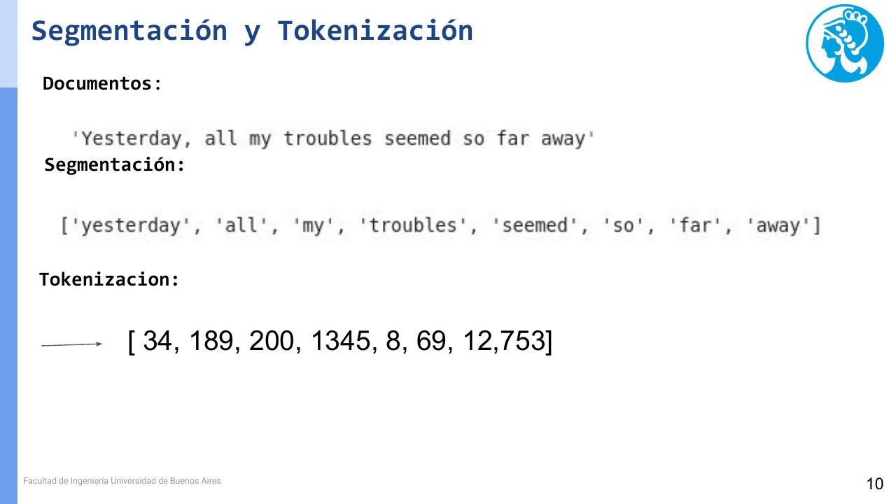

*Slide 10: el documento "Yesterday, all my troubles seemed so far away" se segmenta en ['yesterday', 'all', 'my', 'troubles', 'seemed', 'so', 'far', 'away'] y se tokeniza en [34, 189, 200, 1345, 8, 69, 12, 753].*

- **El mismo elemento tiene siempre el mismo identificador** (00:29:24), en cualquier secuencia o documento donde aparezca.

## 4. Ventana de contexto (00:29:24)

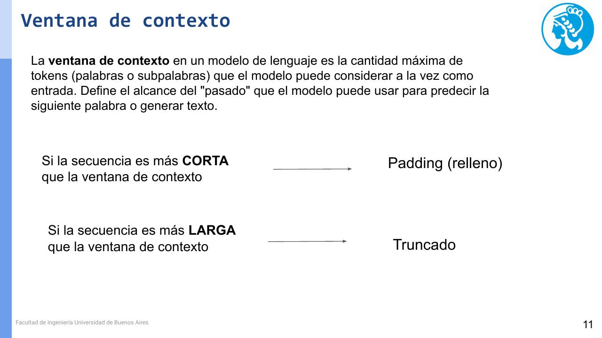

*Slide 11: la ventana de contexto de un modelo de lenguaje es la cantidad máxima de tokens (palabras o subpalabras) que puede considerar a la vez como entrada. Define el alcance del "pasado" que el modelo puede usar para predecir la siguiente palabra o generar texto. Si la secuencia es más corta que la ventana se rellena (padding); si es más larga, se trunca.*

¿Alguien sufrió la ventana de contexto usando modelos?
- **Matías:** que cada turno de la conversación cuesta más caro y que el modelo se puede perder cuando el contexto se agranda. La docente distingue dos cosas: el **contexto** son los tokens que recibe el modelo en cada paso de inferencia; la **ventana** es la máxima, una característica del modelo.
- **Carlos** (00:31:03): en Aprendizaje Profundo, la RNN de PyTorch tenía un parámetro con el tamaño de la ventana. ¿Es eso? Sí.
- **Los modelos comerciales** (00:32:55): la docente mostró la página de modelos de OpenAI, que los nombra por astros: el más chico es Luna y el más capaz, Astro.
  - Además del tamaño, se elige por el **costo**: se cobra por millón de tokens de entrada (el prompt y el system prompt) y por millón de tokens de salida (lo que genera el modelo).
  - Otra característica es la **context window**, que hoy pasa el millón de tokens (00:34:19). En un modelo ya entrenado viene dada, porque OpenAI decidió qué ventana darle y lo entrenó así. Cuando uno entrena un modelo, la elige.
- **¿Qué limitación da?** Nicolás (00:35:37): es lo que el modelo puede recordar de la conversación. En Claude, cargar skills o MCP ocupa ventana, y en algún punto la achica y hace algo parecido a un RAG para no colapsar.
- **La ventana es una caja:** se mete todo el texto a procesar y, si se llena, el modelo procesa solo lo que entra.
  - Los GPT de antes llegaban a unos 125.000 tokens, según la docente. Un PDF de 50 páginas no entraba completo, y el modelo daba un error o, peor, procesaba en silencio solo las primeras hojas y respondía mal si la información estaba al final (00:36:38). ✎ La ventana de GPT-3 era de 2.048 tokens; la de ~128.000 es de GPT-4 Turbo (2023).
  - Hoy casi todo entra, pero no todo: un video de 3 horas no entra en un millón de tokens. Hay que dividir la información o resumirla antes.
  - Los chats comerciales resumen o compactan la conversación por detrás y traen solo lo relevante de las interacciones pasadas (00:37:50). Por eso muchos no lo notan. Si se usa el modelo pelado, hay que manejarlo uno.
- **Matías** (00:38:55): a medida que se llena la ventana, ¿arrastra cada vez más tokens? Sí, y por eso los *harnesses* tienen funciones de compactación. La ventana es un límite físico, pero además está el **costo**: se puede usar el millón completo, pero se paga por token de entrada. Y cuanta más información se le da para una tarea, más ruido recibe y más se equivoca. El manejo de memoria y la compactación son temas importantes (00:40:08).
- **En un modelo propio, la ventana es un parámetro.** Es la cantidad máxima de tokens que el modelo considera a la vez como entrada. Según ella, las secuencias se rellenan o se truncan como parte del preprocesamiento, antes de entrenar.

## 5. Truncado (00:41:32)

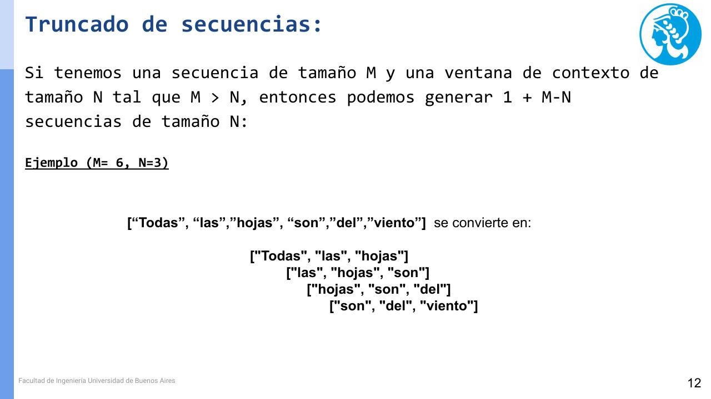

*Slide 12: con una secuencia de tamaño M y una ventana de tamaño N < M se generan 1 + M − N secuencias de tamaño N. Ejemplo con M = 6 y N = 3: ["Todas", "las", "hojas", "son", "del", "viento"] da ["Todas", "las", "hojas"], ["las", "hojas", "son"], ["hojas", "son", "del"] y ["son", "del", "viento"].*

- El modelo chico de la clase usa ventanas chicas: 10 en el notebook y 3 en las slides. "Todas las hojas son del viento" tiene seis palabras (tokenizando por palabra) y no entra en una ventana de 3.
- Se corta haciendo **todas las combinaciones de 3 posibles**, corriendo la ventana de a una palabra (00:42:45). De una oración salen cuatro, listas para entrenar: ya es una forma de **aumento de datos**.

## 6. Padding (00:42:45)

- **El padding de visión** (00:44:09): Carlos lo vio en redes convolucionales. Gonzalo Castro: es para que el *kernel* llegue a procesar toda la imagen y no se coma los bordes. Acá es lo mismo pero en una dimensión, y lo que se mueve es la ventana de contexto.
- Una oración más corta que la ventana (de una o dos palabras con ventana 3) se **rellena con ceros**, como en imágenes (00:45:26).
- **¿Por qué los ceros van a la izquierda?** Hernando: porque lo que se predice es la siguiente palabra. Lo que se va completando queda a la derecha; con ceros a la derecha, las palabras siguientes quedarían separadas por ceros y fuera de orden. Así la oración termina junta, sin ceros en el medio.
- Gonzalo, por chat: además entramparía la predicción (00:46:53). Sería agregar elementos sin información al final, que en una RNN es justo la parte que más pesa.

## 7. Aumento de datos (00:46:53)

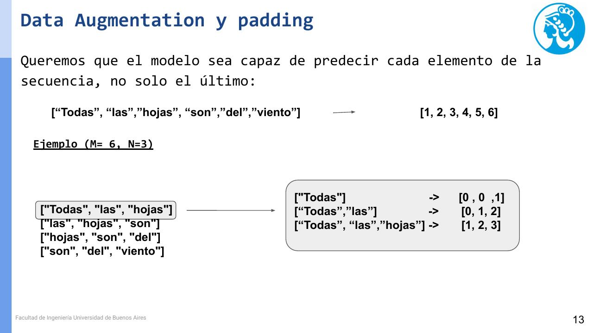

*Slide 13: "Queremos que el modelo sea capaz de predecir cada elemento de la secuencia, no solo el último". ["Todas", "las", "hojas", "son", "del", "viento"] → [1, 2, 3, 4, 5, 6]. De ["Todas", "las", "hojas"] salen ["Todas"] → [0, 0, 1], ["Todas", "las"] → [0, 1, 2] y ["Todas", "las", "hojas"] → [1, 2, 3].*

- Además de las secuencias completas, se generan secuencias **incompletas** con padding. De "Todas las hojas" salen "Todas", "Todas las" y "Todas las hojas" (00:48:13). Cada una de las cuatro ventanas da tres, así que se multiplica la cantidad de ejemplos.
- **¿Por qué hacen falta ejemplos de distinta completitud?** Gonzalo Castro: para probar más combinaciones. Además, el modelo va a tener que generar a partir de distintas cantidades de palabras (00:49:37): a veces de una sola, a veces de una oración casi completa. Para eso tiene que haber visto ejemplos de todos los largos.

## 8. La biblioteca de Babel: la probabilidad de una secuencia (00:50:59)

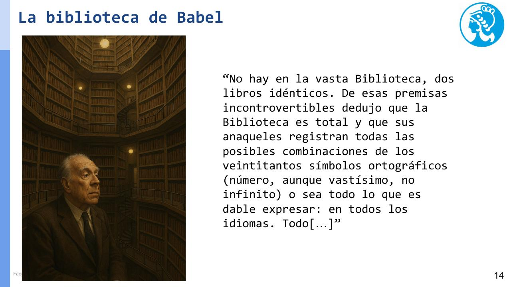

*Slide 14: Borges y una cita de "La biblioteca de Babel": la Biblioteca es total y sus anaqueles registran todas las combinaciones posibles de los símbolos ortográficos.*

- Vicky se acordaba del cuento pero no lo pudo contar. Es una biblioteca con **todas las combinaciones posibles de caracteres**, prácticamente infinita (00:52:33). Un libro sacado al azar puede no tener ningún sentido o ser una obra maestra, y entre las combinaciones aleatorias hay libros con sentido, buenos y mejores.
- **Eso es lo que aprende un modelo de lenguaje** (00:53:52): de todas las combinaciones posibles, cuáles tienen sentido lingüístico, cuál es más probable que sea una obra bien construida. Y lo decide **palabra por palabra**.
- La probabilidad de una secuencia completa (una oración, un párrafo, un libro) se desagrega en probabilidades condicionales:

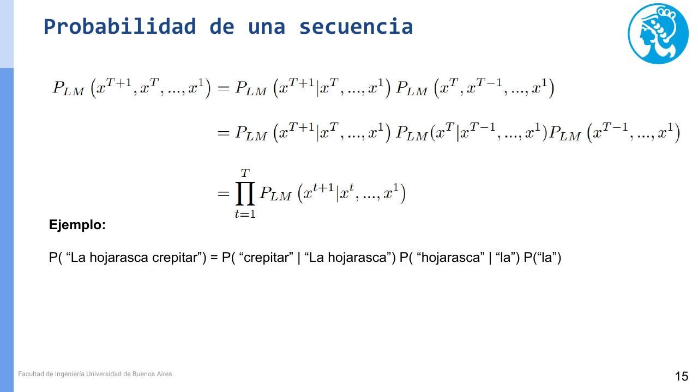

*Slide 15: la probabilidad de una secuencia es el producto de las probabilidades condicionales de cada elemento. Ejemplo: P("La hojarasca crepitar") = P("crepitar" | "La hojarasca") · P("hojarasca" | "la") · P("la").*

```math
P_{LM}\left(x^{T+1}, x^{T}, \dots, x^{1}\right) = \prod_{t=1}^{T} P_{LM}\left(x^{t+1} \mid x^{t}, \dots, x^{1}\right)
```

- El problema complejo, elegir un libro de la biblioteca, se divide en pasos chicos y concretos: elegir la siguiente palabra (00:55:12). Primero *la*, después *hojarasca* dado *la*, después *crepitar* dado *la hojarasca*.

## 9. Perplejidad (00:56:43)

¿Con qué se mide si el modelo aprende? Hace falta una métrica que guíe el entrenamiento: la **perplejidad**.

- Es la **cantidad media de palabras posibles**. Para decidir la siguiente palabra, el modelo achica todo el vocabulario a un grupo de candidatas. Cuantas menos candidatas tiene, más aprendió.
- Si la perplejidad es igual al tamaño del vocabulario, el modelo no sabe nada: elige al azar (00:58:05). Si baja, está aprendiendo a discriminar entre palabras. El objetivo es **minimizarla**.
- Matemáticamente es la **inversa de la probabilidad del corpus normalizada por la cantidad de palabras**:

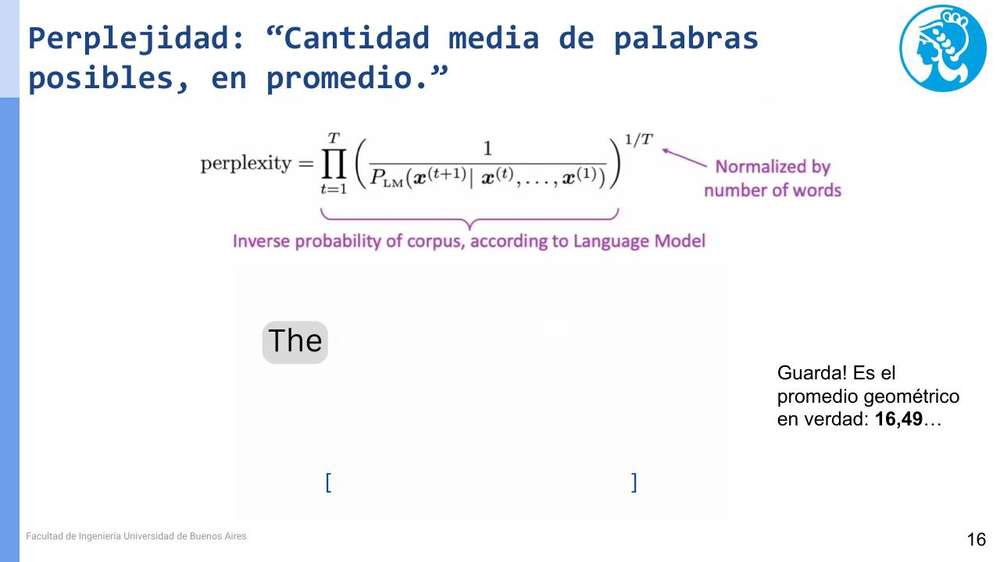

*Slide 16: perplejidad, la "cantidad media de palabras posibles, en promedio": la inversa de la probabilidad del corpus según el modelo de lenguaje, normalizada por el número de palabras. La animación muestra, palabra por palabra, entre cuántas palabras eligió el modelo. "¡Guarda! Es el promedio geométrico en verdad: 16,49…".*

```math
\text{perplexity} = \prod_{t=1}^{T} \left( \frac{1}{P_{LM}\left(x^{(t+1)} \mid x^{(t)}, \dots, x^{(1)}\right)} \right)^{1/T}
```

- **El ejemplo de la animación** (00:59:16): para elegir *fox* el modelo eligió entre 44 palabras, y para elegir *the*, entre 2: ahí estaba mucho más seguro. Con *quick* y *brown* eligió entre 89 y 70. Tiene sentido: son adjetivos, que se pueden intercambiar fácil, mientras que en inglés prácticamente hay un solo artículo para el singular. La perplejidad se puede medir en cada paso de inferencia.
- **Pregunta de Carlos** (01:00:23): ¿se parece al negative sampling de Word2Vec? No. El negative sampling decide cuántos ejemplos se le dan al modelo al **entrenar**. La perplejidad es un **resultado** de las probabilidades que genera el modelo: entre cuántas palabras está decidiendo.
- En resumen: número bajo, el modelo está seguro; número alto, está adivinando entre muchas palabras.

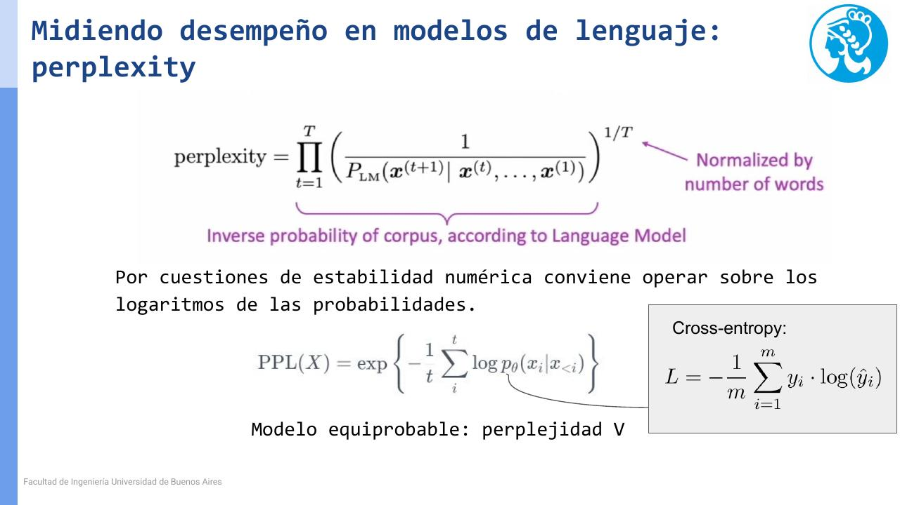

*Slide 17: por estabilidad numérica conviene operar con los logaritmos de las probabilidades, y así la perplejidad se reescribe como la exponencial de la entropía cruzada. Un modelo equiprobable tiene perplejidad V.*

```math
\mathrm{PPL}(X) = \exp\left\{ -\frac{1}{t} \sum_{i=1}^{t} \log p_\theta\left(x_i \mid x_{<i}\right) \right\}
\qquad
L = -\frac{1}{m} \sum_{i=1}^{m} y_i \cdot \log\left(\hat{y}_i\right)
```

- Aplicando logaritmo, la productoria pasa a ser una sumatoria, y lo que queda adentro de la exponencial es la **entropía cruzada** (01:01:55). La perplejidad se puede calcular como la exponencial de la entropía cruzada, que las librerías ya calculan.
- ✎ Por qué un modelo equiprobable da V: si cada palabra tiene probabilidad 1/V, cada factor de la productoria vale V y la media geométrica de T factores iguales a V es V.
- ✎ Un ejemplo chico: si el modelo le da probabilidad 0.5 a la primera palabra correcta y 0.25 a la segunda, la perplejidad es (1 / (0.5 · 0.25))^(1/2) = √8 ≈ 2.83: en promedio "duda" entre unas 3 palabras.

Recreo de 15 minutos (01:03:23).

## 10. El notebook: corpus de Borges y preprocesamiento (01:03:23)

[Notebook de la clase](material/notebook-modelo-lenguaje-borges.ipynb), con Keras como en las clases anteriores.

**El corpus**
- Es `full_corpus.csv`, del repo de Karen Palacio (`karen-pal/borges`): **719 cuentos** de 57 autores latinoamericanos sacados de ciudadseva.com. Hay 62 de Borges, 55 de Cortázar, 50 de Baldomero Lillo, 45 de Monterroso…
- En clase se usan los **62 cuentos de Borges**: "Abel y Caín", "Adrogué", "Alguien soñará", "El Aleph"…
- Para el desafío 3 hay que usar un corpus propio, y puede ser el del desafío 2 (01:22:03).
- El texto de Borges ya viene limpio y en texto plano. Un libro u otro corpus puede traer pies de página o introducciones editoriales que conviene limpiar.

**Segmentación** (01:23:23)
- Se divide con una expresión regular que corta después de `.`, `,`, `!` o `?`: `r'(?<=[.,!?]) +'`. Como también corta en las comas, a veces quedan frases y no oraciones completas. "Abel y Caín" queda partido así:

```text
'Abel y Caín se encontraron después de la muerte de Abel.'
'Caminaban por el desierto y se reconocieron desde lejos,'
'porque los dos eran muy altos.'
'Los hermanos se sentaron en la tierra,'
'hicieron un fuego y comieron.'
...
```

- Para una ventana chica sirve. Se puede probar con oraciones completas, sin cortar en la coma.
- Con todo el corpus quedan **10.812 documentos** (frases) (01:25:02).

**Tokenización por palabra**
- Se aplica `text_to_word_sequence` a cada frase, y cada documento queda como una lista de palabras: `['abel', 'y', 'caín', 'se', 'encontraron', 'después', 'de', 'la', 'muerte', 'de', 'abel']` (01:26:13).

**El tamaño de la ventana**
- Se elige "al ojo", con un **histograma** del largo de las frases. Van de 1 a 63 palabras: hay 3.718 frases de 1 a 4 palabras, 2.615 de 5 a 7, 1.670 de 8 a 10, y después cae rápido. ✎ La mediana anda por 6 palabras.
- Se toma una **ventana de 10** (01:27:53). El código deja comentados otros criterios: el percentil 90 menos 1, la media o la mediana. Con oraciones completas el histograma se corre a la derecha y conviene una ventana más grande.
- `Tokenizer()` de Keras asigna los IDs con `fit_on_texts` y `texts_to_sequences`. Los ordena de la palabra más frecuente a la menos: *de* = 1, *la* = 2, *que* = 3, *el* = 4… El 0 queda reservado.
- Se separa train y validación: 80/20 sobre las frases, con `train_test_split(..., random_state=42)`.

**Truncado, aumento de datos y padding** (01:29:35)
- Las frases más largas que la ventana se cortan en ventanas de `max_context_size + 1` = 11 palabras, corriendo de a una. **¿Por qué el +1?** Carlos: es el target. El modelo recibe 10 palabras de entrada y predice la 11.ª.
- Solo con el truncado quedan **21.707 secuencias** (01:31:02). La docente lo comparó con las ~11.000 frases y dijo que casi se duplicó. ✎ En realidad el truncado se aplica solo al train, unas 8.650 frases (el 80 %), así que el aumento es mayor.
- **Aumento de datos:** de cada secuencia se generan los prefijos de 2, 3, 4… palabras, hasta completar la ventana (01:32:37). A todos se les hace padding a 11 con `padding='pre'`, ceros a la izquierda. Lo mismo pasa con las frases originales más cortas que la ventana.

```python
for sent in tok_sent:
    subseq = [sent[:i+2] for i in range(len(sent)-1)]
    tok_sent_augm.append(pad_sequences(subseq, maxlen=max_context_size+1, padding='pre'))
train_seqs = np.concatenate(tok_sent_augm, axis=0)   # (178448, 11)
```

- Quedan **178.448 secuencias**, todas de largo 11 (01:34:11). Las 10 primeras columnas son `X` y la última, `y`. Por ejemplo, `X[0]` = `[0, 0, 0, 0, 0, 0, 0, 0, 0, 4]` (*el*) y `y[0]` = 5084 (*cirujano*).

**Utilidades del tokenizador** (01:35:34)
- `index_word` va del índice a la palabra y `word_index`, al revés. Sirven para decodificar lo que genera el modelo.
- El vocabulario tiene **15.002 palabras** (y algunos símbolos). `word_docs` dice en cuántos documentos aparece cada palabra, y con eso se ven las más y las menos frecuentes. ✎ Entre las más frecuentes, después de las stopwords, aparece Borges: *hombre*, *noche*, *libro*, *dios*, *biblioteca*, *laberinto*, *infinito*, *universo*, *sueño*.
- **Todo esto es independiente del modelo** (01:36:46). Segmentación, tokenización, truncado, aumento de datos y padding, en ese orden, sirven igual para una RNN o un Transformer y los usan los modelos grandes. Lo que cambia es la arquitectura y la tokenización: los modelos de punta no tokenizan por palabra, sino por combinaciones frecuentes de caracteres.

## 11. La arquitectura: embedding + LSTM (01:38:21)

```python
model = Sequential()
model.add(Embedding(input_dim=vocab_size+1, output_dim=50, input_shape=(max_context_size,)))
model.add(LSTM(64, return_sequences=True))
model.add(Dropout(0.2))
model.add(LSTM(64))                      # la última LSTM no lleva return_sequences
model.add(Dense(32, activation='relu'))
model.add(Dense(vocab_size+1, activation='softmax'))
model.compile(loss=SparseCategoricalCrossentropy(), optimizer='adam', metrics=['accuracy'])
```

- **Embedding entrenable:** la capa de embedding de Keras tiene pesos entrenables por defecto. Mientras se entrena el modelo de lenguaje, también se arma una matriz de embeddings desde cero, como el CBOW de la clase 2, pero aprendida con otra red y otra tarea: completar oraciones (01:39:45).
- **`LSTM(64, return_sequences=True)`:** ¿para qué el parámetro? Hernando: lo convierte en many-to-many. Gonzalo: para que la salida mantenga la dimensión de la entrada (01:41:11). Cada celda tiene que entregarle un elemento a la siguiente capa; sin el parámetro, esa capa no recibiría nada. Las capas inferiores siempre son many-to-many.
- **`Dropout(0.2)`** (01:42:37): Hernando dijo que es regularización: apaga neuronas al azar para que todas aporten. Durante el entrenamiento, cada conexión tiene un 20 % de probabilidad de apagarse. Eso obliga al modelo a encontrar otros caminos para la inferencia y evita el overfitting (01:46:00).
- **La última `LSTM(64)`, sin `return_sequences`:** Carlos explicó que solo se quiere la palabra a predecir. El problema entero es **many-to-one**: se predice una palabra por vez, así que alcanza con la salida del último paso, un vector de 64 (01:47:17).
- **Dos densas:** `Dense(32)` procesa y `Dense(vocab_size+1, softmax)` da la probabilidad de cada palabra del vocabulario. **¿Por qué +1?** Gonzalo pensó que era por la palabra a predecir, pero no (01:48:51). Carlos: es el **token del padding**, el 0. No tiene significado, pero se reserva.
- **Compilación** (01:50:22): *sparse categorical crossentropy*, que usa índices en vez de one-hot, el optimizador **Adam** y accuracy como métrica.

| Capa | Salida | Parámetros |
|---|---|---|
| Embedding | (None, 10, 50) | 750.150 = 15.003 × 50 |
| LSTM | (None, 10, 64) | 29.440 = 4 × 64 × (50 + 64 + 1) |
| Dropout | (None, 10, 64) | 0 |
| LSTM | (None, 64) | 33.024 = 4 × 64 × (64 + 64 + 1) |
| Dense | (None, 32) | 2.080 |
| Dense | (None, 15003) | 495.099 = 32 × 15.003 + 15.003 |
| **Total** | | **1.309.793 (5 MB)** |

- La mayor parte de los parámetros está en el embedding (01:53:07). ✎ Las cuentas de las LSTM salen de 4 bloques (las compuertas y la candidata) de d_h · (d_x + d_h + 1):

```math
\#\text{params}_{\text{LSTM}} = 4 \, d_h \left( d_x + d_h + 1 \right)
```

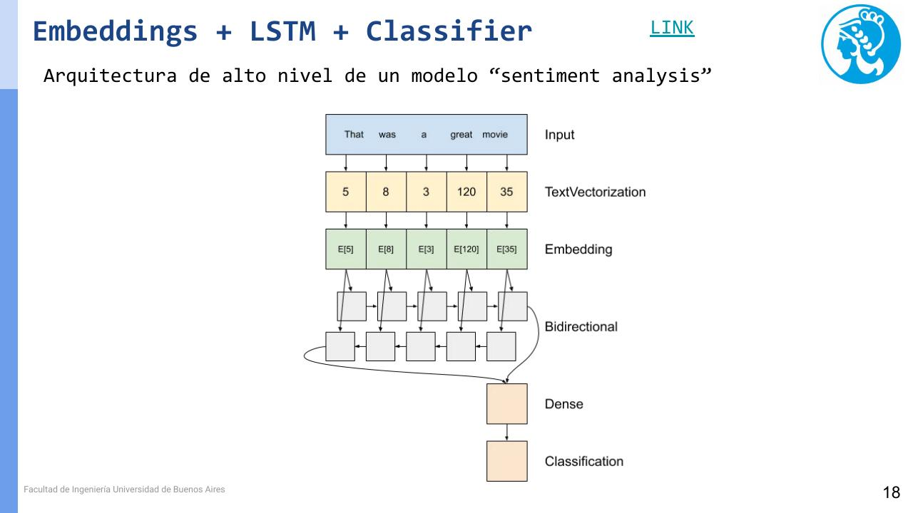

*Slide 18: arquitectura de alto nivel de un modelo de análisis de sentimiento. "That was a great movie" → TextVectorization [5, 8, 3, 120, 35] → Embedding → Bidirectional → Dense → clasificación.*

- La estructura es parecida a la de la slide: entrada tokenizada → embeddings → capas recurrentes → densas que clasifican. En vez de una bidireccional, acá hay dos LSTM con dropout en el medio. La slide 19 repite la RNN multicapa de la clase 3.
- **Embeddings preentrenados** (01:51:46): en vez de entrenarlos desde cero, se puede cargar la matriz de un Word2Vec, GloVe o fastText ya entrenado y reemplazar cada token por su vector.

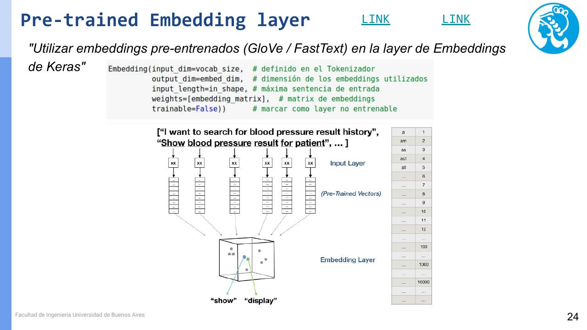

*Slide 24: usar embeddings preentrenados (GloVe, fastText) en la capa de embedding de Keras.*

```python
Embedding(input_dim=vocab_size,        # definido en el Tokenizador
          output_dim=embed_size,       # dimensión de los embeddings utilizados
          input_length=in_shape,       # máxima sentencia de entrada
          weights=[embedding_matrix],  # matriz de embeddings
          trainable=False)             # marcar como layer no entrenable
```

## 12. ¿Qué tan grandes son los modelos? (01:53:07)

- **¿En qué escala de parámetros están los modelos de GPT o Claude?** Carlos: en los millones. Por chat salieron 7 *billions*, 32 *billions*, y Denis habló de *trillions*.
- La docente (02:12:49) distingue dos grupos:
  - **Modelos open source "chicos":** tienen *billions* (miles de millones) de parámetros, pero se consideran chicos porque corren en una sola GPU. Por ejemplo, los Qwen, de 1,5B, 7B y 32B, y otros de más de 200B.
  - **Modelos comerciales de punta** (Claude, ChatGPT, Gemini): ya andan por los *trillions*, según dijo Denis en el chat.
- ✎ Ojo con el falso amigo: *billion* en inglés son mil millones, y *trillion*, un billón (10¹²) en español. Además, los laboratorios no publican el tamaño de sus modelos comerciales: esas cifras son estimaciones.
- El modelo de la clase, con ~1,3 millones de parámetros, es muy chico. Hay que aspirar a oraciones coherentes, no a algo parecido a ChatGPT (02:14:12). Un modelo mejora con más parámetros, con otra arquitectura (Transformers) y con una tokenización por subpalabras. No estamos tan lejos de lo que se hace hoy, pero no hay GPUs para esa escala.
- **Carlos:** ¿la cantidad de parámetros define la memoria que hace falta? Sí, la memoria de la GPU (02:15:25). Por detrás todo son multiplicaciones de matrices (tensores), y para eso son ideales las GPUs. Los modelos grandes no entran en una sola GPU: se reparten en varias en paralelo, y hay GPUs especializadas en modelos de lenguaje.
- **Mixture of experts (MoE):** Gonzalo Castro lo había visto en Hugging Face (02:16:49). La red está dividida en "expertos", subredes especializadas en cierto tipo de tareas.
  - Un modelo puede tener, por ejemplo, 32B de parámetros y **3B activos**, y en la inferencia usa solo esa parte.
  - Esos modelos se reconocen en Hugging Face porque al tamaño le agregan la "A" de activos (02:19:40). En Hugging Face se puede ver el tamaño de cada modelo; hay muchísimas variantes de Qwen, y algunos modelos tienen un paper asociado.
  - ✎ Una precisión: los parámetros activos reducen el **cómputo** por token, pero en general todos los expertos tienen que estar cargados en memoria, porque cada token puede ir a cualquiera.
- **GPU en Colab** (01:55:29): conviene la **T4**, la gratuita. Como es la que usa todo el mundo, a veces no hay disponibles. La docente tuvo que cambiar a una **A100**, que se paga con créditos, desde "Cambiar tipo de entorno de ejecución".

## 13. Callbacks de perplejidad y entrenamiento (02:19:40)

- Un **callback** es una rutina personalizada que se mete en el entrenamiento de Keras. Sirve para calcular algo que Keras no trae, como la perplejidad (02:21:10). El notebook tiene dos:
  - **`PplCallback`**, desde cero. Para cada frase de validación arma todos sus prefijos con padding, predice, toma la probabilidad de cada palabra real, suma los logaritmos y saca la exponencial del promedio negativo. Después promedia sobre las frases.
  - **`PerplexityCallback`**, el atajo: la exponencial de la *loss*, que ya es la entropía cruzada que calcula Keras (02:22:38). Es mucho más corto y más rápido.
  - No dan exactamente lo mismo, porque el padding y el orden de los promedios cambian. En clase se usa la versión simplificada.

```python
class PerplexityCallback(keras.callbacks.Callback):
    def on_epoch_end(self, epoch, logs=None):
        train_loss = logs.get('loss')
        if train_loss is not None:
            logs['perplexity'] = np.exp(train_loss)   # perplejidad = exp(entropía cruzada)
        # si hay datos de validación, hace lo mismo con val_loss
```

- **Entrenamiento:** `model.fit(X, y, epochs=50, callbacks=[PerplexityCallback(...)], batch_size=300)`, con 595 pasos por época (02:23:55).
  - La perplejidad arrancó cerca de **1.000**, con un vocabulario de 15.000. No era el azar total, pero el modelo estaba muy indeciso.
  - Fue bajando hasta quedar **entre 8 y 9**: de elegir entre ~1.000 palabras pasó a elegir entre unas 9.
  - Al final se guarda el modelo con `model.save('my_model.keras')`.
- En la salida guardada del notebook se ven 19 épocas. La perplejidad baja 1124 → 640 → 440 → 313 → 251 → 213 → 180 → 152 → 128 → 110 → 96 → 84 → 75 → 67 → 61 → 55 → 51 → 46 → 43, con una accuracy de 0.29.
- ✎ El callback recibe los datos de validación, pero `fit` no tiene `validation_data`: lo que se imprime es la perplejidad de **entrenamiento**, medida sobre los mismos ejemplos con que se entrena. Por eso la conclusión del notebook habla de overfitting. Para medir de verdad hay que pasar `validation_data` y mirar `val_perplexity`.
- **Pregunta de Carlos** (02:25:20): ¿la accuracy y la loss no dicen mucho acá? La que más ayuda es la perplejidad. La accuracy no sirve tanto porque **una oración se puede completar de más de una manera**: "El perro comió su…" puede seguir con *hueso*, *croqueta* o *carne*, y ninguna está mal. La perplejidad sí sirve, porque mide cuánto acota el modelo (02:26:46). Nunca va a llegar a 1, porque hay más de una palabra posible, pero tampoco tiene que abarcar todo el vocabulario: "El perro comió su silla" o "su nube" no deberían entrar.

## 14. Generación autorregresiva (02:26:46)

- **Con Gradio**, de a una palabra (02:28:07):
  - "el perro…" se desvió enseguida.
  - "La casa de" dio "La casa de la casa de la espuma".
  - "La calle Liniers" (02:29:34) tiene sentido, porque Liniers es de Buenos Aires, pero siguió con "nos gritó", que ya no.
- **La salida de un paso es la entrada del siguiente:** la generación es **autorregresiva**. La docente lo hizo a mano para mostrarlo.
- **`generate_seq`** lo automatiza. Recibe el texto inicial, la cantidad de palabras a generar y la ventana de contexto, y va agregando el `argmax` en cada paso:

```python
generate_seq(model, tok, 'La casa', max_length=max_context_size, n_words=13)
# en clase: "La casa de la espuma que un remo levantó en el tercero breve"
```

- **Resultado** (02:31:01): está más o menos, pero ya se ve un modelo de lenguaje. Pone los sujetos donde corresponde, y *remo levantó* tiene cierto sentido: captura algo de la estructura del lenguaje. La docente dijo que en otras corridas le salieron mejores.

## 15. Estrategias de decodificación: greedy y beam search (02:32:20)

Hasta ahora se elegía la palabra más probable, pero normalmente no se hace así, tampoco en los modelos grandes. ¿Cómo se elige la palabra entre todas las probabilidades?

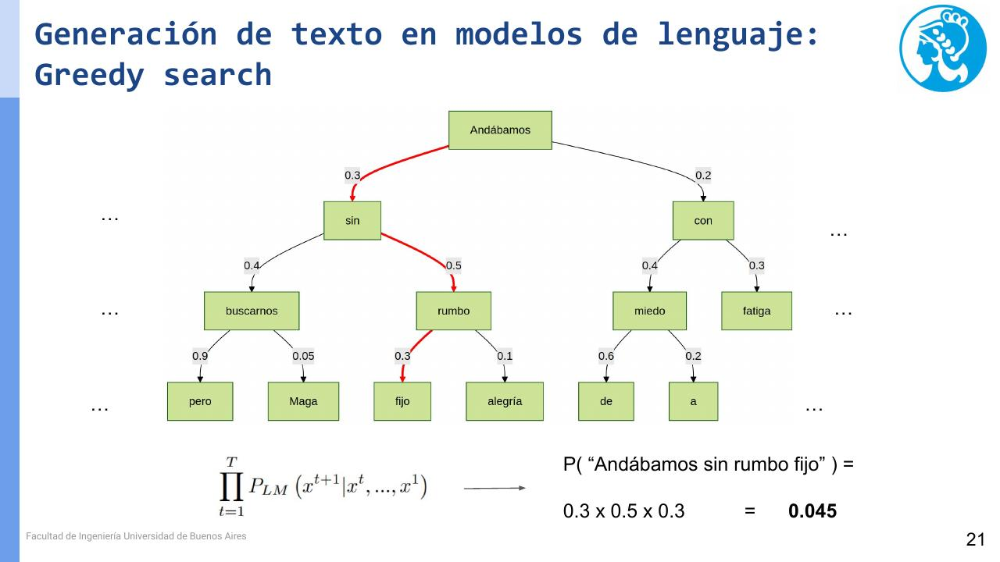

*Slide 21: greedy search sobre un árbol de probabilidades. Desde "Andábamos" se elige en cada paso la rama más probable: sin (0.3) → rumbo (0.5) → fijo (0.3). P("Andábamos sin rumbo fijo") = 0.3 × 0.5 × 0.3 = 0.045.*

| Paso | Opciones (probabilidad) |
|---|---|
| Andábamos → | sin (0.3) · con (0.2) |
| sin → | buscarnos (0.4) · rumbo (0.5) |
| con → | miedo (0.4) · fatiga (0.3) |
| buscarnos → | pero (0.9) · Maga (0.05) |
| rumbo → | fijo (0.3) · alegría (0.1) |
| miedo → | de (0.6) · a (0.2) |

- **Greedy search:** a partir de las palabras iniciales se calculan las probabilidades de todo el vocabulario y se elige la más alta. Con eso se repite el cálculo, y así se arma la oración: "Andábamos sin rumbo fijo".
- **¿Sale siempre lo mismo?** (02:33:48) Hernando dijo que puede cambiar; Gonzalo, que siempre sale lo mismo, y es así. Los pesos y los vectores no cambian, así que las probabilidades tampoco: greedy search es **determinista**.
- En cambio, ChatGPT y los otros modelos varían sus respuestas, como dijo Hernando. Es porque no eligen la palabra más probable.

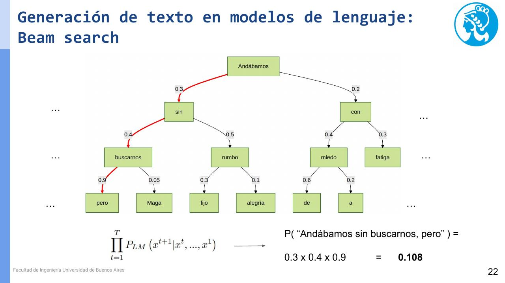

*Slide 22: beam search sobre el mismo árbol. P("Andábamos sin buscarnos, pero") = 0.3 × 0.4 × 0.9 = 0.108.*

- **Beam search** (02:35:05): en vez de decidir paso por paso, mantiene varias **ramas** con probabilidades altas y compara las secuencias completas. Multiplica las probabilidades de cada elemento de una rama y elige la de mayor **probabilidad conjunta**. La rama de greedy tenía 0.045; "Andábamos sin buscarnos, pero" tiene 0.108.
- Greedy no la eligió porque comparaba paso a paso (02:36:28): en el segundo paso *rumbo* (0.5) le ganó a *buscarnos* (0.4). Beam search mira la rama completa.
- **También es determinista:** multiplica siempre las mismas probabilidades y elige siempre la misma rama.
- ✎ El árbol sale del comienzo de *Rayuela*, de Cortázar, donde aparece la Maga. ✎ En la práctica se suman logaritmos en vez de multiplicar probabilidades, para no perder precisión con números muy chicos: es lo que hace `select_candidates` con `np.log(pp + 1E-10)`.

## 16. Muestreo aleatorio y temperatura (02:37:54)

- **Lo que usan los modelos actuales** es una versión de beam search **estocástica**: en vez de tomar siempre las palabras más probables, se hace un **muestreo** según sus probabilidades.
  - Las más probables salen con más frecuencia, y por eso las respuestas siguen siendo correctas, pero también pueden salir otras.
  - Por ejemplo, después de "Adopté un…" tienen probabilidad alta *perro*, *gato* o *loro*. En vez de elegir siempre *perro*, a veces sale *gato*, *hámster* o *loro*.
- **La temperatura** (02:39:09):
  - Nicolás la usó en la API de OpenAI (GPT-4 mini): se manda con el prompt para que el modelo no alucine tanto.
  - Carlos le bajaba la temperatura para tareas más deterministas, para que no delire, y se la subía cuando necesitaba algo conversacional, que fluya y sea más variado.
- **Divide los logits** que salen del modelo antes de la softmax (02:40:15):

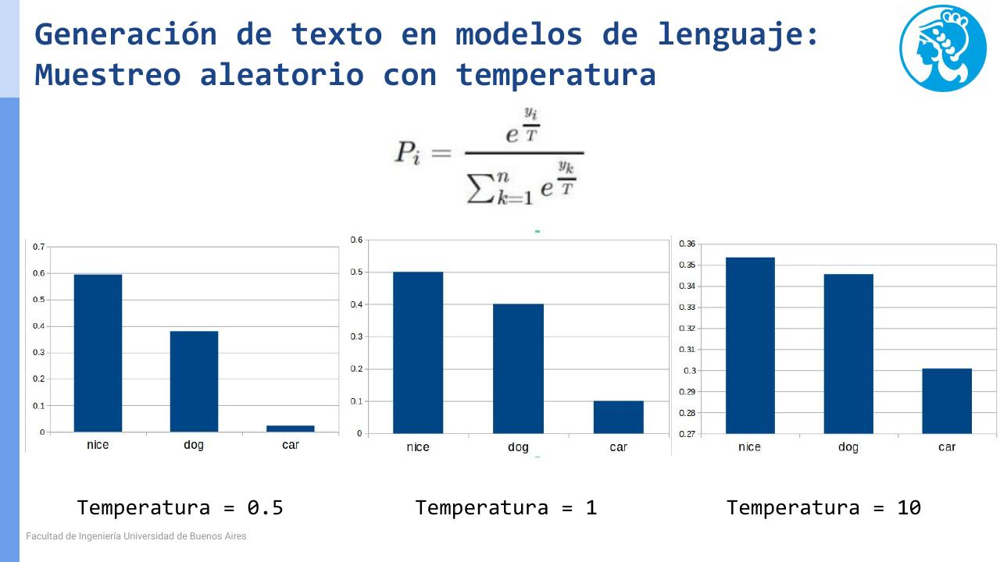

*Slide 23: muestreo aleatorio con temperatura. Probabilidades de nice, dog y car con temperatura 0.5, 1 y 10.*

```math
P_i = \frac{e^{y_i / T}}{\sum_{k=1}^{n} e^{y_k / T}}
```

| Temperatura | nice | dog | car |
|---|---|---|---|
| 0.5 | 0.60 | 0.38 | 0.02 |
| 1 | 0.50 | 0.40 | 0.10 |
| 10 | 0.35 | 0.35 | 0.30 |

*✎ Valores calculados con la fórmula a partir de los de T = 1, que coinciden con las barras de la slide.*

- **Temperatura alta:** **aplana la curva** y achica la distancia entre las palabras. Es más probable que salgan palabras distintas de la más probable y combinaciones más inusuales (02:41:41). Sirve para una lluvia de ideas o para que el modelo cambie su forma de hablar. Si solo se toma la más probable, sale la palabra promedio y la oración promedio.
- **El riesgo:** con una temperatura demasiado alta también es más probable elegir palabras sin sentido. El modelo empieza a decir cualquier cosa y empeora. Hay un rango dentro del cual se puede variar sin arruinar el resultado.
- **Temperatura baja** (02:42:49): **aumenta la distancia** entre las palabras, y casi siempre (no siempre) sale la misma. Sirve cuando se quiere que el modelo responda casi siempre algo parecido.
- **En las APIs:** antes dejaban modificar la temperatura. Según la experiencia de la docente, los últimos modelos (como Luna) ya no, porque vienen con un valor preseteado. Con un modelo open source hay libertad total.

## 17. Top-k y top-p (02:44:12)

Son otros dos parámetros para dirigir el muestreo. No estaban en las slides: la docente los mostró en una página web y dijo que iba a agregar las imágenes al material.
- **Top-k:** limita entre cuántas palabras se sortea. Con k = 1 se elige siempre la mejor, que equivale a greedy. Con k = 3 se sortea entre las tres más probables.
- **Top-p** (02:45:48): usa una **probabilidad acumulada**, como un percentil. Arranca por la palabra más probable y va sumando hasta llegar a p. En el ejemplo, con p = 0.8, tres palabras sumaban 0.75: la siguiente (*roof*) ya pasaba a 0.85, así que quedó afuera, y el sorteo es entre esas tres.
- Los modelos grandes usan estos parámetros, y todos sirven para ajustar el muestreo aleatorio entre las probabilidades de las palabras (02:47:20).
- ✎ A top-p también se lo llama *nucleus sampling* (Holtzman et al., 2019), y valores típicos son 0.9 o 0.95. La temperatura se aplica antes del corte, y en general se combinan.

## 18. Beam search estocástico en el notebook (02:47:20)

- El notebook trae `encode` y `decode`, para ir del texto a los IDs y al revés, y dos funciones de búsqueda:
  - `select_candidates` suma el logaritmo de las probabilidades nuevas al acumulado de cada rama y sortea los candidatos con `np.random.choice`, usando `softmax(pred_large / temp)`.
  - `beam_search(model, num_beams, num_words, input, temp)` repite eso palabra por palabra.
- ✎ En el notebook de la clase la línea del beam search determinista está comentada, así que siempre muestrea. La plantilla del desafío 3 agrega un parámetro `mode`: `'det'` o `'sto'`.
- **Con "La casa", 5 palabras y temperatura 1** salen oraciones distintas en cada rama: "la casa de la casa de pensar", "la casa de un concepto vago"… No varían tanto.
- **Con temperatura 2** (02:48:45): "la casa que la serie del puerto", "la casa de más hombres", "la casa que la compañía es". Ya hay variedad, y a veces lo aleatorio incluso da oraciones con más sentido que la del greedy.
- **En la práctica no se usa el greedy sino beam search**, y se juega con la temperatura hasta encontrar el punto ideal para el modelo (02:49:57).
- **Conclusión:** el corpus es grande y el modelo, chico. Se puede mejorar agregando capas, dándole más ejemplos o usando embeddings preentrenados.
- **Pregunta de Carlos:** las oraciones pierden sentido hacia el final; ¿influye elegir LSTM o GRU? En parte es porque un modelo tan chico sobreajusta y entra en **loops** (02:51:26): "de la casa de la casa…" podría seguir infinitamente.
  - Pasa hasta con los LLMs. En el trabajo de la docente prueban los agentes poniendo a conversar dos LLMs, y a veces se traban: uno dice "necesito que pagues mañana", el otro "no puedo pagar", y así para siempre (02:52:19).
  - El muestreo con temperatura ayuda a salir de esos loops: con la temperatura baja es más probable caer en uno. Un modelo más grande cae menos.

## 19. Desafío 3 (02:52:19)

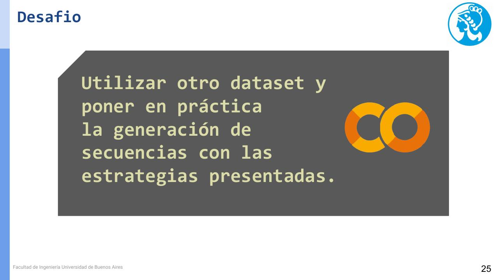

*Slide 25: utilizar otro dataset y poner en práctica la generación de secuencias con las estrategias presentadas.*

En el último recreo la docente subió al repo el material de la clase 4 y la plantilla del desafío 3. La consigna completa, las aclaraciones y los detalles de la plantilla están en [desafios/03-modelo-lenguaje-caracteres](../../desafios/03-modelo-lenguaje-caracteres/README.md). Lo principal:
- **Un modelo de lenguaje como el de la clase, pero tokenizado por caracteres:** genera carácter por carácter (02:53:39). Hay que usar la plantilla del desafío, no el notebook de la clase. **Lo corrige Fernando Silva.**
- **Corpus propio:** el del desafío 2 u otro. Limpiar, tokenizar y separar en train y validación.
- **Arquitecturas recurrentes:** SimpleRNN, LSTM o GRU. Probar combinaciones de capas y de dropout hasta llegar a un modelo decente, y documentar lo que se va encontrando (02:54:54).
- **Generación:** con el mejor modelo, probar **greedy search**, **beam search determinista** (sin muestreo) y **beam search estocástico** (con muestreo), y en este último, distintas temperaturas.
- **Conclusiones en cada punto.** No dejar solo la arquitectura final: contar qué se probó, cómo fue y qué se cree que pasó. Eso suma puntos.
- **Sugerencias** (02:56:16): guiarse por la perplejidad, con el callback de la plantilla o con el simplificado del notebook de la clase, que corre más rápido. Explorar SimpleRNN y LSTM. El optimizador recomendado es rmsprop.
- **La plantilla** (02:57:23):
  - El ejemplo es "La vuelta al mundo en 80 días", pero hay que usar un corpus propio.
  - Como se genera de a un carácter, el contexto tiene que ser más grande. El vocabulario es mucho más chico: unos 65 caracteres.
  - **No hay embedding**, porque un carácter no tiene significado semántico. Los caracteres entran como one-hot.
  - El modelo de ejemplo tiene una sola capa recurrente y una densa: no usarlo tal cual. Probar dos capas con dropout en el medio, LSTM y GRU (02:58:41).
  - Ya trae las funciones de generación y la selección de candidatos con `mode='det'` o `'sto'` y la temperatura.
- **Pregunta de Gonzalo** (02:59:59): si se registran todas las pruebas, ¿no queda larguísimo? No hace falta duplicar el código. Alcanza con una captura y un comentario del tipo "probé tal combinación y no anduvo bien" (03:01:22). Las variaciones de modo y temperatura sí conviene dejarlas en código, porque son una línea cada una.
- **Pregunta de Carlos:** ¿qué hacer con números, puntuación y espacios? Dejarlos, porque entran al vocabulario como cualquier carácter. Si se limpian, el modelo genera oraciones planas.
- **Hacerlo con tiempo** (03:02:53): a veces la T4 no está disponible o se corta la conexión a la mitad. Con créditos se puede usar otra GPU.

## 20. Cierre (03:02:53)

- La clase se alargó un poco. Desde la semana siguiente sigue Fernando Silva, pero las preguntas a la docente se pueden seguir mandando por mail.
- Debe las notas de los desafíos 1 y 2: iba a avanzar con la corrección ese fin de semana.

---

## Correcciones de la transcripción automática

| Dice la transcripción | Es |
|---|---|
| lse posgrados (hablante) | la docente, Josselyn Ordóñez (cuenta del posgrado) |
| Microsoft Outlock | Microsoft Outlook |
| LCTM, LCSTM, LSM, el STM, LCSM | LSTM |
| la RU, la Jer, Gru, Gruiera | GRU |
| RNM, RNES, RNS | RNN, RNNs |
| la celda del | la celda de Elman |
| van gradients, vanishing greatness, van gradi | vanishing gradient |
| Long Shorterm memories | Long Short-Term Memory |
| restoronaron | destronaron |
| comport, comporta, la compu reseteo | compuerta, la compuerta de reseteo |
| H sombrerito, H sombro | h̃, la memoria candidata |
| preparation (el preparation) | backpropagation |
| paguear las palabras | taggear (etiquetar) las palabras |
| reinformant learning, reforming learning | reinforcement learning |
| toque, toquen, tocenizar, toquenizado | token, tokenizar, tokenizado |
| Open AI, PNI, Peni, Open a | OpenAI |
| contextwin | context window |
| prom, system prom | prompt, system prompt |
| Cloud, Cloud Opus, cloud | Claude, Claude Opus |
| CP (cargar skills o en CP) | MCP |
| hards (features de compactación) | *harnesses* |
| P torch | PyTorch |
| troncado | truncado |
| pading, paring, pad | padding |
| héos | ceros |
| kernal | kernel |
| datención, dat aumentation, data aumentation | data augmentation (aumento de datos) |
| monalo | modelo |
| perplegidad, perplejida, perpigidad, perplejía, profilo | perplejidad |
| D (cuando eligió D) | *the* |
| Quick o Brom | *quick*, *brown* |
| peces (hacia dónde se mueven los peces) | pesos |
| croacéntropca, crocéntrica, crocéntropis, croscentropic, crucéntropy | cross-entropy (entropía cruzada) |
| Borja | Borges |
| Abel Cainas, Droger, soñará | "Abel y Caín", "Adrogué", "Alguien soñará" |
| delf | de "El Aleph" |
| Rex | regex (expresión regular) |
| queas, queras, que eras | Keras |
| elizer | `Tokenizer` |
| Tex to Word Sequence | `text_to_word_sequence` |
| estograma | histograma |
| Iralelin | probablemente Elian |
| edins, embedir, envedis, Bins, edading | embeddings, embedding |
| civ | CBOW |
| return sequence through, retorn sequence strom | `return_sequences=True` |
| droppo, pagando conexiones | dropout, apagando conexiones |
| boca boca | `vocab_size` |
| Quen, quens | Qwen |
| Haring Face, Hargin Face, Haging Face | Hugging Face |
| AB (dicen AB) | A3B: parámetros activos |
| 100 (le cambié a 100) | A100 |
| colback, col | callback |
| batiz | batch size |
| gried search, great search, grid search, GDY search | greedy search |
| bim search, BIM, BMS | beam search |
| estrebo, maestro aleatorio, muestro, muestrero | estocástico, muestreo aleatorio |
| lor | loro |
| Topkai, toca el | top-k |
| Linear, Lineers, Linearse | Liniers |
| rem | remo |
| look | loop |
| estadofiteado | sobreajustado (*overfitteado*) |
| CHG GPT, chat GPT | ChatGPT |
| elm, Ll, LMS, LLMS | LLM, LLMs |
| Pus Fable, Sol | probablemente nombres de modelos recientes (Opus, Fable…) |

---

## ✎ Para los desafíos

**Desafío 3** ([consigna y aclaraciones](../../desafios/03-modelo-lenguaje-caracteres/README.md))

| Consigna | Conceptos de la clase |
|---|---|
| Corpus y preprocesamiento | Segmentación y tokenización (§3), ventana de contexto (§4), truncado (§5), padding a la izquierda (§6), aumento de datos (§7) |
| Arquitecturas recurrentes | SimpleRNN, LSTM y GRU (§0 y la clase 3), `return_sequences` y dropout (§11) |
| Entrenar guiándose por la perplejidad | Perplejidad (§9), callbacks (§13) |
| Generar con greedy, beam search determinista y estocástico | Generación autorregresiva (§14), greedy y beam search (§15), muestreo y temperatura (§16 y §18), loops (§18) |

Detalles prácticos:
- **La plantilla plantea el problema como many-to-many, no como many-to-one como el notebook de la clase.** La entrada es una ventana de 100 caracteres y el target, la misma ventana corrida un lugar, así que la última capa recurrente lleva `return_sequences=True`. Cada posición aporta gradiente, y con eso se entrena más rápido.
- **La perplejidad por caracteres no se compara con la de palabras.** Con ~60 caracteres, un modelo al azar da ~60, no ~15.000. Un buen modelo por caracteres en español suele quedar en el orden de 3 a 6.
- **El set de validación de la plantilla está mal armado.** `val_text[init*max_context_size:init*(max_context_size+1)]` arma secuencias de largo 0, 1, 2… Lo correcto es `[init*max_context_size:(init+1)*max_context_size]`.
- **`set(article_text)` no tiene un orden fijo:** con `sorted(set(...))` el mapeo de caracteres a IDs es siempre el mismo y el modelo guardado sigue sirviendo.
- **Las ventanas de train se solapan casi del todo.** Se arman con paso 1, así que hay casi una por carácter. Con un libro entero conviene un paso mayor o un subconjunto del texto, justificándolo.
- **`recurrent_dropout` desactiva cuDNN en la GPU de Colab** y la LSTM o la GRU entrenan mucho más lento. Mejor usar capas `Dropout` entre las capas recurrentes.
- **Temperatura en `select_candidates`:** divide por T los log-probs acumulados antes de la softmax. Probar al menos un valor bajo (0.5), 1 y uno alto (1.5 o 2), y ver cómo se cambia coherencia por variedad.
- **Greedy y beam search determinista suelen entrar en loops** con modelos chicos: es un resultado para comentar, no un error. Para que el muestreo sea reproducible, fijar `np.random.seed`.
- **La celda de Gradio bloquea la ejecución** con `launch(debug=True)` e instala con `!pip`. Para que el notebook corra de punta a punta, dejarla detrás de una bandera.
- **Dejar registro de todo lo probado:** una tabla con arquitectura, parámetros, mejor perplejidad de validación y tiempo de entrenamiento resume bien los experimentos.

---

## ✎ Glosario

- **Modelo de lenguaje:** modelo que asigna probabilidades a secuencias de tokens, en particular a la siguiente palabra dadas las anteriores.
- **Generación autorregresiva:** cada token generado se agrega a la entrada para generar el siguiente.
- **Ventana de contexto:** cantidad máxima de tokens que el modelo considera a la vez como entrada.
- **Truncado:** cortar una secuencia larga en ventanas del tamaño del contexto.
- **Padding (pre):** rellenar con ceros a la izquierda las secuencias más cortas que la ventana.
- **Aumento de datos (en modelos de lenguaje):** generar más ejemplos a partir de una secuencia: sus ventanas y sus prefijos.
- **Token de padding:** el 0, reservado para el relleno. Por eso la salida tiene `vocab_size + 1` clases.
- **Perplejidad:** exponencial de la entropía cruzada: la cantidad media de palabras entre las que el modelo duda. Un modelo al azar da V.
- **Entropía cruzada:** la pérdida que se minimiza: el promedio de −log de la probabilidad asignada al token correcto.
- **Callback:** rutina que Keras ejecuta en ciertos momentos del entrenamiento, por ejemplo al final de cada época.
- **Early stopping:** cortar el entrenamiento cuando la métrica de validación deja de mejorar.
- **Dropout:** apagar al azar una fracción de las conexiones durante el entrenamiento, para regularizar.
- **Sparse categorical crossentropy:** entropía cruzada que recibe el índice de la clase correcta en vez de un one-hot.
- **Embedding entrenable / preentrenado:** la matriz se aprende con el modelo / se carga de Word2Vec, GloVe o fastText y se congela con `trainable=False`.
- **Greedy search:** en cada paso, el token más probable. Es determinista.
- **Beam search:** mantiene varias ramas y elige la de mayor probabilidad conjunta. Es determinista.
- **Muestreo (estocástico):** sortear el siguiente token según sus probabilidades.
- **Logits:** las salidas del modelo antes de la softmax.
- **Temperatura:** divide los logits antes de la softmax. Con T > 1 la distribución se aplana y con T < 1 se afila.
- **Top-k:** sortear solo entre los k tokens más probables.
- **Top-p (nucleus sampling):** sortear entre los tokens más probables que acumulan una probabilidad p.
- **Loop (repetición):** el modelo repite la misma secuencia indefinidamente, algo típico del greedy con modelos chicos.
- **Aprendizaje por refuerzo (post-entrenamiento):** etapa posterior al preentrenamiento en la que el modelo se ajusta según una recompensa: preferencias humanas o la verificación automática de tareas.
- **Compactación de contexto:** resumir o recortar la conversación para que entre en la ventana.
- **Mixture of experts (MoE):** arquitectura dividida en expertos de la que se activa solo una parte por token (parámetros activos).
- **Parámetros activos:** los que se usan por token en un MoE. Por ejemplo, 3B de un total de 32B.
- **Gradio:** librería para armar rápido una interfaz web y probar un modelo.

---

## ✎ Preguntas de práctica

1. ¿Qué modela un modelo de lenguaje? Escribir la fórmula de la probabilidad de una secuencia.
2. ¿En qué se parece el modelo de la clase a un LLM y en qué se diferencia?
3. ¿Por qué un LLM a veces responde "sí" y después se disculpa?
4. ¿Qué agrega el aprendizaje por refuerzo a un modelo preentrenado? ¿Por qué mejoró tanto en matemática y programación?
5. Nombrar en orden los cinco pasos para preparar el dataset de un modelo de lenguaje.
6. ¿Qué es la ventana de contexto? ¿Qué diferencia hay entre usarla en un modelo comercial y elegirla al entrenar uno propio?
7. ¿Qué pasaba cuando un PDF no entraba en la ventana de contexto?
8. ¿Cuántas secuencias de 3 tokens salen de truncar "Todas las hojas son del viento"? ¿Cuál es la fórmula?
9. ¿Por qué el padding se hace a la izquierda?
10. Con la ventana N = 3, ¿qué ejemplos con padding salen de ["Todas", "las", "hojas"] si los IDs son 1, 2 y 3?
11. ¿Por qué conviene entrenar con secuencias incompletas?
12. ¿Qué tiene que ver la biblioteca de Babel con un modelo de lenguaje?
13. Escribir P("La hojarasca crepitar") como producto de probabilidades condicionales.
14. ¿Qué mide la perplejidad? ¿Cuánto vale para un modelo que elige al azar entre V palabras?
15. ¿Cómo se relaciona la perplejidad con la entropía cruzada? ¿Por qué esa relación es conveniente?
16. Si un modelo le asigna 0.5 y 0.25 a las dos palabras correctas, ¿cuál es su perplejidad?
17. ¿Por qué la accuracy no sirve para evaluar un modelo de lenguaje?
18. ¿Qué diferencia hay entre el negative sampling de Word2Vec y la perplejidad?
19. En el notebook de Borges, ¿cómo se segmentó el texto, qué ventana se usó y cuántas secuencias de entrenamiento quedaron?
20. ¿Por qué se trunca en ventanas de `max_context_size + 1`?
21. ¿Por qué la primera LSTM lleva `return_sequences=True` y la última no?
22. ¿Para qué sirve el `Dropout(0.2)`?
23. ¿Por qué la capa de salida tiene `vocab_size + 1` neuronas?
24. ¿Dónde están la mayoría de los 1,3 millones de parámetros del modelo? Calcular los de la primera LSTM.
25. ¿Qué perplejidad mide el `PerplexityCallback` tal como se usa en el notebook? ¿Por qué importa?
26. ¿Qué significa que un modelo MoE tenga "32B y 3B activos"?
27. ¿Qué es la generación autorregresiva?
28. ¿Por qué greedy search siempre da el mismo resultado? ¿Por qué ChatGPT no?
29. En el árbol de la slide, ¿qué frase elige greedy y cuál beam search? ¿Con qué probabilidades?
30. ¿Qué hace la temperatura? ¿Qué pasa con T = 0.5 y con T = 10 en el ejemplo nice/dog/car?
31. ¿Qué diferencia hay entre top-k y top-p?
32. ¿Por qué los modelos chicos entran en loops y cómo ayuda el muestreo?
33. ¿En qué se diferencia el desafío 3 del ejemplo de la clase?
34. ¿Por qué en un modelo por caracteres no se usa una capa de embedding?

<details>
<summary>Respuestas</summary>

1. La probabilidad de la siguiente palabra dadas las anteriores. P(w₁, …, w_m) = Π P(w_i | w_{i−(n−1)}, …, w_{i−1}).
2. La tarea es la misma: predecir el siguiente token, que es como se preentrenan los LLMs. Cambian la escala (1,3 millones de parámetros contra miles de millones), la arquitectura (LSTM contra Transformer) y la tokenización (palabras contra subpalabras).
3. Porque genera de a un token: primero elige la respuesta más probable y después la justifica. Si la justificación lleva a lo contrario, se corrige y se disculpa.
4. Una segunda etapa en la que el modelo hace tareas y se ajusta según si las hizo bien. En matemática y programación es fácil verificar el resultado (comprobar la fórmula, compilar y correr tests), así que la señal de recompensa es clara.
5. Segmentación, tokenización, truncado, aumento de datos y padding.
6. La cantidad máxima de tokens que el modelo considera a la vez. En un modelo comercial viene dada (y se paga por token); al entrenar uno propio es un hiperparámetro que hay que elegir.
7. El modelo daba un error o, peor, procesaba solo lo que entraba, las primeras páginas, y respondía mal si la información estaba al final.
8. 4 secuencias. 1 + M − N = 1 + 6 − 3.
9. Porque lo que se predice va a la derecha. Con ceros a la derecha quedarían entre las palabras y en la parte de la secuencia que más pesa en una RNN.
10. [0, 0, 1], [0, 1, 2] y [1, 2, 3].
11. Porque al generar, el modelo arranca de entradas de cualquier largo, incluso de una sola palabra, y tiene que haber visto ejemplos de todos los largos.
12. La biblioteca tiene todas las combinaciones de caracteres, con sentido y sin sentido. El modelo tiene que aprender cuáles son probables lingüísticamente, de a una palabra.
13. P(crepitar | la hojarasca) · P(hojarasca | la) · P(la).
14. Entre cuántas palabras duda el modelo en promedio. Para uno al azar, V.
15. La perplejidad es la exponencial de la entropía cruzada. Es conveniente porque las librerías ya calculan la entropía cruzada como pérdida.
16. (1 / (0.5 · 0.25))^(1/2) = √8 ≈ 2.83.
17. Porque una oración se puede completar bien de varias formas ("El perro comió su hueso", "su carne"…): no hay una única respuesta correcta.
18. El negative sampling es una técnica de entrenamiento (cuántos ejemplos negativos se usan). La perplejidad es una métrica que sale de las probabilidades del modelo.
19. Con una regex que corta después de `.`, `,`, `!` y `?`, que dio 10.812 frases. Ventana de 10 palabras. Después del truncado y del aumento de datos quedaron 178.448 secuencias de 11.
20. Porque las 10 primeras palabras son la entrada y la 11.ª es el target.
21. La primera tiene que pasarle a la siguiente capa un vector por cada paso (many-to-many). La última solo tiene que entregar el estado final, porque se predice una sola palabra (many-to-one).
22. Para regularizar: apaga al azar el 20 % de las conexiones durante el entrenamiento, así el modelo no depende de un único camino y sobreajusta menos.
23. Porque además de las 15.002 palabras está el token 0 del padding.
24. En el embedding (750.150) y en la capa de salida (495.099). La primera LSTM: 4 × 64 × (50 + 64 + 1) = 29.440.
25. La de entrenamiento, porque `fit` no recibe datos de validación. Importa porque no muestra el sobreajuste: la perplejidad sobre texto nuevo es más alta.
26. Que tiene 32.000 millones de parámetros en total pero usa solo 3.000 millones por token, los de los expertos activados. Eso reduce el cómputo de cada inferencia.
27. Generar de a un token y usar la salida de cada paso como parte de la entrada del siguiente.
28. Porque elige siempre el máximo de unas probabilidades que no cambian: los pesos y la entrada son los mismos. ChatGPT muestrea según las probabilidades, con temperatura.
29. Greedy: "Andábamos sin rumbo fijo", con 0.3 × 0.5 × 0.3 = 0.045. Beam search: "Andábamos sin buscarnos, pero", con 0.3 × 0.4 × 0.9 = 0.108.
30. Divide los logits antes de la softmax. Con T = 0.5 la distribución se afila (0.60, 0.38, 0.02) y con T = 10 se aplana (0.35, 0.35, 0.30).
31. Top-k sortea entre una cantidad fija de tokens, los k más probables. Top-p sortea entre los más probables que acumulan una probabilidad p, así que la cantidad varía según qué tan concentrada esté la distribución.
32. Porque sobreajustan y la secuencia más probable vuelve sobre sí misma. El muestreo con temperatura introduce variación y permite salir del ciclo.
33. Tokeniza por caracteres en vez de por palabras, usa un corpus propio, no tiene embedding, usa un contexto más largo (100) y pide comparar arquitecturas y estrategias de generación.
34. Porque un carácter no tiene significado semántico propio: alcanza con un one-hot sobre un vocabulario de unos 60 caracteres.

</details>
