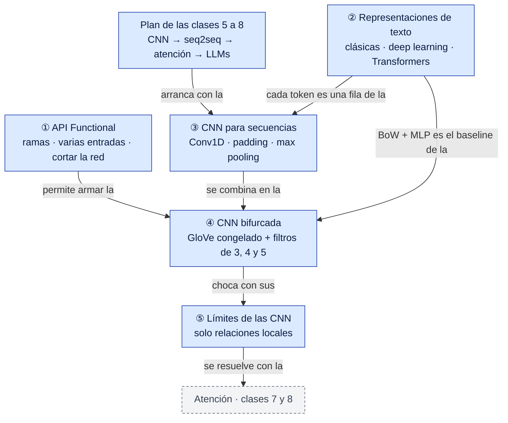
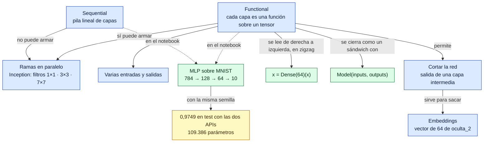
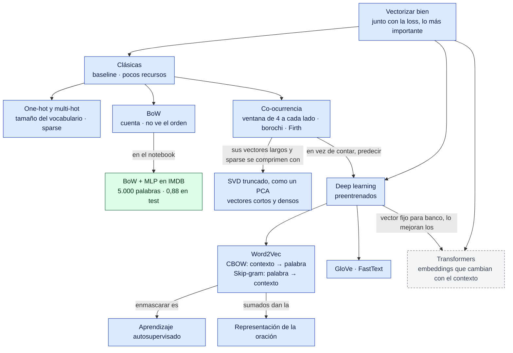
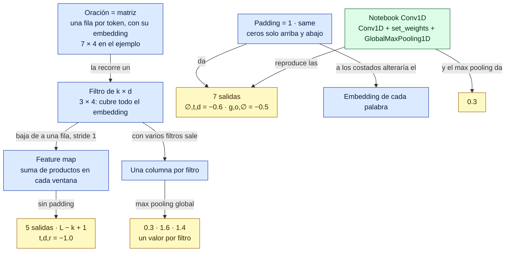
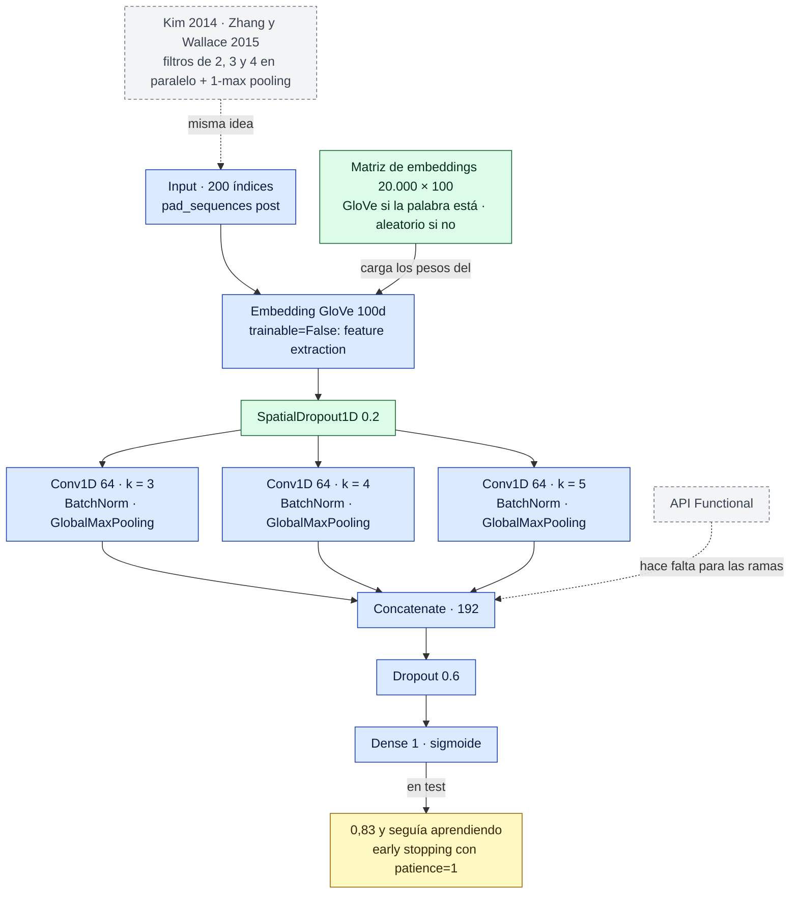
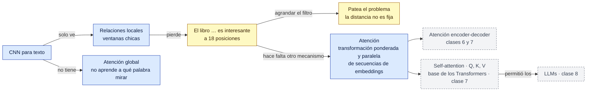

# Red conceptual — Clase 5: CNN para PLN

Complemento del [resumen](resumen.md). Primero hay una vista general de toda la clase y después un mapa por bloque de temas, en el orden en que se dieron. Los números de sección (§) remiten al resumen.

**Cómo leerla**
- Cada flecha forma una frase: *Functional → permite → cortar la red*. Una flecha sin texto quiere decir "incluye".
- Las flechas punteadas unen conceptos de temas distintos.
- Colores: azul = tema · verde = librería, función o herramienta · amarillo = dato para memorizar · gris punteado = concepto que se desarrolla en otro mapa o en otra clase.

> Todo el contenido sale de la clase. La organización y las frases de las flechas son propias.

## Vista general

## 1. Plan de las clases 5 a 8 (§0)

```mermaid
%%{init: {"flowchart": {"nodeSpacing": 30, "rankSpacing": 40, "padding": 10}}}%%
flowchart LR
    RNN["RNN · clase 3<br>procesa de a un token, en orden"] -->|es lenta para| MUCHO["Entrenar con mucho texto"]
    MUCHO -->|alternativa| CNN["CNN para PLN · clase 5<br>filtros que se calculan en paralelo"]
    CNN -->|su limitación es una| VEN["Ventana corta"]
    CNN -->|le sigue| S2S["Seq2seq · clase 6<br>encoder-decoder"]
    S2S -->|es la excusa para entender el| TRF["Transformer · clase 7<br>encoder-decoder + atención"]
    TRF -->|es la arquitectura de los| LLM["LLMs · clase 8"]

    classDef tema fill:#dbeafe,stroke:#1e40af,color:#0b1b3f
    classDef dato fill:#fef9c3,stroke:#a16207,color:#3b2405
    classDef puente fill:#f3f4f6,stroke:#6b7280,color:#374151,stroke-dasharray:4 3
    class CNN,MUCHO tema
    class VEN dato
    class RNN,S2S,TRF,LLM puente
```

## 2. Keras: Sequential y Functional (§1 y §2)

## 3. Representaciones de texto (§3 a §10)

## 4. Conv1D paso a paso (§11 a §14)

## 5. La CNN bifurcada del notebook (§15 y §16)

## 6. Límites de las CNN y atención (§17 y §18)

