# Clase 5 — CNN para PLN

- **Docente:** MSc. Fernando Silva. En la transcripción figura como "lse posgrados", la cuenta del posgrado. Fue su primera clase: da las clases 5 a 8 y sigue desde donde dejó Josselyn Ordóñez.
- **Fecha:** jueves 19/11/2026, de ~19:03 a ~21:30. El docente suele arrancar 19:05 para esperar a todos, pero se conecta desde 19:01 por si hay consultas.
- **Duración:** ~2 h 26 min (la transcripción va de 00:03:01 a 02:28:51). No hubo recreos: el docente prefiere pasarlos al final y terminar media hora antes. En las clases más pesadas va a hacer recreos en el medio (01:34:30).
- **Grabación:** [Google Drive](https://drive.google.com/file/d/1EKmgCjjgFSpRgurthGhRLThnvdze4_OW/view?usp=sharing)
- **Material:** [slides](material/slides-cnn-pln.pdf) · notebooks: [Sequential vs Functional](material/notebook-sequential-vs-functional.ipynb), [BoW y MLP](material/notebook-bow-mlp.ipynb), [CNN, Conv1D](material/notebook-cnn-conv1d.ipynb) y [CNN, arquitectura](material/notebook-cnn-arquitectura.ipynb) · [transcripción](material/transcripcion.txt) · [notas de Gemini](material/notas-gemini.txt) · [carpeta `Clase 5` del repo de la materia](https://github.com/FIUBA-Posgrado-Inteligencia-Artificial/procesamiento_lenguaje_natural/tree/nov_2026/Clase%205)
- **Desafío:** esta clase no presentó ninguno. El [desafío 3](../../desafios/03-modelo-lenguaje-caracteres/README.md) tiene nota 10 hasta el jueves 26/11, y el desafío 4 (seq2seq) se presenta en la clase 6.
- **Lectura sugerida (no obligatoria):** el curso de NLP de Lena Voita, en particular [Seq2seq and attention](https://lena-voita.github.io/nlp_course/seq2seq_and_attention.html). Muchas slides del docente se basan en ese curso.
- **Clase anterior:** [resumen de la clase 4](../04-modelo-lenguaje/resumen.md) (modelo de lenguaje con LSTM).
- **Red conceptual:** [red-conceptual.md](red-conceptual.md)

> **Fuentes:** la transcripción completa, las slides y los cuatro notebooks de la clase. Las notas de Gemini solo se usaron para cotejar. Los tiempos `(hh:mm:ss)` marcan el bloque de la transcripción donde arranca cada tema. Lo marcado con ✎ es elaboración propia y no se dijo en clase.

---

## Repaso rápido

- **Plan de las clases 5 a 8:** CNN para PLN (5) → seq2seq (6), "como excusa" para entender los Transformers → mecanismo de atención y Transformers (7) → grandes modelos de lenguaje (8), que se entrenan con la arquitectura Transformer. De las CNN a los LLMs.
- **¿Por qué CNN para texto?** Una RNN procesa de a un token y en orden, y eso es lento para entrenar con mucho texto. Una CNN aplica filtros y procesa más rápido. Su límite es una ventana corta.
- **API Functional de Keras:** cada capa se aplica como una función sobre la salida de otra, y el modelo se cierra "como un sándwich" con `Model(inputs, outputs)`. Permite lo que `Sequential` no puede: ramas en paralelo (como en Inception), varias entradas o salidas y cortar la red para quedarse con una representación intermedia (un embedding). El mismo MLP sobre MNIST, armado con las dos APIs, da 0,9749 de accuracy en test.
- **Lo más importante en una red neuronal,** según el docente, es la función de pérdida y que los vectores de entrada estén bien hechos.
- **Tres familias de representaciones:**
  - **Clásicas** (one-hot, BoW, TF-IDF, co-ocurrencia): se usan como baseline o con pocos recursos.
  - **De deep learning** (Word2Vec, GloVe, FastText): vectores fijos, que no ven el contexto. "Banco" tiene siempre el mismo vector.
  - **Transformers:** con la atención, el vector de cada palabra cambia según las de alrededor.
- **One-hot y multi-hot:** cada palabra es un vector del tamaño del vocabulario con un solo 1, y una oración es la suma de los vectores de sus palabras (multi-hot). BoW cuenta en vez de marcar y no ve el orden: "me gustan los gatos, pero no los perros" y "me gustan los perros, pero no los gatos" dan el mismo vector.
- **Notebook BoW + MLP (IMDB):** vocabulario de 5.000 palabras, una matriz de 25.000 × 5.000 y un MLP de 512-256-128 con BatchNorm, Dropout y L2. Da 0,88 de accuracy en test.
- **Co-ocurrencia:** una palabra se conoce por sus vecinas (Firth). Con el ejemplo del borochi, sin saber qué es, el contexto alcanza para darse cuenta de que es un animal salvaje. Se cuenta en una ventana de 4 palabras a cada lado.
- **Del conteo a la predicción:** los vectores de conteo son largos y dispersos, y lo ideal es que sean cortos y densos. Hay dos caminos:
  - **Comprimir** la matriz con SVD, como un PCA.
  - **Predecir en vez de contar:** Word2Vec. CBOW predice la palabra enmascarada a partir de su contexto y Skip-gram hace lo contrario. Es aprendizaje autosupervisado.
- **CNN para secuencias:** la oración es una matriz, con una fila por token (su embedding). El filtro ocupa k filas y todo el ancho del embedding y baja de a una fila (Conv1D). El padding va solo arriba y abajo, porque a los costados alteraría el embedding. Con varios filtros sale una columna por filtro, y el max pooling global se queda con el máximo de cada una.
- **Notebook Conv1D:** reproduce el ejemplo de las slides con `Conv1D(filters=1, kernel_size=3, padding='same', use_bias=False)` y el filtro cargado a mano. Da [−0.6, −1.0, −0.5, −3.6, −0.2, 0.3, −0.5], y el max pooling da 0.3.
- **Notebook CNN bifurcada (IMDB):** GloVe de 100 dimensiones congelado (transfer learning por extracción de características) → tres ramas Conv1D con filtros de 3, 4 y 5 → max pooling global → concatenar → dropout → sigmoide. Da 0,83 en test, y seguía aprendiendo cuando lo cortó el early stopping.
- **Límites de las CNN:** solo ven relaciones locales ("El **libro** que compré … es **interesante**"). Agrandar el filtro solo patea el problema, porque la distancia entre palabras relacionadas no es fija. Hace falta otro mecanismo, la **atención**: una transformación ponderada y paralela de una secuencia de embeddings en otra. Es la base de los Transformers.

---

## 0. Presentación y plan de las clases 5 a 8 (00:03:01)

- Fernando Silva da las cuatro clases que quedan del módulo y sigue con el avance de Josselyn. Ella ya había avisado el primer día que iban a ser dos docentes.
- **Repaso del programa** (00:04:39): mostró en el GitHub de la materia las slides del primer día de clases.
  - **Clase 1:** introducción a NLP y técnicas clásicas: tokenización, stemming, lematización, stopwords, one-hot y bag of words.
  - **Clase 2:** word embeddings. Ahí ubicó también TF-IDF ✎ (en realidad se vio en la [clase 1](../01-introduccion-vectorizacion/resumen.md)).
  - **Clase 3:** redes recurrentes: Elman, LSTM y GRU.
  - **Clase 4:** modelos de lenguaje y generación de secuencias con modelos autorregresivos.
- **Clase 5, CNN para NLP** ("o PLN, que es lo mismo en español") (00:06:08). Las RNN de la clase 3 sirven para cualquier secuencia, no solo texto: audio, series de tiempo… Hasta las imágenes, que no son secuencias, se pueden tratar con RNN.
- **El puente al revés** (00:07:20): las RNN nacieron como propuesta para manejar secuencias, cuando ya existían las CNN de visión por computadora. El camino habitual es CNN → RNN para texto. Ahora se hace al revés: hay RNN que funcionan, pero también otras alternativas. Una muy poderosa se ve más adelante (los Transformers) y otra interesante son las CNN, que se ven hoy.
- **¿Por qué CNN?** (00:08:28)
  - Como trabajan con filtros, **pueden procesar más rápido**. Las RNN son lentas porque son secuenciales: con "hoy me siento triste" procesan "hoy", después "me", después "siento" y después "triste", y recién entonces dicen "negativo". Si se quiere entrenar un modelo grande con mucho texto, eso es un problema.
  - Además, sirve para ver que las CNN también entran en el juego del PLN.
  - **Su limitación:** una ventana muy corta, que se comprueba al final de la clase (§17).
  - ✎ La diferencia de velocidad viene de que cada salida de una convolución depende solo de su ventana, así que todas las posiciones se calculan en paralelo. En una RNN, para calcular h_t hace falta h_{t−1}.
- **Clase 6, seq2seq** (00:09:47): se ve "más como una excusa para entender cómo funcionan los Transformers". Un bloque (una CNN o una RNN) se conecta con otro (una RNN) en una arquitectura **encoder-decoder**, que resuelve tareas más complejas, como la traducción. Se pueden combinar CNN + RNN, RNN + RNN o solo CNN, aunque esto último es poco común.
- **Clase 7, mecanismo de atención y Transformers:** es otra dinámica, distinta de las CNN y las RNN. Dicho de forma muy simplista, el Transformer es "esto [el encoder-decoder] empoderado con mecanismo de atención" (00:11:04).
- **Clase 8, grandes modelos de lenguaje (LLMs):** se entrenan con la arquitectura Transformer. Ese es el *storytelling* de las cuatro clases: cómo se llega de las CNN a los LLMs.

## 1. Keras: modelo Sequential y modelo Functional (00:12:33)

- ¿Vieron el modo **Functional** de armar redes, o solo el **Sequential**? Algunos no lo habían visto, así que el docente preparó un Colab.
- **Sequential**, dibujado en horizontal (00:13:48): una red para clasificar perros y gatos. La imagen se aplana con una capa `Flatten`, pasa por una capa oculta de 128 nodos y otra de 64, y termina en una salida de un nodo, porque es binaria. Todo está conectado con todo. Es un flujo: la imagen entra, se aplana, pasa por cada capa y termina.
- **En código** (00:14:52) es `Sequential([layers.Dense(128, ...), layers.Dense(64, ...), ...])`. No hace falta decir qué capa sigue a cuál: la primera línea hace su proceso, la segunda le sigue, y así. Es lo que se hizo hasta ahora en todos los módulos.
- **Functional** arma ese tipo de redes y también otras más complejas, como **Inception**, que probablemente vean en una materia más avanzada de visión (00:16:15).
  - Convolución, max pooling, convolución, y después la red se **divide en ramas** con kernels distintos. Una convolución de 7×7 ve una región espacial grande (49 píxeles) y una de 1×1 ve a nivel de píxel. Combinar niveles distintos es útil, y esa es una de las premisas de Inception.
  - Las ramas se **concatenan** (`Concatenate`), se hace un max pooling y se vuelve a dividir en tres, cuatro o cinco caminos. Al final, una red densa clasifica (00:17:33).
  - **Esa bifurcación no se puede armar con Sequential.** A medida que las redes se hacen más complejas, Sequential deja de alcanzar.
  - ✎ En la Inception original (GoogLeNet, 2014) las ramas son 1×1, 3×3, 5×5 y un max pooling de 3×3. Los filtros de 7×7, factorizados en 1×7 y 7×1, aparecen en versiones posteriores.
- **Manejar la red por pedazos** (00:17:33): sirve también para GANs y autoencoders. Por ejemplo, con la red ya entrenada se puede pedir "dame la salida hasta esta convolución" (00:18:41). Es una propiedad muy útil de Functional.
- **Un sándwich:** en Functional la red se arma por pedazos, y después se definen la entrada y la salida, que son los dos panes.

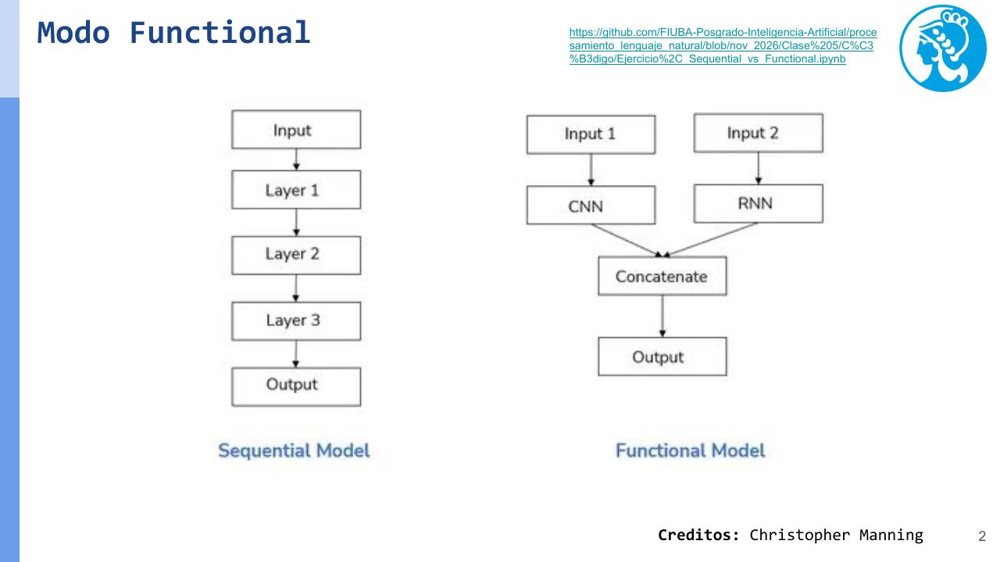

*Slide 2: modo Functional. Sequential model: Input → Layer 1 → Layer 2 → Layer 3 → Output, una capa detrás de otra. Functional model: Input 1 → CNN e Input 2 → RNN, que se juntan en un Concatenate → Output. Créditos: Christopher Manning.*

- La slide está en vertical, pero es lo mismo: dos ramas y además **dos entradas**. Functional hace falta cuando hay dos entradas y dos salidas, cinco entradas y ocho salidas, etcétera (00:18:41).

## 2. Notebook: Sequential vs Functional (00:19:36)

[Notebook](material/notebook-sequential-vs-functional.ipynb). Es una red muy simple, sin NLP ni CNN: el punto es armar la misma red con las dos APIs y ver que da lo mismo, porque es la misma arquitectura.

**Datos** (00:20:45)
- Importa `numpy`, `tensorflow` y, de `tensorflow.keras`, `layers`, `models` e `Input`. `models` e `Input` son lo nuevo.
- **MNIST**, "el más fácil de todos": `tf.keras.datasets.mnist.load_data()`. Como es un dataset de juguete, ya viene dividido en train y test, así que no hace falta `train_test_split`.
- Las imágenes de 28 × 28 se aplanan con `reshape` a **784** valores y se normalizan dividiendo por 255 (00:21:46). Son de 8 bits: 2⁸ = 256 valores, de 0 a 255. Así quedan entre 0 y 1.
- `input_dim = 784` y `num_clases = 10`, los dígitos del 0 al 9.

**A) Sequential**

```python
tf.keras.utils.set_random_seed(42)

modelo_seq = models.Sequential([
    layers.Dense(128, activation="relu", input_shape=(input_dim,), name="oculta_1"),
    layers.Dense(64, activation="relu", name="oculta_2"),
    layers.Dense(num_clases, activation="softmax", name="salida"),
], name="modelo_sequential")
```

- **`set_random_seed(42)`:** para que la red Functional que se arma después arranque con los mismos pesos iniciales. Si no, las dos redes darían resultados distintos aunque tengan la misma arquitectura. Así la comparación es justa (00:22:55).
- **`name`** es opcional, pero es muy útil cuando se quieren obtener embeddings de una capa.
- La salida usa **softmax** porque es multiclase.
- Se compila con `adam` y `sparse_categorical_crossentropy`, y se entrena 5 épocas con batch 32 (00:24:02). Da **0,9749** de accuracy en test.
- ✎ Keras avisa (`UserWarning`) que en un Sequential conviene empezar con `Input(shape)` en vez de pasarle `input_shape` a la primera capa.

**B) Functional** (00:24:02)

```python
tf.keras.utils.set_random_seed(42)

entrada = Input(shape=(input_dim,), name="entrada")
x = layers.Dense(128, activation="relu", name="oculta_1")(entrada)
x = layers.Dense(64, activation="relu", name="oculta_2")(x)
salida = layers.Dense(num_clases, activation="softmax", name="salida")(x)

modelo_func = models.Model(inputs=entrada, outputs=salida, name="modelo_functional")
```

- Es lo mismo, pero en pedazos: no hay un `Sequential(...)` que agrupe todo.
- **Conviene leerlo de derecha a izquierda** (00:25:22). Al final de la segunda línea, entre paréntesis, está `entrada`: es la entrada de la capa que se define a su izquierda, una `Dense(128)` llamada `oculta_1`. El resultado se guarda en `x`. El docente lo asoció con un concepto de programación funcional, la **currificación**.
- En la línea siguiente, `x` es la entrada de la `Dense(64)`, y su resultado vuelve a guardarse en `x`, que a su vez es la entrada de la última capa (00:26:36). Se lee **en zigzag**: `entrada` → `x` → `x` → `salida` (00:27:32).
- **El sándwich** (00:28:47): como las capas quedan sueltas, `models.Model(inputs=entrada, outputs=salida)` define el primer pan y el último. Todo lo que pasa en el medio ya está definido.
- `summary()` muestra los parámetros: 100.480 + 8.256 + 650 = **109.386**.
- La compilación, el entrenamiento y la evaluación son un copy-paste de los de arriba. Da **0,9749** en test, igual que el Sequential. ✎ Hasta la accuracy de train de cada época coincide (0,9878 en la última).
- ✎ `layers.Dense(128)` crea la capa, y el segundo paréntesis la llama sobre `entrada` (su método `__call__`). Por eso se escribe `f(...)(x)`: se parece a la currificación, una función que devuelve otra función.

**Carlos:** ¿la misma librería de siempre soporta esta forma de definir las redes? Sí, es Keras, solo que con las capas sueltas. Acá no parece gran cosa, pero después sirve para armar bifurcaciones (00:30:00).

**Ejemplo del potencial: sacar embeddings de una capa intermedia** (00:30:00). El docente lo agregó en vivo; no está en el notebook del repo.
- Supongamos que el objetivo nunca fue clasificar dígitos, sino aprovechar una **representación intermedia**. Las redes extraen información en distintos niveles de abstracción (00:31:35).
- Para armar embeddings con una red así, se le **corta la cabeza** y uno se queda con la última capa oculta, que tiene el mayor nivel de abstracción antes de clasificar. Con Functional es fácil, porque las capas ya están entrenadas (00:32:47):

```python
modelo_embeddings = models.Model(inputs=entrada, outputs=x)   # x: la salida de "oculta_2"
# recibe la imagen y devuelve un vector de 64 elementos: un embedding
```

- Así se puede cortar la red, agregarle entradas, bifurcarla, darle varias salidas, etcétera. ✎ Con los nombres de las capas, lo mismo se escribe `outputs=modelo_func.get_layer("oculta_2").output`.

## 3. Clasificar texto: la importancia de los vectores (00:34:10)

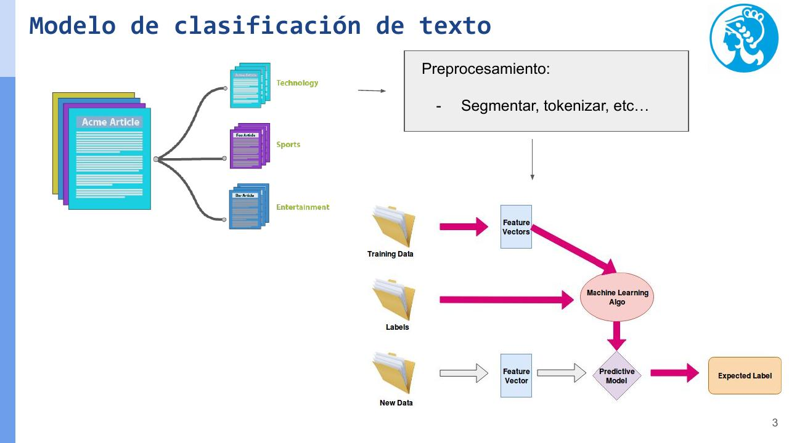

*Slide 3: modelo de clasificación de texto, con artículos en Technology, Sports y Entertainment. Preprocesamiento (segmentar, tokenizar, etc.) → los textos de entrenamiento se convierten en feature vectors que, junto con las etiquetas (labels), entrenan un algoritmo de machine learning → modelo predictivo. Un texto nuevo se convierte en un feature vector y el modelo predice su etiqueta (expected label).*

- Se agarra mucho texto, se preprocesa (se tokeniza, se lematiza, se sacan las stopwords, se limpia) y así se arma el dataset. Con él se entrena el modelo, que queda listo para recibir datos nuevos. Esos datos se **vectorizan** y el modelo predice (00:35:19).
- **La vectorización es lo más importante.** Para el docente hay dos cosas clave en las redes neuronales:
  - **La función de pérdida:** cómo se define para que el modelo funcione bien.
  - **Que los vectores estén bien hechos.** Si no lo están, de nada sirve todo lo demás.

## 4. Representación de secuencias: tres familias (00:35:19)

Es un breve repaso de lo que se vio con Josselyn en las primeras clases.

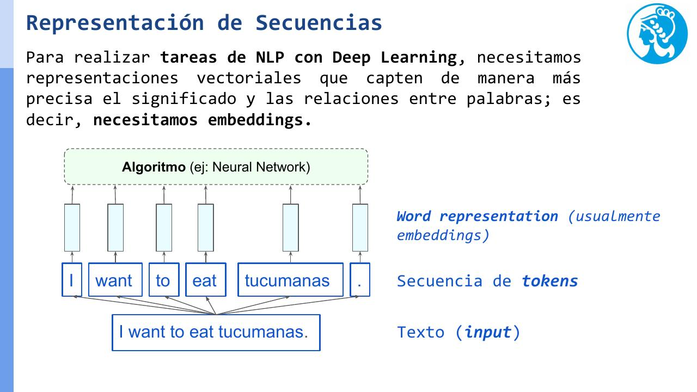

*Slide 4: para tareas de NLP con deep learning hacen falta representaciones vectoriales que capten mejor el significado y las relaciones entre palabras: embeddings. El texto (input) "I want to eat tucumanas." se divide en una secuencia de tokens (I, want, to, eat, tucumanas, .). Cada token se representa con un vector (word representation, usualmente un embedding), y esos vectores entran al algoritmo, por ejemplo una red neuronal.*

- El texto se convierte en vectores (feature vectors, word representations) y recién ahí se le pasa al algoritmo. Hay muchas maneras de hacerlo.

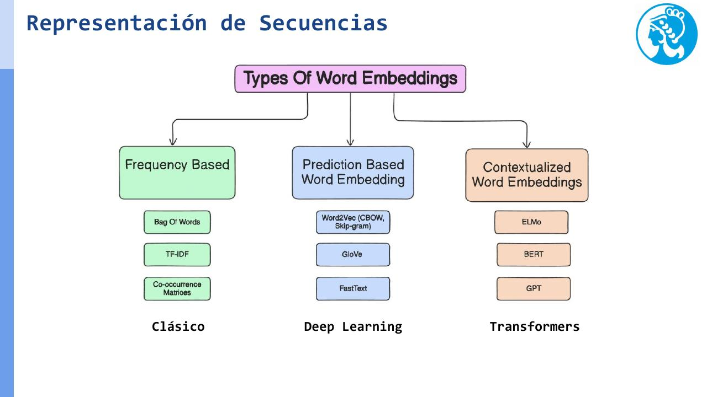

*Slide 5: tipos de word embeddings. Frequency based (clásico): Bag of Words, TF-IDF, matrices de co-ocurrencia. Prediction based (deep learning): Word2Vec (CBOW, Skip-gram), GloVe, FastText. Contextualized (Transformers): ELMo, BERT, GPT. La misma slide se repite más adelante resaltando el bloque que se ve en cada momento: frecuencia (slide 6) y predicción (slide 15).*

**Clásicos** (00:36:30): one-hot, bag of words, TF-IDF, matrices de co-ocurrencia.
- Funcionan, pero no son del todo eficientes y son sensibles a muchas cosas. BoW sirve como **baseline**, pero después tiene muchos problemas.
- **No ve el orden:** BoW cuenta, así que "me gustan los gatos, pero no los perros" y "me gustan los perros, pero no los gatos" dan el mismo vector (00:37:46). Además tiene muchos ceros y es muy grande, porque abarca todo el vocabulario.
  - ✎ Con el vocabulario *me, gustan, los, gatos, pero, no, perros*, las dos oraciones dan [1, 1, 2, 1, 1, 1, 1]: el 2 es *los*, el "2 1 0 1…" que esbozó el docente.
- **Lucas**, por chat: dos oraciones con las mismas palabras y distinto significado tienen similitud coseno 1. Según BoW son idénticas, y está mal.
- Por eso los clásicos no se usan, salvo como baseline (00:39:00).

**Deep learning** (00:39:00): mucho mejor. Usa redes neuronales y muchos datos, y ya hay modelos **preentrenados**, GloVe, FastText y Word2Vec, en distintas dimensiones.
- **El problema: no tienen en cuenta el contexto.** Walter y Denis propusieron por chat el ejemplo de *banco*. "Mañana te banco en el partido de fútbol" es apoyar; "mañana voy al banco a sacar dólares" es una institución financiera. El significado cambia según el contexto, pero el vector no.
- **Los vectores son fijos** (00:39:59): sea el banco para sentarse (Geraldine), el de apoyar o la entidad financiera, siempre es el mismo vector de, por ejemplo, 100 números.

**Transformers:** con el **mecanismo de atención**, el vector de *banco* se actualiza según las demás palabras de la oración, y eso lo hace mucho más eficiente. **Lautaro**, por chat: en los Transformers los embeddings son dinámicos. Sí: en el paso de *self-attention* se van ajustando al texto de alrededor (00:42:10).

**¿Para qué ver lo clásico y el deep learning si los Transformers ya lo resolvieron?** Depende (00:41:01).
- **Lo clásico** se usa cuando se necesita inferencia rápida, no hay acceso a internet o los recursos son limitados. **El deep learning** también, y con GPU anda muy bien. Con internet, buen poder de cómputo y sin necesidad de respuestas inmediatas, uno se puede dar el lujo de un Transformer.
- **Como baseline:** para saber si un embedding nuevo hecho con Transformers es bueno, hay que compararlo con un modelo base que se sabe que no es muy bueno. Si no lo supera, la propuesta no sirve. Los papers casi siempre comparan un embedding nuevo contra bag of words y Word2Vec (00:42:10).

**Lena Voita:** el docente compartió su blog/curso de NLP, que "explica muy bien" y que usaba mucho cuando hacía el máster. Muchas de sus slides se basan en él (00:43:30).

## 5. One-hot y multi-hot (00:43:30)

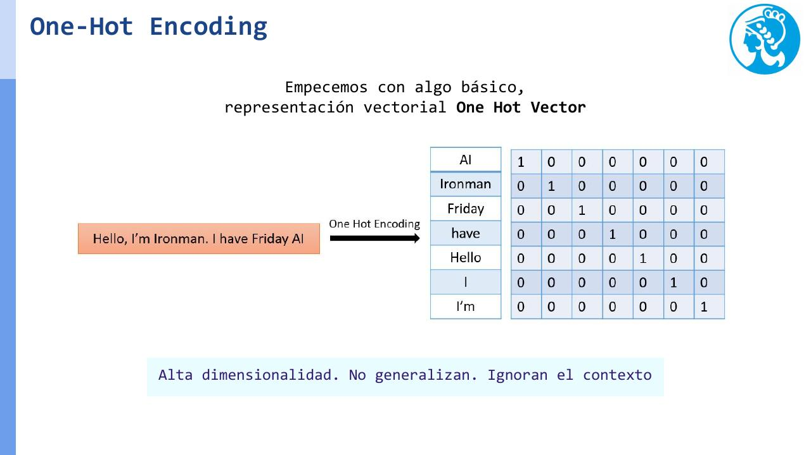

*Slide 7: representación One Hot Vector de "Hello, I'm Ironman. I have Friday AI". Con un vocabulario de 7 palabras, cada una es un vector de 7 posiciones con un único 1: AI = [1 0 0 0 0 0 0], Ironman = [0 1 0 0 0 0 0], Friday = [0 0 1 0 0 0 0], have = [0 0 0 1 0 0 0], Hello = [0 0 0 0 1 0 0], I = [0 0 0 0 0 1 0], I'm = [0 0 0 0 0 0 1]. Problemas: alta dimensionalidad, no generalizan, ignoran el contexto.*

- Se extraen las palabras únicas para armar el vocabulario y se ponen en las filas y en las columnas (00:44:38). Como coinciden, la diagonal queda llena de unos. El vector de *Friday* es su fila.
- Es sencillo de entender y armar, pero "creo que es el que tiene más problemas" (00:45:46):
  - **Alta dimensionalidad:** cada vector tiene el tamaño del vocabulario. Con 50.000 palabras únicas, cada palabra son 50.000 números.
  - **Sparse:** de esos números, uno solo es 1 y el resto son ceros, que no aportan información.
  - **No generaliza e ignora el contexto.**
  - ✎ Todos los vectores one-hot son ortogonales entre sí: *good* queda tan lejos de *great* como de *movie*.

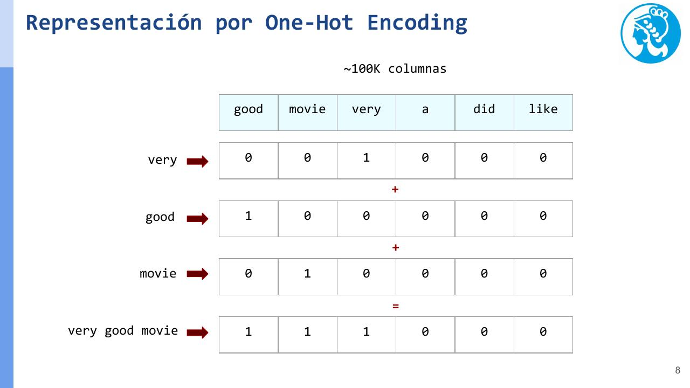

*Slide 8: con un vocabulario real los vectores tienen ~100K columnas. Con las columnas good, movie, very, a, did y like: very = [0 0 1 0 0 0], good = [1 0 0 0 0 0] y movie = [0 1 0 0 0 0]. Sumados, "very good movie" = [1 1 1 0 0 0].*

- **Multi-hot** (00:46:58): sumar los one-hot de las palabras da un vector que representa la oración entera. Así se le puede pasar la oración al modelo y preguntarle si es positiva o negativa.
- ✎ La suma pierde el orden: "movie very good" da el mismo vector.

## 6. Notebook: BoW + MLP en IMDB (00:46:58)

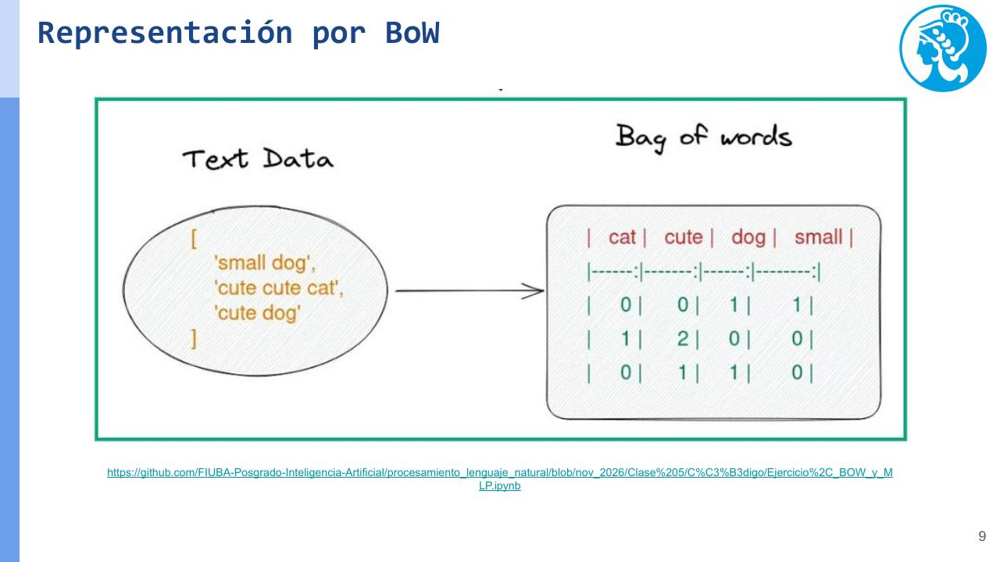

*Slide 9: BoW de ['small dog', 'cute cute cat', 'cute dog'] con el vocabulario cat, cute, dog, small: 'small dog' = [0 0 1 1], 'cute cute cat' = [1 2 0 0], 'cute dog' = [0 1 1 0].*

- **BoW es un one-hot que no es binario: cuenta** (00:50:33). "small dog" tiene una vez *dog* y una vez *small*: [0 0 1 1]. "cute cute cat" tiene dos veces *cute* y una vez *cat*: [1 2 0 0] (00:51:41).

[Notebook](material/notebook-bow-mlp.ipynb): análisis de sentimiento con un MLP sobre BoW, es decir, el multi-hot que entra a una red simple (00:49:11).

**Preparación**
- Importa `numpy`, `tensorflow` y `matplotlib`. De Keras trae el dataset `imdb`, `pad_sequences`, `Model`, `Input`, `Dense`, `Dropout`, `BatchNormalization`, el regularizador `l2`, el callback `EarlyStopping`, el optimizador `Adam`, `plot_model` e `Image` de `IPython.display`.
- Se comprueba la GPU: el notebook se corrió con GPU, en TensorFlow 2.20.0.
- **`vocab_size = 5000`** (00:50:33): el tamaño de los vectores BoW, 5.000 columnas.
  - **¿Cómo se elige?** Normalmente se pone un número grande (5.000, 10.000). Si en realidad hay 6.000 palabras únicas, se priorizan las más frecuentes y las demás no se tienen en cuenta (00:51:41).
  - La otra opción, "muy buena", es contar las palabras únicas del dataset y usar ese número. En el ejemplo de la slide son 4 (00:52:41).
- **`imdb.load_data(num_words=vocab_size)`:** carga IMDB directamente y considera las 5.000 palabras más representativas. Hay **25.000** críticas de train y **25.000** de test (00:53:47).

**De secuencias a BoW** (00:53:47)

```python
def sequences_to_bow(sequences, dimension):
    results = np.zeros((len(sequences), dimension))
    for i, sequence in enumerate(sequences):
        for word_idx in sequence:
            if word_idx < dimension:
                results[i, word_idx] += 1
    return results
```

- Arma una matriz de ceros de cantidad de secuencias × `vocab_size` (00:55:16). Recorre cada oración, por ejemplo la 0, "Fernando está feliz", y dentro de ella cada palabra.
- `if word_idx < dimension` verifica que la palabra esté entre las 5.000 más frecuentes (00:56:31). Si está, suma 1 en su columna, en la fila de esa oración. Si la palabra se repite, vuelve a sumar, y así se arman los conteos (00:57:50).
- `X_train_bow` y `X_test_bow` quedan de **(25.000, 5.000)**: 25.000 críticas por 5.000 palabras (00:58:57).

**El MLP, armado con Functional** (00:58:57)

```python
input_layer = Input(shape=(vocab_size,))

dense1 = Dense(512, activation="relu", kernel_regularizer=l2(1e-4))(input_layer)
dense1 = BatchNormalization()(dense1)
dense1 = Dropout(0.5)(dense1)

dense2 = Dense(256, activation="relu", kernel_regularizer=l2(1e-4))(dense1)
dense2 = BatchNormalization()(dense2)
dense2 = Dropout(0.5)(dense2)

dense3 = Dense(128, activation="relu", kernel_regularizer=l2(1e-4))(dense2)
dense3 = BatchNormalization()(dense3)
dense3 = Dropout(0.5)(dense3)

output_layer = Dense(1, activation="sigmoid")(dense3)
model = Model(inputs=input_layer, outputs=output_layer)
```

- **¿Cuántas entradas tiene la red?** No son 25.000, que es la cantidad de críticas, sino **5.000, una por palabra**: *hola* entra por un nodo, *chao* por otro (01:01:32).
- Cada bloque es una `Dense` conectada con todo lo anterior, seguida de `BatchNormalization` y `Dropout`. Estas dos "son solo una flecha": no agregan otra capa conectada todos con todos (01:04:42).
- La salida es una `Dense` de **un nodo con sigmoide**, porque es clasificación binaria: el comentario es positivo o negativo (01:06:13).
- ✎ Son ~2,73 millones de parámetros, el 94 % en la primera capa: 5.000 × 512 + 512 = 2.560.512.

**Entrenamiento** (01:06:13)
- `Adam(learning_rate=1e-4)`, `binary_crossentropy` (porque la salida es sigmoide) y accuracy.
- **`EarlyStopping(monitor="val_loss", patience=2, restore_best_weights=True)`:** si en dos épocas la val_loss no mejora, se detiene y vuelve a los mejores pesos.
- `model.fit(X_train_bow, y_train, validation_split=0.2, epochs=20, batch_size=32, callbacks=[early_stop])`.
- Funciona muy bien: la distancia entre la accuracy de train y la de validación es relativamente baja, así que está bien entrenado (01:07:30). En test da **0,88** (0,8813), cerca de la de validación. Las curvas de accuracy van juntas y las de loss bajan.
- ✎ Paró en la época 9 y volvió a la 7, la mejor: val_loss 0,4066 y val_accuracy 0,8854.

**Inferencia** (01:07:30)
- `imdb.get_word_index()` da el índice de cada palabra. Las palabras están ordenadas de la más frecuente a la menos, y por eso `num_words=5000` se queda con las 5.000 más importantes.
- `encode_text_bow` hace un BoW de una sola oración (01:08:41): pasa el texto a minúsculas, lo separa en tokens con `split()`, arma un vector de ceros de `vocab_size` y suma 1 en el índice de cada palabra que esté entre las 5.000 más frecuentes.
- `predict_sentiment` codifica el texto, se lo pasa al modelo y decide con un umbral de 0,5 (01:10:55):

| Texto | Score | Sentimiento |
|---|---|---|
| this movie was amazing i loved it | 0,9561 | positivo |
| this film was terrible and boring | 0,0166 | negativo |
| the actors were fantastic and the story was beautiful | 0,8092 | positivo |
| worst movie ever | 0,0356 | negativo |

- Funciona con BoW y un MLP que, aclaró, tampoco es tan simple: tiene cuatro capas (01:12:01).
- ✎ `encode_text_bow` le suma 3 a cada índice. En el IMDB de Keras, los índices 0, 1 y 2 están reservados (padding, inicio de secuencia y palabra desconocida) y el 3 queda sin usar, mientras que `get_word_index()` devuelve el ranking sin ese corrimiento.

## 7. Matriz de co-ocurrencia (01:12:01)

Es una representación más rica que BoW y sirve de puente hacia el deep learning.


*Slide 10: "Una vez mi papá vió un borochi cuando fue a Santa Cruz. …podemos ver al borochi comiendo unas frutas silvestres… Actualmente muchos ganaderos cazan al borochi por verlo como una amenaza." ¿Qué es el borochi? "You shall know a word by the company it keep[s]", Firth, 1957.*

- **La historia** (01:13:17): un amigo cuenta que su papá vio un borochi en Santa Cruz. Es la primera vez que uno escucha la palabra. Después, en la tele, alguien dice que el borochi come frutas silvestres. Un tiempo después, en la radio, que los ganaderos lo cazan porque lo ven como una amenaza. A la tercera vez, con las palabras de alrededor, ya se le está armando un significado.
- **Lo que se deduce** (01:14:23): parece un animal, probablemente omnívoro, y bastante grande para que lo vean como una amenaza. Vive en el llano, porque Santa Cruz es una ciudad del llano. Si alguien pregunta si el borochi es una sopa, uno sabe que no: es un animal.
- Es el **lobo de crin**, "como un zorro de patas largas" que vive en el llano. **Nicolás** contó que en Argentina se lo conoce como **aguará guazú**.
- Eso es la matriz de co-ocurrencia: mirar una palabra y también sus vecinas. Como dice Firth, "un lingüista muy conocido", uno debería conocer una palabra por la compañía que tiene. O, como en el refrán, "dime con quién andas y te diré quién eres" (01:15:19).

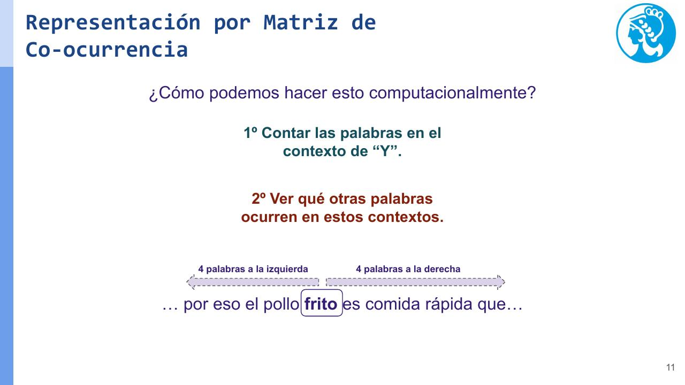

*Slide 11: ¿cómo se hace esto computacionalmente? 1° contar las palabras en el contexto de "Y". 2° ver qué otras palabras ocurren en esos contextos. Ejemplo: "… por eso el pollo **frito** es comida rápida que…", con 4 palabras a la izquierda y 4 a la derecha de "frito".*

- Se recorren las palabras y se miran sus vecinas, que uno define: 4 a la izquierda y 4 a la derecha (01:16:21).
- Alrededor de *frito* hay palabras que son ruido, las stopwords (*el*, *que*), y palabras que realmente apoyan su significado: *pollo*, *comida* y *rápida*. Frito se usa para comida que se fríe en aceite, que suele ser comida rápida.

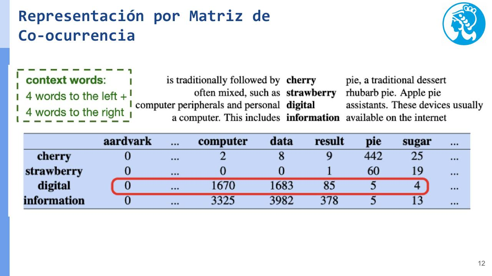

*Slide 12: context words, 4 a la izquierda y 4 a la derecha. Ejemplos de contextos: "is traditionally followed by **cherry** pie, a traditional dessert", "often mixed, such as **strawberry** rhubarb pie. Apple pie", "computer peripherals and personal **digital** assistants. These devices usually", "a computer. This includes **information** available on the internet".*

| | aardvark | … | computer | data | result | pie | sugar | … |
|---|---|---|---|---|---|---|---|---|
| cherry | 0 | … | 2 | 8 | 9 | 442 | 25 | … |
| strawberry | 0 | … | 0 | 0 | 1 | 60 | 19 | … |
| digital | 0 | … | 1670 | 1683 | 85 | 5 | 4 | … |
| information | 0 | … | 3325 | 3982 | 378 | 5 | 13 | … |

- Se arma como el one-hot, con las palabras únicas en filas y columnas, pero se llena distinto: **contando** (01:17:28).
- *cherry* aparece 0 veces cerca de *aardvark* ("no tengo idea de qué significa"). **Carlos** aclaró por chat que es un oso hormiguero (01:27:58). ✎ En realidad el *aardvark* es el cerdo hormiguero u oricteropo; el oso hormiguero es otro animal.
- *cherry* aparece 2 veces cerca de *computer*, en situaciones muy puntuales ("se me cayó una cherry en la computadora"), 8 cerca de *data*, 9 cerca de *result* y **442** cerca de *pie* (01:18:34). Eso tiene sentido: *cherry pie* se usa muchísimo. Con *sugar* también aparece, aunque menos.
- *digital* aparece mucho cerca de *computer*, *data* y *result*, y muy poco cerca de las demás.
- ✎ Las filas son los vectores: *digital* (la fila marcada en la slide) se parece a *information*, y *cherry* a *strawberry*. El ejemplo es del libro de Jurafsky y Martin (*Speech and Language Processing*, cap. 6), con conteos sobre Wikipedia.

## 8. Del conteo a la predicción (01:19:34)

- **Mejor, pero con problemas:** estos vectores son mucho mejores que one-hot y BoW, pero siguen siendo *sparse*. *digital* tiene números grandes con algunas palabras y después valores muy bajos y muchos ceros.
- **Slide 13:** los vectores de la matriz de co-ocurrencia son **largos** (tienen el tamaño del vocabulario, |V|) y **sparse** (la mayoría son ceros). Lo ideal es que sean **cortos** (pocas dimensiones) y **densos** (muchos valores reales que signifiquen algo). Para que los métodos de conteo se acerquen a ese ideal, se puede aplicar **SVD** sobre la matriz de conteo.
- **Comprimir** (01:20:55): es lo mismo que hacían con PCA en machine learning. SVD y PCA son básicamente lo mismo: para obtener el PCA se centran los datos y se aplica un SVD truncado. Al comprimir, los valores se mezclan y queda una representación más chica. Se pierde información, pero es más manejable y cumple el ideal: corta y densa.

```math
X_{|V| \times |V|} \approx U_k \, \Sigma_k \, V_k^{\top}
```

  ✎ Con las k componentes más grandes (k ≈ 100 a 300), las filas de U_k Σ_k son los vectores densos de las palabras.

- **La otra opción: predecir en vez de contar**, sin un `for` dentro de otro `for` que vaya contando qué palabra está junto a cuál.
- **Slide 14:** *count-based methods*, SVD sobre la matriz de conteo. *Prediction-based methods*: los vectores se crean entrenando un clasificador que predice si es probable que una palabra c ("chicken") aparezca en el contexto de una palabra w ("tucumana"). Ejemplos: GloVe y Word2Vec.
  - Antes se contaba: *pollo* aparece, digamos, 552 veces cerca de *tucumana*, una empanada que suele ser de pollo. Ahora se predice, y predecir es trabajo de una red neuronal (01:22:09). Así llegan los métodos de predicción más conocidos: GloVe, Word2Vec y FastText.
- **Los papers de la slide:**
  - *Efficient Estimation of Word Representations in Vector Space*: el paper de Word2Vec. Su autor, **Tomas Mikolov**, también es el cuarto autor de FastText (01:23:20). Otro autor es **Jeffrey Dean**, "una eminencia", entre los creadores de TensorFlow en Google.
  - *Don't count, predict!*, de Baroni, Dinu y Kruszewski: compara los vectores de conteo con los de predicción y explica el salto de count-based a prediction-based. **Marco Baroni** fue el tutor de la tesis de maestría del docente.
- ✎ El paper de Word2Vec es de 2013 y *Don't count, predict!* de 2014. En este último, los vectores de predicción le ganaron a los de conteo en casi todas las tareas. GloVe, aunque la slide lo ponga entre los de predicción, se entrena sobre la matriz global de co-ocurrencia: está a mitad de camino entre los dos enfoques.

## 9. Word2Vec: CBOW y Skip-gram (01:24:38)

Se vio con Josselyn ([clase 2](../02-word-embeddings/resumen.md)); acá va un resumen en una slide.

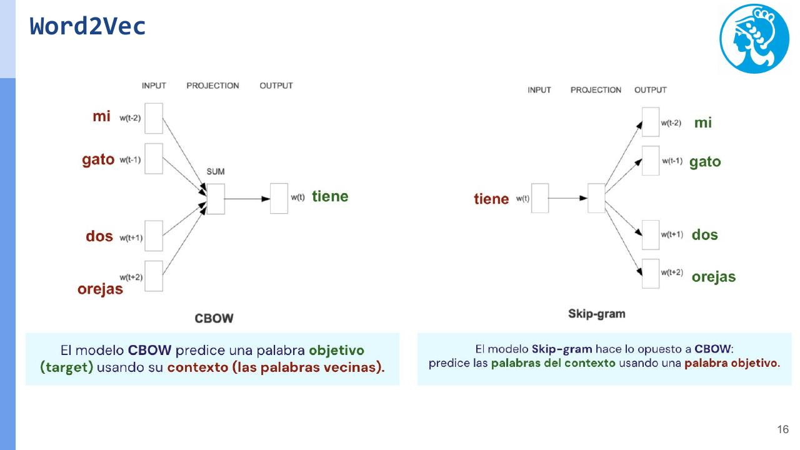

*Slide 16: Word2Vec con "mi gato tiene dos orejas". CBOW: las palabras del contexto, mi w(t−2), gato w(t−1), dos w(t+1) y orejas w(t+2), se suman en la proyección y predicen la palabra objetivo (target), "tiene", w(t). Skip-gram hace lo opuesto: a partir de "tiene" predice las palabras del contexto.*

- Internamente tiene **dos métodos, CBOW y Skip-gram**, y se elige uno con un parámetro en el código de Gensim. ✎ En `gensim.models.Word2Vec` es `sg=0` para CBOW (el default) y `sg=1` para Skip-gram.
- **CBOW es many-to-one y funciona enmascarando** (01:25:48). El modelo tiene que aprender las relaciones entre las palabras para dar buenos embeddings. Se oculta *tiene*, que pasa a ser el target, y se le da al modelo "mi gato ___ dos orejas". La palabra quitada se guarda para comparar. Si el modelo dice "mi gato vino dos orejas", no es lo esperado, y vuelve a aprender hasta que diga *tiene*.
- **El enmascaramiento es propio del aprendizaje autosupervisado** (01:26:48), que se ve un poco en la clase 7 y un poco en la 8. Es lo que permite entrenar los grandes modelos de lenguaje.
- **Skip-gram** es al revés: se le pasa *tiene* y predice qué palabras van a estar a su alrededor.
- **Datos:** además de la arquitectura, hacen falta muchos datos: libros (Google Books), noticias, Wikipedia. Hoy suena obvio, porque los LLMs se entrenan con cantidades enormes de datos, pero "hace casi 10 años" fue una muy buena idea (01:27:58). ✎ Word2Vec es de 2013.

## 10. Embeddings de una oración (01:27:58)

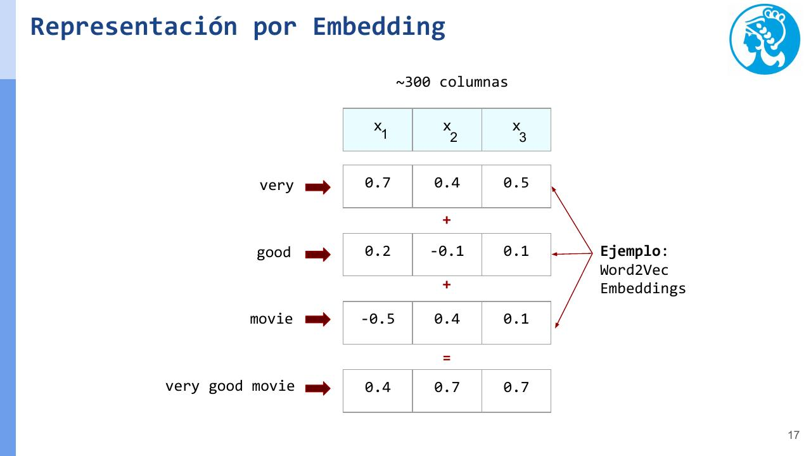

*Slide 17: con embeddings, cada palabra es un vector denso de ~300 columnas (en el ejemplo, 3: x₁, x₂, x₃). Con embeddings de Word2Vec: very = [0.7 0.4 0.5], good = [0.2 −0.1 0.1] y movie = [−0.5 0.4 0.1]. Sumados, "very good movie" = [0.4 0.7 0.7].*

- **Es el multi-hot de antes,** pero con los embeddings de Word2Vec ("multi-Word2Vec"): se suman los embeddings de las palabras para representar la oración. La idea es la misma; solo cambian los vectores de cada palabra, que ahora son más ricos (01:29:08).
- **Aclaración:** esto se hace con las técnicas clásicas y con las de deep learning. En el mundo de los Transformers hay modelos entrenados directamente para devolver embeddings de oraciones; es otro mundo.
- **Ahora, en vez de un MLP, una CNN:** es una alternativa un poco más compleja que el MLP y también una alternativa a las RNN.
- ✎ La suma también pierde el orden: es un "BoW de embeddings". Para aprovechar el orden hace falta un modelo que recorra la secuencia, como una RNN (clases 3 y 4) o una CNN.

## 11. CNN para secuencias: la ventana deslizante (01:30:38)

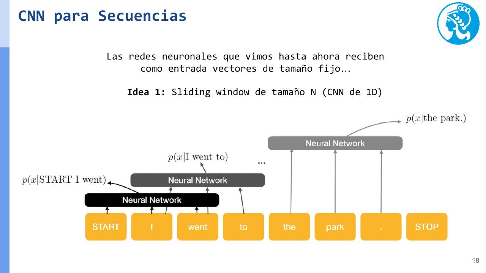

*Slide 18: las redes neuronales vistas hasta ahora reciben como entrada vectores de tamaño fijo. Idea 1: una ventana deslizante (sliding window) de tamaño N, que es una CNN de 1D. En "START I went to the park . STOP", la misma red neuronal mira de a 3 tokens y predice p(x | START I went), p(x | I went to), …, p(x | the park .).*

- Las CNN se vieron en visión por computadora, **en dos dimensiones**. Acá se usan **en una**, y la diferencia es muy sencilla.
- **El filtro (kernel) se desliza.** En 2D se definía un filtro de 3 × 3, una matriz chica que miraba una región de la imagen y daba un valor nuevo. En 1D se define solo un N, no N × N. Con N = 3 se mira de a tres palabras.
- La primera ventana, "START I went", da un número que representa la relación entre esas tres palabras. Después viene "I went to", y así, con **stride 1** (01:31:53).
- **En código** no se pasa una oración, sino muchas, y cada una se arma como una matriz.
- **Slide 19:** en vez de los píxeles de una imagen, la entrada son oraciones o documentos representados como una **matriz**. Cada fila corresponde a un token, típicamente una palabra o un carácter: cada fila es un vector que representa una palabra. Esos vectores típicamente son word embeddings (Word2Vec o GloVe) o vectores one-hot.
  - "Típicamente una palabra" porque se habla de técnicas clásicas y de deep learning (01:33:01). Con los Transformers se va a ver que un token no siempre es una palabra, sino algo así como una sílaba.
- Las slides de esta parte son de **Christopher Manning**, investigador de Stanford, que tiene slides sobre CNN con buenos ejemplos.
- ✎ La red de la ventana es siempre la misma, comparte los pesos en todas las posiciones, y eso es justamente una convolución. Además, a diferencia de una imagen, el filtro ocupa todo el ancho de la matriz y solo se mueve a lo largo de la secuencia: por eso es Conv**1D**.

## 12. Conv1D paso a paso (01:33:01)

- Los recuadros violetas de la slide 20 confundían, así que el docente los borró con IA ("ya es la quinta vez que doy esta clase"; antes lo transcribía a mano) y pasó el ejemplo a Excalidraw (01:35:47).

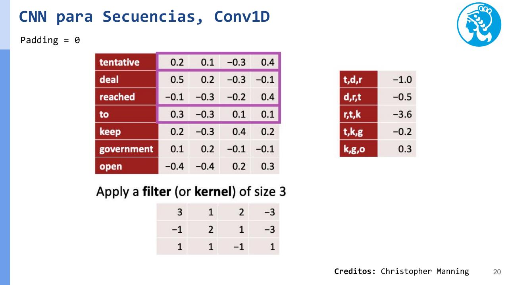

*Slide 20: Conv1D con padding = 0. La oración "tentative deal reached to keep government open" es una matriz de 7 × 4, con un embedding de 4 dimensiones por palabra. Un filtro (kernel) de tamaño 3, que en realidad es una matriz de 3 × 4, recorre la secuencia y da 5 valores, uno por cada grupo de 3 palabras seguidas. Créditos: Christopher Manning.*

| Token | d₁ | d₂ | d₃ | d₄ |
|---|---|---|---|---|
| tentative | 0.2 | 0.1 | −0.3 | 0.4 |
| deal | 0.5 | 0.2 | −0.3 | −0.1 |
| reached | −0.1 | −0.3 | −0.2 | 0.4 |
| to | 0.3 | −0.3 | 0.1 | 0.1 |
| keep | 0.2 | −0.3 | 0.4 | 0.2 |
| government | 0.1 | 0.2 | −0.1 | −0.1 |
| open | −0.4 | −0.4 | 0.2 | 0.3 |

Filtro: [3 1 2 −3], [−1 2 1 −3], [1 1 −1 1]. Salida: t,d,r = −1.0 · d,r,t = −0.5 · r,t,k = −3.6 · t,k,g = −0.2 · k,g,o = 0.3.

- **La matriz** (01:37:37): la oración se dividió en tokens, y cada token se representa con números, su embedding. Acá son 4 por palabra, muy pocos: "imaginemos que Word2Vec nos devuelve cuatro números", porque no tendría sentido poner 300 en una slide. Sin quererlo, queda una matriz de tokens × dimensiones del embedding.
- **El kernel** es la misma idea que en 2D: una matriz que se pone encima y se desliza (01:38:39). Manning dice "de tamaño 3", pero es de 3 × 4. ¿Por qué 4?
  - **Hernando:** por el tamaño de los embeddings. Correcto.
  - **Carlos:** ¿para incluir el target? No.
- **Si fuera de 3 × 3** (01:39:53), dejaría afuera la última columna, y esos números significan algo: se entrenaron, no se pueden descartar. El kernel mide **k × la dimensión del embedding**. Acá k = 3 y la dimensión es 4, así que es de 3 × 4 (01:41:04).
- **La convolución,** como en las imágenes: se multiplica posición por posición y se suma todo. La relación entre *tentative*, *deal* y *reached* queda resumida en −1. Después el kernel baja una fila y da d,r,t, y así hasta el final (01:42:20).
- ✎ La cuenta para t,d,r:

```math
\underbrace{(0.2 \cdot 3 + 0.1 \cdot 1 - 0.3 \cdot 2 + 0.4 \cdot (-3))}_{\text{tentative} \,=\, -1.1}
+ \underbrace{(0.5 \cdot (-1) + 0.2 \cdot 2 - 0.3 \cdot 1 - 0.1 \cdot (-3))}_{\text{deal} \,=\, -0.1}
+ \underbrace{(-0.1 \cdot 1 - 0.3 \cdot 1 - 0.2 \cdot (-1) + 0.4 \cdot 1)}_{\text{reached} \,=\, 0.2}
= -1.0
```

- ✎ En general, con un filtro W de k × d y una entrada x de L × d:

```math
y_t = \sum_{j=0}^{k-1} \sum_{c=1}^{d} W_{j,c} \, x_{t+j,\,c} + b
```

**Padding** (01:43:36)

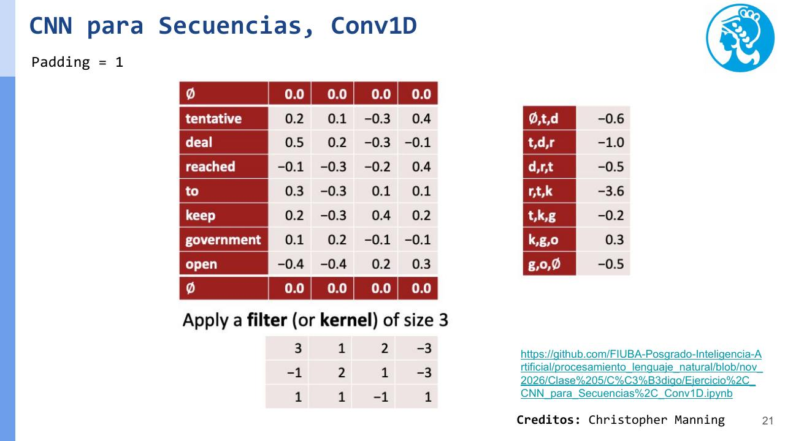

*Slide 21: con padding = 1 se agrega una fila de ceros (∅) al principio y otra al final. Salen 7 valores, uno por palabra: ∅,t,d = −0.6 · t,d,r = −1.0 · d,r,t = −0.5 · r,t,k = −3.6 · t,k,g = −0.2 · k,g,o = 0.3 · g,o,∅ = −0.5. Es una slide extra que armó el docente, y la misma imagen está en el notebook de Conv1D.*

- **En imágenes,** el padding es un margen de ceros alrededor, para que el filtro llegue hasta el borde. Acá **se agrega solo arriba y abajo**.
- **¿Por qué no a los costados?** (01:44:37)
  - **Hernando:** porque es una convolución de una sola dimensión. No es la razón: con ceros a los costados y un kernel adaptado, igual se podría bajar en una dimensión.
  - **Hernando:** porque no aportaría nada. "Va por ahí."
  - **Lucas,** por chat: porque se estaría alterando el embedding. Esa es la razón: esos números son cuatro por algo, y no se puede sacar ni agregar valores (01:45:46).
- Con el mismo kernel y las filas de padding, la primera ventana es ∅,t,d = −0.6 y la última, g,o,∅ = −0.5.
- ✎ Con stride 1, el largo de la salida es:

```math
L_{\text{out}} = L - k + 2p + 1
```

  Sin padding da 7 − 3 + 1 = 5, y con p = 1 da 7 − 3 + 2 + 1 = 7. En Keras, `padding='valid'` (el default) es sin padding, y `padding='same'` agrega lo necesario para que la salida tenga el mismo largo que la entrada.

## 13. Notebook: Conv1D (01:46:45)

[Notebook](material/notebook-cnn-conv1d.ipynb). Reproduce la slide 21: se le pasan los embeddings y el kernel, pero no el padding, y debería dar los mismos resultados. Si la lógica es esa, el código tiene que coincidir.

```python
x = np.array([
    [0.2, 0.1, -0.3, 0.4],     # tentative
    [0.5, 0.2, -0.3, -0.1],    # deal
    [-0.1, -0.3, -0.2, 0.4],   # reached
    [0.3, -0.3, 0.1, 0.1],     # to
    [0.2, -0.3, 0.4, 0.2],     # keep
    [0.1, 0.2, -0.1, -0.1],    # government
    [-0.4, -0.4, 0.2, 0.3]     # open
], dtype=np.float32)
x = np.expand_dims(x, axis=0)   # (1, 7, 4)

filters = np.array([
    [[3], [1], [2], [-3]],
    [[-1], [2], [1], [-3]],
    [[1], [1], [-1], [1]]], dtype=np.float32)   # (3, 4, 1)

conv_layer = tf.keras.layers.Conv1D(filters=1, kernel_size=3, padding='same', use_bias=False)
_ = conv_layer(x)                    # construye la capa
conv_layer.set_weights([filters])    # le carga el filtro de la slide
conv_output = conv_layer(x)          # [-0.6, -1.0, -0.5, -3.6, -0.2, 0.3, -0.5]

global_max_pool = tf.keras.layers.GlobalMaxPooling1D()
global_max_pool(conv_output)         # [[0.3]]
```

- **Los embeddings** son los de la slide, sin las filas de padding, que las agrega el código (01:48:13).
- **El batch** (01:49:21): una red no se entrena con una imagen, sino con lotes de 100 o 1.000, y el batch es una dimensión más. Keras `Conv1D` espera `(batch, steps, channels)`, así que `np.expand_dims` lo lleva a **1 × 7 × 4**: un ejemplo, siete palabras y cuatro dimensiones. Es lo mismo, con un corchete más.
  - ✎ El markdown del notebook dice que se pasa de (7, 4) a "(1,4,7)", pero la salida muestra `(1, 7, 4)`, que es lo correcto.
- **El filtro se define a mano,** con forma `(kernel_size, in_channels, out_channels)` = `(3, 4, 1)`. Normalmente no se define: entrenar una red convolucional consiste justamente en encontrar los mejores valores de los filtros para resolver un problema (01:50:34). Acá se fijan para ver el proceso de la convolución.
- **`kernel_size=3`,** no 3 × 3 ni (3, 3): el ancho se adapta solo a los 4 canales del embedding. Si no coincidieran, `set_weights` daría error (01:51:37).
- `padding='same'` y sin bias. Se construye la capa llamándola sobre `x` y se le asignan los pesos con `set_weights([filters])`.
- **Resultado:** −0.6, −1, −0.5, −3.6, −0.2, 0.3 y −0.5, los mismos valores de la slide. El padding no se escribió a mano: lo agregó `padding='same'` (01:52:58).
- `GlobalMaxPooling1D` da **0.3**, el máximo de esa columna (01:53:58).
- ✎ Hay que llamar la capa una vez antes de `set_weights` porque Keras crea los pesos recién cuando conoce la forma de la entrada.

## 14. Varios filtros y max pooling (01:52:58)

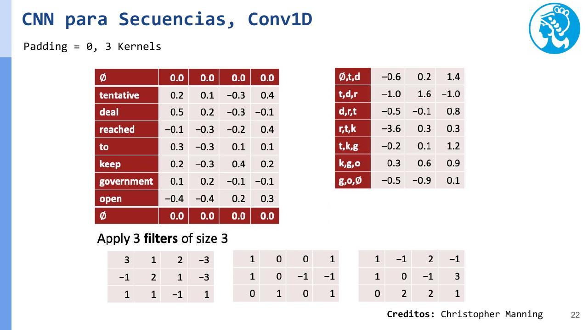

*Slide 22: con 3 filtros de tamaño 3 sale una columna por filtro, una matriz de 7 × 3. Los filtros son el de antes, [1 0 0 1], [1 0 −1 −1], [0 1 0 1] y [1 −1 2 −1], [1 0 −1 3], [0 2 2 1].*

| Ventana | Filtro 1 | Filtro 2 | Filtro 3 |
|---|---|---|---|
| ∅,t,d | −0.6 | 0.2 | 1.4 |
| t,d,r | −1.0 | 1.6 | −1.0 |
| d,r,t | −0.5 | −0.1 | 0.8 |
| r,t,k | −3.6 | 0.3 | 0.3 |
| t,k,g | −0.2 | 0.1 | 1.2 |
| k,g,o | 0.3 | 0.6 | 0.9 |
| g,o,∅ | −0.5 | −0.9 | 0.1 |

- Se puede hacer más complejo con **más filtros**. El segundo también es de 3 × 4, pero con otros valores, así que da otra columna. Con cinco filtros habría cinco columnas.
- ✎ El título dice "Padding = 0", pero la matriz tiene las filas ∅ y salen 7 valores por filtro: es padding = 1, como en la slide 21. Lo mismo pasa en la slide 23.
- ✎ Cada filtro aprende a detectar un patrón distinto de 3 palabras. La cantidad de filtros es la cantidad de canales de salida (`filters` en Keras).

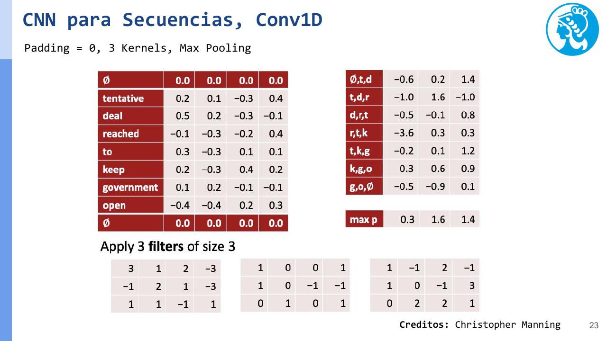

*Slide 23: max pooling sobre el tiempo. De cada columna se queda el máximo: max p = [0.3, 1.6, 1.4].*

- **Max pooling, "mucho más fácil"** (01:53:58): el máximo de cada columna. En código es `tf.keras.layers.GlobalMaxPooling1D()` sobre la salida de la convolución, como en el notebook.
- Con esto queda armado un pequeño bloque de convolución con pooling, todo en una dimensión y con embeddings como entrada. "La complejidad de la convolución 2D bajó mucho" en comparación.
- ✎ El max pooling global resume la oración, sea del largo que sea, en un vector con tantas posiciones como filtros. Cada posición dice qué tan fuerte apareció el patrón de ese filtro en algún lugar de la oración, sin importar dónde.

## 15. Arquitecturas para clasificar oraciones (01:53:58)

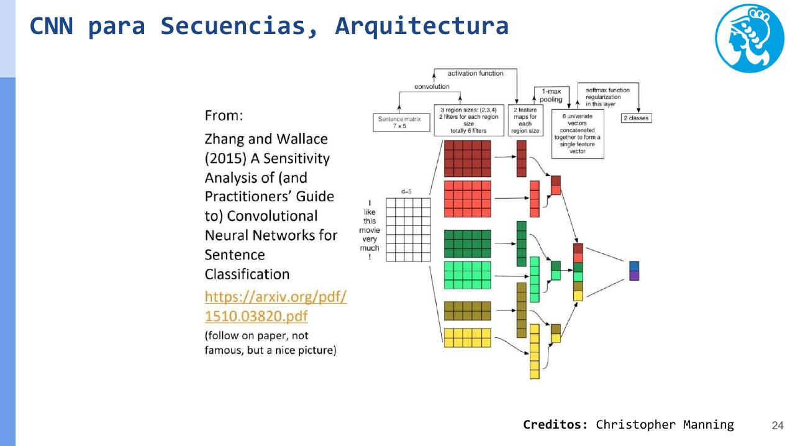

*Slide 24: figura de Zhang y Wallace (2015), "A Sensitivity Analysis of (and Practitioners' Guide to) Convolutional Neural Networks for Sentence Classification" (arxiv.org/pdf/1510.03820), "follow on paper, not famous, but a nice picture". "I like this movie very much !" es una matriz de 7 × 5 (d = 5). Usa tres tamaños de región (2, 3 y 4) con 2 filtros cada uno, 6 filtros en total → convolución y función de activación → 2 feature maps por tamaño de región → 1-max pooling → 6 valores que se concatenan en un único vector de features → softmax, con regularización en esa capa → 2 clases.*

- Es lo mismo, pero más elaborado (01:55:16). Cada palabra de "I like this movie very much" tiene su embedding, se arma la matriz, se aplican convoluciones y pooling, y al final se pasa a una red que dice positivo o negativo.
- **Carlos:** ¿qué ventaja tiene esta arquitectura más compleja, con convolución, pooling y otra convolución, frente al ejemplo anterior?
  - La misma que en 2D: extraer **distintos niveles de abstracción** para pasarle a la red información más limpia (01:56:28).
  - En la vida real el texto es mucho más largo y complejo, así que hacen falta más capas que vayan extrayendo lo más importante de a poco.
- ✎ La figura no apila capas: tiene una sola capa convolucional con filtros de tres tamaños en paralelo, y un 1-max pooling. Los "niveles" son los tamaños de n-grama (bigramas, trigramas, 4-gramas), como las ramas de Inception. Es la arquitectura de Yoon Kim (2014), *Convolutional Neural Networks for Sentence Classification*. El paper de Zhang y Wallace estudia cómo influye cada hiperparámetro: el tamaño y la cantidad de filtros, el pooling y la regularización.
- ✎ Sin padding, los feature maps miden 7 − 2 + 1 = 6, 7 − 3 + 1 = 5 y 7 − 4 + 1 = 4. El 1-max pooling lleva cada uno a un solo número, así que se pueden concatenar aunque midan distinto.

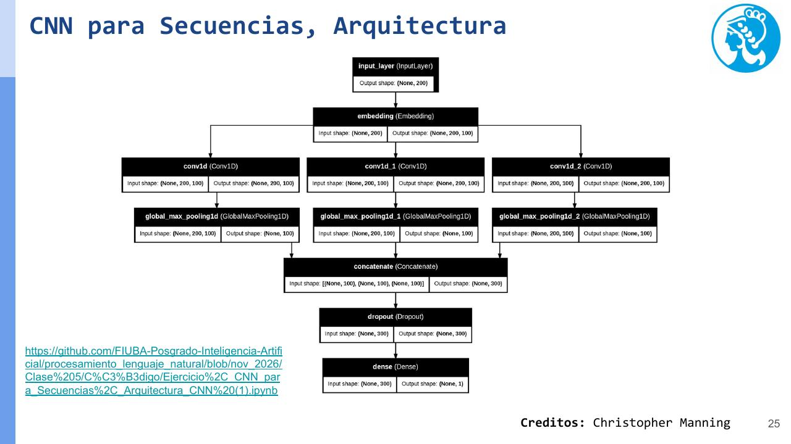

*Slide 25: la arquitectura del notebook, graficada con `plot_model`. input_layer (None, 200) → embedding (None, 200, 100) → tres ramas Conv1D, cada una (None, 200, 100) → GlobalMaxPooling1D (None, 100) → concatenate (None, 300) → dropout (None, 300) → dense (None, 1).*

- "Si la anterior era interesante, esta es más interesante": una **CNN bifurcada**, que mira distintos niveles, para clasificación. Se arma con Functional.
- **Iba a ser un ejercicio en clase** (01:58:20), no un TP, de 15 minutos. Como era largo, aunque no complicado, el docente prefirió explicar la solución. La próxima clase sí va a haber un ejercicio en clase, con un buen tiempo para hacerlo con calma (02:00:00).
- **Gensim "es un dolor de cabeza"** para instalar. El consejo, hasta donde se entiende en la transcripción, es no fijar la versión e instalarlo como en el notebook: `!pip install -q gensim pydot graphviz`.
- **El recorrido de la clase** (02:00:00): BoW → MLP funcionó; después la co-ocurrencia y los embeddings hechos con redes neuronales; después cómo se usan los embeddings en convoluciones. Falta el flujo completo: **embeddings en vez de BoW, y una CNN en vez del MLP**.

## 16. Notebook: CNN bifurcada con GloVe (02:02:23)

[Notebook](material/notebook-cnn-arquitectura.ipynb): la misma tarea que el de BoW, sentimiento en IMDB, ahora con una CNN sobre embeddings de GloVe.

**Preparación**
- Lo más necesario es **Gensim**, para cargar los embeddings preentrenados. El resto es lo de siempre: `imdb`, `pad_sequences`, `Model`, `Input`, `Embedding`, `Conv1D`, `GlobalMaxPooling1D`, `Dense`, `Dropout`, `Concatenate`, `SpatialDropout1D`, `BatchNormalization`, `l2`, `EarlyStopping`, `Adam`, `plot_model`, el cargador de Gensim e `Image`.
- **Parámetros:** `vocab_size = 20000` (antes eran 5.000; "lo quiero un poco más representativo"), `max_len = 200` palabras por crítica y `embedding_dim = 100`.
- `imdb.load_data(num_words=20000)`: 25.000 críticas de train y 25.000 de test.

**Parte A: preprocesamiento** (02:03:37)
- **`pad_sequences(X, maxlen=200, padding="post", truncating="post")`.** Lucas confirmó que ya lo habían visto con Josselyn.
  - "Hoy me siento feliz" se rellena con ceros **después** de la oración hasta llegar a 200: cuatro palabras y 196 ceros (`padding="post"`) (02:04:49).
  - Si un usuario al que no le gustó la película se desquita con 500 palabras, se cortan las últimas 300 (`truncating="post"`).
  - Se aplica a train y a test, que quedan de **(25.000, 200)**.
  - ✎ En la clase 4 el padding iba a la izquierda (`pre`), porque se predecía la palabra que sigue. Acá se clasifica la crítica entera, y el max pooling global no depende de la posición.
- **`word_index` y `reverse_word_index`** (02:06:08): el primero da el índice de cada palabra ("Fernando" → 2011, "gato" → 199, "loro" → 101, en sus ejemplos inventados) y el segundo hace lo contrario: el 101 es *loro*.
- **Tokens especiales:** 0 = `<PAD>`, 1 = `<START>`, 2 = `<UNK>` y 3 = `<UNUSED>`. Son tokens comodín. Por ahora solo tiene sentido el padding, pero "la próxima clase va a tener mucho sentido usarlos", y más adelante con los Transformers.

```python
reverse_word_index = {}
for word, idx in word_index.items():
    reverse_word_index[idx + 3] = word
reverse_word_index[0] = "<PAD>"
reverse_word_index[1] = "<START>"
reverse_word_index[2] = "<UNK>"
reverse_word_index[3] = "<UNUSED>"
```

**Parte B: GloVe y la matriz de embeddings** (02:07:20)
- Los embeddings de **GloVe** ya están entrenados y capturan información semántica. `gensim_load("glove-wiki-gigaword-100")` trae GloVe entrenado en Wikipedia y Gigaword, con 100 números por palabra. Por eso `embedding_dim = 100`. Es la parte que tarda: la descarga pesa 128 MB y puede llevar unos minutos.
- **No hacen falta todos los embeddings de GloVe**, solo los de las palabras del dataset (02:08:32). Se arma una **matriz de embeddings** con valores aleatorios, de `vocab_size` × `embedding_dim` = 20.000 × 100. Los 100 no son inventados: es lo que da GloVe, así que encaja.

```python
embedding_matrix = np.random.normal(scale=0.6, size=(vocab_size, embedding_dim))
for idx in range(vocab_size):
    word = reverse_word_index.get(idx)
    if word is not None and word in glove:
        embedding_matrix[idx] = glove[word]
```

  (en el notebook los dos `if` están anidados)

- **El relleno** (02:09:39): para cada índice del vocabulario se busca la palabra con `reverse_word_index` (el 101 es *loro*). Si GloVe la tiene, su vector reemplaza la fila aleatoria.
- **¿Por qué valores aleatorios?** (02:10:48) Porque una palabra del dataset puede no estar en GloVe. Si alguien escribe "la veo porque me gusta a mí y a mi loro, que se llama Cocoliso", seguro GloVe no tiene *cocoliso*. En vez de dejarla sin representación, se queda con valores aleatorios. Eso influye un poco, pero menos que descartarla.

**La red** (02:11:58)

```python
input_layer = Input(shape=(max_len,))
embedding_layer = Embedding(input_dim=vocab_size, output_dim=embedding_dim,
                            weights=[embedding_matrix], trainable=False)(input_layer)
embedding_layer = SpatialDropout1D(0.2)(embedding_layer)          # (None, 200, 100)

conv1 = Conv1D(filters=64, kernel_size=3, padding="same", activation="relu",
               kernel_regularizer=l2(1e-4))(embedding_layer)
conv1 = BatchNormalization()(conv1)
pool1 = GlobalMaxPooling1D()(conv1)
# rama 2: igual con kernel_size=4 → pool2 · rama 3: igual con kernel_size=5 → pool3

concat = Concatenate()([pool1, pool2, pool3])                      # (None, 192)
dropout = Dropout(0.6)(concat)
output_layer = Dense(1, activation="sigmoid")(dropout)
model = Model(inputs=input_layer, outputs=output_layer)
```

- **La capa `Embedding` es transfer learning de tipo *feature extraction*:** usa embeddings ya entrenados y no los toca (`trainable=False`). Si se ajustaran, sería *fine-tuning* (02:11:58). Recibe `input_dim=vocab_size`, `output_dim=embedding_dim` y los pesos de `embedding_matrix`.
- **`SpatialDropout1D(0.2)`** es la misma idea que el dropout, pero para este caso de una dimensión: omite el 20 % de los elementos durante el entrenamiento (02:13:15).
- **Rama 1** (02:14:30): una Conv1D con **64 filtros** ("antes usaba uno, después tres, ahora 64"), cada uno de 3 × la dimensión del embedding (3 × 100), con padding, ReLU y L2. Después vienen `BatchNormalization` y `GlobalMaxPooling1D`, y queda `pool1` (02:16:01).
- **Rama 2** (02:17:20): igual, con `kernel_size=4`. **Su entrada vuelve a ser `embedding_layer`**: no sigue a la convolución anterior, va **en paralelo**. Como las dos comparten la entrada, son paralelas.
- **Rama 3** (02:18:28): lo mismo, con `kernel_size=5` en el notebook. Después se concatenan `pool1`, `pool2` y `pool3`, siguen un `Dropout(0.6)` y una `Dense(1, sigmoid)` que dice si la crítica es positiva o negativa (02:19:55).
- El docente fue dibujando el grafo en Excalidraw a partir de screenshots del código: para ver qué va en paralelo, hay que mirar qué variable recibe cada capa entre paréntesis.

**Entrenamiento y evaluación** (02:19:55)
- El modelo se cierra como un sándwich y se compila con `Adam(learning_rate=1e-4)`, `binary_crossentropy` y accuracy. El early stopping es `EarlyStopping(monitor="val_loss", patience=1, restore_best_weights=True)`, con `validation_split=0.2`, hasta 80 épocas y batch 32.
- La accuracy fue subiendo de a poco hasta que la detuvo el early stopping. **El modelo seguía aprendiendo**, y con un poco más de paciencia en el callback quizás llegaba a 85 %. Se podría mejorar la arquitectura, pero funciona y da un rendimiento relativamente bueno.
- ✎ Paró en la época 31 y volvió a la 30: val_loss 0,4090 y val_accuracy 0,8318. **Accuracy en test: 0,8298.**

**Inferencia** (02:21:16)
- `encode_text` repite el preprocesamiento sobre el texto nuevo (minúsculas, `split`, índices + 3 y padding a 200) para dejarlo listo para el modelo.
- Mismas frases que en el notebook de BoW, mismos sentimientos (02:22:14):

| Texto | BoW + MLP | CNN |
|---|---|---|
| this movie was amazing i loved it | 0,9561 | 0,8738 |
| this film was terrible and boring | 0,0166 | 0,0432 |
| the actors were fantastic and the story was beautiful | 0,8092 | 0,8149 |
| worst movie ever | 0,0356 | 0,1099 |

- **Denis,** por chat: ¿por qué el rendimiento de validación fue mejor que el de train? Suele pasar y es normal; acá es por la arquitectura. Si la brecha fuera grande, por ejemplo 90 en validación y 70 en train, el modelo estaría mal diseñado: "no sería overfitting, sería un modelo dañado" (02:22:14).

✎ Observaciones sobre el notebook:
- **Validación por encima de train:** la causa concreta es que el dropout (0,2 + 0,6) solo actúa durante el entrenamiento. La accuracy de train que muestra `fit` se calcula con las neuronas apagadas, y la de validación, con la red completa.
- **La CNN (0,830) quedó por debajo del BoW + MLP (0,881).** Posibles causas:
  - El embedding está congelado.
  - Al truncar a 200 palabras se corta el final de muchas críticas, donde suele estar el veredicto.
  - Con `patience=1` y un learning rate de 1e-4, el entrenamiento se cortó cuando la val_loss todavía bajaba de a poco (0,4090 → 0,4091).
  - Valdría la pena probar `trainable=True`, más paciencia o un `max_len` mayor.
- **La slide 25 no coincide con el código del repo:** el gráfico tiene 100 filtros por rama y concatena 300 valores, mientras que el notebook usa 64 filtros, `SpatialDropout1D` y `BatchNormalization`, y concatena 192.
- **Un detalle en `encode_text`:** `word_index.get(word, 2) + 3` manda las palabras desconocidas al índice 5, que es *and*, y no al 2 (`<UNK>`). Habría que sumar 3 solo cuando la palabra existe.
- **Parámetros:** 2.000.000 en el embedding (congelados) y 77.569 entrenables. Casi todos están en las convoluciones: k · d · F + F da 19.264, 25.664 y 32.064 para k = 3, 4 y 5, con d = 100 y F = 64.
- **Lo que dijo el docente frente al notebook:**
  - Dijo que Gensim permite cargar Word2Vec, pero el notebook carga GloVe. `gensim.downloader` tiene los dos.
  - Dijo que GloVe trae palabras en varios idiomas, pero `glove-wiki-gigaword-100` es solo inglés, con un vocabulario de 400.000 palabras.
  - Dijo que había GPU, pero la salida guardada de esa celda muestra la lista vacía: el notebook del repo se corrió en CPU, a ~35 s por época.

## 17. Límites de las CNN para NLP (02:23:43)

- **Slide 26:** la CNN funciona, pero no es lo más óptimo para NLP:
  - **Contexto largo pobre:** solo capturan relaciones locales.
  - **Sin atención global:** no modelan bien las relaciones entre palabras lejanas.
- Se puede mejorar el modelo, pero no va a llegar al 100 %.
- **El ejemplo:** "El **libro** que compré en la tienda que está cerca de la universidad que visitamos el año pasado es **interesante**." ¿Qué es interesante? El libro, que se mencionó mucho antes. Para una CNN que mira de a tres palabras esa relación es demasiado lejana, y cuando llega a *interesante* ya se olvidó de *libro*.
- Con **oraciones cortas** las CNN funcionan bien (02:24:50).
- **¿Se resuelve agrandando el alto del kernel?** Lo preguntó un compañero por chat.
  - Se podría usar 20 en vez de 3, pero las relaciones no están a una distancia fija: pueden estar a 50 o a 5.
  - **Carlos:** agrandar el kernel es **patear el problema**, solo dejarlo para después (02:26:00).
- **Sin atención global:** quizás, dentro de la CNN, *libro* le da mucha importancia a *universidad*, que tendría sentido, pero a la que debería dársela es a *interesante*. Esa atención se tiene que aprender, y la CNN no la aprende: hace un resumen de un grupo de unidades.
- Una CNN procesa en ventanas que suelen ser chicas, así que pierde las relaciones a larga distancia. **Hace falta otro mecanismo.**
- ✎ Entre *libro* (2.ª palabra) e *interesante* (20.ª) hay 18 posiciones. Apilando convoluciones con filtros de tamaño k, el campo receptivo crece de a k − 1 por capa:

```math
\text{campo receptivo} = 1 + L\,(k-1) \;\Rightarrow\; 1 + 2L \ge 19 \;\Rightarrow\; L \ge 9 \text{ capas con } k = 3
```

  Una RNN sí las conecta, pero a lo largo de 18 pasos, con el desvanecimiento del gradiente de la [clase 3](../03-redes-recurrentes/resumen.md).

## 18. Mecanismo de atención y cierre (02:26:00)

- **Slide 27:** en general, un mecanismo de atención es una transformación de secuencias de embeddings a secuencias de embeddings, de forma **ponderada** y **paralela**. Más adelante se va a ver que el mecanismo de **self-attention** es el que usan las arquitecturas Transformer.
- No se profundiza ahora, porque es tema de las clases 7 y 8. La *self-attention* se usa en el Transformer y es lo que permitió que hoy haya grandes modelos de lenguaje.

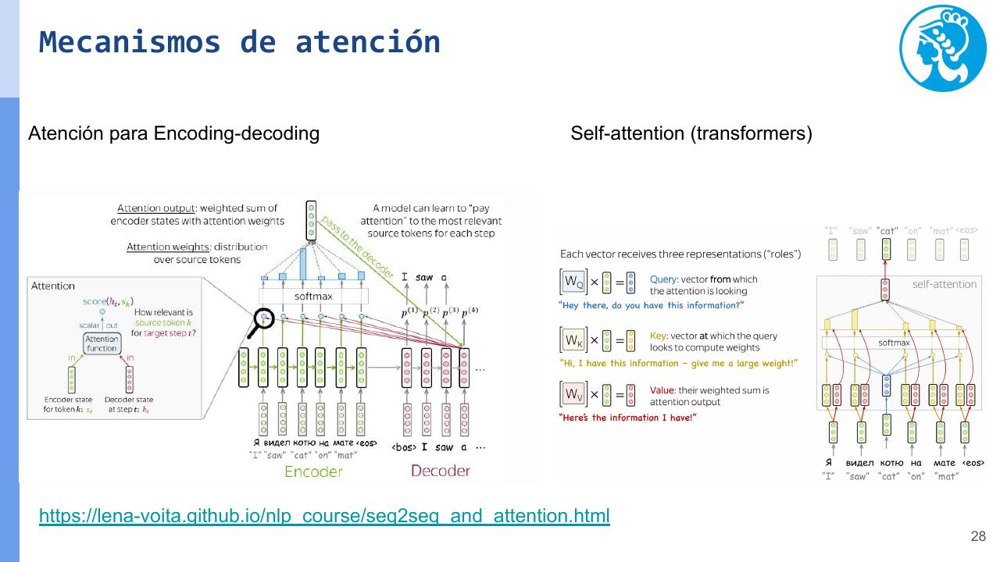

*Slide 28: figuras del curso de NLP de Lena Voita ([seq2seq and attention](https://lena-voita.github.io/nlp_course/seq2seq_and_attention.html)).*
- *Atención para encoder-decoder: se traduce "Я видел котю на мате" ("I saw cat on mat") al inglés. En cada paso t, el decoder calcula un score(h_t, s_k) con cada estado s_k del encoder, que mide qué tan relevante es el token fuente k para ese paso. Una softmax convierte los scores en pesos, una distribución sobre los tokens fuente, y la salida es la suma ponderada de los estados del encoder, que pasa al decoder.*
- *Self-attention (Transformers): cada vector recibe tres representaciones ("roles") al multiplicarlo por W_Q, W_K y W_V. La query pregunta "Hey there, do you have this information?", la key responde "Hi, I have this information – give me a large weight!" y el value aporta "Here's the information I have!". La salida es la suma de los values ponderada por la softmax de los productos query · key.*

- **Lectura** (02:27:09): la idea del encoder-decoder se ve la clase que viene, y la atención aplicada al encoder-decoder y la *self-attention*, en la clase 7. No es tarea ni es obligatorio; es el mismo link del curso de Lena Voita que compartió al principio.
- **Cierre:** el próximo jueves sigue con sequence to sequence. Las dudas se le pueden mandar al mail de la primera slide.

---

## Correcciones de la transcripción automática

| Dice la transcripción | Es |
|---|---|
| lse posgrados (hablante) | el docente, Fernando Silva (cuenta del posgrado) |
| Josely, Joseline, Joselin, Josel | Josselyn (Ordóñez) |
| Githaub | GitHub |
| stem, lemantización, stofws, stops, stockws | stemming, lematización, stopwords |
| one horing, OneHehot Vector, Oneen Coding, one encoding, one hor en cording | one-hot encoding, one-hot vector |
| back of words, Back of Wars, Bago Words, B of Worlds | bag of words |
| W and Bearings, wordings, warings | word embeddings |
| enverings, en beedings, en bearings, embings, edings, embarings, invering, emberi, ember ening, losings | embeddings |
| TF y DF, TFIDf | TF-IDF |
| LCTM | LSTM |
| GRW | GRU |
| autodresivos | autorregresivos |
| RNs, LNs, LNS, RNES | RNN, RNNs |
| redesales recurrentes, redesunales recurrentes, Recur Neal Networks, Recure Newal Network | redes neuronales recurrentes |
| convolutional new networks, Newal Networks | convolutional neural networks |
| sequen to sequence, into sequence | sequence to sequence (seq2seq) |
| storyting | storytelling |
| lls | LLMs |
| sequenal, secuential, secuenchal, seuential, seal, Models.se | Sequential, `models.Sequential` |
| flattend | Flatten |
| capa culta | capa oculta |
| layers punto tense, Layers punse, dance, Dens, D 128 | `layers.Dense`, Dense |
| pulling, max pulling | pooling, max pooling |
| Namperas | NumPy |
| emnis, datacaset delis | MNIST |
| Micky Strain, Xin y NX test, XTH test, Jrain, Jin, jet train | `X_train`, `X_test`, `y_train` |
| set random seat 42 | `set_random_seed(42)` |
| una cura así de, accuras, accuracient test, la Curacy | accuracy |
| queras, quedas, que eras | Keras, `tensorflow.keras` |
| Lost function | loss function |
| word presentation os | word representations |
| Glob, Globe, Glow, glov | GloVe |
| Fastx, Fastch, fast | FastText |
| Word to back, work to back, Word toback | Word2Vec |
| Elena Boita, Lena Boita | Lena Voita |
| Iron Man… I have Friday. I | "Hello, I'm Ironman. I have Friday AI" |
| spars | sparse |
| multiod, multihod | multi-hot |
| Nampi Tensor Flow, MAT Plus lif | NumPy, TensorFlow, Matplotlib |
| bat norm, Bach nor, B norm | BatchNormalization |
| T Flow… 2.0 | TensorFlow 2.20.0 |
| bookup size, bup size, Vo size, workup size | `vocab_size` |
| IMDb.l low data paréntesisw igual | `imdb.load_data(num_words=...)` |
| Dense de 502 elementos | `Dense(512)` |
| Dense de 516 nodos | `Dense(256)` |
| relut kér regularizador | relu, `kernel_regularizer` |
| Ipus layer | `input_layer` |
| binaryentropy, Binance Crossentropy | binary crossentropy |
| tornamos los mejores pesos | restauramos los mejores pesos (`restore_best_weights`) |
| hago la diferencia | hago la inferencia |
| encodex bow, text bow | `encode_text_bow` |
| cocurrencia, conocurrencia, concurrencia, ocurrencia | co-ocurrencia |
| Santactus | Santa Cruz |
| lobo de Cren, lobo de Cream | lobo de crin |
| Agora Wasú | aguará guazú |
| FTH | Firth |
| art bark, Darback | aardvark |
| Os hormiguero | oso hormiguero (Carlos, por chat) |
| P (442 veces) | pie |
| PSA | PCA |
| SBD | SVD |
| Tomás Micoló | Tomas Mikolov |
| Jeffre Dean | Jeffrey Dean |
| Tens of Flow | TensorFlow |
| Mar. Aroni | Marco Baroni |
| code base | count-based |
| Jensin, Jensim, Gen Sim, James Load | Gensim, `gensim_load` |
| CBO, Cbow, Cow | CBOW |
| skip RAM | Skip-gram |
| aprendizaje autosupervisador, auto superupervisado | aprendizaje autosupervisado |
| la clave hace | la clase |
| stright, stri | stride |
| Scalidra, Scalidow | Excalidraw |
| Christopher Manin, Christopher Money | Christopher Manning |
| teta teta td, Geta | ∅,t,d y g,o,∅ (las ventanas con la fila de padding ∅) |
| DRT deal Richard 2 | d,r,t: deal reached to |
| convulsión | convolución |
| spam dims | `expand_dims` |
| ampli, ampio | NumPy (`.numpy()`) |
| tf.layers.1d | `tf.keras.layers.Conv1D` |
| Com layer, comp layer, comput output | `conv_layer`, `conv_output` |
| Weights filters | `set_weights([filters])` |
| global maxpulling 1D | `GlobalMaxPooling1D` |
| espcial dropout, special drop out | `SpatialDropout1D` |
| com 2D (en la rama 2) | `conv2`: la Conv1D de la rama 2, no una Conv2D |
| Wiki Gigaw | wiki-gigaword |
| Padra shape | padded shape |
| truncate impost | `truncating="post"` |
| maxl | `max_len` |
| fine tunit | fine-tuning |
| Inter. former | en el Transformer |
| atección global | atención global |
| reunimiento | rendimiento |
| overfeitting | overfitting |
| colap | Colab |
| redonal | red neuronal |

---

## ✎ Para los desafíos

**Desafío 3** (nota 10 hasta el jueves 26/11): la clase no lo mencionó. Lo único aprovechable es para el análisis: si la accuracy de validación queda por encima de la de train, la explicación habitual es el dropout, que solo actúa al entrenar (§16).

**Desafío 4** (seq2seq; se presenta en la clase 6 y tiene nota 10 hasta el jueves 10/12). La consigna todavía no está, pero de esta clase seguramente sirva:

| Lo visto | Para qué sirve en un seq2seq |
|---|---|
| API Functional (§1 y §2) | Un encoder-decoder en Keras tiene al menos dos entradas (la secuencia de origen y la de destino), así que no se puede armar con `Sequential` |
| Cortar la red con `Model(inputs, outputs=capa_intermedia)` (§2) | En inferencia se arman modelos separados de encoder y decoder que reusan las capas entrenadas; es la misma técnica que sacar un embedding |
| Tokens especiales `<PAD>`, `<START>`, `<UNK>` (§16) | El docente dijo que van a tener sentido en la clase 6. En un seq2seq marcan el inicio y el fin de la secuencia de salida |
| Matriz de embeddings preentrenados con Gensim y `trainable=False` (§16) | Se puede reusar tal cual para las capas `Embedding` del encoder y del decoder. Las palabras que no están en el preentrenado quedan con valores aleatorios |
| `pad_sequences` con `post` o `pre` (§16 y clase 4) | Las secuencias de entrada y de salida tienen que quedar de largo fijo |
| `EarlyStopping` con poca paciencia (§16) | Con `patience=1` el entrenamiento se cortó cuando todavía mejoraba: conviene más paciencia y `restore_best_weights=True` |

---

## ✎ Glosario

- **API Sequential (Keras):** el modelo es una pila lineal de capas; cada capa recibe la salida de la anterior.
- **API Functional (Keras):** cada capa se aplica como una función sobre tensores y el modelo se define con `Model(inputs, outputs)`. Permite ramas, varias entradas y varias salidas.
- **Inception:** arquitectura de visión con ramas en paralelo de distintos tamaños de filtro cuyas salidas se concatenan.
- **Representación intermedia (embedding de una capa):** la salida de una capa oculta de una red entrenada, usada como vector de características.
- **Baseline:** modelo simple de referencia que una propuesta nueva tiene que superar.
- **One-hot:** vector del tamaño del vocabulario con un 1 en la posición de la palabra.
- **Multi-hot:** suma de los one-hot de las palabras de una oración.
- **Bag of Words (BoW):** vector de un documento con la cantidad de veces que aparece cada palabra del vocabulario. Pierde el orden.
- **Matriz de co-ocurrencia:** cuenta cuántas veces aparece cada palabra dentro de una ventana alrededor de cada otra.
- **Hipótesis distribucional:** las palabras que aparecen en contextos parecidos tienen significados parecidos. Es la idea de Firth: "You shall know a word by the company it keeps".
- **Vector sparse / denso:** con mayoría de ceros / con valores reales en casi todas las posiciones.
- **SVD (descomposición en valores singulares):** factoriza la matriz de conteos. Quedarse con las k componentes más grandes da vectores densos de k dimensiones. PCA es un SVD truncado sobre los datos centrados.
- **Métodos count-based / prediction-based:** los vectores salen de contar co-ocurrencias / de entrenar un modelo que predice palabras del contexto.
- **CBOW:** variante de Word2Vec que predice la palabra central a partir de su contexto.
- **Skip-gram:** variante de Word2Vec que predice las palabras del contexto a partir de la central.
- **Aprendizaje autosupervisado:** las etiquetas salen de los mismos datos, por ejemplo enmascarando una palabra y pidiendo predecirla, sin anotación humana.
- **Embedding estático / contextual:** el vector de una palabra es siempre el mismo (Word2Vec, GloVe, FastText) / depende de la oración en la que aparece (ELMo, BERT, GPT).
- **Conv1D:** convolución que recorre la secuencia en una sola dirección. El filtro ocupa todo el ancho del embedding.
- **Filtro (kernel):** matriz de pesos de k × d que se multiplica elemento a elemento con k filas seguidas, y se suma todo.
- **Feature map:** la salida de un filtro a lo largo de la secuencia.
- **Padding (`valid` / `same`):** sin relleno, la salida se acorta en k − 1 / con ceros en los extremos, la salida tiene el largo de la entrada. En texto se agrega solo al principio y al final de la secuencia.
- **Stride:** cuántas posiciones se corre el filtro en cada paso. En la clase, 1.
- **Max pooling sobre el tiempo (`GlobalMaxPooling1D`):** se queda con el máximo de cada feature map y deja un vector con tantas posiciones como filtros.
- **Campo receptivo:** cuántos tokens de la entrada ve una salida. Con capas de filtros de tamaño k, crece de a k − 1 por capa.
- **SpatialDropout1D:** dropout que apaga canales enteros (dimensiones del embedding) en toda la secuencia, en vez de valores sueltos.
- **BatchNormalization:** normaliza las activaciones de cada batch. Estabiliza y acelera el entrenamiento.
- **Regularización L2 (`kernel_regularizer=l2(...)`):** suma a la pérdida el cuadrado de los pesos, para que no crezcan demasiado.
- **Binary crossentropy:** pérdida para clasificación binaria con salida sigmoide.
- **IMDB:** dataset de 50.000 críticas de películas etiquetadas como positivas o negativas (25.000 de train y 25.000 de test). Viene en Keras, ya convertido a índices.
- **`pad_sequences` (`pre` / `post`):** lleva las secuencias a un largo fijo, rellenando y truncando al principio / al final.
- **Matriz de embeddings:** matriz de vocabulario × dimensión con el vector preentrenado de cada palabra, para cargar en la capa `Embedding`.
- **Transfer learning por *feature extraction* / *fine-tuning*:** se usan los pesos preentrenados congelados (`trainable=False`) / se siguen ajustando con los datos propios.
- **Gensim:** librería de Python para embeddings y modelos de tópicos. `gensim.downloader` descarga modelos preentrenados como `glove-wiki-gigaword-100`.
- **Encoder-decoder (seq2seq):** un bloque codifica la secuencia de entrada y otro genera la de salida. Es el tema de la clase 6.
- **Mecanismo de atención:** transformación de una secuencia de embeddings en otra, como sumas ponderadas con pesos que calcula el modelo, en paralelo.
- **Self-attention:** atención de una secuencia sobre sí misma, con queries, keys y values. Es la base de los Transformers.
- **Query, key y value:** las tres proyecciones de cada vector en la self-attention: lo que se busca, contra qué se compara y lo que se aporta a la suma.

---

## ✎ Preguntas de práctica

1. ¿Qué temas cubren las clases 5 a 8 y cómo se conectan entre sí?
2. ¿Por qué una CNN puede procesar texto más rápido que una RNN? ¿Cuál es su principal limitación?
3. ¿Qué diferencia hay entre la API Sequential y la Functional de Keras?
4. Nombrar tres cosas que se pueden hacer con la API Functional y no con la Sequential.
5. ¿Por qué el modelo Sequential y el Functional del notebook dan exactamente la misma accuracy?
6. ¿Cómo se lee la línea `x = layers.Dense(64, activation="relu")(x)`?
7. ¿Cómo se obtiene un embedding de 64 dimensiones del MLP de MNIST ya entrenado?
8. Según el docente, ¿cuáles son las dos cosas más importantes en una red neuronal?
9. ¿Por qué "me gustan los gatos, pero no los perros" y "me gustan los perros, pero no los gatos" tienen similitud coseno 1 con BoW?
10. ¿Qué problema tienen los embeddings de Word2Vec con la palabra "banco"? ¿Cómo lo resuelven los Transformers?
11. Si los Transformers son mejores, ¿para qué sirven todavía las representaciones clásicas y las de deep learning?
12. ¿Qué es un vector multi-hot? Dar el de "very good movie" con las columnas good, movie, very, a, did y like.
13. ¿En qué se diferencia BoW de one-hot? Dar el BoW de "cute cute cat" con el vocabulario cat, cute, dog y small.
14. ¿Qué pasa en el notebook de BoW con las palabras que no están entre las 5.000 más frecuentes?
15. ¿Cuántas neuronas tiene la capa de entrada del MLP de BoW: 25.000 o 5.000? ¿Por qué?
16. ¿Por qué la salida del MLP es una `Dense(1, activation="sigmoid")` con `binary_crossentropy`?
17. ¿Qué hace `EarlyStopping(monitor="val_loss", patience=2, restore_best_weights=True)`?
18. ¿Qué es el borochi y qué ilustra el ejemplo?
19. ¿Cómo se arma una matriz de co-ocurrencia? ¿Qué ventana se usó en la clase?
20. En la tabla de la slide 12, ¿qué palabras se parecen entre sí y por qué?
21. ¿Qué problemas tienen los vectores de conteo y cuál es el ideal?
22. ¿Cuáles son los dos caminos para llegar a vectores cortos y densos?
23. ¿Qué hace CBOW y qué hace Skip-gram? ¿Por qué se dice que es aprendizaje autosupervisado?
24. ¿Por qué en una Conv1D sobre texto el filtro mide k × d y no k × k?
25. Calcular la salida del filtro de la slide 20 para la ventana "tentative deal reached".
26. Con 7 tokens y un filtro de tamaño 3, ¿cuántas salidas hay sin padding y con padding 1?
27. ¿Por qué el padding se agrega solo arriba y abajo de la matriz y no a los costados?
28. ¿Qué devuelve el max pooling global de la slide 23 y qué significa?
29. En el notebook de Conv1D, ¿para qué se usa `np.expand_dims` y qué forma tiene el filtro?
30. ¿Por qué hay que llamar a la capa una vez antes de usar `set_weights`?
31. Describir la arquitectura de la CNN bifurcada del notebook. ¿Por qué hace falta la API Functional?
32. ¿Qué significa `trainable=False` en la capa `Embedding`? ¿Cómo se llama ese tipo de transfer learning?
33. ¿Qué se hace con las palabras del vocabulario que no están en GloVe? ¿Por qué no se descartan?
34. ¿Por qué la accuracy de validación de la CNN quedó por encima de la de train? ¿Cuándo sería una mala señal?
35. ¿Por qué una CNN no relaciona "libro" con "interesante" en el ejemplo de la slide 26? ¿Por qué no alcanza con agrandar el filtro?
36. ¿Qué es un mecanismo de atención según la clase?

<details>
<summary>Respuestas</summary>

1. CNN para PLN (5), seq2seq o encoder-decoder (6), atención y Transformers (7) y LLMs (8). El seq2seq sirve para entender el Transformer, que es un encoder-decoder con atención, y los LLMs se entrenan con la arquitectura Transformer.
2. Porque cada salida de la convolución depende solo de su ventana, así que todas se calculan a la vez, mientras que una RNN procesa de a un token y necesita el estado anterior. Su limitación es que la ventana es corta: solo captura relaciones locales.
3. Sequential es una pila lineal: el orden de las capas está implícito. En Functional cada capa se aplica a la salida de otra y el modelo se define por sus entradas y salidas, así que puede ser un grafo.
4. Ramas en paralelo que se concatenan (como Inception o la CNN bifurcada), varias entradas o varias salidas, y cortar la red para obtener la salida de una capa intermedia.
5. Porque es la misma arquitectura y `set_random_seed(42)` hace que las dos arranquen con los mismos pesos iniciales (y el mismo orden de los datos).
6. De derecha a izquierda: el `x` entre paréntesis es la entrada de la capa `Dense(64)` y su salida se guarda de nuevo en `x`, que va a ser la entrada de la capa siguiente.
7. Se arma un modelo nuevo con la misma entrada y, como salida, la capa oculta de 64: `models.Model(inputs=entrada, outputs=x)` o `outputs=modelo_func.get_layer("oculta_2").output`. Es "cortarle la cabeza" a la red.
8. Definir bien la función de pérdida y que los vectores de entrada estén bien hechos.
9. Porque BoW solo cuenta cuántas veces aparece cada palabra, y las dos oraciones tienen las mismas palabras con los mismos conteos. El orden se pierde.
10. Tiene un único vector fijo para todos sus sentidos (apoyar, institución financiera, asiento). En un Transformer, la atención actualiza el vector de cada palabra según las palabras que la rodean.
11. Para inferencia rápida, sin acceso a internet o con pocos recursos, y como baseline: un embedding nuevo tiene que superar a BoW y a Word2Vec para valer la pena.
12. La suma de los one-hot de las palabras de la oración: [1 1 1 0 0 0].
13. One-hot marca con un 1; BoW cuenta las apariciones. "cute cute cat" = [1 2 0 0].
14. `imdb.load_data(num_words=5000)` las reemplaza por el índice reservado para palabras desconocidas, así que no tienen columna propia. En `encode_text_bow`, las que quedan fuera de las 5.000 no se cuentan.
15. 5.000, una por palabra del vocabulario. 25.000 es la cantidad de críticas: las filas de la matriz, que son los ejemplos.
16. Porque es clasificación binaria (crítica positiva o negativa): la sigmoide da una probabilidad entre 0 y 1, la entropía cruzada binaria es la pérdida que le corresponde y se decide con un umbral de 0,5.
17. Corta el entrenamiento si la val_loss no mejora durante 2 épocas seguidas y vuelve a los pesos de la mejor época.
18. El lobo de crin o aguará guazú. Ilustra que el significado de una palabra desconocida se puede deducir de las palabras que la rodean: Santa Cruz, frutas silvestres, ganaderos, amenaza.
19. Se recorre el texto y, para cada palabra, se cuenta cuántas veces aparece cada otra palabra dentro de una ventana alrededor. En la clase, 4 palabras a cada lado.
20. *digital* e *information* (mucho *computer* y *data*, casi nada de *pie* y *sugar*), y *cherry* y *strawberry* (mucho *pie* y *sugar*).
21. Son largos, del tamaño del vocabulario, y sparse, con la mayoría de los valores en cero. Lo ideal es que sean cortos y densos.
22. Comprimir la matriz de conteo con SVD truncado (como un PCA) o entrenar un modelo que prediga palabras del contexto: Word2Vec, GloVe, FastText.
23. CBOW predice la palabra central a partir de las de su contexto; Skip-gram predice el contexto a partir de la central. Es autosupervisado porque las etiquetas salen del mismo texto, enmascarando palabras, sin anotación humana.
24. Porque cada fila es el embedding de un token y el filtro tiene que cubrirlo entero. Con k × k dejaría afuera dimensiones que tienen información.
25. (0.6 + 0.1 − 0.6 − 1.2) + (−0.5 + 0.4 − 0.3 + 0.3) + (−0.1 − 0.3 + 0.2 + 0.4) = −1.1 − 0.1 + 0.2 = −1.0.
26. 5 sin padding y 7 con padding 1. L − k + 2p + 1.
27. Porque agregar ceros a los costados cambiaría la dimensión de los embeddings: se estaría alterando la representación de cada palabra. El padding solo agrega filas, es decir, tokens vacíos.
28. [0.3, 1.6, 1.4]: el máximo de cada columna, uno por filtro. Es un vector de largo fijo que dice qué tan fuerte apareció el patrón de cada filtro en algún lugar de la oración.
29. Para agregar la dimensión del batch: de (7, 4) a (1, 7, 4), porque `Conv1D` espera (batch, steps, channels). El filtro tiene forma (kernel_size, in_channels, out_channels) = (3, 4, 1).
30. Porque Keras crea los pesos recién la primera vez que la capa se aplica a una entrada, cuando conoce su forma. Antes no hay pesos que reemplazar.
31. `Input(200)` → `Embedding` con GloVe congelado → `SpatialDropout1D(0.2)` → tres ramas en paralelo, cada una con `Conv1D` de 64 filtros (kernels de 3, 4 y 5), `BatchNormalization` y `GlobalMaxPooling1D` → `Concatenate` (192) → `Dropout(0.6)` → `Dense(1, sigmoid)`. Hace falta Functional porque las tres ramas comparten la misma entrada y después se juntan.
32. Que los pesos de la capa no se actualizan al entrenar: los embeddings de GloVe quedan fijos. Es transfer learning por extracción de características (*feature extraction*); si se ajustaran, sería *fine-tuning*.
33. Se quedan con los valores aleatorios con los que se inicializó la matriz. No se descartan porque son parte del vocabulario y quedarían sin representación, lo que perjudica más que un vector al azar.
34. Por el dropout (y el `SpatialDropout1D`), que apagan neuronas solo durante el entrenamiento: la accuracy de train se mide con la red recortada. Una brecha chica es normal; una grande (90 contra 70) indicaría, según el docente, un modelo mal diseñado.
35. Porque la CNN mira ventanas chicas (de tres palabras) y las dos palabras están a 18 posiciones. Agrandar el filtro no sirve porque la distancia entre palabras relacionadas no es fija (puede ser 5 o 50): es patear el problema. Además, la CNN no aprende a qué palabras prestarles atención.
36. Una transformación de una secuencia de embeddings en otra secuencia de embeddings, de forma ponderada y en paralelo. La self-attention, que usan los Transformers, es un caso.

</details>
