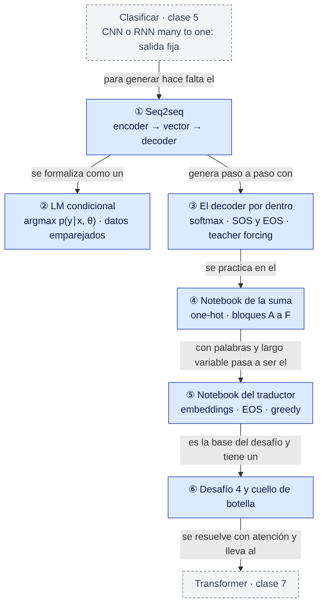
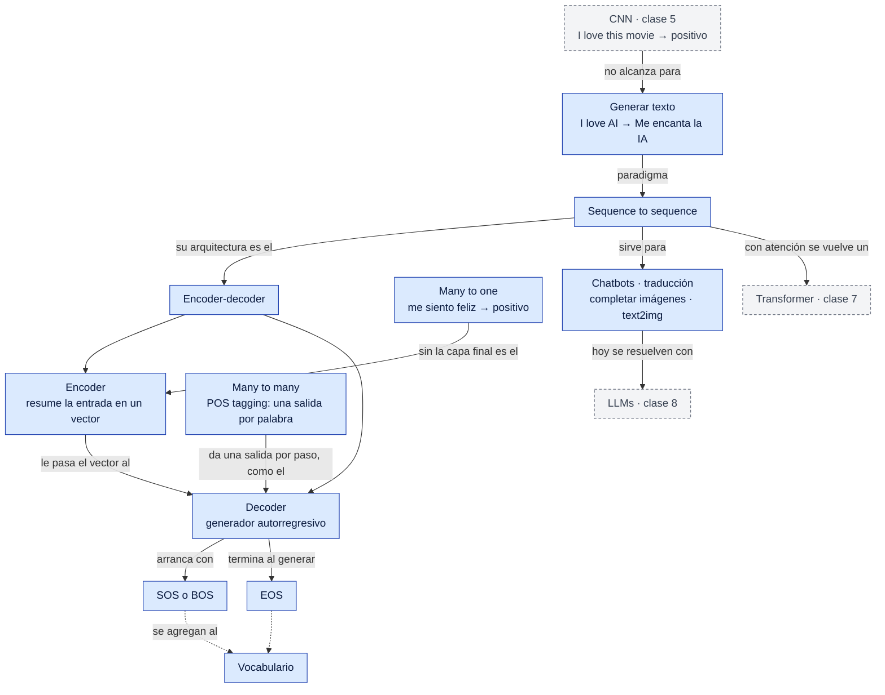
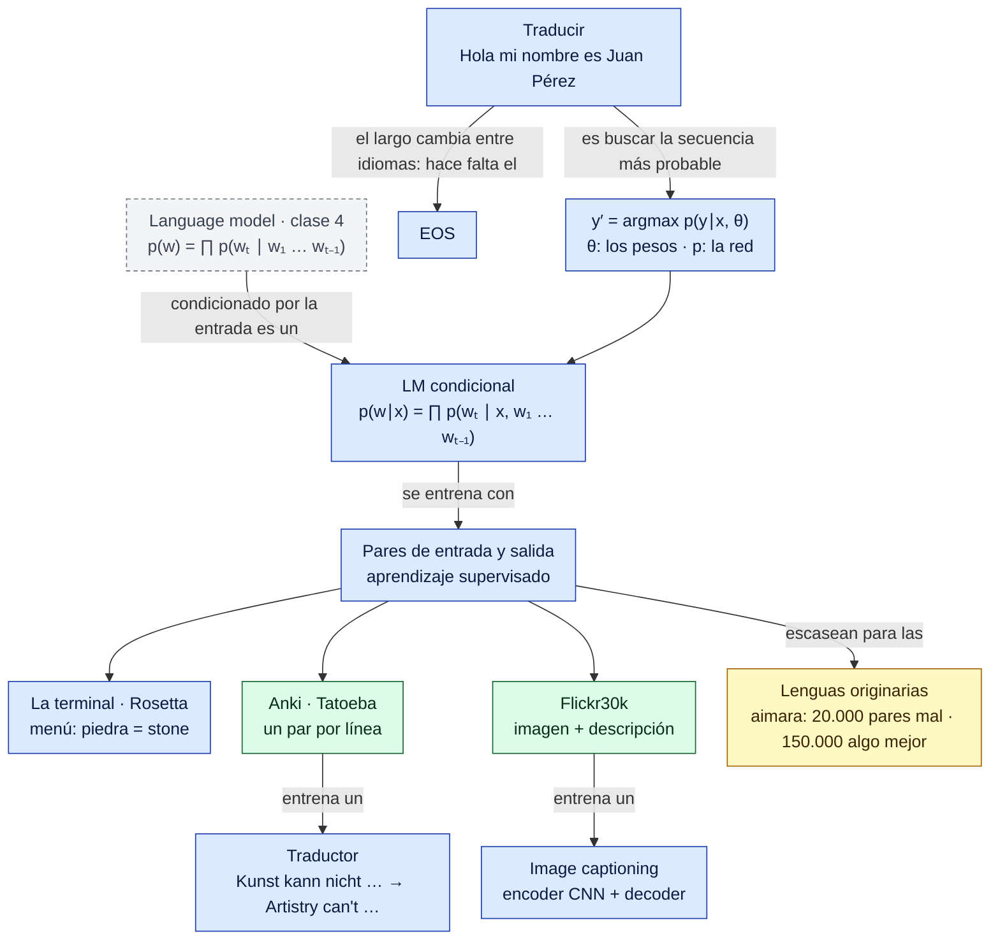
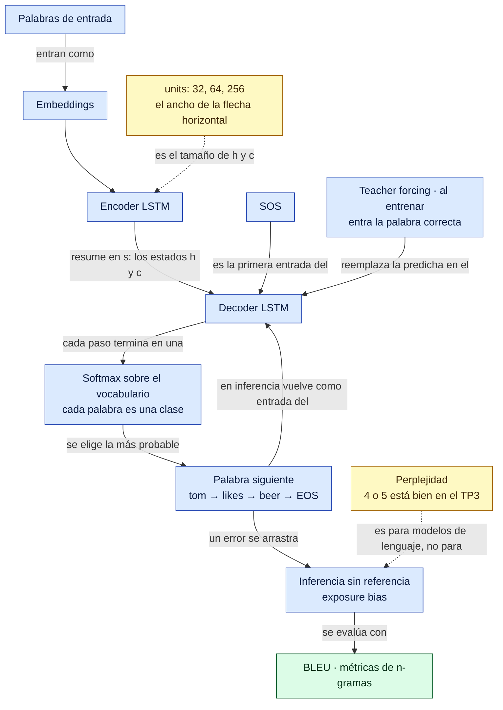
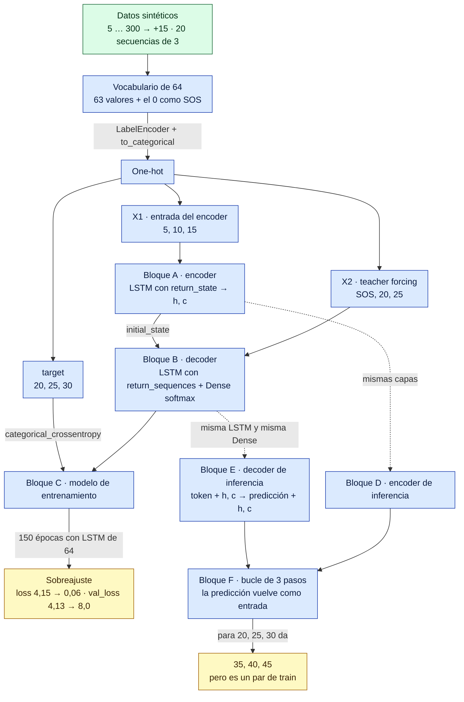
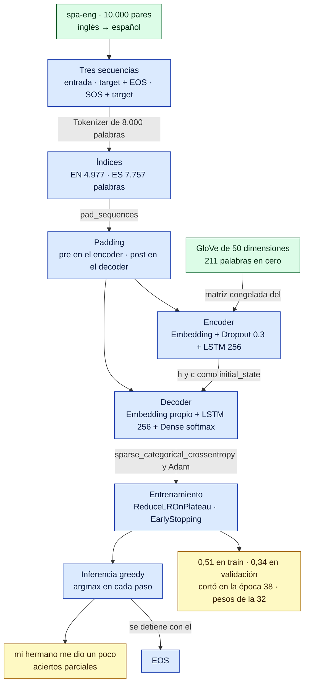
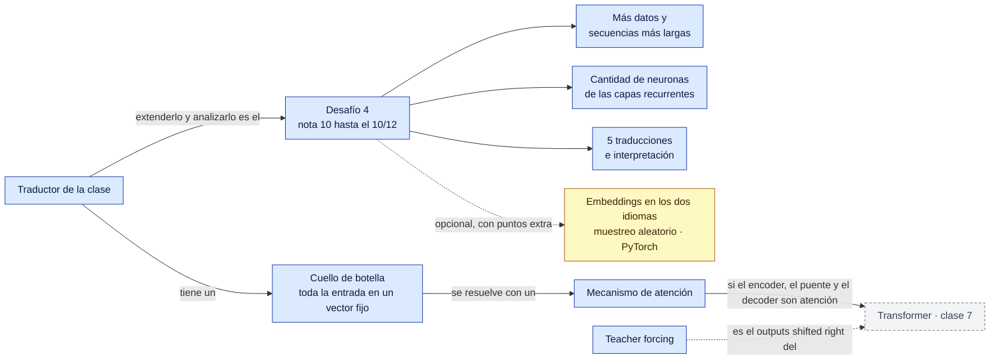

# Red conceptual — Clase 6: seq2seq y encoder-decoder

Complemento del [resumen](resumen.md). Primero hay una vista general de toda la clase y después un mapa por bloque de temas, en el orden en que se dieron. Los números de sección (§) remiten al resumen.

**Cómo leerla**
- Cada flecha forma una frase: *Encoder → resume en s → Decoder*. Una flecha sin texto quiere decir "incluye".
- Las flechas punteadas unen conceptos de temas distintos.
- Colores: azul = tema · verde = librería, función, dataset o herramienta · amarillo = dato para memorizar · gris punteado = concepto que se desarrolla en otro mapa o en otra clase.

> Todo el contenido sale de la clase. La organización y las frases de las flechas son propias.

## Vista general

## 1. De clasificar a generar (§0 a §3)

## 2. La traducción como modelo de lenguaje condicional (§4 a §7)

## 3. El encoder-decoder por dentro (§8 a §10)

## 4. Notebook de la suma (§11 a §15)

## 5. Notebook del traductor (§16 a §19)

## 6. Desafío 4 y cierre (§20 y §21)

