# Clase 6 — Seq2seq: la arquitectura encoder-decoder

- **Docente:** MSc. Fernando Silva. En la transcripción figura como "lse posgrados", la cuenta del posgrado. Es su segunda clase.
- **Fecha:** jueves 26/11/2026, de ~19:08 a ~21:46.
- **Duración:** ~2 h 39 min (la transcripción va de 00:07:38 a 02:46:38). Como en la clase 5, los recreos se pasaron al final para salir antes (02:10:42). Entre 01:30:01 y 01:44:58 no hay transcripción: son los ~15 minutos para completar el ejercicio.
- **Grabación:** falta el link.
- **Material:** [slides](material/slides-seq2seq.pdf) · notebooks: [encoder-decoder (suma 15)](material/notebook-encoder-decoder.ipynb) y [traductor](material/notebook-traductor.ipynb) · [transcripción](material/transcripcion.txt) · [notas de Gemini](material/notas-gemini.txt) · [carpeta `Clase 6` del repo de la materia](https://github.com/FIUBA-Posgrado-Inteligencia-Artificial/procesamiento_lenguaje_natural/tree/nov_2026/Clase%206)
- **Desafío:** se presentó el [desafío 4](../../desafios/04-traductor-seq2seq/README.md): extender y analizar el traductor de la clase. Tiene nota 10 hasta el jueves 10/12 (clase 8). La consigna formal va a estar en el GitHub de la materia (§20). El desafío 3 tenía nota 10 hasta este mismo jueves.
- **Lectura sugerida en la clase 5:** [Seq2seq and attention](https://lena-voita.github.io/nlp_course/seq2seq_and_attention.html), del curso de NLP de Lena Voita.
- **Clase anterior:** [resumen de la clase 5](../05-redes-convolucionales/resumen.md) (CNN para PLN).
- **Red conceptual:** [red-conceptual.md](red-conceptual.md)

> **Fuentes:** la transcripción completa, las slides y los dos notebooks de la clase. Las notas de Gemini solo se usaron para cotejar. Los tiempos `(hh:mm:ss)` marcan el bloque de la transcripción donde arranca cada tema. Lo marcado con ✎ es elaboración propia y no se dijo en clase.

---

## Repaso rápido

- **De clasificar a generar:** una CNN (o una RNN many to one) recibe un texto y da una salida fija, como una clase. Para generar texto (traducir, responder) hace falta otro paradigma: el **sequence to sequence** (seq2seq).
- **Arquitecturas recurrentes:** many to one para clasificar ("me siento feliz" → positivo) y many to many para etiquetar cada palabra (POS tagging). El seq2seq combina las dos.
- **Seq2seq es el paradigma y encoder-decoder, su arquitectura.** El **encoder** es una many to one sin la capa final: resume la entrada en un vector. El **decoder** es un generador: arranca con el token **SOS** (o BOS) y ese vector, y cada palabra que genera vuelve como entrada (**generación autorregresiva**) hasta que genera **EOS**. Los dos tokens especiales se agregan al vocabulario.
- **Aplicaciones:** chatbots, traducción, completar imágenes, texto a imagen e image captioning. Hoy se resuelven con LLMs y Transformers, pero el seq2seq clásico es la base: con un **mecanismo de atención** se convierte en un Transformer.
- **La traducción es una búsqueda:** de todas las traducciones posibles se quiere la más probable, y′ = argmax p(y | x, θ). Un seq2seq es un **modelo de lenguaje condicional**: el decoder es un modelo de lenguaje del idioma de destino, condicionado por la entrada.
- **Hacen falta pares** (entrada, salida): es aprendizaje supervisado. Ejemplos: *La terminal*, la piedra de Rosetta, un menú bilingüe, los datasets de [Anki](https://www.manythings.org/anki/) y Flickr30k. Las lenguas originarias tienen pocos datos: el equipo de Fernando entrenó un Transformer de español a aimara con 20.000 pares, con malos resultados, y con 150.000 mejoró un poco.
- **Las palabras entran como embeddings.** Las unidades de una LSTM (32, 64, 256) son **el ancho de la flecha horizontal**, el tamaño del estado oculto, no el largo de la secuencia ni el del embedding.
- **El decoder paso a paso:** en cada paso, una **softmax** sobre todo el vocabulario (es multiclase) y se elige la palabra más probable.
- **Teacher forcing:** al entrenar, la entrada de cada paso del decoder es la palabra correcta anterior, no la que predijo. En la inferencia no hay referencia, así que un error se arrastra. Una traducción se evalúa con métricas como **BLEU**; la perplejidad es para modelos de lenguaje, y para el desafío 3 una de 4 o 5 está bien.
- **Notebook de la suma (+15):** 20 secuencias de tres números, vocabulario de 64 (63 valores y el 0 como `<sos>`) en one-hot. Tres secuencias: **X1** (entrada del encoder), **X2** (teacher forcing: `<sos>` y el target corrido) y el **target**. Se arma en bloques A a F con `LSTM(64)`. Sobreajusta (la val_loss sube) y predice [35, 40, 45] para [20, 25, 30].
- **Notebook del traductor (inglés-español):** 10.000 pares con `<sos>` y `<eos>`, `Tokenizer` de 8.000 palabras, padding `pre` en el encoder y `post` en el decoder, GloVe de 50 congelado en el encoder, LSTM de 256 y callbacks. Llega a 0,51 de accuracy en train y 0,34 en validación, y traduce con greedy hasta el `<eos>`, con aciertos parciales.
- **Desafío 4:** extender el traductor (más datos, secuencias más largas, cantidad de neuronas), mostrar 5 traducciones e interpretar. Opcional: embeddings para los dos idiomas, otra estrategia de generación o PyTorch.
- **Cuello de botella:** toda la entrada pasa por un vector de tamaño fijo. La atención lo resuelve, y un encoder-decoder hecho solo de atención es un **Transformer**, el tema de la clase que viene.

---

## 0. Repaso: de clasificar a generar (00:07:38)

- La clase de hoy es sequence to sequence, que "nos va a dar paso para ver después sobre Transformers".
- **Repaso de la clase 5:** las CNN funcionan para NLP. Reciben un texto y producen una salida fija, por ejemplo una clase: "I love this movie" → CNN → positivo.
- Sirven para clasificar: sentimiento, spam, tópicos. Se les pasa una oración o un párrafo y dicen "esto pertenece al área de ciencias o al área de biología" (00:09:17).
- **Su limitación:** la ventana que se va deslizando no encuentra relaciones largas. Con un párrafo, la CNN no captura toda la información.
- Pero en NLP no todo es clasificar: hay generación, traducción, etcétera. Para generar texto hace falta un paradigma nuevo, el **sequence to sequence**: recibe una secuencia, por ejemplo en inglés, y devuelve otra en español: "I love AI" → "Me encanta la IA" (00:10:51).
- Las herramientas sueltas ya se vieron: las RNN (vanilla, LSTM y GRU) y las CNN. Hoy se juntan para **armar generadores**.

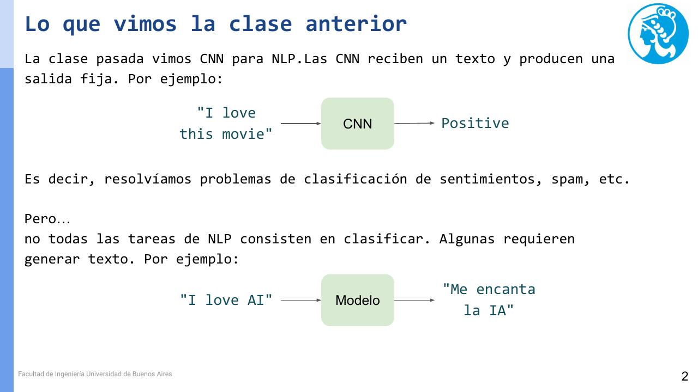

*Slide 2: la clase anterior: "I love this movie" → CNN → Positive (clasificación de sentimientos, spam, etc.). Pero no todas las tareas consisten en clasificar; algunas requieren generar texto: "I love AI" → Modelo → "Me encanta la IA".*

## 1. Arquitecturas de redes recurrentes (00:10:51)

- La slide se llama "Soluciones", pero Fernando prefiere decirles **arquitecturas de redes neuronales**. Probablemente ya la vieron con Josselyn. Una de ellas es la que se usa para armar el seq2seq.
- **Many to one** (00:11:57), dibujada en Excalidraw: para clasificar "me siento feliz" como positiva o negativa, una RNN (vanilla, LSTM o GRU) recibe una palabra por paso, la procesa y le pasa la información al paso siguiente. Recién al final da la salida, la flecha que va hacia arriba: "positivo". Son muchas entradas y una salida, lo más fácil que se puede hacer con una red recurrente (00:13:38).
- **Many to many: POS tagging.** Clasificar cada palabra, por ejemplo según su categoría lingüística. Con "me siento feliz", cada nodo da su salida en el momento, sin esperar al final: "me" es de tipo 3, "siento" de tipo 1 y "feliz" de tipo 9 (00:15:17).
- Son las dos tareas más comunes de NLP, y la idea del seq2seq es **combinarlas**.

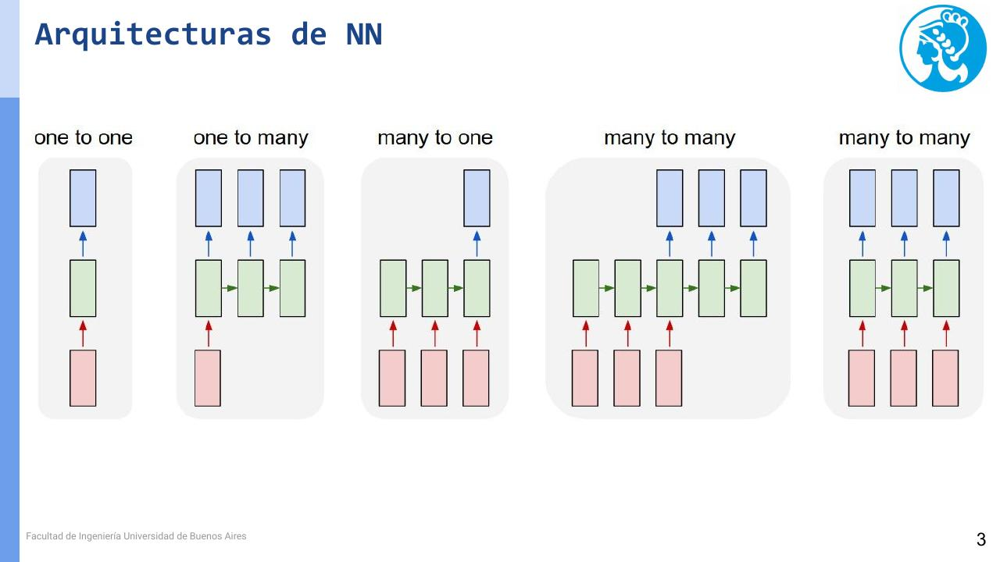

*Slide 3: one to one, one to many, many to one, many to many que primero lee toda la entrada y después genera, y many to many sincronizada, con una salida por cada entrada. Rojo: entradas; verde: estados de la red; azul: salidas.*

- La clasificación es la many to one; el POS tagging, la many to many sincronizada (la última), y el seq2seq, la many to many que primero lee y después genera (00:22:39).
- ✎ La figura es del blog de Andrej Karpathy *The Unreasonable Effectiveness of Recurrent Neural Networks* (2015). La one to many es, por ejemplo, describir una imagen con una oración.

## 2. El encoder-decoder (00:15:17)

- **¿Seq2seq y encoder-decoder son lo mismo?** (00:16:47) En teoría sí, pero sequence to sequence es un **paradigma**, y encoder-decoder es una **arquitectura** de ese paradigma.
- **El dibujo:**
  1. "Me siento feliz" entra a una red recurrente, que da una salida. Esa salida **no pasa por una sigmoide**, como en la clasificación: se queda como **vector**. Si se le agregara una capa y una sigmoide, sería un clasificador binario. Es lo mismo que antes, sin la capa final (00:18:10).
  2. El vector pasa a **otro bloque**, de otro color porque es distinto. Ese bloque recibe además un token que es como un botón que dice "vas a empezar la secuencia": **SOS** (*start of sequence*) o **BOS** (*begin of sequence*). En papers, blogs, videos y código aparecen los dos nombres, pero es la misma idea.
  3. Con el vector y el SOS, el bloque genera la primera palabra, "I" (00:19:26). Esa salida vuelve como entrada del paso siguiente, que genera "feel", que vuelve como entrada y genera "happy". Es **generación autorregresiva**.
  4. Al final genera **EOS** (*end of sequence*), y ahí termina (00:20:54).
- **Carlos:** ¿qué son las líneas horizontales del bloque de la derecha? Las conexiones de una red recurrente: el bloque de la derecha también es una RNN, igual que el de la izquierda, y se pueden pensar como dos LSTM. Las flechas azules solo copian cada salida como entrada del paso siguiente.
- **El bloque de la izquierda es el encoder:** una many to one. Recibe muchas entradas y da una salida, como un clasificador, pero sin clasificar: da el vector previo a la clasificación.
- **El de la derecha es el decoder:** un generador que da una salida en cada momento. Sus salidas vuelven como entradas para que "vaya entendiendo lo que ha generado": generó "I", así que lo tiene en cuenta para la palabra siguiente; con "I feel" genera "happy", y así (00:22:39).
- Eso es un seq2seq: junta dos bloques y resuelve problemas como generar la traducción de un texto. Es la many to many que lee toda la secuencia y después genera.
- **Hernando:** ¿de dónde sale el *begin of sequence*? Es un **token que se agrega**: en el código se le dice explícitamente que empiece con el BOS o el SOS (00:23:44).
- **Carlos:** entonces, ¿hay que agregar al vocabulario tanto el de inicio como el de fin? Exactamente.
- Si da el tiempo, al final se hace el puente con los Transformers; si no, en la clase que viene.

## 3. Aplicaciones y por qué estudiar el seq2seq clásico (00:24:59)

- **Slide 4:** el seq2seq trabaja con el concepto many to many en formato codificador → decodificador: la entrada se codifica en una representación intermedia y se decodifica al espacio de salida. Sirve para traducir o transferir representaciones entre distintos dominios de datos o modalidades.
  - **Chatbots:** "¿cuánto cuesta la polera (bueno, la remera) del Barcelona?" → "La remera del Barcelona cuesta 110 €". Una secuencia de entrada y una de salida.
  - **Traducción de idiomas:** "me siento feliz" → "I feel happy".
  - **Completar una imagen:** una imagen incompleta se puede considerar una secuencia de píxeles, y el modelo devuelve los que faltan.
  - **Texto a imagen o imagen a texto** (00:26:13): una secuencia de palabras genera una secuencia de píxeles.
  - En general, todo lo que tenga una secuencia de entrada y una de salida.

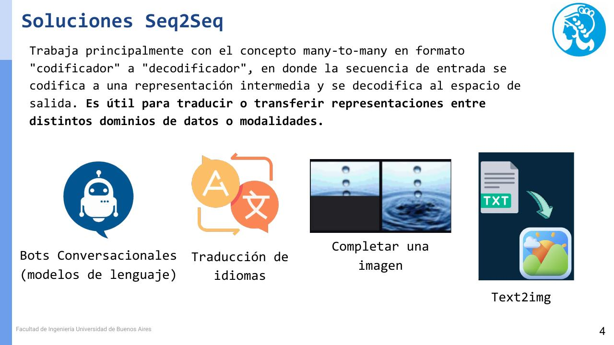

*Slide 4: soluciones seq2seq: bots conversacionales (modelos de lenguaje), traducción de idiomas, completar una imagen y text2img.*

- **Este encoder-decoder clásico, con LSTM o GRU, hoy no se usa** en chatbots. Antes sí, y también para traducir: hace casi 10 años, Fernando vio en la universidad a un investigador presentar un traductor de español a una lengua originaria hecho así, y "en su momento era wow" (00:26:13).
- Hoy un chatbot se hace con un LLM. Para completar una imagen se usa ChatGPT o Nano Banana, y para pasar de texto a imagen, ChatGPT usa internamente DALL·E. En la práctica, todo esto se resolvió con técnicas modernas que lo hacen mucho mejor (00:27:23).
- El código de hoy, que es lo clásico, funciona, pero "tiene sus detalles", por dos razones: se hace sencillo por las limitaciones de Colab, y estas tareas ya se resolvieron con técnicas modernas.
- **¿Para qué verlo, entonces?** (00:28:26) Porque es la base para entender lo que viene: se mejora con el **mecanismo de atención**, y un seq2seq con atención se transforma en un **Transformer**. Por eso la clase que viene es de Transformers.

## 4. La traducción como búsqueda de la secuencia más probable (00:28:26)

- "Hola, mi nombre es Juan Pérez" → "Hi, my name is Juan Pérez".
- **Las longitudes pueden variar** de un idioma a otro, y eso lo hace desafiante. Ahí entra el **EOS**: sin él, el generador seguiría sin parar ("I feel happy. How do you feel today? We are living in… bla, bla, bla"). Con el EOS, la red avisa que ya no tiene nada que decir y termina (00:29:42).
- **Traducir es buscar:** hay muchas traducciones posibles ("My name is Juan Pérez", "Hi, I am Juan Pérez", "Hi, Juan Pérez"…), algunas erróneas, pero alternativas al fin. No las busca una persona: la red tiene que encontrar la **más probable dada la entrada** (00:30:46).

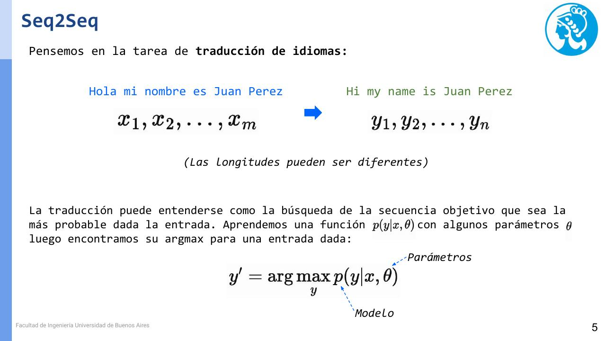

*Slide 5: "Hola mi nombre es Juan Perez" (x₁, x₂, …, xₘ) → "Hi my name is Juan Perez" (y₁, y₂, …, yₙ). Las longitudes pueden ser diferentes. Se aprende una función p(y|x, θ) con parámetros θ y se busca su argmax para una entrada dada.*

```math
y' = \arg\max_{y}\; p(y \mid x, \theta)
```

- θ son los **parámetros**, es decir, los pesos, y p es la red neuronal, que tiene que aprender a dar las mejores secuencias para cada secuencia de entrada.
- ✎ Recorrer todas las secuencias posibles es imposible, porque crecen exponencialmente con el largo. El argmax se aproxima: con greedy, que elige la palabra más probable en cada paso (lo que hacen los notebooks), o con beam search ([clase 4](../04-modelo-lenguaje/resumen.md)).

## 5. Modelos de lenguaje condicionales (00:31:53)

- **Un language model** (visto con Josselyn) asigna probabilidades a secuencias de palabras. Para "Hola, mi nombre es Juan Pérez", multiplica la probabilidad de "hola" por la de "mi" dado "hola", por la de "nombre" dado "hola mi", y así.
- **Los seq2seq son conditional language models:** buscan la probabilidad de una secuencia dado un **contexto de condicionamiento**, que es la entrada. Con "Hola, mi nombre es Fernando", el modelo dice "bueno, parece que quiere decir 'Hi, my name is Fernando'" y multiplica las probabilidades de las palabras en inglés: "hi", por "my" dado "hi", etcétera (00:32:51).

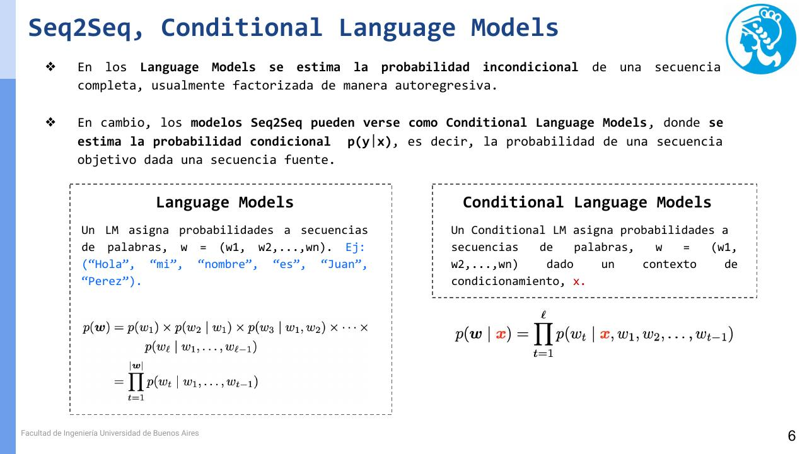

*Slide 6: en los language models se estima la probabilidad incondicional de una secuencia completa, factorizada de manera autorregresiva (ej.: "Hola", "mi", "nombre", "es", "Juan", "Perez"). Los seq2seq pueden verse como conditional language models: estiman p(y|x), la probabilidad de una secuencia objetivo dada una secuencia fuente.*

```math
p(\boldsymbol{w}) = p(w_1) \times p(w_2 \mid w_1) \times p(w_3 \mid w_1, w_2) \times \cdots \times p(w_\ell \mid w_1, \dots, w_{\ell-1}) = \prod_{t=1}^{|\boldsymbol{w}|} p(w_t \mid w_1, \dots, w_{t-1})
```

```math
p(\boldsymbol{w} \mid \boldsymbol{x}) = \prod_{t=1}^{\ell} p(w_t \mid \boldsymbol{x}, w_1, w_2, \dots, w_{t-1})
```

- Esto no se hace a mano: pasa adentro de la red. Lo que dice es que, para entrenar una arquitectura así, hay que darle **una secuencia de entrada y una de salida**: es un problema **supervisado** (00:32:51).
- ✎ La única diferencia con el modelo de lenguaje de la clase 4 es la x en cada factor: el decoder es un modelo de lenguaje del idioma de destino, condicionado por lo que resumió el encoder.

## 6. Datos emparejados (00:32:51)

- ***La terminal*** (Tom Hanks, de los 2000): un viajero de un país ficticio queda varado en un aeropuerto de Estados Unidos sin hablar inglés. Aprende con las revistas de los aviones y los aeropuertos, que traen el mismo texto en los dos idiomas: "Las frutas de la Patagonia son deliciosas" / "The fruits of Patagonia are delicious". Sin darse cuenta, ahí hay un **dataset de pares** (00:34:00).
- **Nicolás** (por chat): la piedra de Rosetta, un acontecimiento importante para descifrar los jeroglíficos (00:35:00).
- **El menú bilingüe de un restaurante:** "Picanha a la piedra" / "Picanha stone cooked" y "Chuletón a la piedra" / "T-bone steak stone cook". Si uno no supiera inglés, vería que "piedra" aparece dos veces en español y "stone" dos veces en la traducción: *stone* debe significar *piedra*. Se ven relaciones entre las palabras de los pares, y eso es lo que pasa en la red.

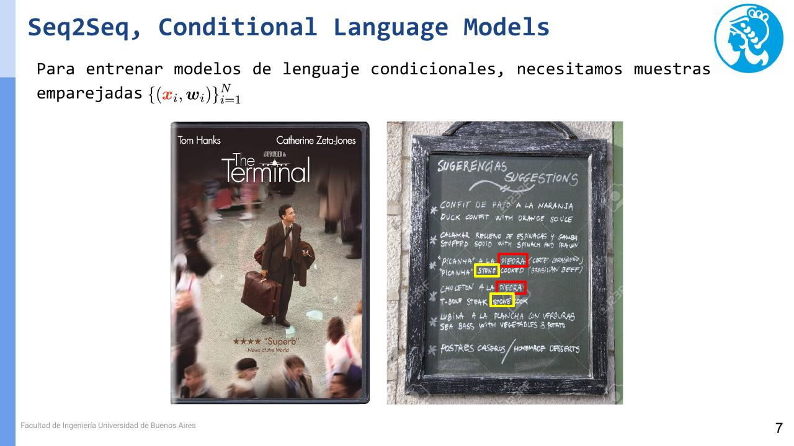

*Slide 7: para entrenar modelos de lenguaje condicionales se necesitan muestras emparejadas {(xᵢ, wᵢ)}, con i de 1 a N. El póster de La terminal (Tom Hanks y Catherine Zeta-Jones) y la pizarra "Sugerencias / Suggestions" de un restaurante, con PIEDRA y STONE resaltadas.*

- **Hacen falta muchos pares**, como en cualquier modelo de lenguaje (00:35:58). [manythings.org/anki](https://www.manythings.org/anki/) tiene datasets de inglés a muchos idiomas (afrikáans, albanés…). Fernando bajó el de inglés-francés: un TXT grande con un par por línea.

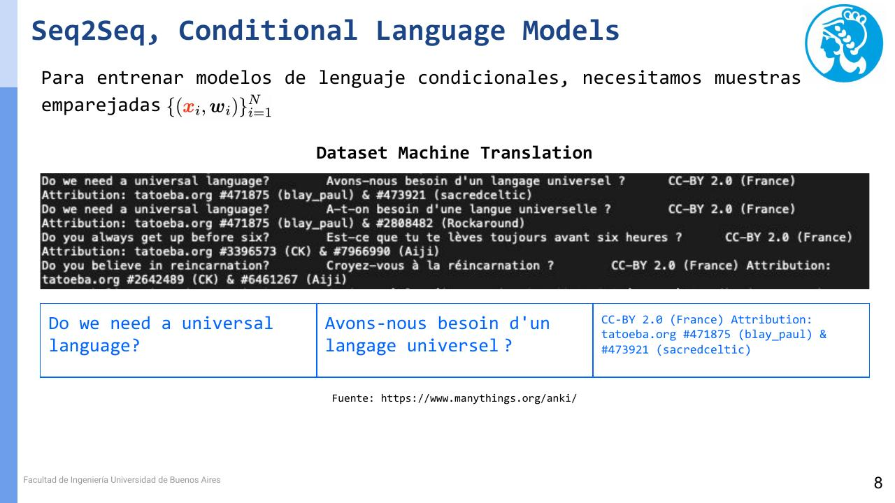

*Slide 8: dataset de traducción automática (fuente: manythings.org/anki). Cada línea tiene la oración en inglés, su traducción y la atribución a tatoeba.org, con licencia CC-BY 2.0 (France): "Do we need a universal language?" / "Avons-nous besoin d'un langage universel ?" y, para el mismo original, otra traducción: "A-t-on besoin d'une langue universelle ?". Siguen "Do you always get up before six?" y "Do you believe in reincarnation?".*

- Una oración puede tener **varias traducciones**, y se agregan como pares distintos (00:37:12).
- **La dirección importa:** un modelo que traduce de inglés a español no es lo mismo que uno de español a inglés, aunque parezca. Hay buenos traductores con Transformers de inglés a español, quizás de alemán, pero la mayoría son de inglés a otro idioma.
- **Lenguas con pocos datos** (00:38:32): para lenguas originarias de Sudamérica (aimara, quechua, guaraní) casi no hay datasets, porque no están digitalizadas, y no se pudieron entrenar modelos. Aún en la época de la IA generativa hay competencias para esto. En Anki, inglés-ruso tiene casi medio millón de pares, y otro idioma (quizás una variante del ruso), 79: "con 79 no vas a entrenar nada" (00:39:49).
- **La experiencia del equipo de Fernando:** traducción de español a aimara con un Transformer moderno entrenado desde cero. Con 20.000 secuencias no tuvieron buenos resultados; con 150.000, un poco de mejora. Todavía están viendo cómo resolverlo. No es tan sencillo y hacen falta muchos datos.

## 7. Traducción e image captioning con encoder-decoder (00:40:58)

- **Traducción:** la oración en alemán entra al encoder, que la **resume** en un vector. Ese vector es una representación, y también puede verse como un **embedding de la oración**. El decoder genera la traducción al inglés de forma autorregresiva, teniendo en cuenta todo lo que generó antes.

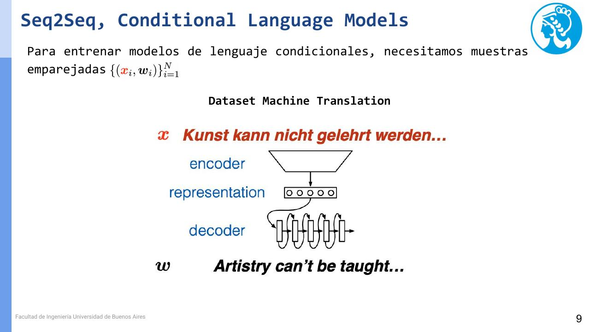

*Slide 9: dataset de traducción automática: x = "Kunst kann nicht gelehrt werden…" → encoder → representation → decoder → w = "Artistry can't be taught…".*

- **Image captioning** (00:41:58): describir una imagen con texto. Fernando lo vio en Instagram con internet lento: la foto no cargaba y arriba decía "esto puede ser la foto de un loro bailando". Para entrenarlo hace falta un dataset supervisado de imágenes con su descripción, como **Flickr30k**, que está en Hugging Face.

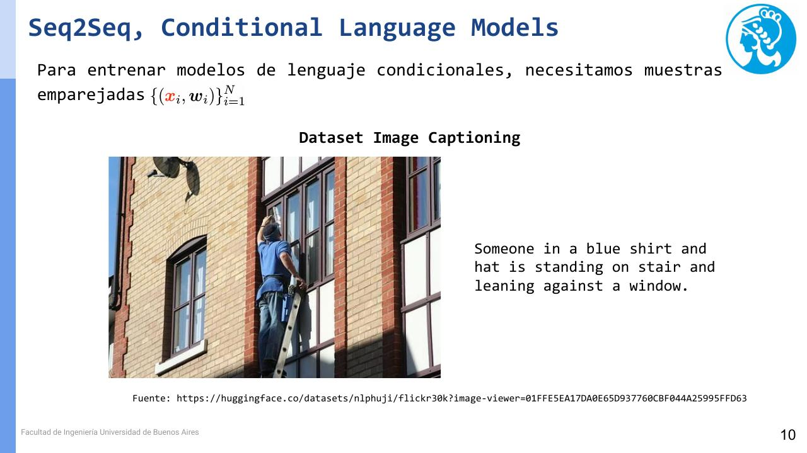

*Slide 10: dataset de image captioning (Flickr30k, en Hugging Face): una persona limpia una ventana parada en una escalera, y la descripción es "Someone in a blue shirt and hat is standing on stair and leaning against a window."*

- La imagen entra al **encoder, que en este caso sería una CNN**, y su resumen pasa al decoder, que genera el texto (00:43:09).

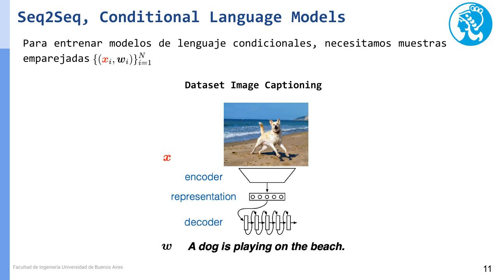

*Slide 11: la foto de un perro en la playa → encoder → representation → decoder → "A dog is playing on the beach."*

## 8. Las palabras entran como vectores (00:44:11)

- En el dibujo del encoder-decoder parecía que la LSTM recibía las palabras directamente, algo "medio mágico". Pero las redes no reciben datos no estructurados: "me" entra como su **embedding**, igual que "siento" y "feliz". Una función recibe la palabra y devuelve su vector, y recién eso entra a la LSTM. Del otro lado pasa lo mismo: el decoder genera un vector, que se traduce a la palabra "I" (00:45:30).

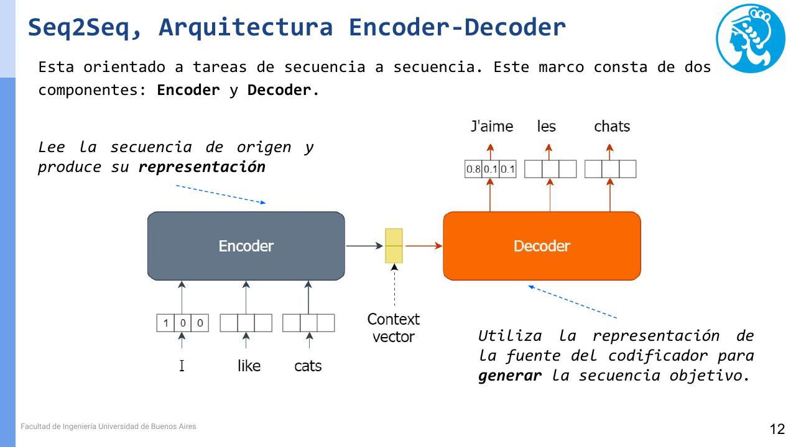

*Slide 12: el encoder lee la secuencia de origen ("I like cats", cada palabra como un vector, por ejemplo el one-hot [1 0 0]) y produce su representación, el context vector. El decoder la usa para generar la secuencia objetivo ("J'aime les chats"), con una distribución de probabilidades por palabra, como [0.8 0.1 0.1].*

- **Carlos:** ¿la dimensión del embedding es la cantidad de *features* que recibe la neurona? Sí: al encoder se le pasa una matriz con todas las palabras que se van a usar y sus embeddings, así que la entrada tiene la dimensión del embedding.
- **¿Qué es el 32 de `LSTM(32)`?** (00:46:42) Fernando dibujó una capa `Embedding`, con la matriz de GloVe o de Word2Vec, conectada a una `LSTM(32)`, y preguntó qué significa el 32, porque no es el tamaño del embedding.
  - **Carlos:** ¿el largo de la cadena, tres en el dibujo? No.
  - **Rodolfo:** ¿la cantidad de secuencias que se le mandan? Tampoco.
  - **Es el ancho de la flecha horizontal:** cuánta información oculta se pasa de un nodo al siguiente (00:47:57). Con 32 maneja ese tamaño; con 8, menos información. Depende del problema.
- En la slide 12 el embedding tiene tres números, solo como ejemplo. Para que la traducción sea buena conviene usar embeddings que capturen información semántica: "será un GloVe de 100 dimensiones" (00:49:05). ✎ En el notebook del traductor es GloVe de 50 (§18).
- ✎ En Keras, el 32 es `units`: el tamaño de los vectores h y c de la LSTM. No depende del largo de la secuencia, que es la cantidad de pasos, ni del embedding, que entra multiplicado por las matrices de pesos de la celda.

## 9. El decoder paso a paso (00:49:05)

- El encoder recibe la secuencia de entrada y la **comprime** en un vector de representación, que en las slides se llama **s**.

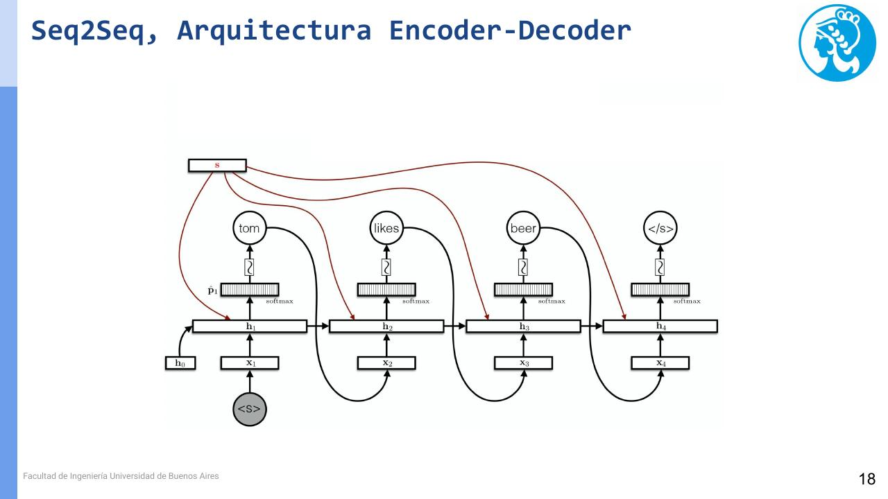

*Slides 13 a 18: el encoder procesa toda la secuencia de entrada y produce un estado oculto, que se pasa como s al decoder. El decoder arranca con h₀ y el token <s>: calcula h₁, una softmax da p̂₁ y se elige "tom". "tom" entra como x₂ y sale "likes"; después, "beer" y, al final, </s>. s llega a todos los pasos (flechas rojas).*

- **Paso a paso,** a medida que se arman las slides:
  1. El decoder recibe s y el token **<s>** (el SOS o BOS), en representación vectorial, y calcula h₁. h₀ es su primera representación oculta, la que viene por defecto al declararlo (00:50:16).
  2. Sale un vector que dice cuál de las palabras disponibles debería ser la siguiente. Cada palabra es una clase, así que es un problema **multiclase**, y la **softmax** asigna las probabilidades. Se elige la mayor: "tom".
  3. "tom" entra en el paso siguiente, combinado otra vez con el resumen del encoder, y sale "likes" (00:51:30). Después, "beer".
  4. Al final sale **</s>**, el EOS: "aquí decía inicio, aquí dice fin".
- Es lo mismo que el dibujo de Excalidraw: el vector de representación se une con el SOS, y el decoder genera y reutiliza cada salida hasta que da el EOS.
- ✎ En las slides, s llega a cada paso del decoder. En los notebooks, los estados del encoder solo son el estado inicial del decoder (`initial_state`). Existen las dos variantes: la primera es la de Cho et al. (2014), y la segunda, la de Sutskever et al. (2014).

## 10. Teacher forcing, inferencia y métricas (00:52:41)

- Fernando empezó llamando teacher forcing a lo anterior y se corrigió: usar lo que da la red, aunque se equivoque, es generar **sin teacher forcing**.

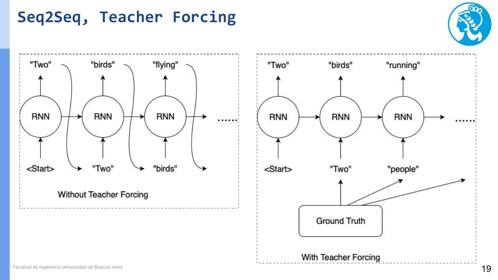

*Slide 19: sin teacher forcing, cada paso de la RNN recibe la salida anterior: <Start> → "Two", "Two" → "birds", "birds" → "flying". Con teacher forcing, la entrada de cada paso viene del ground truth: <Start> → "Two", "Two" → "birds", pero el paso siguiente recibe "people" (no "birds") y genera "running".*

- **Sin teacher forcing:** arranca la generación y dice "two"; "two" entra para que diga "birds", y después "flying". Pero se esperaba "two people running": se usó "birds" porque no había ninguna referencia, solo lo que decía el modelo (00:52:41).
- **Con teacher forcing** se usa el **ground truth**, lo que debería decir (00:54:05). Dice "two", que está bien, y de todas formas se fuerza "two" como entrada. Dice "birds", pero se esperaba "people", así que "birds" no se tiene en cuenta y entra "people". Así se va alineando con lo que se le pasó.
- **Para entrenar se usa teacher forcing.** Se compara cada salida con la esperada y se acumula el error: "two" está bien, error 0; "birds" en vez de "people", error 10, por decir algo; y así (00:55:08). Se fuerza al modelo a alinearse con el dataset.
- **En la inferencia no hay teacher forcing.** Alguien escribe "dos personas corriendo", una oración que el modelo nunca vio, y no hay profesor ni referencia: tiene que completarla con sus propias salidas. Si se equivoca ("two birds flying"), no tiene otra opción, tenía que dar una secuencia (00:56:07). Por eso, en los ejercicios, a veces el modelo va bien, se equivoca en una palabra y **la oración se empieza a distorsionar**.
- ✎ Con teacher forcing, la pérdida de una oración es la suma de las entropías cruzadas de cada paso, con las palabras anteriores tomadas del ground truth:

```math
\mathcal{L} = -\sum_{t=1}^{n} \ln p\left(y_t \mid \boldsymbol{x}, y_1, \dots, y_{t-1}\right)
```

  Todos los pasos se calculan a la vez, porque las entradas del decoder ya se conocen: son la secuencia objetivo corrida un lugar. La diferencia entre entrenar con las palabras correctas y generar con las propias se llama *exposure bias*.
- **Carlos:** sin teacher forcing, ¿contra qué se compara para calcular el error? (00:57:07) Ahí no se usa una pérdida, porque es inferencia: se usan **métricas** que dicen qué tan parecida es una secuencia a la que se esperaba. Por ejemplo **BLEU**, o métricas basadas en n-gramas, como cuántas palabras o pares de palabras le atinó.
- **Carlos:** ¿también la perplejidad, como en el TP? Sí, aunque la perplejidad es más para **language models**, como se vio con Josselyn. El TP3 había que entregarlo ese mismo día (00:58:00).
- **Carlos:** ¿hasta cuándo seguir entrenando? Con una perplejidad de 4 no sabe si está bien o mal, y las oraciones son más o menos coherentes. Con una arquitectura clásica, datos limitados y Colab sin mucha GPU, **una perplejidad de 4 o 5 está bien**. Podría ser mucho mejor, pero no habría mucho más que hacer. Con un LLM al que hay que hacerle fine-tuning sí habría que sacar mejores resultados (00:59:12).
- **Gonzalo:** también depende del corpus: si es chico, por más neuronas que se agreguen, no va a mejorar de 4. Exactamente: los datos. Lo que se hace en la materia está acotado por el cómputo y por las arquitecturas. Fernando corrige el TP3 y tiene todo eso en cuenta (01:00:16).
- ✎ BLEU compara los n-gramas (de 1 a 4 palabras) de la traducción generada con los de una o más traducciones de referencia, con una penalización si la generada es demasiado corta. Va de 0 a 1, o de 0 a 100.

## 11. Ejercicio: un encoder-decoder que suma 15 (01:00:16)

- Antes de traducir, un encoder-decoder que **suma 15**: [5, 10, 15] → [20, 25, 30].
- Parece fácil, pero lo interesante es que **nunca se le dice "sumá 15"**: solo se le dan secuencias, y el modelo tiene que aprender el patrón solo.

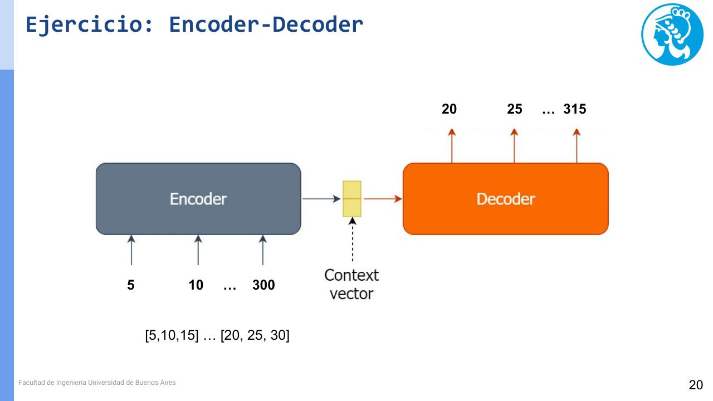

*Slide 20: el encoder recibe 5, 10, …, 300 y el decoder genera 20, 25, …, 315 a partir del context vector. Los pares son [5, 10, 15] … [20, 25, 30].*

- **Dinámica** (01:01:38): Fernando explicó el notebook hasta el bloque del encoder-decoder, y los alumnos completaron las celdas marcadas "tu código aquí" y ejecutaron todo, sin necesidad de entender el resto. Fueron 15 minutos. Después lo resolvió explicando todo en detalle.
- El notebook del repo es la **versión resuelta**.

## 12. Notebook de la suma: datos, vocabulario y las tres secuencias (01:03:43)

[Notebook](material/notebook-encoder-decoder.ipynb). Objetivo: aprender a mapear una secuencia numérica a otra, de [x, x+5, x+10] a [x+15, x+20, x+25].

**Imports:** `numpy`, `preprocessing` de scikit-learn, `to_categorical`, `Model`, `Input`, `LSTM`, `Dense`, Matplotlib y Seaborn. Que se importe `Model` ya dice que la red se arma **en pedazos**, con la API Functional de la clase 5, y se junta "como un rompecabezas" (01:05:11).

**Datos sintéticos**

```python
X_flat = list(range(5, 301, 5))          # [5, 10, 15, ..., 300]
y_flat = [x + 15 for x in X_flat]       # [20, 25, 30, ..., 315]

X = np.array(X_flat).reshape(-1, 3, 1)  # secuencias de 3
y = np.array(y_flat).reshape(-1, 3, 1)
```

- X[0] = [5, 10, 15] e y[0] = [20, 25, 30]. Las formas son **(20, 3, 1)**: 20 secuencias de tres elementos (01:06:18).

**Vocabulario**

- Tiene que cubrir **todos los valores posibles**, los de las dos listas. Casi todos están en las dos, pero y tiene además 305, 310 y 315, y X tiene además 5, 10 y 15, porque están desfasadas. `all_values = np.unique(np.concatenate([X.ravel(), y.ravel()]))` va de 5 a 315.
- El notebook explica por qué: si el vocabulario solo tuviera los valores de train, los de validación o test serían desconocidos, el modelo no los podría predecir y la val_loss podría explotar.
- **El `<sos>` también entra al vocabulario** (01:07:30): se aprovecha que el 0 no aparece en los datos, así que **el 0 es el start of sequence**, el comodín. `labels = [0] + list(all_values)`.
- **`LabelEncoder`** de scikit-learn, con `fit(labels)`, convierte cada número en un índice, y `to_categorical` lo pasa a **one-hot**: un vector de ceros con un solo 1. Es "una suerte de embeddings", porque los números no tienen embeddings (01:09:08).
- `VOCAB_SIZE = 64`. El 0 queda como [1, 0, 0, …] y el 5, como [0, 1, 0, …] (01:10:26).
- **Hernando:** ¿no hay que agregar también el end of sequence? No en este ejercicio, porque la entrada y la salida tienen **largo fijo**, tres elementos. El EOS se agrega cuando la salida puede variar, como en la traducción: en el ejercicio siguiente.
- ✎ Son 63 valores (de 5 a 315 de a 5) más el 0: 64.

**Las tres secuencias** (01:11:43)

```python
def preparar_dataset(X, Y, label_encoder, vocab_size):
    X1_list, X2_list, target_list = [], [], []
    for x_seq, y_seq in zip(X, Y):
        enc_in  = list(label_encoder.transform(x_seq.ravel()))   # número → índice
        enc_out = list(label_encoder.transform(y_seq.ravel()))
        dec_in = [0] + enc_out[:-1]       # teacher forcing: <sos> y el target corrido
        X1_list.append(to_categorical(enc_in,  num_classes=vocab_size))
        X2_list.append(to_categorical(dec_in,  num_classes=vocab_size))
        target_list.append(to_categorical(enc_out, num_classes=vocab_size))
    return np.array(X1_list), np.array(X2_list), np.array(target_list)
```

- Las tres listas acumulan **la entrada del encoder, el teacher forcing y el objetivo**. A la entrada del decoder se le agrega explícitamente el `<sos>` (índice 0) al principio.
- **Decodificando el one-hot a mano** (01:14:09), con los índices de la lista 0, 5, 10, 15, …:
  - **X1[0]** = 5, 10, 15: los unos están en las posiciones 1, 2 y 3.
  - **X2[0]** = 0, 20, 25: el 1 de la primera fila está en la posición 0 (el `<sos>`), y después, en la 4 y la 5.
  - **target[0]** = 20, 25, 30: posiciones 4, 5 y 6.
- **Gonzalo:** el target es la salida, y X2 tiene el 20 y el 25. Exacto: X1 es la entrada del encoder, el target es lo que se quiere obtener y **X2 es el teacher forcing** (01:19:25).
- **El dibujo** (01:20:39): 5, 10 y 15 (X1) entran al encoder, que da un resumen. El decoder arranca con el 0. Al principio los pesos son aleatorios, así que supongamos que predice 8. Con teacher forcing, la entrada siguiente es 20 de todas formas. Después predice 25, que está bien, y entra 25; después, 30. Al final se compara cada salida con el target: 8 contra 20 da una pérdida (digamos 10) y las otras dos, 0. Se suman (01:22:48).
- **Hernando:** el 8 no está en el vocabulario. Es verdad: debería ser, digamos, 100, que está en el vocabulario y está mal. Era un ejemplo de que al principio falla.
- Las formas son **(20, 3, 64)**: 20 secuencias de tres números, cada uno un one-hot de 64 (01:23:57).

## 13. Notebook de la suma: la arquitectura en bloques (01:23:57)

- La función `construir_modelos` arma **tres modelos en uno**: `model`, el modelo completo de entrenamiento; `encoder_model`, que extrae el contexto (los estados h y c), y `decoder_model`, que genera la salida token a token.
- El notebook trae un diagrama con los bloques. Había que completar del A al D; el E y el F ya estaban (01:27:39):

| Bloque | Qué es | En el código |
|---|---|---|
| A | Encoder: una LSTM que lee x₁ … x_T y devuelve h_T y c_T | `LSTM(n_units, return_state=True)` |
| B | Decoder, compartido entre entrenamiento e inferencia: arranca con <SOS>, recibe y₁ … yₙ₋₁ (teacher forcing) y cada paso pasa por Dense + softmax | `LSTM(n_units, return_sequences=True, return_state=True)` y `Dense(n_output, softmax)` |
| C | Modelo de entrenamiento con teacher forcing: A + B | `Model([encoder_input, decoder_input], dec_out)` |
| D | Modelo de inferencia del encoder: devuelve solo los estados | `Model(encoder_input, encoder_states)` |
| E | Modelo de inferencia del decoder: un paso, con los estados como entrada y como salida | `Model([decoder_input, h, c], [salida, h_nuevo, c_nuevo])` |
| F | El bucle de generación autorregresiva | la función `predecir` (§15) |

- **Resolución** (01:44:58, después de los 15 minutos):

```python
def construir_modelos(n_input, n_output, n_units=128):
    # ENCODER (Bloque A): secuencia de cualquier largo (None) → estados h, c
    encoder_input  = Input(shape=(None, n_input))
    _, state_h, state_c = LSTM(n_units, return_state=True)(encoder_input)
    encoder_states = [state_h, state_c]                    # "contexto" aprendido

    # DECODER compartido entre entrenamiento e inferencia (Bloque B)
    decoder_input = Input(shape=(None, n_output))
    decoder_lstm  = LSTM(n_units, return_sequences=True, return_state=True)
    decoder_dense = Dense(n_output, activation='softmax')

    # En entrenamiento, el decoder arranca con los estados del encoder
    dec_out, _, _ = decoder_lstm(decoder_input, initial_state=encoder_states)
    dec_out       = decoder_dense(dec_out)

    model = Model(inputs=[encoder_input, decoder_input], outputs=dec_out)   # Bloque C

    encoder_model = Model(inputs=encoder_input, outputs=encoder_states)     # Bloque D

    # Bloque E: los estados entran explícitamente en cada paso
    inf_state_h = Input(shape=(n_units,))
    inf_state_c = Input(shape=(n_units,))
    inf_states_in = [inf_state_h, inf_state_c]
    inf_dec_out, new_h, new_c = decoder_lstm(decoder_input, initial_state=inf_states_in)
    inf_dec_out = decoder_dense(inf_dec_out)
    decoder_model = Model(inputs=[decoder_input] + inf_states_in,
                          outputs=[inf_dec_out, new_h, new_c])

    return model, encoder_model, decoder_model
```

- **Bloque A** (01:46:14): recibe la secuencia "de cualquier longitud", por eso el `None`, aunque se sabe que es 3. `n_units` vale 128 por defecto. Con `return_state=True` la LSTM devuelve tres cosas: la secuencia de salida, que no se usa (por eso `_`), y los estados h y c. **Juntos son el resumen** de la entrada, el contexto aprendido (01:47:20).
- **Bloque B** (01:48:21): "la misma capa de LSTM se va a reutilizar en ambas fases". No tendría sentido entrenar un decoder y usar otro distinto en la inferencia: sería entrenar dos decoders.
  - `return_sequences=True` son **las flechas que van hacia arriba** en el dibujo, una salida por paso. También lleva `return_state=True` (01:49:31).
  - La `Dense` tiene `n_output` nodos: no tres, sino el tamaño del vocabulario, 64. En cada paso elige uno de los 64 números, por eso la activación es **softmax** (01:50:28).
  - `initial_state=encoder_states` es **el puente**: lo que da el encoder es el estado inicial del decoder, la flecha naranja del dibujo (01:51:38).
  - La salida del decoder, la flecha roja, pasa por la `Dense`, que da su veredicto: el número siguiente.
- **Bloque C:** las entradas son `encoder_input` (la secuencia inicial) y `decoder_input` (el teacher forcing), y la salida, `dec_out`. Se arma "como un sándwich" (01:52:42).
- **Bloque D:** el mismo encoder, aprovechando lo que ya se entrenó. Es muy común: se arma un bloque grande y después se usan sus pedazos entrenados (01:53:50).
- **Bloque E:** acá sí cambia, porque en la inferencia no hay teacher forcing y la salida vuelve como entrada. Recibe h y c: al principio, los del encoder, y después, los propios. La misma `decoder_lstm` entrenada devuelve la salida, el h nuevo y el c nuevo, y **se usan los tres** (01:55:08).
- ✎ El `None` del largo no es decorativo: en el entrenamiento el decoder recibe las tres posiciones juntas, y en la inferencia, de a una. Como las dos fases comparten `decoder_input`, tiene que aceptar cualquier largo.

## 14. Notebook de la suma: entrenamiento y sobreajuste (01:30:01)

```python
model, encoder_model, decoder_model = construir_modelos(IN_DIM, OUT_DIM, n_units=64)
model.compile(loss='categorical_crossentropy', optimizer='adam')

hist = model.fit([X1, X2], target, epochs=150, batch_size=5,
                 validation_split=0.2, verbose=1)
```

- `IN_DIM` y `OUT_DIM` valen 64, y se usan **64 unidades**, no las 128 por defecto (01:56:11).
- **`categorical_crossentropy`**, porque en cada paso una softmax elige la palabra siguiente, y Adam.
- `fit` recibe **dos entradas**, X1 (la entrada) y X2 (el teacher forcing), y el target. 150 épocas, batch de 5 y un 20 % para validación. `verbose=1` muestra un log sencillo (01:57:19). ✎ Es el de la barra de progreso; `verbose=2` muestra una línea por época.
- **Hernando y Denis:** la val_loss sube (01:30:01). Es **sobreajuste**: la loss de train baja, la de validación sube y hay una brecha grande entre las dos (01:44:58).

*Curva de la loss en el notebook: la de train baja de 4,15 a 0,06 en las 150 épocas, con la caída más fuerte entre las épocas 20 y 40. La de validación se mantiene entre 4,1 y 4,3 hasta la época 20 y después sube hasta 8,0.*

- **¿Por qué sobreajusta?** Porque el dataset es chico (Fernando dijo "dos secuencias de 64 números"; ✎ son 20 secuencias de 3, 16 de train y 4 de validación). Se podría agrandar el dataset, simplificar la red o agregar regularizadores. Pero no importa: es una prueba, y "la lógica funciona y eso es lo que nos interesa" (01:57:19).
- ✎ Lo que más explica la curva de validación: `validation_split=0.2` toma el **último** 20 % de los datos (Keras no mezcla antes de separar), así que valida con entradas de 245 a 300 y targets de 260 a 315. Esos targets **nunca aparecen como target en train**, y con one-hot cada número es una clase sin relación con las demás: no hay forma de "aprender a sumar". El modelo aprende una tabla con los pares de train. Por eso la val_loss solo baja en la época 2 y después sube.
- ✎ La loss arranca en 4,15 porque al principio la red predice casi uniforme entre las 64 clases:

```math
-\ln\frac{1}{64} = \ln 64 \approx 4{,}16
```

- ✎ Con 64 unidades, el modelo tiene 70.208 parámetros (33.024 por cada LSTM y 4.160 en la `Dense`) para 48 números de target en train.

## 15. Notebook de la suma: inferencia (01:58:26)

- **`decodificar_ohe`** convierte una secuencia en one-hot a los valores originales. El one-hot sirvió para entrenar, pero en la inferencia se quieren devolver números (5, 10, 15), no vectores de ceros y unos.

```python
def decodificar_ohe(seq_ohe, label_encoder):
    indices = [np.argmax(v) for v in seq_ohe]
    return label_encoder.inverse_transform(indices)
```

- **Bloque F** (01:59:50): junta las dos inferencias. Es "una parte muy interesante, que también se ve en los Transformers".

```python
def predecir(x_seq, encoder_model, decoder_model, label_encoder, vocab_size, n_steps=3):
    states = encoder_model.predict(x_seq, verbose=0)          # paso 1: contexto (h, c)
    token = to_categorical(0, num_classes=vocab_size).reshape(1, 1, vocab_size)  # paso 2: <sos>
    output = []
    for _ in range(n_steps):
        pred, h, c = decoder_model.predict([token] + states, verbose=0)
        output.append(pred[0])      # distribución predicha
        states = [h, c]             # nuevos estados
        token  = pred               # la predicción es la nueva entrada (autorregresión)
    return output
```

  1. **Paso 1:** el encoder de inferencia recibe la secuencia (por ejemplo, 25, 30, 35) y devuelve los estados h y c.
  2. **Paso 2:** el primer token del decoder es el `<sos>`. No se le puede pasar un 0, sino un vector, y como todos los datos pasaron por `to_categorical`, se usa `to_categorical(0)`: un vector con el 1 al principio (02:01:35).
  3. **El bucle** da `n_steps = 3` vueltas, porque la salida tiene tres elementos (02:02:46). El decoder recibe el token y los estados, y devuelve la predicción, el h nuevo y el c nuevo. La predicción se guarda (digamos que es 40), h y c pasan a ser los estados, y el 40 es la entrada siguiente (02:03:44). Así genera de a uno.
- **Carlos:** ¿el `n_units` de 128 tiene que ver con los tres valores de entrada y de salida? (02:04:53) No. Por defecto es 128, pero se llama con 64, y es **el ancho de la flecha** que atraviesa la red recurrente (02:06:06). Los tres pasos los da el `for` de la inferencia: genera tres veces y se detiene. No hace falta EOS, porque el largo es fijo.
- **Carlos:** ¿tampoco tiene que ver con la dimensión del one-hot, como lo vieron en Aprendizaje Profundo? No (02:08:24). Sí tiene que ver con la **capacidad del modelo**: con 64, las características se guardan en 64 elementos, que es un buen número. Con 4 es muy poca información, y con 1024, demasiado: puede memorizar y sobreajustar. "Incluso quizás por eso hay overfitting": tal vez convenía un valor más chico (02:09:34).
- **Prueba:** [20, 25, 30], con el target calculado a mano (+15). Los datos de prueba pasan por `preparar_dataset`, porque todo el preprocesamiento de train se repite en la inferencia.

```
Esperado: [35, 40, 45]
Predicho: [35, 40, 45]
Loss en test: 0.0731
```

- Le atinó, y la loss es baja (el notebook pide menos de 0,10). Hizo la suma "sin saber que tenía que hacer una suma" (02:10:42).
- ✎ Ojo con esa conclusión: [20, 25, 30] es X[1], **la segunda secuencia de train**, así que la prueba muestra que memorizó ese par, no que generaliza. La curva de validación (§14) dice lo contrario. Una prueba real sería con una de las últimas cuatro secuencias.
- ✎ Con `token = pred` vuelve a entrar la distribución de probabilidades completa, no el one-hot del número elegido. Funciona porque, una vez entrenada, la softmax queda muy concentrada en una clase. La versión greedy estricta sería `to_categorical(np.argmax(pred), vocab_size)`.

## 16. Traductor: secuencias de largo variable (02:12:29)

- Es el mismo encoder-decoder, "quizás un poco desordenado", con una diferencia: **se agrega el EOS**, porque una oración y su traducción no tienen la misma cantidad de palabras. Antes se cortaba con `n_steps = 3`; ahora la condición es "si generás EOS, se detiene" (02:13:28).
- Además, como son palabras, se vectoriza con **embeddings**, no con one-hot.

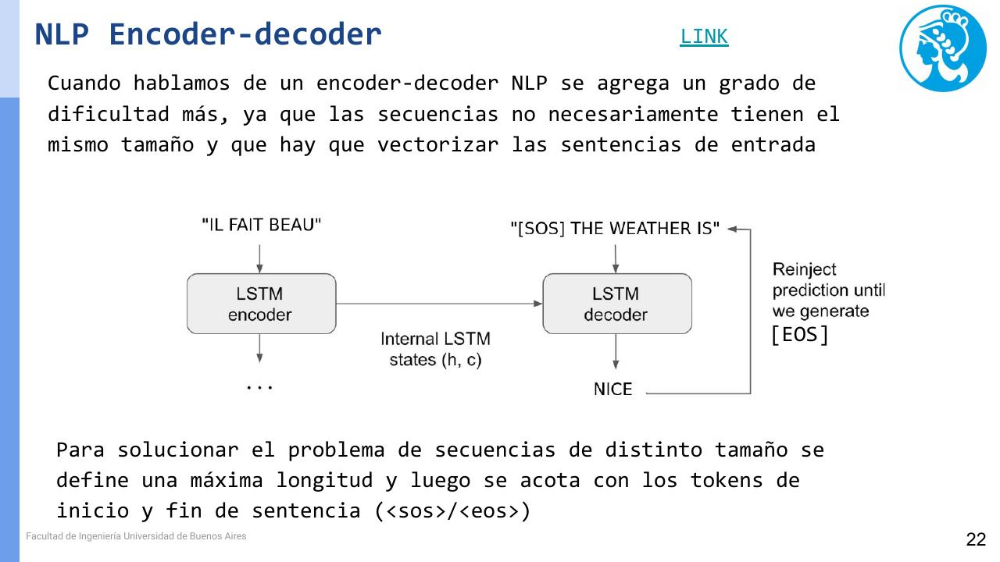

*Slide 22: en NLP se agrega una dificultad, porque las secuencias no necesariamente tienen el mismo tamaño y hay que vectorizar las oraciones. "IL FAIT BEAU" entra al LSTM encoder, cuyos estados internos (h, c) pasan al LSTM decoder. Este recibe "[SOS] THE WEATHER IS" y predice "NICE", y la predicción se reinyecta hasta generar [EOS]. Para secuencias de distinto tamaño se define una longitud máxima y se acota con los tokens de inicio y fin de oración (<sos>/<eos>).*

- Slide 23: un traductor de inglés a español, con las oraciones de entrada vectorizadas con embeddings (el mismo diagrama de la slide 9). Este Colab ya está resuelto.

## 17. Notebook del traductor: datos, tokenización y padding (02:13:28)

[Notebook](material/notebook-traductor.ipynb).

- **Imports:** `pad_sequences`, `Tokenizer`, los callbacks `ReduceLROnPlateau` y `EarlyStopping`, y `Input`, `LSTM`, `Dense`, `Embedding`, `Dropout` y `Model`, que dicen que otra vez se arma en pedazos. `pickle`, para cargar los embeddings ya entrenados (02:14:52).
  - **`EarlyStopping`** corta el entrenamiento según una paciencia, y **`ReduceLROnPlateau`** va bajando el learning rate, también según una paciencia, si el modelo no aprende.
- **Datos:** el dataset de traducción inglés-español de TensorFlow (`spa-eng.zip`), parecido al de Anki. `MAX_NUM_SENTENCES = 10000`, y semilla 40 en NumPy y en TensorFlow, para que los resultados se parezcan a los de la clase, porque hay muchos valores aleatorios, como los pesos iniciales. Con otra semilla da distinto. Las líneas se mezclan.
- **Otra vez tres secuencias** (02:15:53): la entrada del encoder, la salida del decoder y el teacher forcing.

```python
output_sentences.append(output + ' <eos>')          # target
output_sentences_inputs.append('<sos> ' + output)   # teacher forcing
input_sentences.append(input_sentence)              # entrada del encoder
```

```
Somebody stole my car.
Alguien robó mi auto. <eos>
<sos> Alguien robó mi auto.
```

- En el dibujo, "Somebody stole my car" entra al encoder, el decoder recibe "<sos> Alguien robó mi auto" y tiene que generar "Alguien robó mi auto <eos>". La diferencia con el ejercicio anterior es que ahora están el SOS y el EOS (02:18:31).

**Tokenización** (02:18:31). Antes no hacía falta, porque eran números.

```python
MAX_VOCAB_SIZE = 8000
input_tokenizer = Tokenizer(num_words=MAX_VOCAB_SIZE)
input_tokenizer.fit_on_texts(input_sentences)
input_integer_seq = input_tokenizer.texts_to_sequences(input_sentences)
word2idx_inputs = input_tokenizer.word_index

output_tokenizer = Tokenizer(num_words=MAX_VOCAB_SIZE,
                             filters='!"#$%&()*+,-./:;=¿¡?@[\\]^_`{|}~\t\n')
output_tokenizer.fit_on_texts(["<sos>", "<eos>"] + output_sentences)
```

- El tokenizador divide en palabras y le asigna a cada una un **índice**, no un embedding: "Fernando es el 95, Juan el 98, Pérez el 12" (02:19:53). `word2idx` es ese diccionario, para buscar el índice de una palabra.
- Solo se tienen en cuenta las **8.000 palabras más frecuentes**.
- El tokenizador de salida filtra los signos de puntuación y además tiene en cuenta `<sos>` y `<eos>`, que también son parte del vocabulario (02:21:05). ✎ El filtro es el de Keras por defecto sin `<` ni `>` (si no, `<sos>` quedaría como `sos`) y con `¿` y `¡`.
- `num_words_output = min(len(word2idx_outputs) + 1, MAX_VOCAB_SIZE)`: cuántas palabras hay en la salida.
- **Los largos máximos** se calculan de los datos, para el padding.

```
Vocabulario EN: 4977 | ES: 7757
max_input_len=26  max_out_len=32
```

**Padding** (02:22:09): las secuencias tienen que tener el mismo largo. Una oración puede tener 50 palabras y otra ("Hola, soy Juan Pérez"), 4. Se rellena hasta la más larga.

```python
encoder_input_sequences  = pad_sequences(input_integer_seq, maxlen=max_input_len)   # pre
decoder_input_sequences  = pad_sequences(output_input_integer_seq, maxlen=max_out_len,
                                         padding='post', truncating='post')
decoder_output_sequences = pad_sequences(output_integer_seq, maxlen=max_out_len,
                                         padding='post', truncating='post')
```

- **En el encoder, ceros al principio**, el `pre` por defecto (02:23:12). Una red recurrente lee de a uno, y en una secuencia larga se va olvidando de lo del principio (*vanishing gradient*). Si los ceros van al principio, no importa que se olviden: la información que interesa queda al final, para el resumen.
- **En el decoder, ceros al final** (`post`), tanto en el target como en el teacher forcing. El decoder tiene que generar palabras, y con ceros al principio aprendería a generar ceros. Al final, después del EOS, no molestan, porque el EOS detiene la secuencia (02:24:24).
- "Muy importante, porque si lo hacen al revés va a fallar."

```
[  0   0 ...   0 702 752  16 104]           # encoder: "somebody stole my car"
[3431  157  612   21  247   0 ...   0]      # entrada del decoder: <sos> alguien robó mi auto
[ 157  612   21  247    1   0 ...   0]      # salida del decoder: alguien robó mi auto <eos>
```

- ✎ `<eos>` tiene el índice 1 porque es la palabra más frecuente: está en las 10.000 oraciones del target. `<sos>` tiene el 3431 porque el tokenizador de salida se entrenó con `output_sentences`, que no lo tienen, así que lo cuenta una sola vez. Con más datos, eso puede romper el modelo: ver el [desafío 4](../../desafios/04-traductor-seq2seq/README.md).

**`tf.data.Dataset`** (02:24:24): es la forma de manejar los datos en TensorFlow, parecida al `DataLoader` de PyTorch. Se llama a una función y devuelve, por ejemplo, 16 oraciones.
- `make_dataset` arma batches de ((entrada del encoder, entrada del decoder), target, peso). Los targets son **índices enteros**, sin one-hot, y el peso vale 0 en el padding para que no cuente en la loss ni en el accuracy.
- Batch de 64, y el último 15 % de los datos es validación: 8.500 oraciones de train y 1.500 de validación.

## 18. Notebook del traductor: GloVe, modelo y entrenamiento (02:25:23)

**Embeddings de GloVe**
- Una celda descarga de Google Drive el pickle `gloveembedding.pkl` (02:25:23). `load_glove_embeddings` lo carga y devuelve los embeddings y un `word2idx` (02:26:26). `get_word_embedding` devuelve el vector de una palabra ("el embedding de Fernando es 7, 8, 9, 5, 7, 6"), o ceros si no está.
- **La matriz de embeddings** (02:27:27) se arma solo con las palabras del dataset. Por ejemplo, "Fernando" tiene embedding en GloVe, pero no aparece en el dataset, así que no hace falta.

```python
def build_embedding_matrix(word2idx_inputs, embeddings, word2idx_glove, nb_words, embed_dim=50):
    matrix = np.zeros((nb_words, embed_dim))
    for word, i in word2idx_inputs.items():
        if i < nb_words:
            vec = get_word_embedding(word, embeddings, word2idx_glove, embed_dim)
            if vec is not None and len(vec) > 0:
                matrix[i] = vec
    return matrix
```

  - Arranca como una matriz de ceros de vocabulario × dimensión del embedding (02:28:43), y se va llenando fila por fila: "hola" con su vector de GloVe, "chao" con el suyo.
  - Las palabras que GloVe no tiene **quedan en cero**. El ejemplo: "Cocoliso", que era el nombre del loro de Fernando (02:29:45).
  - Resultado: `Embeddings nulos: 211`, palabras muy puntuales que no tienen embedding en GloVe (02:30:48).
- ✎ Fernando dijo que GloVe es de 100 dimensiones; en el notebook es `EMBED_DIM = 50`. En la clase 5, las palabras sin GloVe quedaban con valores aleatorios; acá quedan en cero.

**El modelo** (02:30:48)
- `n_units = 256`, las unidades de las LSTM. Como se le dijo a Carlos, no tienen que ver con el tamaño del embedding.

```python
# Encoder
enc_inputs    = Input(shape=(max_input_len,))
enc_emb_layer = Embedding(input_dim=nb_words, output_dim=embed_dim,
                          weights=[embedding_matrix], trainable=False)
enc_emb = Dropout(0.3)(enc_emb_layer(enc_inputs))
enc_lstm_layer = LSTM(n_units, return_state=True)
_, state_h, state_c = enc_lstm_layer(enc_emb)

# Decoder
dec_inputs    = Input(shape=(max_out_len,))
dec_emb_layer = Embedding(input_dim=num_words_output, output_dim=n_units)  # sin GloVe
dec_emb = Dropout(0.3)(dec_emb_layer(dec_inputs))
dec_lstm_layer = LSTM(n_units, return_sequences=True, return_state=True)
dec_out, _, _  = dec_lstm_layer(dec_emb, initial_state=[state_h, state_c])
dec_dense_layer = Dense(num_words_output, activation='softmax')
dec_out = dec_dense_layer(dec_out)

model = Model([enc_inputs, dec_inputs], dec_out)
```

*Simplificado: en el notebook está en dos funciones, `build_encoder` y `build_decoder`, y cada capa tiene nombre.*

- **Encoder** (02:31:58): la capa `Embedding` usa los pesos de GloVe y **no se entrena**, porque ya fueron entrenados ("aunque en ciertas ocasiones sí tiene sentido, ahora no"). Siguen un dropout para evitar el sobreajuste y una LSTM de 256 que devuelve h y c, como antes (02:32:59).
- **Decoder:** su entrada usa `max_out_len`, y su embedding **no toma la matriz de GloVe**. La LSTM tiene `return_sequences=True` (las flechas hacia arriba), y su salida pasa por la `Dense` (02:34:02).
- Las funciones devuelven todo **en pedazos** (las capas de embedding y LSTM), para reusarlos en la inferencia. Antes estaba más ordenado; acá, "un poco desordenado, pero hace lo mismo".
- ✎ `n_units` también define la dimensión del embedding del decoder (`output_dim=n_units`). El modelo tiene ≈ 5,07 millones de parámetros (4,82 millones entrenables), y casi el 80 % está en el embedding y la `Dense` del decoder, las dos de 7.758 × 256.

**Entrenamiento** (02:34:02)

```python
lr_scheduler = ReduceLROnPlateau(monitor='val_loss', factor=0.5, patience=4, min_lr=1e-5)
early_stop = EarlyStopping(monitor='val_loss', patience=6, restore_best_weights=True)

model.compile(loss='sparse_categorical_crossentropy',
              optimizer=tf.keras.optimizers.Adam(learning_rate=5e-4),
              weighted_metrics=['accuracy'])
hist = model.fit(train_ds, validation_data=val_ds, epochs=100,
                 callbacks=[lr_scheduler, early_stop])
```

- El learning rate baja con paciencia 4, y el early stopping corta si la val_loss no mejora en 6 épocas (02:35:03).
- Entropía cruzada **porque es multiclase**, Adam y accuracy. ✎ Es la versión *sparse* porque los targets son índices, no one-hot, y `weighted_metrics` hace que el accuracy ignore el padding.
- **Resultado:** el accuracy empieza bajo y sube hasta **0,51**, y el de validación llega a **0,34**. "No es el mejor accuracy que hemos obtenido", pero ya se sabe por qué. Las curvas de accuracy y de loss empiezan a separarse; el callback cortó el entrenamiento y evitó el sobreajuste.

*Curvas del notebook: el accuracy de train sube de 0,15 a 0,51, y el de validación se aplana en ~0,34 desde la época 30. La loss de train baja de 1,46 a 0,50, y la de validación se queda en ~1,03.*

- ✎ Datos del log: corrió 38 épocas. En la 36 el learning rate bajó a 2,5 × 10⁻⁴, y en la 38 cortó el early stopping, que **restauró los pesos de la época 32** (la mejor val_loss, 1,025, con 0,44 de accuracy en train y 0,335 en validación). El 0,51 y el 0,34 son de la última época, no del modelo con el que se traduce.
- ✎ Ojo al leer la loss: el peso 0 saca el padding de la suma, pero Keras divide por todas las posiciones (32 por oración). Por eso arranca en 1,46 y no cerca de ln 7.758 ≈ 9: está "diluida" y no es la entropía cruzada por palabra. Para calcular la perplejidad hay que dividir por la cantidad de palabras reales.

## 19. Notebook del traductor: inferencia y traducciones (02:36:14)

- **Encoder de inferencia:** reutiliza el embedding y la LSTM entrenados y devuelve h y c.
- **Decoder de inferencia** (02:37:14): recibe tres entradas, como en el ejercicio anterior: un token (al principio, el `<sos>`), el estado h y el estado c. Devuelve la salida de la `Dense`, el h nuevo y el c nuevo.

```python
def build_decoder_inference(dec_emb_layer, dec_lstm_layer, dec_dense_layer, n_units):
    dec_input_single = Input(shape=(1,))
    dec_state_h_in   = Input(shape=(n_units,))
    dec_state_c_in   = Input(shape=(n_units,))
    dec_emb_single = dec_emb_layer(dec_input_single)       # pesos entrenados
    dec_out, h_out, c_out = dec_lstm_layer(dec_emb_single,
                                           initial_state=[dec_state_h_in, dec_state_c_in])
    dec_out = dec_dense_layer(dec_out)
    return Model([dec_input_single, dec_state_h_in, dec_state_c_in], [dec_out, h_out, c_out])
```

- **Diccionarios inversos** (`idx2word`): el modelo trabaja con índices ("Hola, me llamo Fernando" es 57 8 9 15, y la respuesta, 279 11 18), y hay que volver a palabras: el 95 es "Fernando" (02:38:18). La celda tiene arriba el comentario "Aplicamos inferencia greedy", que según Fernando no tiene mucha relación con ella y lo va a cambiar; se refiere a la función siguiente.
- **Traducción greedy** (02:38:18):

```python
def translate_sentence(input_seq):
    h, c = encoder_model(input_seq, training=False)
    target_seq = np.zeros((1, 1))
    target_seq[0, 0] = word2idx_outputs['<sos>']
    eos = word2idx_outputs['<eos>']
    output_sentence = []
    for _ in range(max_out_len):
        output_tokens, h, c = decoder_model([tf.constant(target_seq), h, c], training=False)
        idx = int(np.argmax(output_tokens[0, 0, :]))   # la palabra más probable: greedy
        if idx == eos:
            break
        if idx > 0:
            output_sentence.append(idx2word_target[idx])
        target_seq[0, 0] = idx                          # la predicción es la nueva entrada
    return ' '.join(output_sentence)
```

  - El encoder recibe la oración y da h y c. El primer token del decoder es el `<sos>`, y el índice del `<eos>` se busca en `word2idx`.
  - En cada paso, el decoder recibe el token, h y c, y devuelve la distribución, h y c. Se elige la palabra de **mayor probabilidad (por eso es greedy)**: "hi". ¿Es el EOS? No, así que se guarda y pasa a ser la entrada siguiente. Después vienen "my", "name", "is", "Fernando" y el EOS, y ahí se corta (02:39:20).
  - Ya no hay `n_steps = 3`: la secuencia puede variar y la detiene el EOS. ✎ El `for` hasta `max_out_len` es un tope por si el EOS no aparece.
- `translate(text)` tokeniza un texto nuevo, lo rellena y llama a `translate_sentence` (02:40:18).

**Pruebas:** primero, frases de validación; después, frases nuevas.

| Inglés | Esperado | Predicción | Comentario en clase |
|---|---|---|---|
| People make mistakes in a situation like this. | En una situación así se cometen errores. | cuántos personas no hay nada de la vida | No tiene mucho sentido |
| Do whatever he tells you. | Haz lo que te diga. | lo que me dijo | Hay error, pero no tanto: "lo que" está bien, y "diga" y "dijo" se parecen (02:41:24) |
| Don't you have anything better to do? | ¿No tiene nada mejor que hacer? | tienes que hacer eso | No le atina del todo, pero hay cosas interesantes |
| My brother became a cook. | Mi hermano se ha vuelto un gallito. | mi hermano me dio un poco | La primera parte está bien |
| Tom doesn't do drugs. | Tom no consume drogas. | tom no tiene nada | No lo hizo bien |
| My mother says hi. (nueva) | — | mi padre me dijo | Confundió padre y madre, pero dijo algo interesante (02:42:21) |
| Where is the train station? (nueva) | ¿Dónde está la estación de tren? | dónde está en la habitación | Estaba cerca |
| Can you help me? (nueva) | — | puedes hablar conmigo | Le atinó a "puedes" |
| I love learning languages. (nueva) | Me gusta aprender lenguajes. | me gusta el café | — |

- **Conclusión** (02:42:21): el traductor funciona y tiene sentido, aunque no es lo mejor: el accuracy es bajo, pero genera salidas. **¿Cómo se sabe que aplica el EOS?** Porque las secuencias que da no son muy largas; si nunca lo diera, serían larguísimas. Le atina a algunas cosas y a otras no: es cuestión de agrandar el dataset y hacer pequeñas configuraciones.
- Alguien comentó por chat que es reconfortante que no ande tan bien, como su TP, y Fernando dijo que lo iba a tener en cuenta (02:43:16).
- ✎ En "My brother became a cook" el error es de la referencia: *cook* es cocinero, no gallito. Las traducciones del dataset también tienen ruido.
- ✎ Los cinco ejemplos de validación salen de `np.random.randint`, así que cambian en cada corrida.

## 20. Desafío 4 (02:43:16)

- Es el último TP: usar el código del traductor que se acaba de mostrar, **extenderlo y analizarlo**. Por ejemplo, más entrenamiento o cambiar el número de neuronas. "Es eso, solo es un análisis."
- La slide es un breve resumen: lo que hay que hacer va a estar **formalmente en el GitHub** de la materia (02:44:31).

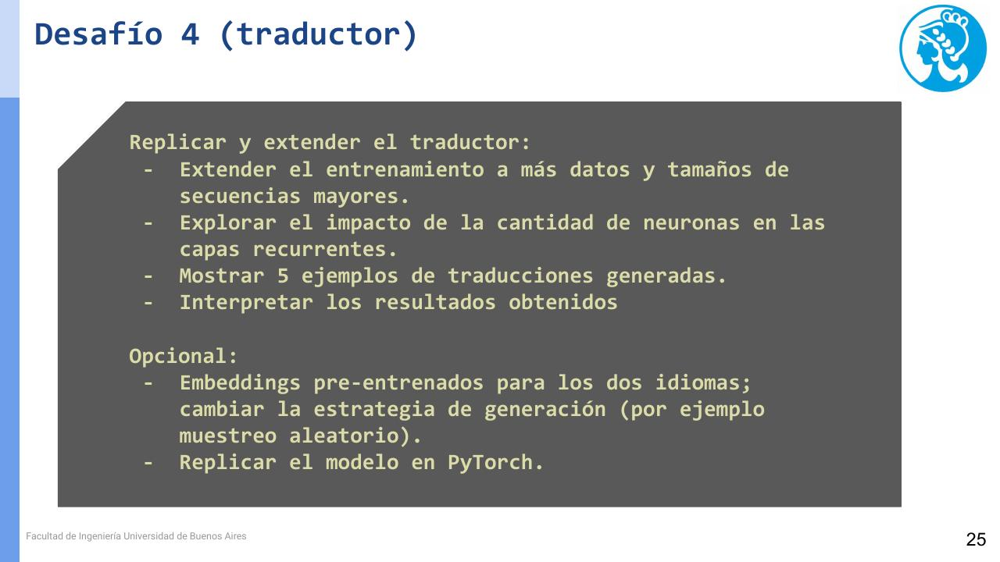

*Slide 25: desafío 4 (traductor). Replicar y extender el traductor: extender el entrenamiento a más datos y a secuencias más largas, explorar el impacto de la cantidad de neuronas en las capas recurrentes, mostrar 5 ejemplos de traducciones generadas e interpretar los resultados. Opcional: embeddings preentrenados para los dos idiomas, cambiar la estrategia de generación (por ejemplo, muestreo aleatorio) y replicar el modelo en PyTorch.*

- **Lo opcional** (replicar el modelo en PyTorch, usar otro embedding, etc.) da **puntos extra** si se hace bien. Lo ideal es completar primero los puntos que van a estar en el GitHub.
- **Los desafíos 3 y 4 los corrige Fernando.** Las dudas, mejor por correo (el de la slide 1), para tener más tiempo de responder, o al final de la clase que viene.
- Consigna, aclaraciones e ideas: [desafíos/04-traductor-seq2seq](../../desafios/04-traductor-seq2seq/README.md).

## 21. Cierre: el cuello de botella y el Transformer (02:44:31)

- Lo visto es un encoder-decoder, pero tiene un **cuello de botella: el vector de representación**. Hay que evitarlo, porque va a dar problemas.

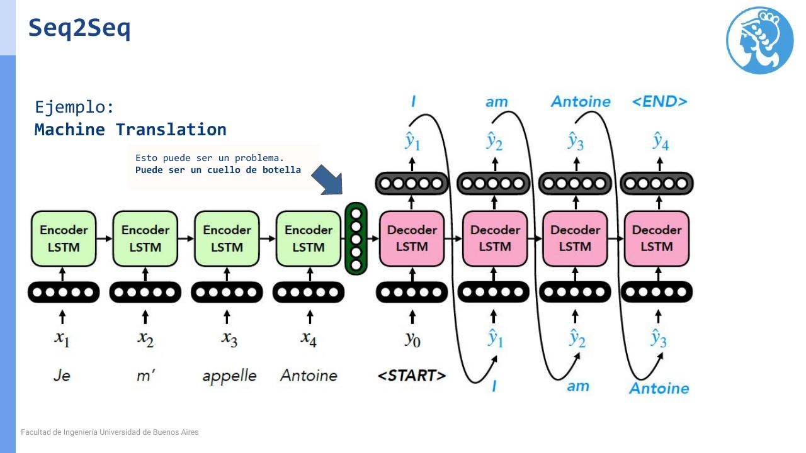

*Slides 26 y 27: traducción automática. "Je m' appelle Antoine" (x₁ a x₄) entra a cuatro pasos de Encoder LSTM. El vector final (en verde) pasa al decoder, que arranca con <START> (y₀) y genera ŷ₁ a ŷ₄ = "I am Antoine <END>", reinyectando cada salida como entrada. La slide 27 señala ese vector: "Esto puede ser un problema. Puede ser un cuello de botella".*

- **La solución es un mecanismo de atención:** con él se evita el cuello de botella y se mejora el modelo.
- **Si la atención es tan buena, ¿por qué no usar solo atención?** Si el encoder, el puente y el decoder son atención, lo que se construye es un **Transformer**.

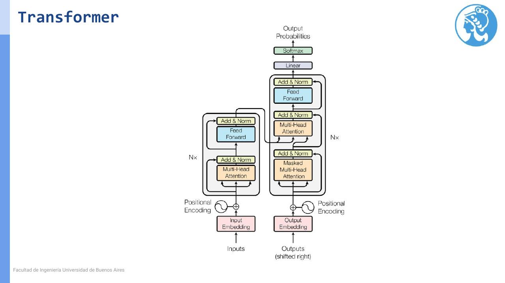

*Slide 28: la arquitectura Transformer. A la izquierda, el encoder: N× bloques de Multi-Head Attention y Feed Forward, cada uno con Add & Norm, sobre Input Embedding + Positional Encoding. A la derecha, el decoder: N× bloques de Masked Multi-Head Attention, Multi-Head Attention sobre la salida del encoder y Feed Forward, sobre Output Embedding + Positional Encoding de las salidas "shifted right". Arriba, Linear y Softmax dan las Output Probabilities.*

- La clase que viene: cómo se pasa del seq2seq clásico al Transformer, y cómo funciona un Transformer en detalle. Las dudas, por correo.
- ✎ El cuello de botella: toda la oración de entrada, sea larga o corta, tiene que entrar en un vector de tamaño fijo (h y c, de 256 en el traductor), y el decoder solo ve ese vector. Con atención, el decoder mira en cada paso todos los estados del encoder y les da pesos distintos (Bahdanau et al., 2014; ver la figura de la [clase 5](../05-redes-convolucionales/resumen.md), §18).
- ✎ Las "Outputs (shifted right)" de la slide 28 son el teacher forcing de hoy: la entrada del decoder es la secuencia objetivo corrida un lugar, que empieza con el token de inicio, como X2 en el ejercicio de la suma.

---

## Correcciones de la transcripción automática

| Dice la transcripción | Es |
|---|---|
| lse posgrados (hablante) | el docente, Fernando Silva (cuenta del posgrado) |
| convolutional newal networks, NN | convolutional neural networks, CNN |
| tallas de NLP | tareas de NLP |
| Me encanta la guía | "Me encanta la IA" |
| RNS, RN, LNs, LNS, lns, LN | RNN, RNNs |
| LCTM, STM, LTM | LSTM |
| grú, group | GRU |
| Josely, Joselyine | Josselyn (Ordóñez) |
| redes no recurrentes | redes neuronales recurrentes |
| mini to one | many to one |
| posttaging, postagging, taging | POS tagging |
| sos o boss, sos o voz | SOS o BOS |
| La salida es B, Genera Fel | "feel" |
| Scalidra, Scalid Draw, vamos a draw | Excalidraw |
| sequest to sequence, Sequ sequence, sequen sequence, sequence su sequence, se con su sequence, modelos to sequence | sequence to sequence (seq2seq) |
| Dali | DALL·E |
| Chargpt | ChatGPT |
| R max | argmax |
| teta | θ (theta) |
| piedra de Droseta, Roseta | piedra de Rosetta |
| picaña la piedra, picaña stone cookets | picanha a la piedra, picanha stone cooked |
| tibone, stick stone cook | T-bone steak stone cook |
| manifings.org ankey, Anky, ani | manythings.org/anki (Anki) |
| TXD | TXT |
| inglés a sudafricano, inglés a albano | inglés-afrikáans, inglés-albanés |
| elimara | el aimara |
| embing, embings, emberi, inverings, enviarient, embarings, berings, enverins, eling, edings, losings | embedding, embeddings |
| Flicker | Flickr (Flickr30k) |
| Hanging Face | Hugging Face |
| convolution al nivel network | convolutional neural network |
| Globe, Glow, Glob, Glockf, elo | GloVe |
| Word toback | Word2Vec |
| hay like CATS | "I like cats" |
| Tom likes Bear | "tom likes beer" |
| Teacher Forcy, teer forcing, teacher for | teacher forcing |
| beards, birs | birds |
| true, tu ("yo esperaba que digas true") | "two" |
| grand truth | ground truth |
| bleu | BLEU |
| perpigidad | perplejidad |
| colap | Colab |
| queras | Keras |
| Nampi de ese canal | NumPy; de scikit-learn (`sklearn`) |
| MAT Plus, PLT, deborn el SNS | Matplotlib (`plt`) y Seaborn (`sns`) |
| resape | `reshape` |
| Gshape | `y.shape` |
| S learn | scikit-learn |
| level encoder | `LabelEncoder` |
| oneeh encoding, one hor encoding, one h encoding, one horing, one hor encore | one-hot encoding |
| bocup size, bo size | `VOCAB_SIZE` |
| tu categorical | `to_categorical` |
| state true | `return_state=True` |
| ret sequences, de turn sequen | `return_sequences=True` |
| dence | `Dense` |
| Sofmax | softmax |
| inicial state | `initial_state` |
| N units, Nun 128 | `n_units`, `n_units=128` |
| verbost, verpost | `verbose` |
| overfeiting, overfeitting, Esofeiting | overfitting |
| Acuracir, acudací, acurí, curac, kirura | accuracy |
| reduce lon plateo, reduce lr plateo | `ReduceLROnPlateau` |
| stoping | early stopping |
| dening dropout | `Embedding`, `Dropout` |
| outputes, outputences inputs | `output_sentences`, `output_sentences_inputs` |
| outputizer | output tokenizer |
| maxup size, max workup size | `MAX_VOCAB_SIZE` |
| word to index | `word2idx` |
| tenso flow data dataset | `tf.data.Dataset` |
| dataer, dataloader de P torch, M dataset, madeet | `DataLoader` de PyTorch, `make_dataset` |
| tensor blog | TensorFlow |
| globbering.pll pico | `gloveembedding.pkl` (un pickle) |
| matrix FN | `matrix_fn` (lo dice el docstring; la función devuelve `embeddings, word2idx`) |
| getwarings | `get_word_embedding` |
| NP.0, pceros | `np.zeros` |
| NB Words por dim | `nb_words` × `embed_dim` |
| cocoliso, Cocol Cocolizo | Cocoliso, el loro de Fernando |
| edad edading matrix | `embedding_matrix` |
| encodereding layer, encodingm layer | `enc_emb_layer`, `enc_lstm_layer` |
| lning rate | learning rate |
| inferencia grid, Grid | inferencia greedy |
| Vamos a ponerle el dos | "vamos a ponerle el SOS" (`word2idx_outputs['<sos>']`) |
| index to word | `idx2word` |
| opu tokens | `output_tokens` |
| N step TR | `n_steps = 3` |
| a coc | a cook |
| latinó, la tiné, latina | le atinó, la atiné, le atina |
| diferencia, transferencia, paraferencia ("modelo de diferencia", "decoder transferencia") | inferencia |
| 1028 | 1024 |
| Py Torch | PyTorch |
| desafío 3 y cu | desafíos 3 y 4 |
| redonal | red neuronal |

---

## ✎ Para los desafíos

**Desafío 3** (nota 10 hasta el jueves 26/11). Fernando, que lo corrige, dijo que con una arquitectura clásica, datos limitados y Colab, una perplejidad de 4 o 5 está bien, y que lo tiene en cuenta al corregir. Gonzalo agregó que con un corpus chico no mejora por más neuronas que se agreguen (§10).

**Desafío 4** (nota 10 hasta el jueves 10/12). La consigna formal todavía no está en GitHub, pero la slide 25 alcanza para empezar. Detalles, trampas del notebook e ideas en [desafíos/04-traductor-seq2seq](../../desafios/04-traductor-seq2seq/README.md). De esta clase sirve:

| Lo visto | Para qué sirve en el desafío |
|---|---|
| Teacher forcing e inferencia (§10) | El accuracy del entrenamiento se mide con teacher forcing: cada paso recibe la palabra correcta anterior. Al traducir los errores se arrastran, así que la calidad real es menor |
| BLEU (§10) | Para comparar configuraciones con traducciones completas, no solo con el accuracy por palabra |
| `n_units`, el ancho del estado (§8 y §15) | Es lo que pide variar el punto de las neuronas. En el notebook también fija la dimensión del embedding del decoder |
| Capacidad y sobreajuste (§14 y §15) | Más unidades no siempre es mejor: con pocos datos, el modelo memoriza y la val_loss sube |
| Padding `pre` y `post` (§17) | Al extender a secuencias más largas hay más padding: mantener `pre` en el encoder y `post` en el decoder |
| `<sos>` y `<eos>` en el tokenizador (§17) | Al usar más datos, revisar que los dos queden dentro de las `num_words` palabras |
| Matriz de GloVe con ceros (§18) | Para el opcional de embeddings en los dos idiomas: hoy solo el encoder (inglés) usa GloVe |
| La loss diluida por el padding (§18) | No sirve para calcular la perplejidad tal cual; el accuracy sí ignora el padding |
| Greedy hasta el `<eos>` (§19) | Para el opcional de cambiar la estrategia de generación: muestreo con temperatura o beam search ([clase 4](../04-modelo-lenguaje/resumen.md), §15 a §18) |

---

## ✎ Glosario

- **Sequence to sequence (seq2seq):** paradigma para tareas con una secuencia de entrada y otra de salida, cuyos largos pueden ser distintos.
- **Encoder-decoder:** la arquitectura del paradigma seq2seq. Un encoder resume la entrada en una representación y un decoder genera la salida a partir de ella.
- **Encoder:** red (RNN, CNN…) que lee la secuencia de entrada y la resume en un vector, por ejemplo los estados h y c de una LSTM.
- **Decoder:** red que genera la secuencia de salida de a un token, a partir del resumen del encoder y de los tokens anteriores.
- **Context vector (vector de contexto o de representación):** el resumen que el encoder le pasa al decoder. Es el cuello de botella del seq2seq clásico.
- **Many to one / many to many:** arquitecturas recurrentes con muchas entradas y una salida (clasificación) / con muchas salidas: una por entrada (POS tagging) o recién después de leer toda la entrada (seq2seq).
- **POS tagging:** etiquetar cada palabra con su categoría gramatical (sustantivo, verbo…).
- **Generación autorregresiva:** cada token generado se usa como entrada para generar el siguiente.
- **SOS o BOS (*start* o *begin of sequence*):** token especial que le indica al decoder que empiece a generar. En los notebooks es el 0 (suma) y `<sos>` (traductor).
- **EOS (*end of sequence*):** token especial que marca el fin de la secuencia. Al generarlo, el decoder se detiene. Hace falta cuando el largo de la salida varía.
- **Modelo de lenguaje condicional:** asigna probabilidades a secuencias dado un contexto x: p(w | x).
- **Argmax y decodificación greedy:** quedarse con la opción de mayor probabilidad. Greedy lo hace en cada paso.
- **Teacher forcing:** al entrenar, la entrada del decoder en cada paso es el token correcto anterior (el ground truth), no el que predijo.
- **Ground truth:** la respuesta correcta del dataset.
- **Exposure bias:** la diferencia entre entrenar con teacher forcing y generar con las propias predicciones. En la inferencia, un error se arrastra.
- **BLEU:** métrica de traducción que compara los n-gramas de la traducción generada con los de las referencias.
- **Perplejidad:** la exponencial de la entropía cruzada por token. Mide qué tan sorprendido está un modelo de lenguaje.
- **Corpus paralelo (datos emparejados):** pares (oración, traducción) o (imagen, descripción) para entrenar un seq2seq supervisado.
- **Anki y Tatoeba:** Tatoeba es una base de oraciones traducidas por voluntarios; manythings.org/anki la distribuye en archivos por par de idiomas.
- **Image captioning:** generar una descripción de una imagen. Flickr30k es un dataset de imágenes con sus descripciones.
- **Lenguas de pocos recursos (*low-resource*):** idiomas con pocos datos digitalizados, como el aimara, el quechua o el guaraní.
- **`LabelEncoder` (scikit-learn):** le asigna un índice entero a cada clase; `inverse_transform` vuelve del índice al valor.
- **`to_categorical` (Keras):** convierte índices en vectores one-hot.
- **Estado oculto (h) y estado de celda (c):** los dos vectores que una LSTM pasa de un paso al siguiente. Su tamaño es `units`.
- **`return_state=True`:** la capa recurrente devuelve también sus estados finales, h y c.
- **`return_sequences=True`:** la capa recurrente devuelve la salida de cada paso, no solo la última.
- **`initial_state`:** los estados con los que arranca una capa recurrente. En el seq2seq, los del encoder.
- **Modelos de inferencia:** modelos armados con las capas ya entrenadas para generar paso a paso (`encoder_model` y `decoder_model`).
- **`categorical_crossentropy` / `sparse_categorical_crossentropy`:** entropía cruzada con los targets en one-hot / como índices enteros.
- **`sample_weight` y `weighted_metrics`:** pesos por posición (0 en el padding) para que no cuente en la pérdida y en las métricas.
- **`Tokenizer` (Keras):** arma el vocabulario por frecuencia y convierte textos en secuencias de índices. `num_words` deja solo las palabras más frecuentes.
- **Padding `pre` / `post`:** rellenar con ceros al principio / al final.
- **`tf.data.Dataset`:** API de TensorFlow para armar el flujo de datos en batches, como el `DataLoader` de PyTorch.
- **`ReduceLROnPlateau`:** callback que multiplica el learning rate por un factor si la métrica no mejora en `patience` épocas.
- **`EarlyStopping`:** callback que corta el entrenamiento si la métrica no mejora en `patience` épocas. Con `restore_best_weights=True` vuelve a los pesos de la mejor época.
- **Cuello de botella:** toda la información de la entrada tiene que pasar por un vector de tamaño fijo.
- **Mecanismo de atención:** en cada paso, el decoder combina todos los estados del encoder con pesos que calcula el modelo.
- **Transformer:** arquitectura encoder-decoder hecha de atención y capas feed forward, sin recurrencia.

---

## ✎ Preguntas de práctica

1. ¿Por qué una CNN como la de la clase 5 no alcanza para traducir?
2. ¿Qué diferencia hay entre una arquitectura many to one y una many to many? Dar una tarea de ejemplo para cada una.
3. ¿Qué diferencia hay entre seq2seq y encoder-decoder, según la clase?
4. ¿En qué se parece el encoder a un clasificador many to one y en qué se diferencia?
5. ¿Qué son el SOS y el EOS? ¿Hay que agregarlos al vocabulario?
6. ¿Por qué hace falta el EOS en la traducción y no en el ejercicio de la suma?
7. ¿Qué significa y′ = argmax p(y | x, θ)? ¿Qué son θ y p?
8. ¿Qué diferencia hay entre un modelo de lenguaje y uno condicional? Escribir las dos factorizaciones.
9. ¿Por qué entrenar un seq2seq es un problema supervisado? ¿Qué tienen que ver *La terminal* y el menú del restaurante?
10. ¿Por qué es difícil hacer un traductor de español a aimara? ¿Qué le pasó al equipo de Fernando?
11. ¿Cómo sería un encoder-decoder para image captioning? ¿Qué red haría de encoder?
12. En una capa `LSTM(32)`, ¿qué es el 32? ¿Qué no es?
13. ¿Por qué el decoder termina en una softmax? ¿Sobre cuántas clases?
14. ¿Qué es teacher forcing? ¿Por qué se usa al entrenar y no en la inferencia?
15. ¿Qué pasa en la inferencia si el decoder se equivoca en una palabra?
16. Sin teacher forcing, ¿cómo se evalúa una traducción? ¿Para qué se usa la perplejidad?
17. En el ejercicio de la suma, ¿por qué el vocabulario tiene 64 elementos? ¿Qué representa el 0?
18. ¿Por qué los números se codifican con one-hot y no con embeddings?
19. ¿Qué son X1, X2 y target? Escribirlos como números para la primera secuencia.
20. ¿Qué devuelve una LSTM con `return_state=True`? ¿Qué se usa como resumen del encoder?
21. ¿Qué hacen `return_sequences=True` e `initial_state=encoder_states` en el decoder?
22. ¿Por qué el decoder de entrenamiento y el de inferencia comparten la misma capa LSTM?
23. ¿Qué entradas y salidas tiene el `decoder_model` de inferencia, y por qué?
24. Describir el bucle de `predecir`. ¿Qué hace que genere tres números?
25. ¿Por qué la val_loss del ejercicio sube desde la época 2? ¿La prueba con [20, 25, 30] demuestra que el modelo aprendió a sumar?
26. ¿Por qué la loss del ejercicio arranca en ≈ 4,16?
27. En el traductor, ¿qué tres secuencias se arman con cada par? Dar el ejemplo de "Somebody stole my car".
28. ¿Por qué el padding va al principio en el encoder y al final en el decoder?
29. ¿Por qué el filtro del tokenizador de salida no incluye `<` ni `>`?
30. ¿Qué pasa con las palabras que no están en GloVe? ¿Qué capa usa GloVe y cuál no?
31. ¿Qué hacen `ReduceLROnPlateau(patience=4)` y `EarlyStopping(patience=6, restore_best_weights=True)` en el traductor?
32. ¿Por qué la traducción del notebook es greedy? ¿Cuándo se detiene?
33. ¿Cómo se sabe que el traductor aprendió a generar el EOS?
34. ¿Qué pide el desafío 4 y qué es opcional?
35. ¿Cuál es el cuello de botella del encoder-decoder clásico y cómo se resuelve?
36. ¿Qué tienen que ver las "Outputs (shifted right)" del Transformer con el teacher forcing?

<details>
<summary>Respuestas</summary>

1. Porque una CNN que clasifica produce una salida fija (una clase), y traducir es generar una secuencia de largo variable. Además, su ventana solo captura relaciones locales.
2. Many to one: muchas entradas y una salida al final, como clasificar el sentimiento de una oración. Many to many: una salida por paso, como el POS tagging, o una secuencia de salida después de leer toda la entrada, como traducir.
3. Seq2seq es el paradigma (de una secuencia a otra) y encoder-decoder es una arquitectura de ese paradigma.
4. Como un clasificador many to one, lee toda la secuencia y da una salida al final. Pero no tiene la capa de clasificación (la sigmoide): devuelve el vector previo, que resume la entrada.
5. Son tokens especiales: el SOS (o BOS) le dice al decoder que empiece a generar, y el EOS marca el final. Sí: son parte del vocabulario, y el decoder tiene que poder recibir el primero y generar el segundo.
6. Porque en la traducción el largo de la salida varía, y sin EOS el decoder no sabría cuándo parar. En la suma la salida siempre tiene tres números, así que el bucle de inferencia da tres pasos y se corta.
7. Que la traducción es la secuencia y que maximiza la probabilidad dada la entrada x. θ son los parámetros (los pesos) y p es la red neuronal que estima esa probabilidad.
8. Un modelo de lenguaje estima p(w) = ∏ p(w_t | w_1, …, w_t−1); uno condicional estima p(w | x) = ∏ p(w_t | x, w_1, …, w_t−1). La diferencia es la x, el contexto (la oración de entrada), en cada factor.
9. Porque para aprender p(y | x) hacen falta ejemplos de la entrada y de la salida correspondiente. *La terminal* (revistas bilingües), la piedra de Rosetta y el menú bilingüe son corpus paralelos: comparando los pares se deducen las equivalencias, como "piedra" y "stone".
10. Porque casi no hay datos: las lenguas originarias están poco digitalizadas. Con 20.000 pares, un Transformer entrenado desde cero dio malos resultados, y con 150.000 mejoró un poco.
11. La imagen entra a un encoder (una CNN) que la resume en un vector, y un decoder recurrente genera la descripción palabra por palabra. Hace falta un dataset de imágenes con sus descripciones, como Flickr30k.
12. Es la cantidad de unidades: el tamaño del estado oculto, "el ancho de la flecha horizontal" que pasa de un paso al siguiente. No es el largo de la secuencia, ni la cantidad de secuencias, ni el tamaño del embedding.
13. Porque elegir la palabra siguiente es un problema multiclase: cada palabra del vocabulario es una clase, y la softmax da una distribución de probabilidades sobre todas. En el traductor son 7.758 clases.
14. Es darle al decoder, en cada paso, la palabra correcta anterior (el ground truth) en vez de la que predijo. Se usa al entrenar porque se conoce la respuesta y el modelo se alinea con el dataset, y además todos los pasos se calculan a la vez. En la inferencia la respuesta no se conoce.
15. Esa palabra equivocada entra como entrada del paso siguiente, el error se arrastra y la oración se empieza a distorsionar.
16. Con métricas que comparan la secuencia generada con la referencia, como BLEU o las basadas en n-gramas. La perplejidad mide un modelo de lenguaje: qué tan probable le resulta un texto.
17. Porque hay 63 valores posibles (de 5 a 315 de a 5) y se agrega el 0, que no aparece en los datos y se usa como `<sos>`.
18. Porque los números no tienen embeddings preentrenados como las palabras. Con `LabelEncoder` y `to_categorical`, cada número es una clase en one-hot.
19. X1 es la entrada del encoder: [5, 10, 15]. X2 es la entrada del decoder con teacher forcing, el `<sos>` y el target corrido: [0, 20, 25]. El target es lo que tiene que generar: [20, 25, 30]. Los tres van en one-hot de 64.
20. Devuelve la salida y los estados finales h y c. El resumen del encoder son h y c juntos (`encoder_states`); la salida se descarta.
21. `return_sequences=True` hace que la LSTM dé una salida en cada paso, para predecir una palabra por posición. `initial_state=encoder_states` hace que el decoder arranque con los estados del encoder: es el puente entre los dos.
22. Porque lo que se aprende al entrenar tiene que ser lo que se usa para generar. Si fueran capas distintas, el decoder de inferencia no estaría entrenado.
23. Recibe el token actual y los estados h y c del paso anterior, y devuelve la distribución de la palabra siguiente y los estados nuevos. Así se genera de a un paso, pasando los estados de un paso al otro a mano.
24. El encoder da h y c; el primer token es `to_categorical(0)` (el `<sos>`); en cada vuelta, el decoder recibe el token y los estados, se guarda la predicción y la predicción y los estados nuevos pasan a ser la entrada siguiente. Genera tres números porque el bucle da `n_steps = 3` vueltas.
25. Fernando lo atribuyó al sobreajuste por un dataset chico. ✎ Además, la validación es el último 20 % (targets de 260 a 315) y esos números nunca aparecen como target en train; con one-hot no hay relación entre números, así que no puede predecirlos. La prueba no demuestra que sume: [20, 25, 30] es una secuencia de train.
26. Porque al principio la red predice casi uniforme entre las 64 clases, y la entropía cruzada de una distribución uniforme es −ln(1/64) = ln 64 ≈ 4,16.
27. La entrada del encoder ("Somebody stole my car."), el target con `<eos>` al final ("Alguien robó mi auto. <eos>") y el teacher forcing con `<sos>` al principio ("<sos> Alguien robó mi auto.").
28. En el encoder no molestan al principio: la RNN se olvida de lo que vio primero, y la información útil queda al final, para el resumen. En el decoder van al final, después del EOS: si estuvieran al principio, aprendería a generar ceros.
29. Porque el filtro por defecto los saca, y entonces `<sos>` y `<eos>` quedarían como "sos" y "eos", que se pueden confundir con palabras.
30. Quedan con su fila en cero en la matriz de embeddings (en el notebook, 211 palabras). La usa el `Embedding` del encoder, congelado (`trainable=False`); el del decoder se entrena desde cero.
31. `ReduceLROnPlateau` divide el learning rate por 2 si la val_loss no mejora en 4 épocas, con un mínimo de 10⁻⁵. `EarlyStopping` corta si no mejora en 6 y vuelve a los pesos de la mejor época: cortó en la 38 y restauró la 32.
32. Porque en cada paso elige la palabra de mayor probabilidad (`argmax`) sin considerar alternativas. Se detiene cuando genera el `<eos>` o cuando llega a `max_out_len` palabras.
33. Porque las traducciones son cortas y terminan: si nunca generara el EOS, seguirían hasta el tope de `max_out_len`.
34. Extender el traductor a más datos y a secuencias más largas, explorar la cantidad de neuronas de las capas recurrentes, mostrar 5 traducciones e interpretar los resultados. Es opcional usar embeddings preentrenados para los dos idiomas, cambiar la estrategia de generación (por ejemplo, muestreo aleatorio) y replicarlo en PyTorch, que da puntos extra.
35. El vector de representación: toda la entrada tiene que entrar en un vector de tamaño fijo, y el decoder solo ve eso. Se resuelve con un mecanismo de atención, que deja al decoder mirar todos los estados del encoder en cada paso. Si todo es atención, es un Transformer.
36. Son lo mismo: la entrada del decoder es la secuencia objetivo corrida un lugar, que empieza con el token de inicio, como X2 en el ejercicio de la suma o `output_sentences_inputs` en el traductor.

</details>
