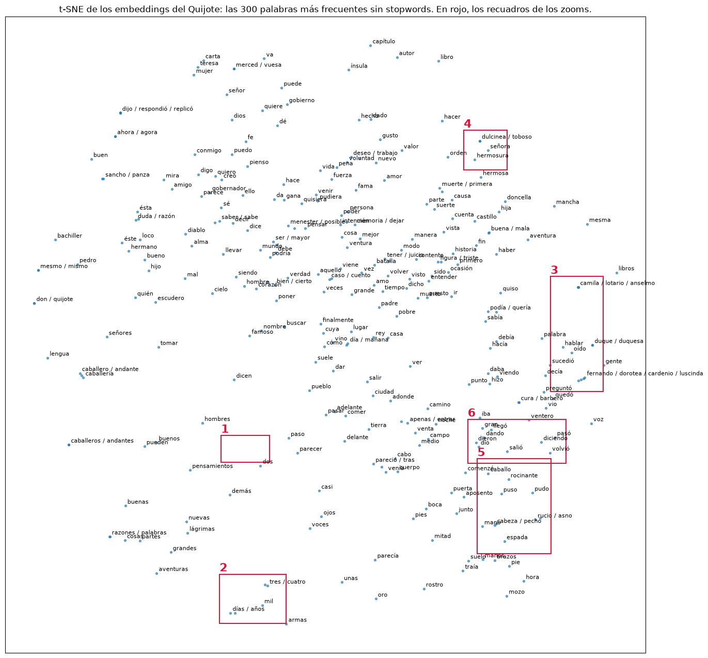

# Desafío 2 — Word embeddings con Gensim

- **Se presentó:** clase 2 (jueves 29/10/2026).
- **Nota 10 hasta:** jueves 12/11 (clase 4), a última hora de Argentina. Después vale 9 hasta el 26/11, 8 hasta el 03/12 y 7 hasta el 10/12; ver la [tabla de notas máximas](../README.md#nota-máxima-según-la-fecha-de-entrega).
- **Entrega:** por el [formulario](https://forms.gle/wsWkQJWAFeh6g6qv5), con el link a este repo o a un Colab. Individual o en pareja.
- **Resolución:** [`desafio-2.ipynb`](desafio-2.ipynb). Es la plantilla de la materia (`Desafíos/Desafio_2.ipynb`: el ejemplo de la clase y la consigna) con la resolución al final, cada experimento con su análisis. De la plantilla se cambiaron dos celdas para que el notebook corra de punta a punta: la descarga del *songs dataset* usa `urllib` y `zipfile` en vez de `!wget` y `!unzip` (macOS no trae `wget`), y la consulta de `diedaa` atrapa el `KeyError` y lo muestra.
- **Teoría:** [resumen de la clase 2](../../clases/02-word-embeddings/resumen.md): CBOW y skip-gram (§16 a §18), negative sampling (§19), t-SNE (§20), Gensim y el ejemplo de la plantilla (§21 a §24) y la consigna (§25).
- **Estado:** resuelto, falta entregar.

## Lo que ya hace la plantilla

- Instala Gensim si falta (la salida guardada muestra la 4.4.0) y baja el *songs dataset* del repo de la materia: letras de 49 artistas, un `.txt` por artista.
- Lee `beatles.txt` con un documento por línea: **1846 documentos**.
- Tokeniza cada línea con `text_to_word_sequence` de Keras, que pasa a minúsculas, saca la puntuación y separa por espacios.
- `Word2Vec(min_count=5, window=2, vector_size=300, negative=20, workers=1, sg=1)` es un **skip-gram**. El vocabulario queda en **445 palabras**.
- Entrena 20 épocas con un callback que imprime la loss de cada una, que baja de 113.045 a 48.960.
- Prueba `most_similar` con `positive` y con `negative` (*darling*, *love*, *four*, *money*), una palabra fuera del vocabulario (da `KeyError`) y `get_vector`.
- Reduce los vectores con `TSNE(random_state=0)` y grafica con Plotly, en 2D y en 3D, las primeras `MAX_WORDS = 200` palabras. Exporta `vectors.tsv` y `labels.tsv` para el proyector de TensorFlow.

## Consigna

**Cada experimento realizado debe estar acompañado de una explicación o interpretación de lo observado, incluido el sustento de las decisiones que tomaron (como modificación de hiperparámetros).**

El notebook de entrega tiene que correr de inicio a fin sin errores.

1. **Crear vectores propios con Gensim**, como en clase, con un corpus propio. Las opciones de dataset están en los enlaces sugeridos en la clase 2.
2. **Elegir términos de interés** y buscar sus términos más similares y menos similares.
3. **Reducir la dimensionalidad** de los embeddings a 2 dimensiones y graficar los embeddings proyectados. Elegir una cantidad de términos (variable `MAX_WORDS`) que deje una visualización adecuada.
4. **Inspeccionar el gráfico** y buscar pequeños grupos de palabras. Interpretarlos e intentar sacar conclusiones. En lo posible, acompañar cada grupo con capturas pegadas en celdas de texto.

La slide 36 de la clase agrega un punto: "Intentar plantear y probar tests de analogías".

## Aclaraciones de la clase (01:58:56 a 02:08:42 y 02:34:41 a 02:40:15)

- **Corpus:** tiene que ser propio y distinto del songs dataset; es lo que da el puntaje completo. Sugerencias:
  - libros de [Project Gutenberg](https://www.gutenberg.org/), de dominio público y sobre todo en inglés;
  - libros de [textos.info](https://www.textos.info/), en español;
  - un dataset propio, como papers de un tema o textos del trabajo.
- **Limpieza:** sacar los caracteres raros y los encabezados y pies de página que se repiten.
- **Segmentación:** cada documento tiene que ser una oración completa. La plantilla separa por línea porque en las canciones cada línea es una oración; en un libro, eso corta las oraciones por la mitad.
- **Hiperparámetros:** para cada uno, elegir un valor, comparar y explicar por qué se eligió y qué se observó. La docente dijo que los considera bastante.
  - `min_count`: con un corpus chico, un valor alto puede volar la mitad de las palabras.
  - `window`: con oraciones largas, probar ventanas mayores que 2.
  - `vector_size`: subirlo solo tiene sentido con un corpus grande.
  - `negative`: más negativos con un corpus chico; si hay overfitting, bajarlo puede ayudar.
  - `sg`: comparar CBOW y skip-gram es opcional.
- **Términos de interés:** idealmente al menos cinco. Buscar los más similares de cada uno y analizar cuáles tienen sentido, cuáles no y cuáles son overfitting del texto.
- **Gráfico:** con la función `reduce_dimensions` de la plantilla, en 2D o 3D, ajustando `MAX_WORDS`.
- **Clusters:** encontrar al menos tres y explicar por qué se agruparon: si tiene sentido o si es una limitación del modelo.
- **Capturas:** t-SNE no da siempre lo mismo, así que la docente no va a ver los mismos grupos. Sacar una captura de cada grupo y pegarla en una celda de texto con el comentario.
- **Conclusiones:** comentar y explicar cada punto de la consigna.

## ✎ Ideas para resolverlo

- **Corpus:** varios libros de un mismo autor, para tener volumen y que los clusters digan algo de ese autor (personajes, lugares, temas). En español sirven los de textos.info; en inglés, por ejemplo, las novelas de Jane Austen o de Dickens en Gutenberg.
- **Pipeline:** limpiar (cortar el encabezado y el pie de Gutenberg) → unir las líneas → `nltk.sent_tokenize` → tokenizar cada oración en minúsculas → `Word2Vec`.
- **Experimentos:** entrenar un modelo base y después cambiar un hiperparámetro por vez (`sg`, `window`, `vector_size`, `min_count`, `negative`, `epochs`). Comparar los vecinos de las mismas palabras y mostrarlo en una tabla.
- **Términos:** elegir palabras de frecuencia media y de temas distintos: un personaje, un lugar, un sentimiento, un objeto, un verbo. Sumar alguna palabra polisémica para mostrar la limitación de tener un solo vector por palabra.
- **Analogías:** probar algunas con `most_similar(positive=[...], negative=[...])`, por ejemplo con pares de personajes (hombre y mujer) o con países y capitales si el corpus los tiene. Si fallan, explicar por qué.
- **Gráfico:** en vez de las primeras `MAX_WORDS` palabras, que son las más frecuentes y en su mayoría stopwords, graficar las palabras sin stopwords o las de interés con sus vecinos.
- Más detalles prácticos en el [resumen de la clase 2](../../clases/02-word-embeddings/resumen.md#-para-los-desafíos).

## Resultados

**Corpus:** *Don Quijote de la Mancha* ([Project Gutenberg #2000](https://www.gutenberg.org/ebooks/2000)), en español y con las dos partes. Después de cortar el encabezado y el pie de Gutenberg, segmentar en oraciones y tokenizar quedan **10.986 oraciones, 383.640 tokens y 22.950 palabras distintas** (5.321 con `min_count=5`): 27 veces más tokens que el corpus de los Beatles.

**Modelo elegido:** skip-gram (`sg=1`), `window=5`, `vector_size=100`, `min_count=5`, `negative=10`, `epochs=20`, con `seed=42` y `workers=1` para que sea reproducible. Cada experimento cambia un solo hiperparámetro. Además de los vecinos de siete palabras, se miden dos cosas: cuántos de 26 pares que deberían quedar cerca (*mesmo*–*mismo*, *miedo*–*temor*, *lanza*–*adarga*…) quedan en el top 10, con su puesto mediano, y cuántas de 13 analogías acierta.

| Configuración | Vocabulario | Pares en el top 10 (de 26) | Puesto mediano | Analogías top 1 / top 5 (de 13) | Segundos |
|---|---|---|---|---|---|
| **Base** | 5.321 | 16 | 4.5 | 7 / 9 | 22 |
| Base con las 5 semillas: 42, 1, 2, 3 y 4 (el ruido) | 5.321 | 15 a 18 | 3.5 a 6.5 | 5 a 7 / 8 a 9 | 22 |
| `sg=0` (CBOW) | 5.321 | 13 | 9.5 | 5 / 8 | 6 |
| `window=2` | 5.321 | 11 | 12.5 | 4 / 6 | 12 |
| `window=10` | 5.321 | 18 | 4.0 | 7 / 9 | 37 |
| `vector_size=50` | 5.321 | 17 | 3.0 | 8 / 10 | 19 |
| `vector_size=300` | 5.321 | 14 | 7.5 | 3 / 7 | 41 |
| `min_count=2` | 11.792 | 12 | 14.0 | 5 / 10 | 27 |
| `min_count=10` | 3.020 | 18 | 3.5 | 6 / 9 | 19 |
| `negative=5` | 5.321 | 17 | 3.5 | 7 / 9 | 12 |
| `negative=20` | 5.321 | 17 | 3.0 | 4 / 9 | 42 |
| `epochs=5` | 5.321 | 12 | 15.0 | 4 / 9 | 6 |
| `epochs=50` | 5.321 | 17 | 4.0 | 6 / 10 | 56 |

- **Preprocesamiento:** el texto se corta entre las marcas `*** START/END OF THE PROJECT GUTENBERG EBOOK ***`, se separa en párrafos (línea en blanco), cada párrafo se une en una línea y se segmenta con `nltk.sent_tokenize(..., language='spanish')`. Un documento es una oración, de 28 tokens de mediana (las líneas de los Beatles tienen 7). `text_to_word_sequence` necesita `¿¡«»—…'` en los filtros; si no, deja palabras como "¿de" o "—dijo". Casi la mitad del vocabulario aparece una sola vez (ley de Zipf).
- **Hiperparámetros:** fue clave medir el ruido de la semilla, porque con otra semilla las medidas se mueven tanto como con varios cambios de configuración. Quedan claramente peores CBOW, `window=2`, `vector_size=300` (tres analogías) y `epochs=5`, el valor por defecto de Gensim, que deja el modelo subentrenado: algo aprende (*mesmo* → *mismo* sigue primero), pero deja 12 pares en el top 10, contra 16 con 20 épocas. `min_count=2` llena los vecinos de palabras raras. `negative` 5 o 20 y `epochs=50` dan lo mismo que la base. `vector_size=50` queda apenas por encima del ruido en tres medidas, por poco y con una sola semilla: me quedo con 100, pero 50 sería igual de válido. `window=10` cambia el tipo de similitud: acerca palabras de la misma escena (*sol*–*luna* pasa del puesto 104 al 9) y aleja las intercambiables (*miedo*–*temor*, del 2 al 22).
- **Loss:** la que imprime el callback de la plantilla no sirve para decidir las épocas. Gensim acumula la loss de toda la corrida en un `float32`, y después de unas pocas épocas los términos chicos se redondean a cero: la loss de cada época queda subestimada y con saltos.
- **Términos de interés:** tienen sentido los vecinos de las palabras con contextos estables: *miedo* → *espanto*, *temor*, *recelo*; *dulcinea* → *toboso*, *aldonza*, *desencantada*; *mesmo* → *mismo* (el modelo descubre solo que la forma antigua y la moderna son la misma palabra). Hay overfitting en *yelmo* → *mambrino* (0.86), *bacía*, *albarda*, que describen un episodio y no un objeto, y en vecinos raros como *jerónimo* (6 apariciones) para *sancho*. *amor* no tiene vecinos con sentido: aparece en contextos demasiado variados.
- **Menos similares:** `most_similar(negative=[w])` devuelve la similitud con −w. Las menos similares son palabras sin relación, con similitud real cercana a 0, porque en este espacio casi no hay similitudes negativas (0.2 % de los pares). Los antónimos quedan cerca: *blanco*–*negro* 0.72, *loco*–*cuerdo* 0.71.
- **Polisemia:** *real* (verdadero, moneda, camino real, Ciudad Real, campamento) y *lugar* (aldea, sitio, ocasión) tienen un solo vector y vecinos mezclados. *escudo* (el arma) y *escudos* (la moneda) se separan solo por casualidad.
- **Analogías:** 7 de 13 en el primer puesto, pero al menos 4 se explican porque *d* ya es el vecino más cercano de *c* (*duque* → *duquesa*, *dulcinea* → *toboso*, *agora* → *ahora*): no prueban una relación. La que sí depende de la resta es *dos : tres :: cuatro : cinco*: sin la resta daría *seis*. Los fallos *cabestro* y *toboso* son el caso simétrico: la respuesta es el vecino de *b*. Fallan las generales: *hombre : mujer :: rey : ?* da nombres de mujer, *señor : señora :: hombre : ?* da palabras femeninas (la resta captura el género gramatical) y *españa : españoles :: francia : ?* da *doce* y *pares* («los doce pares de Francia»). Las 13 sirvieron para elegir el modelo y la semilla 42 es la que mejor sale en analogías, así que 7 de 13 es optimista: las 4 nuevas aciertan 0 en el primer puesto.
- **t-SNE:** con la función de la plantilla sobre las 5.321 palabras, graficando las 300 más frecuentes sin stopwords (con 1.000 no se lee). t-SNE pone casi en el mismo punto colocaciones (*don / quijote*, *dulcinea / toboso*) y palabras intercambiables (*dijo / respondió / replicó*, *mesmo / mismo*, *buena / mala*). Los seis grupos, con su zoom:
  1. [Las aventuras](img/tsne-cluster-1-aventuras.png): *molinos*, *viento*, *batanes*, *yangüeses*, *gigantes*. No se parecen entre sí: aparecen juntas cuando los personajes recuerdan las aventuras de la primera parte (overfitting a pocas frases).
  2. [Cantidades](img/tsne-cluster-2-cantidades.png): los números con *días*, *años*, *azotes*, *escudos*, *reales*. El grupo con más sentido.
  3. [Personajes por historia](img/tsne-cluster-3-personajes.png): los personajes del *Curioso impertinente*, los de Sierra Morena y los duques, cada historia por separado. Es co-ocurrencia, no significado.
  4. [Dulcinea](img/tsne-cluster-4-dulcinea.png): *señora*, *hermosura*, *belleza*, *princesa*, *infanta* y *par* («la sin par Dulcinea»): el amor cortés.
  5. [Monturas](img/tsne-cluster-5-monturas.png): *rocinante*, *rucio*, *asno* y sus aparejos, mezclados con el cuerpo, las armas y los verbos de movimiento: la zona de las escenas de acción.
  6. [Verbos de la narración](img/tsne-cluster-6-verbos.png): *dio*, *llegó*, *salió*, *volvió*: un grupo gramatical.

*Las 300 palabras más frecuentes sin stopwords. Los recuadros rojos son los seis grupos de los zooms. El 1 aparece casi vacío porque sus palabras son menos frecuentes que las 300 graficadas; se ven en su zoom.*

- **Capturas:** en el notebook, cada comentario de §6 lleva pegada su captura: son las imágenes de `img/`, con URL absoluta para que se vean en GitHub y en Colab.
- **Conclusiones:** con un solo libro, Word2Vec aprende sinónimos, variantes antiguas y categorías, pero mucho de lo que aprende son frases que se repiten (*yelmo de Mambrino*, *molinos de viento*), y la mayoría de los aciertos de analogías solo muestran que dos palabras van juntas. Sus límites son el tamaño del corpus, las palabras raras o de contextos variados, la polisemia y la ortografía antigua. Para mejorarlo: más texto de la época, `Phrases` para las colocaciones, normalizar la ortografía o usar fastText.

**Para entregar:** el link a este notebook en GitHub o una copia en Colab compartida con los dos docentes. El notebook corre de punta a punta en unos 8 minutos con CPU; la descarga del corpus puede tardar uno o dos minutos si responde un espejo de Gutenberg.
