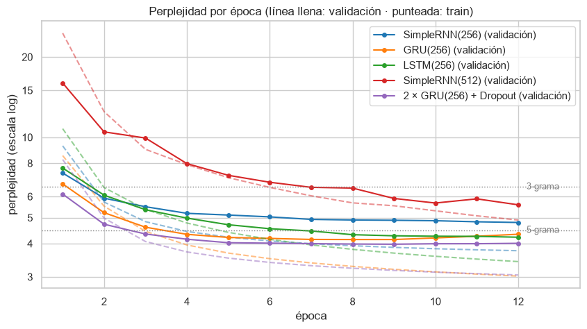
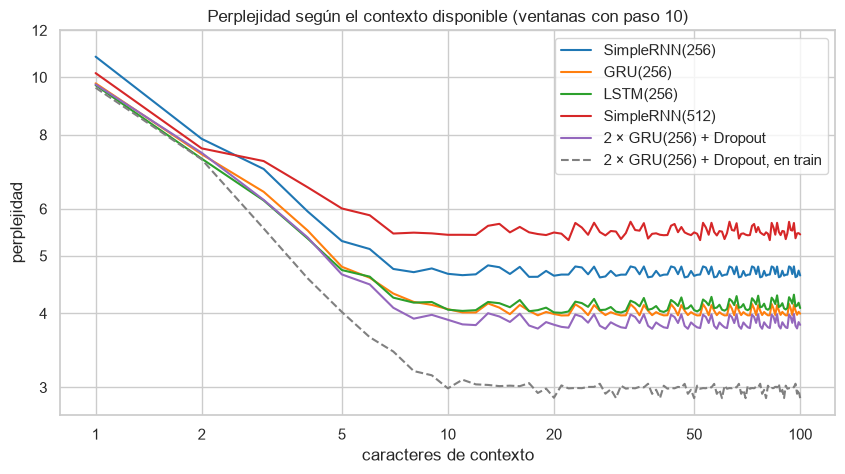

# Desafío 3 — Modelo de lenguaje con tokenización por caracteres

- **Se presentó:** clase 4 (jueves 12/11/2026). Lo presentó Josselyn Ordóñez, pero lo corrige Fernando Silva.
- **Nota 10 hasta:** jueves 26/11 (clase 6), a última hora de Argentina. Después vale 9 hasta el 03/12 y 8 hasta el 10/12; ver la [tabla de notas máximas](../README.md#nota-máxima-según-la-fecha-de-entrega).
- **Entrega:** por el [formulario](https://forms.gle/wsWkQJWAFeh6g6qv5), con el link a este repo o a un Colab. Individual o en pareja.
- **Resolución:** [`desafio-3.ipynb`](desafio-3.ipynb). Es la plantilla de la materia (`Desafíos/Desafio_3.ipynb`, la de tokenización por caracteres, subida el 12/11) adaptada a la primera parte del Quijote: la misma estructura, con los cuatro puntos de la consigna resueltos y analizados y los errores de la plantilla corregidos. Corre de punta a punta en unos 70 minutos en una CPU de 11 núcleos, sin GPU.
- **Teoría:** [resumen de la clase 4](../../clases/04-modelo-lenguaje/resumen.md): preprocesamiento (§3 a §7), perplejidad (§9 y §13), el modelo de Borges (§10 y §11), estrategias de decodificación (§15 a §18) y la presentación del desafío (§19). También el [resumen de la clase 3](../../clases/03-redes-recurrentes/resumen.md), para SimpleRNN, LSTM y GRU.
- **Estado:** resuelto, falta entregar.

## Lo que ya hace la plantilla

- Baja "La vuelta al mundo en 80 días" (Julio Verne) de textos.info con `urllib` y BeautifulSoup, junta los párrafos `
` y pasa todo a minúsculas.
- `max_context_size = 100`. En un modelo por caracteres todo el corpus puede ser un único documento, así que el contexto se elige con más libertad que con palabras.
- El vocabulario es el conjunto de caracteres del texto (`set(article_text)`), con los diccionarios `char2idx` e `idx2char`.
- Tokeniza el texto completo y reserva el 10 % final para validación, en secuencias de 100 caracteres. El train se arma con una ventana de 100 que se desliza de a un carácter.
- Plantea el problema como **many-to-many**: la entrada es [x₀, …, x_N] y el target, la misma secuencia corrida un lugar, [x₁, …, x_{N+1}]. Así cada posición aporta una señal de gradiente, y no solo la última.
- El modelo de ejemplo pasa los índices a one-hot (`TimeDistributed(CategoryEncoding(output_mode="one_hot"))`), sin capa de embedding, porque un carácter no tiene significado semántico. Sigue una `SimpleRNN(200, return_sequences=True, dropout=0.1, recurrent_dropout=0.1)` y una `Dense(vocab_size, softmax)`. Compila con `sparse_categorical_crossentropy` y `rmsprop`.
- `PplCallback` calcula la perplejidad sobre validación al final de cada época, guarda el mejor modelo en `my_model.keras` y corta el entrenamiento si no mejora en 5 épocas (*early stopping*).
- Entrena 20 épocas con `batch_size=256`.
- Para generar, trae Gradio para probar el próximo carácter, `generate_seq` (greedy search) y `beam_search` con `select_candidates`, en modo `det` (determinista) o `sto` (estocástico, con temperatura).

## Consigna

1. **Seleccionar un corpus** de texto sobre el cual entrenar el modelo de lenguaje.
2. **Preprocesar** el corpus para tokenizarlo, estructurar el dataset y separar los datos de entrenamiento y de validación.
3. **Proponer arquitecturas** de redes neuronales basadas en unidades recurrentes para implementar un modelo de lenguaje.
4. Con el o los modelos que se consideren adecuados, **generar nuevas secuencias** a partir de secuencias de contexto con **greedy search** y **beam search determinístico y estocástico**. En este último, observar el efecto de la **temperatura** en la generación.

Sugerencias de la plantilla:
- Guiarse por el descenso de la perplejidad en validación para decidir cuándo terminar el entrenamiento; para eso está el callback.
- Explorar `SimpleRNN` (celda de Elman), `LSTM` y `GRU`.
- `rmsprop` es el optimizador recomendado para una buena convergencia, aunque se pueden probar otros.

## Aclaraciones de la clase (02:53:39 a 03:02:53)

- **La diferencia fundamental con el ejemplo de la clase es la tokenización por caracteres:** el modelo genera carácter por carácter. Hay que usar esta plantilla, no el notebook de Borges.
- **Corpus:** propio. Puede ser el del desafío 2 u otro distinto, pero no el de la plantilla. Limpiarlo si hace falta, tokenizarlo y dividirlo en entrenamiento y validación.
- **Arquitectura:** basada en unidades recurrentes (SimpleRNN, LSTM o GRU). Probar combinaciones de capas y de dropout hasta llegar a un modelo decente; "no esperen un ChatGPT".
- **Generación:** con el mejor modelo, probar greedy search, beam search determinístico (sin muestreo) y estocástico (con muestreo), y en el estocástico, varias temperaturas.
- **Conclusiones en cada punto.** No dejar solo la arquitectura final: contar qué otras se probaron, cómo les fue y qué se cree que pasó. Eso suma puntos.
- **Pregunta de Gonzalo:** ¿hay que dejar el código de todas las pruebas? No hace falta duplicarlo. Alcanza con una captura y un comentario del tipo "probé tal combinación y no anduvo". Las variaciones de modo y temperatura sí conviene dejarlas en código, porque son una línea cada una.
- **Perplejidad:** guiarse por ella para saber si el modelo aprende. El callback de la plantilla la calcula desde cero; si tarda mucho, se puede copiar el simplificado del notebook de la clase (la exponencial de la entropía cruzada), que corre más rápido.
- **Contexto y vocabulario:** el contexto tiene que ser más largo que con palabras, porque se genera de a un carácter. El vocabulario es mucho más chico: unos 65 caracteres en el ejemplo.
- **Sin embedding:** los caracteres no tienen significado semántico, así que entran como one-hot.
- **Pregunta de Carlos:** ¿qué hacer con números, signos de puntuación y espacios? Dejarlos: entran al vocabulario como cualquier carácter. Si se limpian, el modelo genera texto plano, sin puntuación.
- **Hacerlo con tiempo:** a veces la T4 de Colab no está disponible o se corta la conexión. Con créditos se puede usar otra GPU.

## ✎ Ojo con la plantilla

- **El set de validación está mal armado.** `val_text[init*max_context_size:init*(max_context_size+1)]` arma secuencias de largo 0, 1, 2, … en vez de bloques de 100. Debería ser `val_text[init*max_context_size:(init+1)*max_context_size]`.
- **El vocabulario no tiene un orden fijo.** `set(article_text)` puede ordenar los caracteres distinto en cada sesión, y entonces `char2idx` cambia y un modelo guardado deja de servir. Con `sorted(set(article_text))` el mapeo queda fijo.
- **El train es muy redundante.** Con la ventana deslizada de a un carácter hay casi una secuencia por carácter del corpus, todas solapadas: con un libro largo es mucho cómputo. Un paso (*stride*) mayor que 1 reduce el costo, y hay que justificarlo.
- **`encode` no pasa a minúsculas** y falla con un carácter fuera del vocabulario. `generate_seq` sí pasa a minúsculas.
- **`recurrent_dropout` en LSTM o GRU** impide usar la implementación de cuDNN en la GPU de Colab, y el entrenamiento se vuelve mucho más lento.
- **La celda de Gradio** instala la librería con `!pip` y `iface.launch(debug=True)` bloquea la ejecución: para que el notebook corra de punta a punta, dejarla detrás de una bandera.
- **La perplejidad por caracteres no se compara con la de palabras.** Con un vocabulario de unos 60 caracteres, un modelo al azar tiene perplejidad ≈ 60, no ≈ 15.000 como en el ejemplo de Borges.

Encontrados al resolverlo:
- **`X` e `y` solo sirven con paso 1.** `y = ventanas[1:]` usa como target la ventana siguiente, que con paso 1 es la misma secuencia corrida un carácter; con paso 10 queda corrida 10. Hay que armar ventanas de 101 caracteres y separar `X = w[:-1]` e `y = w[1:]`.
- **`TimeDistributed` falla en silencio en `predict` si cambia el largo de la secuencia** (Keras 3.15): después de una llamada con 100 caracteres, una de 13 devuelve una salida de forma `(2, 2, 53)`. La plantilla no lo nota porque rellena todo hasta 100. Un `Embedding` congelado con la matriz identidad da el mismo one-hot y anda con cualquier largo.
- **`pad_sequences` rellena con 0, que acá es un carácter real** (el `\n` con el vocabulario ordenado): una semilla corta queda precedida por decenas de saltos de línea. La red recurrente acepta cualquier largo, así que no hace falta rellenar. Con relleno, la perplejidad del mejor modelo empeora de 4,14 a 4,41.
- **El modo `sto` de `beam_search` sortea con reposición** (`np.random.choice` sin `replace=False`), así que los beams se pueden duplicar, y el primer beam que devuelve no es el más probable.
- **La temperatura del beam search estocástico divide la log-probabilidad acumulada de cada secuencia**, no la de cada carácter. Con 10 beams el texto sigue siendo muy probable aun con temperatura 1,5; el efecto clásico de la temperatura aparece con `num_beams=1`.

## Resultados

Corpus: la primera parte del Quijote (Project Gutenberg #2000, capítulos I a LII), 990.347 caracteres en minúsculas y 53 caracteres distintos. Contexto de 100 caracteres, ventanas de train con paso 10 (89.115) y validación con el 10 % final del texto (990 bloques de 100). Todos los modelos con `rmsprop` (*learning rate* 0,003), batch de 256 y hasta 12 épocas con early stopping por la perplejidad de validación.

| Modelo | Parámetros | Perplejidad de validación | Mejor época | Tiempo (CPU) |
|---|---|---|---|---|
| Azar / 5-grama de caracteres (referencias) | — | 53 / 4,48 | — | — |
| `SimpleRNN(256)` | 92.981 | 4,80 | 12 | 4,7 min |
| `SimpleRNN(512)` | 316.981 | 5,58 | 12 | 8,3 min |
| `LSTM(256)` | 331.061 | 4,22 | 12 | 10,7 min |
| `GRU(256)` | 252.469 | 4,14 | 9 | 12,3 min |
| 2 × `GRU(256)` + `Dropout(0.2)` | 647.221 | **3,97** | 9 | 26,8 min |

*Perplejidad por época (línea llena: validación; punteada: train). La GRU de una capa empieza a sobreajustar en la época 9; la de dos capas con dropout se aplana en ≈ 4,0.*

*Perplejidad de validación según cuántos caracteres de contexto hay (punto 3.6 del notebook). Todos los modelos dejan de mejorar hacia los 20 caracteres; la línea punteada es el mejor modelo sobre texto de train.*

- **Punto 1 (corpus):** el Quijote del desafío 2, solo la primera parte (≈ 1 millón de caracteres) para que entrenar varias arquitecturas en CPU entre en ~1 hora. Corté el encabezado y el pie de Gutenberg y los preliminares, uní las líneas partidas de cada párrafo (dejando un `\n` entre párrafos), pasé a minúsculas y dejé la puntuación y los espacios, como recomendó la docente. La descarga prueba el sitio de Gutenberg y dos espejos, porque el sitio principal devuelve 503 a veces.
- **Punto 2 (preprocesamiento):** vocabulario ordenado con `sorted(set(...))`, validación contigua al final (sin filtrar texto de train) con el armado de la plantilla corregido, y ventanas de train con paso 10, que bajan el cómputo 10 veces sin perder texto (con paso 1, una época de LSTM tardaba ~8,5 min). Con paso mayor que 1 hay que armar `X` e `y` desde ventanas de 101 caracteres. Me quedé con el contexto de 100 de la plantilla; midiendo la perplejidad según la posición, los modelos usan unos 20 caracteres y no mejoran con más.
- **Punto 3 (arquitecturas):** con el mismo estado y las mismas épocas, la GRU y la LSTM le ganan a la SimpleRNN por un 12–14 % y son las únicas de una capa que superan al 5-grama. La `SimpleRNN(512)`, con casi tantos parámetros como la LSTM, terminó peor que la de 256 porque es más inestable de entrenar: el problema de la celda de Elman es el gradiente (clase 3), no la cantidad de parámetros. La GRU aprende más rápido que la LSTM pero sobreajusta desde la época 9. El mejor modelo es el de dos capas GRU con dropout entre ellas (3,97), a costa del doble de tiempo por época. Las pruebas previas (*learning rate*, batch, XLA, `recurrent_dropout`) están resumidas en el punto 3.7 del notebook. Además, el callback de la plantilla tarda 49 s por evaluación y da 4,41 contra 3,98 de la simplificada: el relleno con ceros la sube de 4,14 a 4,41, y promediar la perplejidad de cada bloque, de 3,98 a 4,14 (punto 3.8). Usé la versión simplificada de la clase.
- **Punto 4 (generación):** con el mejor modelo, tres semillas y 300 caracteres. Greedy y beam search determinista caen en loops: con greedy, las tres semillas terminan en el mismo ciclo ("…en el corral de los caballeros andantes que en el cuerpo me ha de ser por allí a su amo…"), y con beam search, en "que todos los caballeros andantes de los caballeros andantes…". El beam search estocástico rompe los loops al subir la temperatura, pero con 10 beams sigue recombinando frases frecuentes, porque la temperatura divide la probabilidad acumulada de la secuencia. Con un solo beam (muestreo puro) se ve el efecto clásico: a 0,5 sale el texto más legible, con diálogos y personajes del libro; a 1 aparecen palabras inventadas (*siguielman*, *cuantonado*); a 1,5 se desarma.

| Estrategia (300 caracteres, promedio de 3 semillas) | Perplejidad del texto según el modelo | % de palabras reales | % de trigramas repetidos |
|---|---|---|---|
| Greedy | 1,85 | 100 | 56 |
| Beam search determinista (10 beams) | 1,46 | 100 | 68 |
| Beam search estocástico, T = 0,5 / 1 / 1,5 | 1,50 / 1,64 / 1,73 | 100 / 100 / 99 | 25 / 11 / 3 |
| Muestreo con un beam, T = 0,5 / 1 / 1,5 | 2,00 / 3,12 / 6,51 | 98 / 87 / 63 | 0,6 / 0 / 0 |

**Para entregar:** el link a este notebook en GitHub (el repo es público) o una copia en Colab compartida con los dos docentes.
