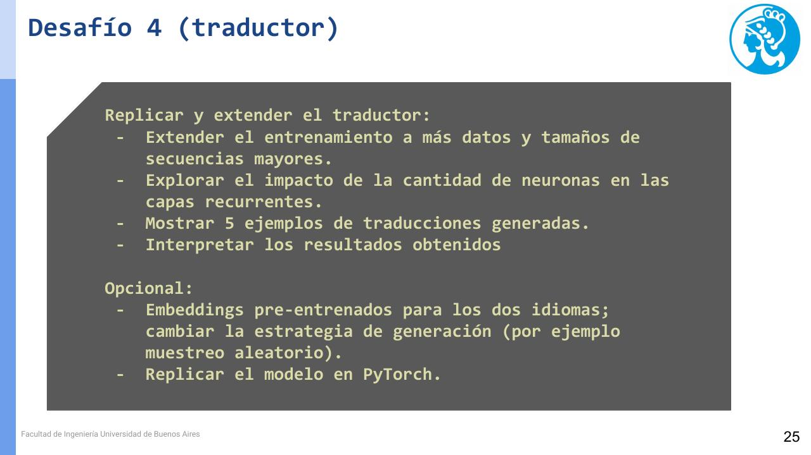

# Desafío 4 — Traductor seq2seq (encoder-decoder)

- **Se presentó:** clase 6 (jueves 26/11/2026). Lo presentó y lo corrige Fernando Silva.
- **Nota 10 hasta:** jueves 10/12 (clase 8), a última hora de Argentina, que es también la última fecha para entregar todo. Ver la [tabla de notas máximas](../README.md#nota-máxima-según-la-fecha-de-entrega).
- **Entrega:** por el [formulario](https://forms.gle/wsWkQJWAFeh6g6qv5), con el link a este repo o a un Colab. Individual o en pareja.
- **Base:** el [notebook del traductor](../../clases/06-seq2seq/material/notebook-traductor.ipynb) de la clase 6 (en el repo de la materia, `Clase 6/Código/Ejercicio,_Traductor.ipynb`).
- **Teoría:** [resumen de la clase 6](../../clases/06-seq2seq/resumen.md): el encoder-decoder (§2 y §9), teacher forcing y BLEU (§10), el traductor (§16 a §19) y la presentación del desafío (§20). Para el opcional de la generación, las estrategias de decodificación de la [clase 4](../../clases/04-modelo-lenguaje/resumen.md) (§15 a §18); para la matriz de embeddings, la [clase 5](../../clases/05-redes-convolucionales/resumen.md) (§16).
- **Estado:** sin empezar. La consigna formal todavía no está: al 27/11, la carpeta `Desafíos/` del repo de la materia solo tiene los desafíos 1 a 3. Lo de abajo sale de la slide 25 y de lo que se dijo en clase.

## Consigna (slide 25)

Replicar y extender el traductor:
1. **Extender el entrenamiento** a más datos y a secuencias más largas.
2. **Explorar el impacto de la cantidad de neuronas** en las capas recurrentes.
3. **Mostrar 5 ejemplos** de traducciones generadas.
4. **Interpretar los resultados** obtenidos.

Opcional:
- Embeddings preentrenados para los dos idiomas.
- Cambiar la estrategia de generación (por ejemplo, muestreo aleatorio).
- Replicar el modelo en PyTorch.

## Aclaraciones de la clase (02:43:16 a 02:44:31)

- Hay que usar el código del traductor que se mostró en clase, **extenderlo y analizarlo**: más entrenamiento, cambiar el número de neuronas, etcétera. "Es eso, solo es un análisis."
- La slide es un breve resumen: lo que hay que hacer va a estar **formalmente en el GitHub** de la materia.
- Lo opcional (replicar el modelo en PyTorch, usar otro embedding, etc.) da **puntos extra** si se hace bien, pero lo ideal es completar primero los puntos obligatorios.
- Lo corrige Fernando Silva, igual que el desafío 3. Las dudas, mejor por correo (está en la slide 1 de la clase 6) o al final de la clase que viene.
- Antes, al mostrar las traducciones, Fernando había dicho que el código "funciona, pero tiene sus detalles": está simplificado por las limitaciones de Colab, y para mejorarlo hay que agrandar el dataset y hacer pequeñas configuraciones (02:42:21).

## Lo que ya hace el notebook del traductor

- Baja el dataset inglés-español de TensorFlow (`spa-eng.zip`, pares de Tatoeba como los de Anki), mezcla las líneas con semilla 40 y se queda con `MAX_NUM_SENTENCES = 10000`.
- Arma tres secuencias por par: la oración en inglés (entrada del encoder), la traducción con `<eos>` al final (target) y la traducción con `<sos>` al principio (entrada del decoder, para el teacher forcing).
- Tokeniza con `Tokenizer(num_words=8000)`: 4.977 palabras en inglés y 7.757 en español, con largos máximos de 26 y 32. Rellena con `pre` en el encoder y con `post` en el decoder.
- Arma un `tf.data.Dataset` con targets enteros y peso 0 en el padding: 85 % de train (8.500 oraciones) y 15 % de validación (1.500), en batches de 64.
- **Encoder:** `Embedding` con GloVe de 50 dimensiones, congelado (las 211 palabras que no están en GloVe quedan en cero) → `Dropout(0.3)` → `LSTM(256, return_state=True)`.
- **Decoder:** `Embedding(7758, 256)` entrenable → `Dropout(0.3)` → `LSTM(256, return_sequences=True, return_state=True)`, que arranca con los estados del encoder → `Dense(7758, softmax)`.
- Compila con `sparse_categorical_crossentropy`, Adam (5 × 10⁻⁴) y `weighted_metrics=['accuracy']`, y entrena hasta 100 épocas con `ReduceLROnPlateau(patience=4)` y `EarlyStopping(patience=6, restore_best_weights=True)`. En la corrida del repo cortó en la época 38 y se quedó con los pesos de la 32: 0,44 de accuracy en train y 0,335 en validación (en la última época, 0,51 y 0,34).
- Arma modelos de inferencia con las capas entrenadas y traduce con greedy hasta el `<eos>`. Imprime 5 frases de validación elegidas al azar y 4 frases nuevas.

## ✎ Ojo con el notebook

- **`<sos>` puede quedar afuera del vocabulario.** El tokenizador de salida se entrena con `["<sos>", "<eos>"] + output_sentences`, y las oraciones del target tienen `<eos>` pero no `<sos>`: lo cuenta una sola vez y le toca el índice 3431 (el `<eos>` es el 1). Con más datos, si llegan a ~8.000 las palabras que aparecen al menos dos veces, el índice de `<sos>` supera `num_words`. Entonces `texts_to_sequences` lo borra de las entradas del decoder sin avisar, y en `translate_sentence` queda fuera del rango de la capa `Embedding` (en CPU da error; en GPU devuelve ceros). Se arregla entrenando el tokenizador también con `output_sentences_inputs`, que tienen `<sos>` en cada oración.
- **Las palabras que quedan fuera de las 8.000 desaparecen.** Sin `oov_token`, `texts_to_sequences` las saltea: la oración queda más corta y el target ya no coincide con la traducción original. Con más datos va a pasar seguido. `Tokenizer(num_words=..., oov_token='<unk>')` las reemplaza por un token de palabra desconocida.
- **La loss está diluida por el padding.** El peso 0 saca el padding de la suma, pero Keras divide por todas las posiciones (32 por oración): por eso la loss arranca en 1,46 y no cerca de ln 7.758 ≈ 9. No sirve para calcular la perplejidad con `exp(loss)`; hay que dividir por la cantidad de palabras reales. Al alargar las secuencias aumenta el padding y la loss baja aunque el modelo no mejore, así que conviene comparar con el accuracy, que sí ignora el padding, o con BLEU.
- **El accuracy se mide con teacher forcing:** cada paso recibe la palabra correcta anterior. Al traducir de punta a punta los errores se arrastran y la calidad es menor. Para el análisis conviene medir también BLEU sobre validación con greedy (por ejemplo, con `corpus_bleu` de NLTK o con `sacrebleu`).
- **`n_units` cambia dos cosas.** Además del tamaño de las LSTM, fija la dimensión del embedding del decoder (`output_dim=n_units`). Para aislar el efecto de las neuronas conviene separarlas.
- **Los 5 ejemplos de validación son al azar** (`np.random.randint`) y cambian en cada corrida. Para comparar configuraciones conviene fijar los índices.
- **Las referencias tienen ruido:** la traducción de "My brother became a cook" en el dataset es "Mi hermano se ha vuelto un gallito".
- **El costo está en el decoder:** el modelo tiene ≈ 5,07 millones de parámetros, y casi el 80 % está en el `Embedding` y la `Dense` del decoder (7.758 × 256 cada uno). Agrandar el vocabulario de salida agranda los dos.

## ✎ Ideas para el análisis

- **Punto 1 (más datos y secuencias más largas):** subir `MAX_NUM_SENTENCES` (20.000, 50.000…) y mirar cómo cambian el vocabulario, los largos máximos, el tiempo por época y las métricas. Con secuencias más largas pesa más el cuello de botella: comparar el BLEU de oraciones cortas y largas.
- **Punto 2 (neuronas):** probar `n_units` de 64, 128, 256 y 512 con todo lo demás fijo, y armar una tabla con parámetros, mejor época, val_loss, accuracy de validación, BLEU y tiempo. Con pocos datos, más unidades sobreajustan antes (§14 y §15 del resumen de la clase 6).
- **Punto 3 (5 traducciones):** las mismas frases para todas las configuraciones, algunas de validación y otras nuevas, cortas y largas.
- **Punto 4 (interpretación):** las curvas de train y validación, los tipos de error (palabras frecuentes que se repiten, confusiones como padre y madre, oraciones que se desvían después del primer error) y su relación con lo visto: exposure bias, cuello de botella y tamaño del dataset.
- **Opcionales:** embeddings en español para el decoder (por ejemplo, los de FastText, `cc.es.300`), muestreo con temperatura en vez de greedy (como en el desafío 3) y el mismo modelo en PyTorch con `nn.Embedding`, `nn.LSTM` y `nn.Linear`.
