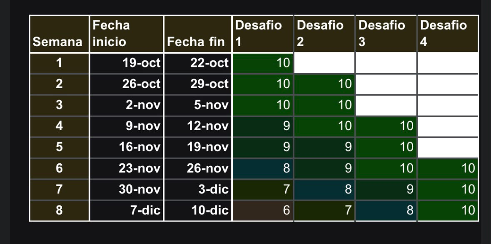

# Desafíos

Cuatro desafíos de código, individuales o en pareja. La nota de la materia es el promedio de los cuatro.

| # | Tema | Se presenta | Nota 10 hasta | Consigna | Estado |
|---|------|-------------|---------------|----------|--------|
| 1 | Vectorización de texto | Clase 1 (22/10) | Jueves 05/11 (clase 3) | [01-vectorizacion](01-vectorizacion/README.md) | Resuelto, falta entregar |
| 2 | Word embeddings | Clase 2 (29/10) | Jueves 12/11 (clase 4) | [02-word-embeddings](02-word-embeddings/README.md) | Resuelto, falta entregar |
| 3 | Generación de secuencias (modelo por caracteres) | Clase 4 (12/11) | Jueves 26/11 (clase 6) | [03-modelo-lenguaje-caracteres](03-modelo-lenguaje-caracteres/README.md) | Resuelto, falta entregar |
| 4 | Modelos seq2seq | Clase 6 (26/11) | Jueves 10/12 (clase 8) | | |

## Nota máxima según la fecha de entrega

*Tabla de la docente con las fechas de cada semana. Tiene los mismos valores que la [slide 6 de la clase 1](../clases/01-introduccion-vectorizacion/img/slide-06-evaluacion-desafios.jpg).* Cada semana va de lunes a jueves y cuenta hasta la última hora (hora argentina) del jueves, que es el día de clase:

| Semana | De lunes a jueves | Desafío 1 | Desafío 2 | Desafío 3 | Desafío 4 |
|---|---|---|---|---|---|
| 1 | 19/10 al 22/10 | 10 | | | |
| 2 | 26/10 al 29/10 | 10 | 10 | | |
| 3 | 02/11 al 05/11 | 10 | 10 | | |
| 4 | 09/11 al 12/11 | 9 | 10 | 10 | |
| 5 | 16/11 al 19/11 | 9 | 9 | 10 | |
| 6 | 23/11 al 26/11 | 8 | 9 | 10 | 10 |
| 7 | 30/11 al 03/12 | 7 | 8 | 9 | 10 |
| 8 | 07/12 al 10/12 | 6 | 7 | 8 | 10 |

En clase se dijo "un punto menos por semana de atraso"; la tabla es más generosa en algunas semanas. La última fecha para entregar todo es el jueves 10/12 (clase 8).

## Cómo se entregan

- Por el [formulario](https://forms.gle/wsWkQJWAFeh6g6qv5), que es el mismo para los 4 desafíos. Pide nombre, mail, **código de alumno** (el del Excel de notas), el segundo integrante si es en pareja, qué desafío se entrega, el link y comentarios opcionales.
- El link puede ser a un **Colab** o a un **repo de GitHub**, con acceso para corregir. Si es Colab, compartirlo con los dos docentes (los mails están en la slide 1 de la clase 1).
- Vale la fecha del formulario. Los docentes llevan un Excel con las entregas y las notas.

## Reglas

- **Para aprobar hay que entregar los 4.** Si falta uno no se aprueba, aunque el promedio dé más de 4. La slide 6 lo dice así: "todos los desafíos deben ser entregados y evaluados satisfactoriamente antes de la fecha del cierre de notas".
- Se puede usar IA. Lo que más pesa es el análisis: cada experimento tiene que ir con su interpretación y sus conclusiones.
- La pareja es una novedad de esta cohorte; antes los desafíos eran individuales.
